# 🎙️ Audiobook Studio (Antigravity Plugin & Option C Engine v5.2)

> **Autonomous Studio-Grade Multi-Voice Audiobook & 2-Host Podcast Production Engine and Google Antigravity Plugin with Gemini Flash TTS, 4D Formants, Audible Flow & Conversational Adaptation, Two-Pass EBU R128 Mastering, and the 8-Pillar Studio Production Certification Harness.**

[](plugin.json)
[](https://www.python.org/)
[](https://ffmpeg.org/)
[](docs/GEMINI_TTS_SYNTHESIS_AND_DIRECTING.md)
[](docs/VOICE_CASTING_DIRECTOR_GUIDE.md)
[-purple.svg)](docs/AUDIO_ENGINEERING.md)
[-indigo.svg)](docs/PODCAST_SYSTEM_ARCHITECTURE.md)
[](docs/QUALITY_GATES.md)
[](LICENSE)

---

## 📖 Overview

**Audiobook Studio** is an enterprise-grade, autonomous vocal production engine and a native **Google Antigravity Plugin**. Designed under **Option C Architecture (Shared Understanding & Dramaturgy Core + Specialized Output Adapters)**, it transforms literature (**EPUB, PDF, TXT, Markdown**) into two broadcast-grade deliverables from a single source:

1. **Audible-Standard Multi-Cast Audiobooks**: Full authorial prose preservation, em-dash lead-ins, anti-swap dialogue attribution, calm measured narration (0.32 temp), and two-pass linear EBU R128 mastering at **-19.0 LUFS** / **-1.5 dBTP** in a chapterized `.m4b` container with cover art.
2. **Conversational 2-Host Narrative Podcasts**: High-retention audio-first shows featuring calibrated host dynamics (Sameer & Priya in Hindustani, Alex & Maya in English), organic breathability ($\le 22$ words per breath, 140ms pre-roll breath pauses), 5-part retention arcs, stereo spatial staging ($-0.25$ Left / $+0.25$ Right), and **-16.0 LUFS** broadcast podcast mastering in `.m4a` / `.mp3` containers.

Audiobook Studio operates both as:
- **A Native Google Antigravity Plugin**: Direct conversational directing via `@audiobook-director`, interactive sidecar Webview studio panel, and multi-skill agent workflows.
- **A Standalone Unified CLI & Python Framework**: Headless production pipelines, batch processing, and deterministic CI/CD certification.

---

## 🚫 Pure Vocals-Only Mandate

Background music (BGM), sound effects (SFX), 5-track stem mixdowns, and external sound bank scraping are **permanently decoupled and archived** in [`archive/cinematic_audio/`](file:///c:/Users/Suraj/Documents/antigravity/optimistic-kepler/archive/cinematic_audio/).

Production compute is 100% focused on vocal clarity, multi-character acting nuance, conversational breathability, and Audible/EBU R128 compliance:
- **Google Gemini Flash TTS Key Pool**: 120+ active rotating API keys with token-bucket concurrency and permanent `BLOCK_NONE` safety settings.
- **4D Acoustic Formant Modulation**: Modulates pitch delta ($\pm 4-12\%$), tempo rate, and 4D parametric EQ curves (`equalizer=f=...`) via FFmpeg DSP to prevent vocal convergence across shared base models.
- **Stanislavski Directing Restraint**: Clamped temperature (`0.30 - 0.52`) and physical vocal anchors eliminate histrionics and pitch screeching.
- **8-Pillar Studio Production Certification Harness**: Autonomous, fail-closed verification across extraction, translation, dramaturgy, attribution, performance, loudness, spatial staging, and packaging.

---

## 🏗️ Option C Architecture: 5-Room Pure Vocals Pipeline

```mermaid
flowchart TD
    subgraph Room1["🌍 Room 1: Pre-Production & Understanding Core"]
        RawBook["Source Document (EPUB / PDF / TXT / MD)"] --> DeepSearch["Novel DeepSearch Engine (Factual Grounding)"]
        DeepSearch --> BookDNA["Book DNA Agent (Literary Tradition & Dialect)"]
        BookDNA --> Personae["Dramatis Personae & Phonetic Lexicon (cast_lock.json)"]
        Personae --> Memory["MemoryStore 2.0 (Epistemic Boundaries & Fact Ledger)"]
    end

    subgraph Room2["🧠 Room 2: Sense-for-Sense Translation Collective (Optional)"]
        Memory --> Collective["4-Agent Translation Collective<br/>• LiteraryDraftTranslator (Canon Sacredness)<br/>• HindustaniCadenceSpecialist (Spoken Flow & Pauses)<br/>• SubtextAndIdiomDramaturge (Earthy Desi Grit & 19-to-21)<br/>• TranslationQualityCritic (Anti-Omission & Terminology)"]
        Collective --> DualRule["Dual-Rule Invariant ('Nothing Above Source')<br/>Classic Reverent Pathos vs Raw Unrated Realism"]
    end

    subgraph Room3["🎭 Room 3: Universal Dramaturgy Core (dramaturgy/)"]
        DualRule & Memory --> SceneAn["SceneAnalyzer (Organic Scene Boundary Discovery)"]
        SceneAn --> BeatPl["BeatPlanner (Stanislavski Actioning, SPU Slicing & Tension Curves)"]
        BeatPl --> PBible["PerformanceBible (Vocal Profiles & Restraint Clamping)"]
        PBible --> DramAST["Immutable Chapter Dramatic AST (dramatic_plan.json)"]
    end

    subgraph Adapters["🎙️ Room 3 Adapters: Specialized Scripting Adapters (adapters/)"]
        DramAST -->|Audible Flow Standard| AudiobookAd["AudiobookAdapter (adapters/audiobook.py)<br/>• Prose-Lead Framing ('वक्ता ने पूछा—')<br/>• Unbroken Character Dialogue Turns<br/>• Transparent Measured Narration (0.32 temp)<br/>• Anti-Swap Dialogue Attribution (0% Inversion)"]
        DramAST -->|Conversational Spoken-First| PodcastAd["PodcastAdapter (adapters/podcast.py)<br/>• 2-Host Dynamic (Sameer/Priya & Alex/Maya)<br/>• SpokenBreathabilityTransformer (<= 22 words)<br/>• 5-Part Retention Arc (Cold Open to Outro)<br/>• Stereo Spatial Staging (-0.25 Left / +0.25 Right)"]
    end

    subgraph Room4["🎙️ Room 4: 4D Formants & Voice Performance"]
        AudiobookAd & PodcastAd --> Caster["Character Caster & 4D Acoustic Formants<br/>Pitch Δ (+/-4-12%), Tempo & Parametric EQ Curves"]
        Caster --> TTS["Gemini Flash TTS Key Pool (120+ Active Keys)<br/>Prosodic Acting, Speech Tags & Breath Marks"]
        TTS --> Editorial["Dialogue Editorial Layer (DE-01 - DE-07)<br/>Endpoint Snapping, Hann Micro-Fades & Turn Latency"]
    end

    subgraph Room5["🎛️ Room 5: Broadcast Mastering & Multi-Format Packaging"]
        Editorial --> TrackSplit{"Format Dispatch"}
        TrackSplit -->|Audiobook Track| M4BMaster["Studio Vocal Master: -19.0 LUFS / -1.5 dBTP<br/>SOXR 48kHz / 24-bit + Dual-Pass Linear Loudnorm<br/>Chaptered .m4b with Embedded Cover Art"]
        TrackSplit -->|Podcast Track| M4AMaster["Podcast Master: -16.0 LUFS / -1.0 dBTP<br/>Stereo Spatial Azimuth Staging (-0.25 / +0.25)<br/>AAC .m4a / .mp3 with Show Notes & Chapters"]
    end

    subgraph CertHarness["🎖️ 8-Pillar Studio Production Certification Harness"]
        M4BMaster & M4AMaster --> Runner["StudioCertificationRunner (certification/runner.py)<br/>P1 Extraction | P2 Translation | P3 Dramaturgy | P4 Attribution<br/>P5 Performance | P6 Loudness | P7 Spatial | P8 Packaging"]
        Runner --> Report["STUDIO_CERTIFICATION_REPORT.json (Release Gate)"]
    end

    Room1 --> Room2
    Room2 --> Room3
    Room3 --> Adapters
    Adapters --> Room4
    Room4 --> Room5
    Room5 --> CertHarness
```



---

## ✨ Core Feature Highlights

### 1. Dual-Track Multi-Format Production
From a single source book, generate:
- **Audiobook Track**: Audible-compliant `.m4b` container with embedded TOC markers and cover art, mastered to **-19.0 LUFS**.
- **Podcast Track**: Engaging 2-host narrative podcast episodes in `.m4a` / `.mp3`, mastered to **-16.0 LUFS** with stereo spatial staging.

### 2. Dedicated 2-Host Narrative Podcast Engine
- **Calibrated Host Chemistry**: Sameer & Priya (Hindustani) or Alex & Maya (English) pairing an *Inquisitive Driver* (Listener Proxy) with a *Domain Expert* (Storyteller).
- **Spoken Breathability Transformer**: Clamps sentence lengths to $\le 22$ words per breath with **140ms pre-roll breath pauses** and natural Devanagari/English boundary splitting.
- **5-Part Retention Arc**: `cold_open_hook` (15–30s peak-tension teaser) $\to$ `show_intro` $\to$ `scene_deepdive` $\to$ `cognitive_reset_banter` $\to$ `show_outro`.
- **Stereo Spatial Staging**: Host A staged at $-0.25$ (Left-Mid) and Host B at $+0.25$ (Right-Mid).

### 3. Audible Flow Standard & Anti-Swap Attribution
- 100% preservation of authorial prose without summarization.
- Em-dash prose-lead framing (`"वक्ता ने पूछा— '...'"`).
- Gate 2 attribution audit enforces **0% speaker turn inversion** ($A \leftrightarrow B$) and prevents character dialogue from being swallowed by the narrator.
- Narrator Transparency Invariant locks narration to `0.32` temperature with calm, objective delivery.

### 4. 8-Pillar Studio Production Certification Harness
Deterministic, automated pre-release certification covering:
- **P1 Extraction**: Ingestion text coverage floor ($\ge 50$ words) and zero empty chapters.
- **P2 Translation**: "Nothing Above Source" dual-rule integrity and zero untranslated placeholders.
- **P3 Dramaturgy**: SPU paragraph alignment and monotonic segment numbering.
- **P4 Attribution**: Anti-Swap speaker attribution and zero quote leakage.
- **P5 Performance**: Vocal restraint clamping (`0.30 - 0.52` temperature, zero melodramatic keywords).
- **P6 Loudness**: EBU R128 loudness compliance (-19.0 LUFS for Audiobooks / -16.0 LUFS for Podcasts).
- **P7 Spatial**: 2-Host spatial azimuth separation ($-0.25$ Left / $+0.25$ Right).
- **P8 Packaging**: Valid `.m4b` / `.m4a` containers, TOC seek table monotonicity, and square cover art.

---

## 🚀 Quickstart & Installation

### Requirements
- **Python**: 3.10+ (tested on Python 3.10 – 3.13)
- **FFmpeg**: 6.0+ with SOXR support (installed and available in `PATH`)
- **Node.js**: 18+ (optional, for the Webview sidecar panel)
- **Google Gemini API Key(s)**: 1 or more API keys (supports 120+ rotating key pool)

### 1. Clone & Setup
```bash
git clone https://github.com/naksh-07/audiobook-studio.git
cd audiobook-studio

# Create and activate virtual environment
python -m venv .venv
source .venv/bin/activate  # On Windows: .venv\Scripts\activate

# Install dependencies in editable mode
pip install -e .
```

### 2. Configure Credentials
Create a `.env` file in the root directory:
```env
# Single primary key or comma-separated pool (120+ keys supported)
GEMINI_API_KEY=your_gemini_api_key_here
```

---

## 💻 CLI Usage Guide (`audiobook-cli`)

### Autonomous Multi-Format Production (`auto`)
```bash
# 1. Produce Audible-standard Hindi audiobook (.m4b)
audiobook-cli auto "books/novel.epub" --hindi --dramatized --voice Aoede --format audiobook

# 2. Produce 2-Host narrative podcast series (.m4a)
audiobook-cli auto "books/novel.epub" --hindi --format podcast --workers 4

# 3. Produce BOTH formats simultaneously in one command
audiobook-cli auto "books/novel.epub" --hindi --dramatized --format both --cover "cover.jpg"
```

### Dedicated 2-Host Podcast Engine (`podcast`)
```bash
# Draft conversational 2-Host script for Chapter 1
audiobook-cli podcast my_project --chapter 1 --hindi

# Full end-to-end podcast production: Draft -> TTS -> Stereo Staging -> -16.0 LUFS Master
audiobook-cli podcast my_project --chapter 1 --produce --workers 3 --target-lufs -16.0
```

### Multi-Format Container Packaging (`package`)
```bash
# Package Audiobook M4B deliverable with Gate 6 strict enforcement
audiobook-cli package my_project --format audiobook --cover "cover.jpg" --enforce-gate6

# Package Podcast M4A episodes
audiobook-cli package my_project --format podcast

# Package BOTH deliverables simultaneously
audiobook-cli package my_project --format both --cover "cover.jpg"
```

### Full-Book Master Audit & 8-Pillar Certification (`audit-book`)
```bash
# Run Gate 6 master audit and complete 8-Pillar Studio Certification Scorecard
audiobook-cli audit-book my_project
```

### Step-by-Step Modular Pipeline
```bash
audiobook-cli extract "books/novel.epub"
audiobook-cli translate my_project --model gemini-3.8-flash
audiobook-cli script my_project --hindi --dramatized --adapter audiobook
audiobook-cli synthesize my_project --voice Aoede --workers 3
audiobook-cli master my_project
audiobook-cli package my_project --format both --cover "cover.jpg"
```

---

## 🔌 Antigravity Plugin Ecosystem

Audiobook Studio installs natively as a Google Antigravity Plugin:

```text
audiobook-studio/
├── plugin.json                 # Antigravity plugin manifest
├── rules/AGENTS.md             # Studio domain invariants & vocal engineering guardrails
├── agents/audiobook-director.md# @audiobook-director conversational agent
├── skills/
│   ├── audiobook-studio/       # Operational directs & project DB inspect
│   ├── audio-engineer-ffmpeg/  # FFmpeg DSP, 4D formants, EBU R128 loudness curves
│   └── novel-audiobook-factory/# Autonomous novel ingestion & production
└── sidecars/studio-panel/      # Interactive Webview Aux-Pane UI extension
```

To install locally into Antigravity:
```bash
# On Windows:
xcopy /E /I /Y . "%USERPROFILE%\.gemini\config\plugins\audiobook-studio"
```

---

## 🧪 Verification & Quality Testing

Audiobook Studio includes over 800 passing automated unit and integration tests:

```bash
# Run complete test suite
pytest tests/ -v

# Run Option C dramaturgy and SPU alignment tests
pytest tests/test_dramaturgy_spu_alignment.py tests/test_dialogue_attribution_auditor.py -v

# Run 8-Pillar studio certification tests
pytest tests/test_mastering_certification.py -v
```

---

## 📚 Complete Technical Documentation

- [🏛️ Option C Architecture Blueprint](file:///c:/Users/Suraj/Documents/antigravity/optimistic-kepler/docs/ARCHITECTURE.md)
- [🎙️ 2-Host Podcast System Architecture](file:///c:/Users/Suraj/Documents/antigravity/optimistic-kepler/docs/PODCAST_SYSTEM_ARCHITECTURE.md)
- [🎭 Dramaturgy & Multi-Format Adaptation System](file:///c:/Users/Suraj/Documents/antigravity/optimistic-kepler/docs/DRAMATURGY_AND_ADAPTATION_SYSTEM.md)
- [🛡️ Quality Gates & 8-Pillar Certification Harness](file:///c:/Users/Suraj/Documents/antigravity/optimistic-kepler/docs/QUALITY_GATES.md)
- [💻 CLI Reference Manual](file:///c:/Users/Suraj/Documents/antigravity/optimistic-kepler/docs/CLI_REFERENCE.md)
- [🎛️ Audio Engineering & Mastering Standards](file:///c:/Users/Suraj/Documents/antigravity/optimistic-kepler/docs/AUDIO_ENGINEERING.md)
- [🎙️ Gemini Flash TTS Synthesis & Directing](file:///c:/Users/Suraj/Documents/antigravity/optimistic-kepler/docs/GEMINI_TTS_SYNTHESIS_AND_DIRECTING.md)
- [🎭 Voice Casting Director Guide](file:///c:/Users/Suraj/Documents/antigravity/optimistic-kepler/docs/VOICE_CASTING_DIRECTOR_GUIDE.md)
- [🇮🇳 Complete Hindi Voice Catalog](file:///c:/Users/Suraj/Documents/antigravity/optimistic-kepler/docs/HINDI_VOICE_CATALOG.md)
- [🧠 Literary Translation Intelligence](file:///c:/Users/Suraj/Documents/antigravity/optimistic-kepler/docs/LITERARY_TRANSLATION_INTELLIGENCE.md)

---

## 📄 License

This project is licensed under the [MIT License](LICENSE).

---

*Built with ❤️ for Google Antigravity by Suraj ([@naksh-07](https://github.com/naksh-07))*
