# 🎙️ Audiobook Studio (Antigravity Plugin & Option C Engine v5.2)

> **Autonomous Studio-Grade Multi-Voice Audiobook & 2-Host Podcast Production Engine and Google Antigravity Plugin with Gemini Flash TTS, 4D Formants, Audible Flow & Conversational Adaptation, Two-Pass EBU R128 Mastering, and the 8-Pillar Studio Production Certification Harness.**

[](plugin.json)
[](https://www.python.org/)
[](https://ffmpeg.org/)
[](file:///c:/Users/Suraj/Documents/antigravity/optimistic-kepler/audiobook_factory/core/models)
[-brightgreen.svg)](file:///c:/Users/Suraj/Documents/antigravity/optimistic-kepler/docs/CLI_REFERENCE.md#12-key-inventory--fleet-monitor-keys)
[](file:///c:/Users/Suraj/Documents/antigravity/optimistic-kepler/docs/GEMINI_TTS_SYNTHESIS_AND_DIRECTING.md)
[-brightgreen.svg)](file:///c:/Users/Suraj/Documents/antigravity/optimistic-kepler/docs/TTS_PLATFORM_CORE_SPECIFICATION.md)
[-blue.svg)](file:///c:/Users/Suraj/Documents/antigravity/optimistic-kepler/docs/STUDIO_VOICE_CASTING_AND_CALIBRATION.md)
[-purple.svg)](file:///c:/Users/Suraj/Documents/antigravity/optimistic-kepler/docs/AUDIO_ENGINEERING.md)
[-indigo.svg)](file:///c:/Users/Suraj/Documents/antigravity/optimistic-kepler/docs/PODCAST_SYSTEM_ARCHITECTURE.md)
[](file:///c:/Users/Suraj/Documents/antigravity/optimistic-kepler/docs/QUALITY_GATES.md)
[-brightgreen.svg)](file:///c:/Users/Suraj/Documents/antigravity/optimistic-kepler/tests)
[](LICENSE)

---

## 📖 Overview

**Audiobook Studio** is an enterprise-grade, autonomous vocal production engine and a native **Google Antigravity Plugin**. Built for **grounded, natural multi-voice character acting and pristine vocal narration** modeled after the benchmark standards of **Audible Studios**, it implements **Option C Architecture (Shared Understanding & Dramaturgy Core + Specialized Output Adapters)**:

1. **Audible-Standard Multi-Cast Audiobooks**: Full authorial prose preservation, em-dash lead-ins, anti-swap dialogue attribution, calm measured narration (0.32 temp), and two-pass linear EBU R128 mastering at **-19.0 LUFS** / **-1.5 dBTP** in a chapterized `.m4b` container with embedded cover art.
2. **Conversational 2-Host Narrative & Technical Podcasts**: High-retention audio-first shows featuring calibrated host dynamics (Sameer & Priya in Hindustani, Alex & Maya in English), organic breathability ($\le 22$ words per breath, 140ms pre-roll breath pauses), 5-part retention arcs, stereo spatial staging ($-0.25$ Left / $+0.25$ Right), and **-16.0 LUFS** broadcast podcast mastering in `.m4a` / `.mp3` containers. Also supports scientific papers, arXiv preprints, and LaTeX/table verbalization.

Audiobook Studio operates both as:
- **A Native Google Antigravity Plugin**: Direct conversational directing via `@audiobook-director`, interactive sidecar Webview studio panel, and multi-skill agent workflows.
- **A Standalone Unified CLI & Python Framework**: Headless production pipelines, batch processing, and deterministic CI/CD certification.

---

## 🚫 Pure Vocals-Only Mandate

Background music (BGM), sound effects (SFX), 5-track stem mixdowns, and external sound bank scraping are **permanently decoupled and archived** in [`archive/cinematic_audio/`](file:///c:/Users/Suraj/Documents/antigravity/optimistic-kepler/archive/cinematic_audio/).

Production compute is 100% focused on vocal clarity, multi-character acting nuance, conversational breathability, and Audible/EBU R128 compliance:
- **Model & Keys Manager Control Plane** ([`KeyLeaseManager`](file:///c:/Users/Suraj/Documents/antigravity/optimistic-kepler/docs/ARCHITECTURE.md#1-keyleasemanager-acid-inventory--atomic-leases), [`AntiBanGuard`](file:///c:/Users/Suraj/Documents/antigravity/optimistic-kepler/docs/ARCHITECTURE.md#2-antibanguard-the-7-iron-shields)): ACID SQLite key inventory (123+ active healthy keys verified), atomic single-request mutual exclusion (`Concurrency = 1`), Win32 `kernel32.OpenProcess` dead-PID crash recovery, zero-secret salted public aliases (`key_XXXX`), and The 7 Iron Shields anti-ban protection (11.0 RPM token bucket, session affinity, 18-32s anti-correlation key-switch delay, stealth SDK headers, emergency global tripwire).
- **Google Gemini Flash TTS Key Pool**: 120+ active rotating API keys with token-bucket concurrency, daily quota tracking (10 RPD per key on `gemini-3.8-flash-tts`), and permanent `BLOCK_NONE` safety settings.
- **4D Acoustic Formant Modulation**: Modulates pitch delta ($\pm 4-12\%$), tempo rate, and 4D parametric EQ curves (`equalizer=f=...`) via FFmpeg DSP to prevent vocal convergence across shared base TTS voices.
- **Stanislavski Directing Restraint**: Clamped temperature (`0.30 - 0.52`) and physical vocal anchors eliminate histrionics and pitch screeching.
- **Pro-Grade AI Vocal Mastering Workstation (Room 5)**: High-performance C++ JUCE / Pedalboard DSP with 4-band vocal parametric EQ (75Hz subsonic cut, 320Hz boxiness reduction, 3.2kHz presence lift), optical vocal compression, and True-Peak limiting ($\le -1.5\text{ dBTP}$), with seamless deterministic FFmpeg dual-pass linear loudnorm fallback.
- **Forensic Speech QA Auditor & AI Polish**: `AudioQAAuditor` (energy VAD, speaking pace 75–240 WPM, dropouts/loops detection, MOS scoring), DeepFilterNet3 neural polish with selective $>45\text{dB}$ SNR auto-bypass, Matchering 2.0 reference spectrum matching ($\pm 3.0\text{dB}$ clamp), and `<0.2s` single-segment hot-patching.
- **8-Pillar Studio Production Certification Harness**: Autonomous, fail-closed verification across extraction, translation, dramaturgy, attribution, performance, loudness, spatial staging, and packaging.

---

## 🏗️ Option C Architecture: 5-Room Pure Vocals Pipeline

```mermaid
flowchart TD
    subgraph Room1["🌍 Room 1: 2-System Pre-Production Architecture"]
        direction TB
        RawBook["Raw Book (PDF / EPUB / TXT)"] --> S1["System 1: Novel Researcher Engine<br/><i>(Stateless Compute & Zero Disk I/O)</i><br/>• LexicalCorpusScanner (0-Token Sweep)<br/>• NovelDeepSearchEngine (Search Grounding)<br/>• BookDNAAgent + DramatisPersonaeAgent<br/>• VocalAcousticDirector (Room Impulse DSP)<br/>• PhoneticLexiconDramaturge (Devanagari)<br/>• gateway_bridge.py (ModelGateway Bridge)"]
        S1 -->|"Immutable Pydantic DTOs"| S2["System 2: Novel Metadata & State Maintainer<br/><i>(Canonical State Store & Atomic Persistence)</i><br/>• audiobook_factory/metadata/ (BookBible & NovelEntity)<br/>• NovelStateMaintainer (NR-GATE-06 2-Phase Commit)<br/>• _STATE_LOCK (Thread Concurrency Protection)<br/>• Windows 11 Atomic Hardening (5x os.replace Retry)<br/>• Dynamic Character Locking (NR-GATE-03 [0.70, 1.30])"]
        S2 --> MasterFiles[("Locked Master State<br/>book_dna.json | book_bible.json | cast_lock.json<br/>vocal_spaces.json | voice_registry.json")]
    end

    subgraph Room1_5["📚 Room 1.5: Standalone Chapter Glossary & Metadata Hub"]
        MasterFiles --> GloMgr["GlossaryManager (audiobook_factory/glossary/)<br/>• ChapterLexicalScanner (0-Token Fast-Path Sweep)<br/>• GlossaryClassifier (Tri-Partite Entity Taxonomy)<br/>• Alias Unification & Dynamic Character Locking<br/>• Persistent Artifact: chapter_XXX_glossary.json"]
        GloMgr --> Projections["Multi-Consumer Projections<br/>• to_translation_glossary() (Flat en -> hi Map)<br/>• to_scripting_roster() (Unified Alias Schema)<br/>• to_dramaturgy_characters() (Scene Cast List)"]
    end

    subgraph Room2["🧠 Room 2: Sense-for-Sense Translation Collective"]
        Projections --> Collective["4-Agent Translation Collective<br/>• LiteraryDraftTranslator (70/30 Canon Sacredness)<br/>• HindustaniCadenceSpecialist (Spoken Flow & Pauses)<br/>• SubtextAndIdiomDramaturge (Earthy Desi Grit & 19-to-21)<br/>• TranslationQualityCritic (Anti-Omission & Terminology)"]
        Collective --> DualRule["Dual-Rule Invariant ('Nothing Above Source')<br/>Classic Reverent Pathos vs Raw Unrated Realism"]
    end

    subgraph Room3["🎭 Room 3: Universal Dramaturgy Core (dramaturgy/)"]
        DualRule --> SceneAn["SceneAnalyzer (Organic Scene Boundary Discovery)"]
        SceneAn --> BeatPl["BeatPlanner (Stanislavski Actioning, SPU Slicing & Tension Curves)"]
        BeatPl --> PBible["PerformanceBible (Vocal Profiles & Restraint Clamping)"]
        PBible --> DramAST["Immutable Chapter Dramatic AST (dramatic_plan.json)"]
    end

    subgraph Adapters["🎙️ Room 3 Adapters: Specialized Scripting Adapters (adapters/)"]
        DramAST -->|Audible Flow Standard| AudiobookAd["AudiobookAdapter (adapters/audiobook.py)<br/>• Prose-Lead Framing ('वक्ता ने पूछा—')<br/>• Unbroken Character Dialogue Turns<br/>• Transparent Measured Narration (0.32 temp)<br/>• Anti-Swap Dialogue Attribution (0% Inversion)"]
        DramAST -->|Conversational Spoken-First| PodcastAd["PodcastAdapter (adapters/podcast.py)<br/>• 2-Host Dynamic (Sameer/Priya & Alex/Maya)<br/>• SpokenBreathabilityTransformer (<= 22 words)<br/>• 5-Part Retention Arc (Cold Open to Outro)<br/>• Stereo Spatial Staging (-0.25 Left / +0.25 Right)"]
    end

    subgraph Room3_5["🎙️ Room 3.5: Studio Voice Casting & Calibration Engine (Option C)"]
        direction TB
        Registry["VoiceProfileRegistry (Shared Core)<br/>• 2,089 Curated Voices (114 Native Hindi)<br/>• Sub-Millisecond Archetype & Dialect Query"]
        Director["StudioCastingDirector (Subsystem 1)<br/>• ModelGateway Control Plane (123+ Key Pool)<br/>• Anime Seiyū Child Rule Guard<br/>• Regional Hindustani Dialect Matching<br/>• CastLockManager (Permanent Project Locks)"]
        Calibrator["SceneAcousticCalibrator (Subsystem 2)<br/>• Pairwise Euclidean Contrast Matrix (>= 0.65)<br/>• Surgical Non-Destructive Parametric EQ Formants<br/>• Phase-Safe: Zero asetrate/atempo DSP"]
        Registry --> Director --> Calibrator
    end

    subgraph Gate28["🛡️ Gate 2.8: Auditory Distinction Gate (gate28_distinction.py)"]
        G28["AuditoryDistinctionGate<br/>• Speaker Whitelist & Cast Lock Check<br/>• Co-Speaker Acoustic Distance >= 0.65<br/>• Phase-Safe Audio Invariant"]
    end

    subgraph Gate29["🛡️ Gate 2.9: Pre-TTS Sanity Gate (Fail-Closed Boundary)"]
        G29["PreSynthesisGate & LLMPreSynthesisJudge<br/>• Tier 1: Deterministic Fast-Path (Whitelist & Acoustic Clamping)<br/>• Tier 2: Adversarial LLM Attribution Judge (123+ Key Pool)"]
    end

    subgraph Room4["🎙️ Room 4: Studio TTS Platform Core (Option C)"]
        Facades["Client Facades<br/>• GenericTTSClient (Single Utterance)<br/>• LongFormTTSClient (Prose Streams)<br/>• MultiCastStudioClient (Ensemble Screenplay)"]
        Facades --> SharedCore["Shared Core: Universal Input Guards & 4-Tier Chunker"]
        SharedCore --> AdaptersTTS["Pluggable Adapters: Gemini 3.8 Flash & Qwen3-TTS<br/>• gateway_bridge.py (ModelGateway Control Plane Bridge)"]
        AdaptersTTS --> Editorial["Editorial DSP: Hann Fades, Net Silence & 4D Formants"]
    end

    subgraph Room5["🎛️ Room 5: Broadcast Mastering & Multi-Format Packaging"]
        Editorial --> TrackSplit{"Format Dispatch"}
        TrackSplit -->|Audiobook Track| M4BMaster["Studio Vocal Master: -19.0 LUFS / -1.5 dBTP<br/>SOXR 48kHz / 24-bit + Dual-Pass Linear Loudnorm<br/>Chaptered .m4b with Embedded Cover Art"]
        TrackSplit -->|Podcast Track| M4AMaster["Podcast Master: -16.0 LUFS / -1.0 dBTP<br/>Stereo Spatial Azimuth Staging (-0.25 / +0.25)<br/>AAC .m4a / .mp3 with Show Notes & Chapters"]
    end

    subgraph CertHarness["🎖️ 8-Pillar Studio Production Certification Harness"]
        M4BMaster & M4AMaster --> Runner["StudioCertificationRunner (certification/runner.py)<br/>P1 Extraction | P2 Translation | P3 Dramaturgy | P4 Attribution<br/>P5 Performance | P6 Loudness | P7 Spatial | P8 Packaging"]
        Runner --> Report["STUDIO_CERTIFICATION_REPORT.json (Release Gate)"]
    end

    Room1 --> Room1_5
    Room1_5 --> Room2
    Room1_5 -.->|"Roster & Aliases"| Room3
    Room1_5 -.->|"Dynamic Voice Lock"| Room3_5
    Room2 --> Room3
    Room3 --> Adapters
    Adapters --> Room3_5
    Room3_5 --> Gate28
    Gate28 --> Gate29
    Gate29 -->|"Audited Script (0% Swap / Distance >= 0.65)"| Room4
    Room4 --> Room5
    Room5 --> CertHarness
```



### 🎛️ Underlying Control Plane: Model & Keys Manager (Option C Architecture)
All production rooms interface with LLMs and speech models exclusively through [`ModelGateway`](file:///c:/Users/Suraj/Documents/antigravity/optimistic-kepler/docs/ARCHITECTURE.md#5-modelgateway-unified-production-facade), backed by:
- **[`KeyLeaseManager`](file:///c:/Users/Suraj/Documents/antigravity/optimistic-kepler/docs/ARCHITECTURE.md#1-keyleasemanager-acid-inventory--atomic-leases)**: ACID SQLite inventory (`audiobooks/keys_inventory.db`), 123+ active healthy keys, atomic leases (`Concurrency = 1`), Win32 `kernel32.OpenProcess` dead-PID crash recovery, and "one user = one key per workload" concurrency limits.
- **[`AntiBanGuard`](file:///c:/Users/Suraj/Documents/antigravity/optimistic-kepler/docs/ARCHITECTURE.md#2-antibanguard-the-7-iron-shields)** (The 7 Iron Shields): 11.0 RPM token bucket rate limiting, session affinity sticky binding, 18–32s random anti-correlation key-switch delay, human cadence pacing, stealth SDK headers (`x-goog-api-client`), and emergency global tripwire.
- **[`ModelRegistry`](file:///c:/Users/Suraj/Documents/antigravity/optimistic-kepler/docs/ARCHITECTURE.md#3-modelregistry-canonical-model-catalog)**: Canonical catalog of 50+ models, context budgets, rate limits, quality tiers (`flagship`, `balanced`, `utility`, `audio`, `local`), and modality profiles.
- **[`RequestRouter`](file:///c:/Users/Suraj/Documents/antigravity/optimistic-kepler/docs/ARCHITECTURE.md#4-requestrouter-intelligent-router--fallback)**: Task- and capability-based matching, per-model circuit breakers (`CLOSED` / `OPEN` / `HALF_OPEN`), and automated fallback ladders.
- **Room 1 Forensic Ingestion Wiring**: Multimodal page escalations in [`GeminiVisionPDFExtractor`](file:///c:/Users/Suraj/Documents/antigravity/optimistic-kepler/audiobook_factory/extraction/parsers/pdf/vision_extractor.py) route directly through `ModelGateway.generate_text()` with inline base64 `parts` payloads, session affinity, and transparent `PersistentKeyPool` $\leftrightarrow$ `KeyLeaseManager` synchronization.
- **Room 1 Pre-Production Research Subsystem Wiring**: All 6 research agents ([`BookDNAAgent`](file:///c:/Users/Suraj/Documents/antigravity/optimistic-kepler/audiobook_factory/preproduction/book_dna_agent.py), [`DramatisPersonaeAgent`](file:///c:/Users/Suraj/Documents/antigravity/optimistic-kepler/audiobook_factory/preproduction/dramatis_personae_agent.py), [`NovelDeepSearchEngine`](file:///c:/Users/Suraj/Documents/antigravity/optimistic-kepler/audiobook_factory/preproduction/novel_deepsearch.py), [`VocalAcousticDirector`](file:///c:/Users/Suraj/Documents/antigravity/optimistic-kepler/audiobook_factory/preproduction/vocal_acoustic_director.py), [`PhoneticLexiconDramaturge`](file:///c:/Users/Suraj/Documents/antigravity/optimistic-kepler/audiobook_factory/preproduction/phonetic_lexicon_dramaturge.py), [`SonicWorldArchitect`](file:///c:/Users/Suraj/Documents/antigravity/optimistic-kepler/audiobook_factory/preproduction/sonic_world_architect.py)) route strictly through [`execute_preproduction_llm()`](file:///c:/Users/Suraj/Documents/antigravity/optimistic-kepler/audiobook_factory/preproduction/gateway_bridge.py#L37) $\rightarrow$ `ModelGateway.generate_text()` with atomic Concurrency=1 key leases from `KeyLeaseManager`, AntiBanGuard 11.0 RPM pacing, official stealth SDK headers, session affinity, `BLOCK_NONE` creative safety framing, and resilient `json_repair`. Rogue direct `urllib` calls are eliminated.
- **Room 1.5 Standalone Chapter Glossary Wiring**: [`GlossaryManager`](file:///c:/Users/Suraj/Documents/antigravity/optimistic-kepler/audiobook_factory/glossary/manager.py) and [`GlossaryClassifier`](file:///c:/Users/Suraj/Documents/antigravity/optimistic-kepler/audiobook_factory/glossary/classifier.py) route through [`execute_glossary_llm()`](file:///c:/Users/Suraj/Documents/antigravity/optimistic-kepler/audiobook_factory/glossary/gateway_bridge.py#L26) $\rightarrow$ `ModelGateway.generate_text()` with Concurrency=1 key leases, zero-token fast-path bypass on known lore, 11.0 RPM AntiBanGuard pacing, and `BLOCK_NONE` creative fiction safety framing. Direct unmetered HTTP calls are completely eliminated.
- **Room 4 Hardened Speech Synthesis Control Plane**: All Room 4 speech generation routes strictly through [`execute_tts_synthesize()`](file:///c:/Users/Suraj/Documents/antigravity/optimistic-kepler/audiobook_factory/tts/gateway_bridge.py#L60) $\rightarrow$ `ModelGateway.synthesize_speech()` with Concurrency=1 mutual exclusion ACID leases from [`KeyLeaseManager`](file:///c:/Users/Suraj/Documents/antigravity/optimistic-kepler/docs/ARCHITECTURE.md#1-keyleasemanager-acid-inventory--atomic-leases) (`workload_type="tts"`). Rogue direct `urllib` calls and plaintext `?key={key}` URL parameters are permanently eliminated, enforcing stealth `X-goog-api-key` headers via `get_stealth_sdk_headers()` and active AntiBanGuard 7 Iron Shields (11.0 RPM token bucket, 18s–32s key-switch cooldown, emergency global tripwire).

---

## ✨ Core Feature Highlights

### 1. Dual-Track Multi-Format Production
From a single source book, generate:
- **Audiobook Track**: Audible-compliant `.m4b` container with embedded TOC markers and cover art, mastered to **-19.0 LUFS**.
- **Podcast Track**: Engaging 2-host narrative podcast episodes in `.m4a` / `.mp3`, mastered to **-16.0 LUFS** with stereo spatial staging.

### 2. Dedicated 2-Host Narrative Podcast Engine
- **Calibrated Host Chemistry**: Sameer & Priya (Hindustani) or Alex & Maya (English) pairing an *Inquisitive Driver* (Listener Proxy) with a *Domain Expert* (Storyteller).
- **Spoken Breathability Transformer**: Clamps sentence lengths to $\le 22$ words per breath with **140ms pre-roll breath pauses** and natural Devanagari/English boundary splitting.
- **5-Part Retention Arc**: `cold_open_hook` (15–30s peak-tension teaser) $\to$ `show_intro` $\to$ `scene_deepdive` $\to$ `cognitive_reset_banter` $\to$ `show_outro`.
- **Stereo Spatial Staging**: Host A staged at $-0.25$ (Left-Mid) and Host B at $+0.25$ (Right-Mid).

### 3. Audible Flow Standard & Anti-Swap Attribution
- 100% preservation of authorial prose without summarization.
- Em-dash prose-lead framing (`"वक्ता ने पूछा— '...'"`).
- Gate 2 attribution audit enforces **0% speaker turn inversion** ($A \leftrightarrow B$) and prevents character dialogue from being swallowed by the narrator.
- Narrator Transparency Invariant locks narration to `0.32` temperature with calm, objective delivery.

### 4. 8-Pillar Studio Production Certification Harness
Deterministic, automated pre-release certification covering:
- **P1 Extraction**: Ingestion text coverage floor ($\ge 50$ words) and zero empty chapters.
- **P2 Translation**: "Nothing Above Source" dual-rule integrity and zero untranslated placeholders.
- **P3 Dramaturgy**: SPU paragraph alignment and monotonic segment numbering.
- **P4 Attribution**: Anti-Swap speaker attribution and zero quote leakage.
- **P5 Performance**: Vocal restraint clamping (`0.30 - 0.52` temperature, zero melodramatic keywords).
- **P6 Loudness**: EBU R128 loudness compliance (-19.0 LUFS for Audiobooks / -16.0 LUFS for Podcasts).
- **P7 Spatial**: 2-Host spatial azimuth separation ($-0.25$ Left / $+0.25$ Right).
- **P8 Packaging**: Valid `.m4b` / `.m4a` containers, TOC seek table monotonicity, and square cover art.

### 5. Modular Studio TTS Platform Core (Option C)
- **Specialized Client Facades**: Dedicated high-level entrypoints for ad-hoc speech ([`GenericTTSClient`](file:///c:/Users/Suraj/Documents/antigravity/optimistic-kepler/audiobook_factory/tts/facades/generic_client.py)), continuous novel prose ([`LongFormTTSClient`](file:///c:/Users/Suraj/Documents/antigravity/optimistic-kepler/audiobook_factory/tts/facades/long_form_client.py)), and ensemble multi-character dramas ([`MultiCastStudioClient`](file:///c:/Users/Suraj/Documents/antigravity/optimistic-kepler/audiobook_factory/tts/facades/multi_cast_client.py)).
- **Universal Input Guards**: Deterministic phonetization of Devanagari numerals ($0-9, ०-९$), currencies ($\$, ₹, €$), percentages, and units via [`NumeralAndTokenExpander`](file:///c:/Users/Suraj/Documents/antigravity/optimistic-kepler/audiobook_factory/tts/guard/numeral_expander.py) while preserving sacred authorial prose.
- **4-Tier Semantic Prose Chunker**: Decomposes text along Scene $\to$ Paragraph $\to$ Sentence $\to$ Clause boundaries (80–160 words) with zero mid-word cuts.
- **TTS Control Plane Bridge & Secret Hygiene**: Enforces fail-closed security via [`gateway_bridge.py`](file:///c:/Users/Suraj/Documents/antigravity/optimistic-kepler/audiobook_factory/tts/gateway_bridge.py), routing 100% of synthesis through `ModelGateway.synthesize_speech()`. Strips plaintext API key query parameters (`?key={key}`) in favor of official stealth `X-goog-api-key` headers, enforces Concurrency=1 ACID leasing (`workload_type="tts"`), and applies 5-category `BLOCK_NONE` creative safety.
- **Pluggable Model Adapters**: Dual-provider architecture supporting **Google Gemini 3.8 Flash Cloud TTS** and local **Qwen3-TTS** registered in [`ModelAdapterRegistry`](file:///c:/Users/Suraj/Documents/antigravity/optimistic-kepler/audiobook_factory/tts/providers/registry.py).
- **Two-Tier Quality Gate**: Sub-5ms mathematical acoustic probe (peak $\ge 1500$, $-52 \le \text{RMS} \le -6\text{ dBFS}$, zero dead air) and phonetic duration ratio validation.
- **Editorial DSP & Formant Sculpting**: 12ms/18ms Hann micro-fades, net-silence dynamic pause subtraction, 2nd-order biquad peaking EQ formants, and TakeBank multi-take auditioning.

---

## 🚀 Quickstart & Installation

### Requirements
- **Python**: 3.10+ (tested on Python 3.10 – 3.13)
- **FFmpeg**: 6.0+ with SOXR support (installed and available in `PATH`)
- **Node.js**: 18+ (optional, for the Webview sidecar panel)
- **Google Gemini API Key(s)**: 1 or more API keys (supports 120+ rotating key pool)

### 1. Clone & Setup
```bash
git clone https://github.com/naksh-07/audiobook-studio.git
cd audiobook-studio

# Create and activate virtual environment
python -m venv .venv
source .venv/bin/activate  # On Windows: .venv\Scripts\activate

# Install dependencies in editable mode
pip install -e .
```

### 2. Configure Credentials
Create a `.env` file in the root directory:
```env
# Single primary API key:
GEMINI_API_KEY=your_gemini_api_key_here

# Or rotating key pool (recommended for full-length books, 120+ keys supported):
GEMINI_API_KEYS=key1,key2,key3,key4

# Optional fallback and acceleration providers:
# CEREBRAS_API_KEY=...
# GROQ_API_KEY=...
# OPENAI_API_KEY=...
```
> [!TIP]
> The engine automatically ingests keys from `.env` into SQLite (`audiobooks/keys_inventory.db`).
> All production rooms lease keys dynamically with 0% double-allocations, automatic Pacific Time midnight rollover, and The 7 Iron Shields anti-ban protection.

---

## 💻 CLI Usage Guide (`audiobook-cli`)

### Autonomous Multi-Format Production (`auto`)
```bash
# 1. Produce Audible-standard Hindi audiobook (.m4b)
audiobook-cli auto "books/novel.epub" --hindi --dramatized --voice Aoede --format audiobook

# 2. Produce 2-Host narrative podcast series (.m4a)
audiobook-cli auto "books/novel.epub" --hindi --format podcast --workers 4

# 3. Produce BOTH formats simultaneously in one command
audiobook-cli auto "books/novel.epub" --hindi --dramatized --format both --cover "cover.jpg"

# 4. Ingest research paper / technical whitepaper into podcast
audiobook-cli podcast "papers/attention_mechanism.pdf" --produce
```

### Dedicated 2-Host Podcast Engine (`podcast`)
```bash
# Draft conversational 2-Host script for Chapter 1
audiobook-cli podcast my_project --chapter 1 --hindi

# Full end-to-end podcast production: Draft -> TTS -> Stereo Staging -> -16.0 LUFS Master
audiobook-cli podcast my_project --chapter 1 --produce --workers 3 --target-lufs -16.0
```

### Multi-Format Container Packaging (`package`)
```bash
# Package Audiobook M4B deliverable with Gate 6 strict enforcement
audiobook-cli package my_project --format audiobook --cover "cover.jpg" --enforce-gate6

# Package Podcast M4A episodes
audiobook-cli package my_project --format podcast

# Package BOTH deliverables simultaneously
audiobook-cli package my_project --format both --cover "cover.jpg"
```

### Full-Book Master Audit & 8-Pillar Certification (`audit-book`)
```bash
# Run Gate 6 master audit and complete 8-Pillar Studio Certification Scorecard
audiobook-cli audit-book my_project
```

### Step-by-Step Modular Pipeline
```bash
audiobook-cli extract "books/novel.epub"
audiobook-cli translate my_project --model gemini-3.8-flash
audiobook-cli script my_project --hindi --dramatized --adapter audiobook
audiobook-cli synthesize my_project --voice Aoede --workers 3
audiobook-cli master my_project
audiobook-cli package my_project --format both --cover "cover.jpg"
```

### Ad-Hoc Speech Synthesis (`tts`)
```bash
# 1. Quick audition of a narrator voice in English via GenericTTSClient
audiobook-cli tts "Welcome to the studio production line." --voice Puck --out welcome.wav

# 2. Devanagari Hindi text with automatic numeral, currency & unit phonetization
audiobook-cli tts "अध्याय ५: व्यापारी ने उसे ₹५०० और $२० दिए।" --voice Aoede --model gemini-3.8-flash --out hindi_sample.wav

# 3. Direct execution via python module
python audiobook_cli.py tts "Character voice test sequence." --voice Charon --out test_charon.wav
```

---

## 🐍 Python API Quickstart: Modular TTS Platform Core

The modular TTS Platform Core provides clean facades for direct programmatic integration:

```python
from pathlib import Path
from audiobook_factory.tts import (
    GenericTTSClient,
    LongFormTTSClient,
    MultiCastStudioClient,
    DeliveryIntent,
)

# 1. Ad-Hoc Single Utterance (<800ms)
client = GenericTTSClient()
saved_path, chunk, validation = client.speak(
    text="नमस्ते दुनिया! आज का तापमान 25°C है और लागत ₹500 है।",
    voice="Aoede",
    model="gemini-3.8-flash",
    output_path=Path("output/hello_hindi.wav"),
)
print(f"[+] Saved to: {saved_path} (Duration: {chunk.duration_sec:.2f}s, Status: {validation.status})")

# 2. In-Memory RIFF WAV Stream (for APIs & Webhooks)
wav_bytes = client.speak_to_bytes(
    text="Direct in-memory speech synthesis with zero disk I/O.",
    voice="Puck",
)
print(f"[+] In-memory audio size: {len(wav_bytes)} bytes")

# 3. Long-Form Novel Prose with 4-Tier Semantic Chunking & Checkpoints
long_client = LongFormTTSClient()
out_wav, total_sec, chunks = long_client.synthesize_prose(
    text="लंबा गद्य पाठ यहाँ जाएगा...",
    output_path=Path("output/prose_stream.wav"),
    voice="Puck",
    target_words_per_chunk=120,
)
print(f"[+] Prose stream complete: {total_sec:.2f}s across {len(chunks)} semantic chunks")
```

---

## 🔌 Antigravity Plugin Ecosystem

Audiobook Studio installs natively as a Google Antigravity Plugin:

```text
audiobook-studio/
├── plugin.json                 # Antigravity plugin manifest
├── rules/AGENTS.md             # Studio domain invariants & vocal engineering guardrails
├── agents/audiobook-director.md# @audiobook-director conversational agent
├── skills/
│   ├── audiobook-studio/       # Operational directs & project DB inspect
│   ├── audio-engineer-ffmpeg/  # FFmpeg DSP, 4D formants, EBU R128 loudness curves
│   └── novel-audiobook-factory/# Autonomous novel ingestion & production
└── sidecars/studio-panel/      # Interactive Webview Aux-Pane UI extension
```

To install locally into Antigravity:
```bash
# On Windows:
xcopy /E /I /Y . "%USERPROFILE%\.gemini\config\plugins\audiobook-studio"
```

---

## 🧪 Verification & Quality Testing

Audiobook Studio is certified by 1,126 passing automated unit, integration, and contract tests (100% green):

```bash
# Run complete test suite
pytest tests/ -v

# Run Option C dramaturgy and SPU alignment tests
pytest tests/test_dramaturgy_spu_alignment.py tests/test_dialogue_attribution_auditor.py -v

# Run Room 3.5 voice casting & Gate 2.8 distinction tests
pytest tests/test_casting_subsystem.py tests/test_gate28_distinction.py -v

# Run 8-Pillar studio certification tests
pytest tests/test_studio_certification_suite.py -v
```

All quality gates are fail-closed:
- **Gate 0.1**: Forensic Ingestion & Reading Order AST Validation.
- **Gate 1 / NR-GATE-01/03**: Dramatis Personae, $\ge 4\%$ Voice Step Separation & $[0.70, 1.30]$ Pitch Bounds.
- **Gate 2**: DialogueAttributionAuditor (0% Speaker Turn Swaps).
- **Gate 2.5**: Stanislavski Acting Restraint & Dramatic Validation.
- **Gate 2.8**: Auditory Distinction & Acoustic Calibration Gate (Pairwise co-speaker distance $\ge 0.65$ & phase-safe ban on asetrate/atempo).
- **Gate 2.9**: Pre-TTS Config & Attribution Sanity Gate (Dual-Tier Hybrid: Tier 1 regex/schema/whitelist/acoustic clamping + Tier 2 Adversarial LLM Attribution Judge via 123+ Gemini key pool).
- **Gate 5**: Dialogue Editorial Snapping & Hann Micro-fades.
- **Gate 6**: Two-Pass Linear Loudnorm Certification (-19.0 LUFS, -1.5 dBTP).
- **8-Pillar Harness**: Comprehensive Studio Production Certification Scorecard (P1 through P8).
- **NR-GATE-06**: Atomic Multi-File State Gate with Staged Two-Phase Commit and Rollback.

---

## 📚 Complete Technical Documentation

For exhaustive technical guides, visit the [`docs/`](docs/) directory and subsystem manuals:
- [🏛️ Option C Architecture Blueprint](file:///c:/Users/Suraj/Documents/antigravity/optimistic-kepler/docs/ARCHITECTURE.md)
- [🎙️ Studio TTS Platform Core Specification (Option C)](file:///c:/Users/Suraj/Documents/antigravity/optimistic-kepler/docs/TTS_PLATFORM_CORE_SPECIFICATION.md)
- [📚 Comprehensive API Reference Manual](file:///c:/Users/Suraj/Documents/antigravity/optimistic-kepler/docs/API_REFERENCE.md)
- [🎙️ Room 3.5: Studio Voice Casting & Acoustic Calibration Engine](file:///c:/Users/Suraj/Documents/antigravity/optimistic-kepler/docs/STUDIO_VOICE_CASTING_AND_CALIBRATION.md)
- [🎙️ 2-Host Podcast System Architecture](file:///c:/Users/Suraj/Documents/antigravity/optimistic-kepler/docs/PODCAST_SYSTEM_ARCHITECTURE.md)
- [🎭 Dramaturgy & Multi-Format Adaptation System](file:///c:/Users/Suraj/Documents/antigravity/optimistic-kepler/docs/DRAMATURGY_AND_ADAPTATION_SYSTEM.md)
- [📚 Glossary & Chapter Metadata Subsystem](file:///c:/Users/Suraj/Documents/antigravity/optimistic-kepler/docs/GLOSSARY_AND_METADATA_SUBSYSTEM.md)
- [🛡️ Quality Gates & 8-Pillar Certification Harness](file:///c:/Users/Suraj/Documents/antigravity/optimistic-kepler/docs/QUALITY_GATES.md)
- [💻 CLI Reference Manual](file:///c:/Users/Suraj/Documents/antigravity/optimistic-kepler/docs/CLI_REFERENCE.md)
- [🔬 Novel Researcher Architecture Specification (2-System Decomposition)](file:///c:/Users/Suraj/Documents/antigravity/optimistic-kepler/docs/NOVEL_RESEARCHER_ARCHITECTURE.md)
- [🎛️ Audio Engineering & Mastering Standards](file:///c:/Users/Suraj/Documents/antigravity/optimistic-kepler/docs/AUDIO_ENGINEERING.md)
- [🎛️ Pro-Grade AI Vocal Mastering & Production (v5.4)](file:///c:/Users/Suraj/Documents/antigravity/optimistic-kepler/docs/VOCAL_AUDIO_MIXING_AND_PRODUCTION.md)
- [🎙️ Gemini Flash TTS Synthesis & Directing](file:///c:/Users/Suraj/Documents/antigravity/optimistic-kepler/docs/GEMINI_TTS_SYNTHESIS_AND_DIRECTING.md)
- [🎭 Voice Casting Director Guide](file:///c:/Users/Suraj/Documents/antigravity/optimistic-kepler/docs/VOICE_CASTING_DIRECTOR_GUIDE.md)
- [🇮🇳 Complete Hindi Voice Catalog](file:///c:/Users/Suraj/Documents/antigravity/optimistic-kepler/docs/HINDI_VOICE_CATALOG.md)
- [🧠 Literary Translation Intelligence](file:///c:/Users/Suraj/Documents/antigravity/optimistic-kepler/docs/LITERARY_TRANSLATION_INTELLIGENCE.md)
- [🎭 Dramatic Adaptation & Screenplay](file:///c:/Users/Suraj/Documents/antigravity/optimistic-kepler/docs/DRAMATIC_ADAPTATION_AND_SCREENPLAY.md)
- [✂️ Dialogue Editorial Layer](file:///c:/Users/Suraj/Documents/antigravity/optimistic-kepler/docs/DIALOGUE_EDITORIAL_LAYER.md)
- [🎙️ Podcast & Technical Verbalization Subsystem](file:///c:/Users/Suraj/Documents/antigravity/optimistic-kepler/audiobook_factory/podcast/README.md)
- [📄 Document Extraction Subsystem (Pillar 1)](file:///c:/Users/Suraj/Documents/antigravity/optimistic-kepler/audiobook_factory/extraction/README.md)

---

## 📄 License

This project is licensed under the [MIT License](LICENSE).

---

*Built with ❤️ for Google Antigravity by Suraj ([@naksh-07](https://github.com/naksh-07))*
