# 🎙️ Audiobook Studio (Antigravity Plugin & Studio Engine v5.2)

> **Autonomous Studio-Grade Multi-Voice Audiobook Production Engine & Google Antigravity Plugin with Gemini Flash TTS, 4D Formant Actor Performance, Two-Pass Linear EBU R128 Mastering, Anti-Swap Dialogue Attribution & Interactive Sidecar Studio Panel.**

[](plugin.json)
[](https://www.python.org/)
[](https://ffmpeg.org/)
[](file:///c:/Users/Suraj/Documents/antigravity/optimistic-kepler/audiobook_factory/core/models)
[-brightgreen.svg)](file:///c:/Users/Suraj/Documents/antigravity/optimistic-kepler/docs/CLI_REFERENCE.md#12-key-inventory--fleet-monitor-keys)
[](file:///c:/Users/Suraj/Documents/antigravity/optimistic-kepler/docs/GEMINI_TTS_SYNTHESIS_AND_DIRECTING.md)
[](file:///c:/Users/Suraj/Documents/antigravity/optimistic-kepler/docs/VOICE_CASTING_DIRECTOR_GUIDE.md)
[-purple.svg)](file:///c:/Users/Suraj/Documents/antigravity/optimistic-kepler/docs/AUDIO_ENGINEERING.md)
[](file:///c:/Users/Suraj/Documents/antigravity/optimistic-kepler/tests)
[](LICENSE)

---

## 📖 Overview

**Audiobook Studio** is an enterprise-grade, autonomous audio production engine and a first-class **Google Antigravity Plugin**. Built for **grounded, natural multi-voice character acting and pristine vocal narration** modeled after the benchmark standards of **Audible Studios**, it provides a unique **Dual-Capability Architecture**:

1. **Autonomous Literary Audiobooks (Novels & Fiction)**: Ingests raw literature (**EPUB, PDF, TXT, Markdown**), executes 4-agent Sense-for-Sense Hindustani translation, allocates multi-cast Stanislavski acting personae, and masters chapterized, broadcast-compliant `.m4b` audiobooks.
2. **Deep-Dive Tech & Research Podcasts (Scientific Papers & Whitepapers)**: Ingests academic papers (arXiv), technical whitepapers, and reports. Converts complex Markdown tables and LaTeX mathematical expressions ($\mathcal{L}_{\text{total}}, E=mc^2$) into spoken prose and produces NotebookLM-style dual-host podcasts (*Dr. Vance* & *Maya*) mastered to **EBU R128 (-19.0 LUFS / -1.5 dBTP)**—all without requiring 15GB of PyTorch/CUDA weights.

Audiobook Studio operates both as:
1. **A Native Antigravity Plugin**: Direct conversational directing via the `@audiobook-director` agent, interactive Webview Studio Panel sidecar, and full multi-skill workflows.
2. **A Standalone CLI & Python Framework**: Programmatic scripting, batch processing, and headless production pipelines.

---

## 🚫 The Pure Vocals-Only Mandate

Background music (BGM), sound effects (SFX), 5-track stem mixdowns, and external sound scraping are **permanently decoupled and archived** in `archive/cinematic_audio/`.

Rather than masking spoken dialogue with noisy background beds or suffering from broken external sound downloaders, this engine channels 100% of its compute into:
- **Model & Keys Manager Control Plane** ([`KeyLeaseManager`](file:///c:/Users/Suraj/Documents/antigravity/optimistic-kepler/docs/ARCHITECTURE.md#1-keyleasemanager-acid-inventory--atomic-leases), [`AntiBanGuard`](file:///c:/Users/Suraj/Documents/antigravity/optimistic-kepler/docs/ARCHITECTURE.md#2-antibanguard-the-7-iron-shields)): ACID SQLite key inventory (123+ active healthy keys verified), atomic single-request mutual exclusion (`Concurrency = 1`), Win32 `kernel32.OpenProcess` dead-PID crash recovery, zero-secret salted public aliases (`key_XXXX`), and The 7 Iron Shields anti-ban protection (11.0 RPM token bucket, session affinity, 18-32s anti-correlation key-switch delay, stealth SDK headers, emergency global tripwire).
- **Google Gemini Flash TTS** with token-bucket rotating key pools and daily quota tracking (10 RPD per key on `gemini-3.8-flash-tts`).
- **4D Acoustic Formant Modulation** (Pitch $\pm 4-12\%$, tempo, and 4D parametric EQ curves) eliminating vocal convergence.
- **Stanislavski Directing Anchors** and temperature clamping (`0.30 - 0.52`) to prevent histrionic screeching.
- **Broadcast EBU R128 Vocal Mastering** (-19.0 LUFS, -1.5 dBTP) with Hann micro-fades.

---

## 🏛️ The 5-Room Pure Vocals-Only Architecture

```mermaid
flowchart TD
    subgraph Room1["🌍 Room 1: 2-System Pre-Production Architecture"]
        direction TB
        RawBook["Raw Book (PDF / EPUB / TXT)"] --> S1["System 1: Novel Researcher Engine<br/><i>(Stateless Compute & Zero Disk I/O)</i><br/>• LexicalCorpusScanner (0-Token Sweep)<br/>• NovelDeepSearchEngine (Search Grounding)<br/>• BookDNAAgent + DramatisPersonaeAgent<br/>• VocalAcousticDirector (Room Impulse DSP)<br/>• PhoneticLexiconDramaturge (Devanagari)<br/>• gateway_bridge.py (ModelGateway Bridge)"]
        S1 -->|"Immutable Pydantic DTOs"| S2["System 2: Novel Metadata & State Maintainer<br/><i>(Canonical State Store & Atomic Persistence)</i><br/>• audiobook_factory/metadata/ (BookBible & NovelEntity)<br/>• NovelStateMaintainer (NR-GATE-06 2-Phase Commit)<br/>• _STATE_LOCK (Thread Concurrency Protection)<br/>• Windows 11 Atomic Hardening (5x os.replace Retry)<br/>• Dynamic Character Locking (NR-GATE-03 [0.70, 1.30])"]
        S2 --> MasterFiles[("Locked Master State<br/>book_dna.json | book_bible.json | cast_lock.json<br/>vocal_spaces.json | voice_registry.json")]
    end

    subgraph Room1_5["📚 Room 1.5: Standalone Chapter Glossary & Metadata Hub"]
        MasterFiles --> GloMgr["GlossaryManager (audiobook_factory/glossary/)<br/>• ChapterLexicalScanner (0-Token Fast-Path Sweep)<br/>• GlossaryClassifier (Tri-Partite Entity Taxonomy)<br/>• Alias Unification & Dynamic Character Locking<br/>• Persistent Artifact: chapter_XXX_glossary.json"]
        GloMgr --> Projections["Multi-Consumer Projections<br/>• to_translation_glossary() (Flat en -> hi Map)<br/>• to_scripting_roster() (Unified Alias Schema)<br/>• to_dramaturgy_characters() (Scene Cast List)"]
    end

    subgraph Room2["🧠 Room 2: Sense-for-Sense Translation Collective"]
        Projections --> Collective["4-Agent Translation Collective<br/>• LiteraryDraftTranslator (70/30 Canon Sacredness)<br/>• HindustaniCadenceSpecialist (Spoken Flow & Pauses)<br/>• SubtextAndIdiomDramaturge (Earthy Desi Grit & 19-to-21)<br/>• TranslationQualityCritic (Anti-Omission & Terminology)"]
        Collective --> DualRule["Dual-Rule Invariant ('Nothing Above Source')<br/>Classic Reverent Pathos vs Raw Unrated Realism"]
    end

    subgraph Room3["🎭 Room 3: Screenplay & Forensic Attribution"]
        DualRule --> Screenplay["Sliding-Window Screenplay Dramaturgy"]
        Screenplay --> Auditor["DialogueAttributionAuditor (Anti-Swap QA)<br/>0% Speaker Flips & Quote Disentanglement"]
        Auditor --> Blocking["Physical Blocking & Spatial Headroom"]
    end

    subgraph Room4["🎙️ Room 4: 4D Formants & Voice Performance"]
        Blocking --> Caster["Character Caster (4D Acoustic Formants)<br/>Pitch Δ, Tempo, Bass Boost & Parametric EQ Profiles"]
        Caster --> TTS["Gemini Flash TTS Key Pool (120+ Active Keys)<br/>Prosodic Acting, Speech Tags & Breath Marks"]
        TTS --> Critic["TakeAuditionCritic (Climax Scene Take Selection)"]
        Critic --> Editorial["Dialogue Editorial Layer (DE-01 - DE-07)<br/>Endpoint Snapping, Hann Micro-Fades & Turn Latency"]
    end

    subgraph Room5["🎛️ Room 5: Broadcast Vocal Mastering & Packaging"]
        Editorial --> VocalMaster["Studio Vocal Mastering Engine<br/>SOXR 48kHz / 24-bit + Dual-Pass Loudnorm EBU R128 (-19 LUFS)"]
        VocalMaster --> Packager["FFMETADATA1 Chapter Generator & AAC Packager"]
        Packager --> Deliverable["Deliverable M4B Audiobook (Chapter Markers & Cover Art)"]
    end

    Room1 --> Room1_5
    Room1_5 --> Room2
    Room1_5 -.->|"Roster & Aliases"| Room3
    Room1_5 -.->|"Dynamic Voice Lock"| Room4
    Room2 --> Room3
    Room3 --> Room4
    Room4 --> Room5
```



### 🎛️ Underlying Control Plane: Model & Keys Manager (Option C Architecture)
All production rooms interface with LLMs and speech models exclusively through [`ModelGateway`](file:///c:/Users/Suraj/Documents/antigravity/optimistic-kepler/docs/ARCHITECTURE.md#5-modelgateway-unified-production-facade), backed by:
- **[`KeyLeaseManager`](file:///c:/Users/Suraj/Documents/antigravity/optimistic-kepler/docs/ARCHITECTURE.md#1-keyleasemanager-acid-inventory--atomic-leases)**: ACID SQLite inventory (`audiobooks/keys_inventory.db`), 123+ active healthy keys, atomic leases (`Concurrency = 1`), Win32 `kernel32.OpenProcess` dead-PID crash recovery, and "one user = one key per workload" concurrency limits.
- **[`AntiBanGuard`](file:///c:/Users/Suraj/Documents/antigravity/optimistic-kepler/docs/ARCHITECTURE.md#2-antibanguard-the-7-iron-shields)** (The 7 Iron Shields): 11.0 RPM token bucket rate limiting, session affinity sticky binding, 18–32s random anti-correlation key-switch delay, human cadence pacing, stealth SDK headers (`x-goog-api-client`), and emergency global tripwire.
- **[`ModelRegistry`](file:///c:/Users/Suraj/Documents/antigravity/optimistic-kepler/docs/ARCHITECTURE.md#3-modelregistry-canonical-model-catalog)**: Canonical catalog of 50+ models, context budgets, rate limits, quality tiers (`flagship`, `balanced`, `utility`, `audio`, `local`), and modality profiles.
- **[`RequestRouter`](file:///c:/Users/Suraj/Documents/antigravity/optimistic-kepler/docs/ARCHITECTURE.md#4-requestrouter-intelligent-router--fallback)**: Task- and capability-based matching, per-model circuit breakers (`CLOSED` / `OPEN` / `HALF_OPEN`), and automated fallback ladders.
- **Room 1 Forensic Ingestion Wiring**: Multimodal page escalations in [`GeminiVisionPDFExtractor`](file:///c:/Users/Suraj/Documents/antigravity/optimistic-kepler/audiobook_factory/extraction/parsers/pdf/vision_extractor.py) route directly through `ModelGateway.generate_text()` with inline base64 `parts` payloads, session affinity, and transparent `PersistentKeyPool` $\leftrightarrow$ `KeyLeaseManager` synchronization.
- **Room 1 Pre-Production Research Subsystem Wiring**: All 6 research agents ([`BookDNAAgent`](file:///c:/Users/Suraj/Documents/antigravity/optimistic-kepler/audiobook_factory/preproduction/book_dna_agent.py), [`DramatisPersonaeAgent`](file:///c:/Users/Suraj/Documents/antigravity/optimistic-kepler/audiobook_factory/preproduction/dramatis_personae_agent.py), [`NovelDeepSearchEngine`](file:///c:/Users/Suraj/Documents/antigravity/optimistic-kepler/audiobook_factory/preproduction/novel_deepsearch.py), [`VocalAcousticDirector`](file:///c:/Users/Suraj/Documents/antigravity/optimistic-kepler/audiobook_factory/preproduction/vocal_acoustic_director.py), [`PhoneticLexiconDramaturge`](file:///c:/Users/Suraj/Documents/antigravity/optimistic-kepler/audiobook_factory/preproduction/phonetic_lexicon_dramaturge.py), [`SonicWorldArchitect`](file:///c:/Users/Suraj/Documents/antigravity/optimistic-kepler/audiobook_factory/preproduction/sonic_world_architect.py)) route strictly through [`execute_preproduction_llm()`](file:///c:/Users/Suraj/Documents/antigravity/optimistic-kepler/audiobook_factory/preproduction/gateway_bridge.py#L37) $\rightarrow$ `ModelGateway.generate_text()` with atomic Concurrency=1 key leases from `KeyLeaseManager`, AntiBanGuard 11.0 RPM pacing, official stealth SDK headers, session affinity, `BLOCK_NONE` creative safety framing, and resilient `json_repair`. Rogue direct `urllib` calls are eliminated.
- **Room 1.5 Standalone Chapter Glossary Wiring**: [`GlossaryManager`](file:///c:/Users/Suraj/Documents/antigravity/optimistic-kepler/audiobook_factory/glossary/manager.py) and [`GlossaryClassifier`](file:///c:/Users/Suraj/Documents/antigravity/optimistic-kepler/audiobook_factory/glossary/classifier.py) route through [`execute_glossary_llm()`](file:///c:/Users/Suraj/Documents/antigravity/optimistic-kepler/audiobook_factory/glossary/gateway_bridge.py#L26) $\rightarrow$ `ModelGateway.generate_text()` with Concurrency=1 key leases, zero-token fast-path bypass on known lore, 11.0 RPM AntiBanGuard pacing, and `BLOCK_NONE` creative fiction safety framing. Direct unmetered HTTP calls are completely eliminated.

---

## 🔌 Antigravity Plugin Ecosystem

Audiobook Studio installs seamlessly into Google Antigravity as an all-in-one production plugin:

```text
audiobook-studio/
├── plugin.json                 # Core Antigravity plugin manifest
├── assets/
│   └── logo.svg                # Studio branding icon
├── rules/
│   └── AGENTS.md               # Studio domain invariants & vocal engineering guardrails
├── agents/
│   └── audiobook-director.md   # Studio Audiobook Director persona (@audiobook-director)
├── skills/
│   ├── audiobook-studio/       # Operational directs, project DB inspect, zero-CLI API
│   ├── audio-engineer-ffmpeg/  # FFmpeg DSP, 4D formants, EBU R128 mastering curves
│   └── novel-audiobook-factory/# Autonomous novel ingestion, translation & production
└── sidecars/
    └── studio-panel/           # Webview Aux-Pane UI Extension & Soundboard
        ├── sidecar.json        # Sidecar lifecycle & UI entrypoint
        ├── main.mjs            # Express server + SSE event hub
        ├── index.html          # Clean dark studio interface
        ├── app.js              # State streaming, live waveform, casting board
        └── styles.css          # Studio theme typography and layout
```

### 1. The `@audiobook-director` Agent
Eliminate memorizing CLI flags. Speak directly to the director:
- *"Produce next chapter with multi-cast Gemini Flash voices"*
- *"Show active audiobook projects and progress"*
- *"Audition character voices and verify cast roster"*
- *"Run Gate 6 loudness and speech attribution audit on chapter 3"*

### 2. The Interactive Studio Panel (Sidecar Webview)
The embedded Webview runs in Antigravity's auxiliary side pane, providing:
- **Live SSE Event Stream**: Real-time progress bars for translation, scripting, TTS chunking, and mastering.
- **Character Casting Matrix**: Visual character roster, assigned acoustic formants (pitch shift, tempo, EQ contour), and 0% collision verification.
- **Waveform Audition Soundboard**: Preview raw takes vs mastered speech segments directly inside the IDE.

---

## 🎛️ Studio Vocal Engineering & Mastering (EBU R128)

Audiobook Studio strictly adheres to international broadcast and Audible production standards:

| Parameter | Benchmark Target | Engine Implementation |
|---|---|---|
| **Integrated Loudness** | **-19.0 LUFS** ($\pm 0.5$ LUFS) | Two-pass measured linear loudnorm (`-f null -` pass 1, `linear=true` pass 2). |
| **True Peak Ceiling** | $\le$ **-1.5 dBTP** | Hard limiter ceiling with Kaiser Sinc 48kHz / 24-bit post-loudnorm resampling. |
| **Consonant Clarity** | Zero de-esser degradation | Dynamic sibilance de-essers are banned; crisp Hindi dental/aspirated consonants (स, श, छ, थ, ध) are preserved. |
| **Phase Coherence** | Natural tempo phrasing | WSOLA time-stretching banned during playback; pacing modulated naturally via punctuation. |
| **Micro-Fades** | Zero-crossing snapping | 12ms pre-speech fade-in and 18ms post-speech fade-out at -52 dBFS noise floor. |
| **Output Container** | Audible-compatible `.m4b` | AAC-LC 128-192 kbps, embedded chapters (`FFMETADATA1`), and high-res cover art. |

---

## 🚀 Quickstart & Installation

### Requirements
- **Python**: 3.10+ (tested on Python 3.10 – 3.13)
- **FFmpeg**: 6.0+ with SOXR support (installed and available in `PATH`)
- **Node.js**: 18+ (for the Webview sidecar panel)
- **Google Gemini API Key(s)**: 1 or more Gemini API keys (supports 120+ key pool)

### 1. Clone & Set Up Python Environment
```bash
git clone https://github.com/naksh-07/audiobook-studio.git
cd audiobook-studio

# Create and activate virtual environment
python -m venv .venv
source .venv/bin/activate  # On Windows: .venv\Scripts\activate

# Install dependencies
pip install -e .
```

### 2. Configure Credentials
Create a `.env` file in the root directory:
```env
# Single primary API key:
GEMINI_API_KEY=your_gemini_api_key_here

# Or rotating key pool (recommended for full-length books):
GEMINI_API_KEYS=key1,key2,key3,key4

# Optional fallback and acceleration providers:
# CEREBRAS_API_KEY=...
# GROQ_API_KEY=...
# OPENAI_API_KEY=...
```
> [!TIP]
> The engine automatically ingests keys from `.env` into SQLite (`audiobooks/keys_inventory.db`).
> All production rooms lease keys dynamically with 0% double-allocations, automatic Pacific Time midnight rollover, and The 7 Iron Shields anti-ban protection.

### 3. Install into Google Antigravity
To install as a local Antigravity plugin:
```bash
# Link or copy to Antigravity plugin directory:
# On Windows:
xcopy /E /I /Y . "%USERPROFILE%\.gemini\config\plugins\audiobook-studio"
# On Linux / macOS:
# cp -r . ~/.gemini/config/plugins/audiobook-studio
```
Restart Antigravity or open Plugins Manager to see **Audiobook Studio** live!

---

## 💻 Command-Line Interface (`audiobook_cli.py`)

Run autonomous end-to-end production with a single command or execute granular stages step-by-step:

```bash
# 1-Click Autonomous Novel Production:
audiobook-studio auto "path/to/novel.epub" --hindi --dramatized --voice Aoede --workers 3

# 1-Click Autonomous Tech Paper & Whitepaper Podcast:
audiobook-studio podcast "path/to/research_paper.pdf"
# Or with offline mock audio (zero quota):
python audiobook_cli.py podcast "paper.pdf" --mock

# Inspect fleet key inventory and active leases:
audiobook-studio keys status
# Sweep stale / dead-PID leases (Win32 & POSIX):
audiobook-studio keys sweep
# Probe fleet health and active traffic capacity:
audiobook-studio keys test

# Or step-by-step modular pipeline:
audiobook-studio extract "path/to/novel.epub"
audiobook-studio translate <book_slug>
audiobook-studio script <book_slug> --hindi --dramatized
audiobook-studio synthesize <book_slug> --voice Aoede --workers 3
audiobook-studio master <book_slug>
audiobook-studio package <book_slug> --cover "cover.jpg"

# Granular podcast CLI:
python -m audiobook_factory.podcast.cli produce "paper.pdf"
python -m audiobook_factory.podcast.cli script "paper.pdf"
python -m audiobook_factory.podcast.cli render "podcast_script.json"
```

### Command Matrix

| Subcommand | Scope | Description |
|---|---|---|
| **`auto`** | Full Book | 1-Click autonomous pipeline (Extract $\rightarrow$ Translate $\rightarrow$ Script $\rightarrow$ Synth $\rightarrow$ Master $\rightarrow$ Package). |
| **`produce`** | Chapter / All | Produces mastered vocal chapters with EBU R128 (-19 LUFS) loudness and timeline ledger. |
| **`podcast`** | Research Paper | Dual-host podcast synthesis from scientific papers, Markdown tables, and LaTeX math. |
| **`extract`** | Ingestion | Ingests EPUB, PDF, TXT, or MD documents into clean Markdown chapters. |
| **`translate`** | Translation | Translates extracted chapters into literary dramatic Hindustani via Translation Collective. |
| **`script`** | Screenplay | Parses prose into standardized screenplay JSON with speaker attribution and acting tags. |
| **`synthesize`** | Audio (TTS) | Synthesizes dialogue chunks using Google Gemini Flash Cloud TTS and 4D formants. |
| **`master`** | Mastering | Concatenates vocal chunks with 5-stage DSP chain and EBU R128 loudness normalization. |
| **`package`** | Delivery | Packages all mastered chapters into a chapterized `.m4b` container with cover art. |
| **`audit`** | QA (Chapter) | Runs Multi-Gate Independent Verification (Gates 0, 1, 2, 2.5, 2.8) on a specific chapter. |
| **`audit-book`** | QA (Macro) | Runs Macro-Tier Gate 6 certification (Voice Continuity, Loudness, TOC Monotonicity). |
| **`keys`** | Control Plane | Inspects key fleet status, active leases, audit logs, and resets quotas. |

---

## 🧪 Verification & Quality Testing

Audiobook Studio maintains strict architectural anti-tamper and regression suites:

```bash
# Run complete test suite (800+ isolated tests)
pytest tests/ -v
```

All quality gates are fail-closed:
- **Gate 0.1**: Forensic Ingestion & Reading Order AST Validation.
- **Gate 1 / NR-GATE-01/03**: Dramatis Personae, $\ge 4\%$ Voice Step Separation & $[0.70, 1.30]$ Pitch Bounds.
- **Gate 2**: DialogueAttributionAuditor (0% Speaker Turn Swaps).
- **Gate 2.5**: Stanislavski Acting Restraint (clamped temp, physical vocal anchors).
- **Gate 5**: Dialogue Editorial Snapping & Hann Micro-fades.
- **Gate 6**: Two-Pass Linear Loudnorm Certification (-19.0 LUFS, -1.5 dBTP).
- **NR-GATE-06**: Atomic Multi-File State Gate with Staged Two-Phase Commit and Rollback.

---

## 📚 Documentation Index

For exhaustive technical guides, visit the [`docs/`](docs/) directory and subsystem manuals:
- [🎙️ Podcast & Technical Verbalization Subsystem](audiobook_factory/podcast/README.md)
- [📄 Document Extraction Subsystem (Pillar 1)](audiobook_factory/extraction/README.md)
- [🏛️ Architecture Blueprint](docs/ARCHITECTURE.md)
- [📚 API Reference Manual](docs/API_REFERENCE.md)
- [💻 CLI Reference Manual](docs/CLI_REFERENCE.md)
- [🔬 Novel Researcher Architecture Specification (2-System Decomposition)](docs/NOVEL_RESEARCHER_ARCHITECTURE.md)
- [🎛️ Audio Engineering & Mastering](docs/AUDIO_ENGINEERING.md)
- [🎙️ Gemini Flash TTS Synthesis & Directing](docs/GEMINI_TTS_SYNTHESIS_AND_DIRECTING.md)
- [🎭 Voice Casting Director Guide](docs/VOICE_CASTING_DIRECTOR_GUIDE.md)
- [🇮🇳 Complete Hindi Voice Catalog](docs/HINDI_VOICE_CATALOG.md)
- [🧠 Literary Translation Intelligence](docs/LITERARY_TRANSLATION_INTELLIGENCE.md)
- [🎭 Dramatic Adaptation & Screenplay](docs/DRAMATIC_ADAPTATION_AND_SCREENPLAY.md)
- [✂️ Dialogue Editorial Layer](docs/DIALOGUE_EDITORIAL_LAYER.md)
- [🛡️ Quality Gates Specifications](docs/QUALITY_GATES.md)

---

## 📄 License

This project is licensed under the [MIT License](LICENSE).

---

*Built with ❤️ for Google Antigravity by Suraj ([@naksh-07](https://github.com/naksh-07))*
