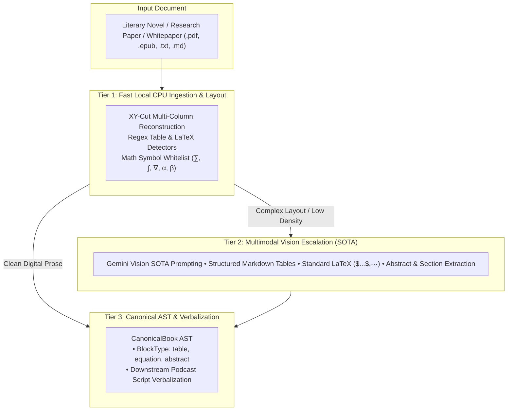

# Audiobook Studio: Document Extraction Subsystem (Pillar 1)

Standalone forensic document ingestion, geometric layout reconstruction, text normalization, chapter segmentation, and Canonical AST generation engine.

## 1. Overview

The `audiobook_factory.extraction` package converts raw literary documents, research papers, and technical whitepapers (`.epub`, `.pdf`, `.txt`, `.md`) into a canonical AST representation (`CanonicalBook`) with zero loss of raw textual fidelity, character-accurate provenance, fail-closed quality gate auditing, and native support for complex Markdown tables and LaTeX mathematical formulas.

## 2. Architecture

```
audiobook_factory/extraction/
├── __init__.py           # Clean public API exports
├── contracts.py          # Strongly typed Pydantic v2 AST schemas
├── engine.py             # ExtractionEngine coordinator & process_book_file
├── normalizer.py         # TextNormalizer (Unicode spaces, HTML decoding, bracket protection)
├── segmenter.py          # ChapterSegmenter (regex rules, 2-line title assembler, meso-tier splitting)
├── quality_gate.py       # Gate 0.1 ExtractionQualityAuditor (fail-closed on REVIEW)
└── parsers/              # Dedicated format parsers
    ├── __init__.py
    ├── epub.py           # ForensicEPUBParser (EPUB 3 nav landmarks & node-level anchor isolation)
    ├── text.py           # PlainTextParser & MarkdownParser (line offset tracking, tables, LaTeX math)
    └── pdf/              # Forensic PDF subsystem
        ├── __init__.py
        ├── forensic_engine.py
        ├── layout_reconstructor.py  # Geometric XY-cut multi-column reading order
        ├── quality_analyzer.py      # Multi-signal quality scoring & math symbol whitelisting
        ├── vision_extractor.py      # Gemini Multimodal Vision SOTA extractor
        └── models.py
```

## 3. Data Contracts (AST)

- **`CanonicalBook`**: Top-level single source of truth containing metadata, quality report, and ordered chapters. Provides `save_canonical()`, `load_canonical()`, `project_legacy_extracted()`, and `to_legacy_metadata()`.
- **`CanonicalChapter`**: Ordered collection of `CanonicalBlock` units. Distinguishes authentic `literary_chapter` from artificial `production_chunk`.
- **`CanonicalBlock`**: Atomic structural unit with sacred `raw_text`, speech-ready `normalized_text`, forensic `SourceProvenance`, and `semantic_metadata`.
  - **`BlockType`**: `"paragraph" | "heading" | "scene_break" | "dialogue" | "verse" | "quote" | "raw" | "table" | "equation" | "abstract" | "callout"`
  - **`table`**: Structured Markdown table with row/column counts and table headers (`| Col 1 | Col 2 |`).
  - **`equation`**: Display or inline LaTeX formulas (`$$\mathcal{L} = \sum ...$$`, `$E=mc^2$`).
  - **`abstract`**: Academic / whitepaper abstract and executive summaries.
  - **`callout`**: Research takeaways, tips, or warning sidebars (`> [!NOTE]`).
- **`SourceProvenance`**: Forensic coordinates tracing text back to source file, line numbers, character offsets, PDF page/columns, or EPUB spine items.
- **`ExtractionQualityReport`**: Quantitative metrics, confidence score, warnings, suspicious pages, and Gate 0.1 status.

## 4. 3-Tier Zero-Bloat Hybrid Extraction Architecture

Rather than requiring 15GB–20GB of local PyTorch/CUDA weights (like MinerU or Docling), the extraction engine uses a lightweight, cloud-accelerated 3-Tier hybrid design:



## 5. Usage

### Programmatic Ingestion

```python
from pathlib import Path
from audiobook_factory.extraction import ExtractionEngine, process_book_file

# Method 1: Using ExtractionEngine to get CanonicalBook AST
book = ExtractionEngine.extract(
    input_file=Path("research_paper.pdf"),
    output_base_dir=Path("projects"),
    force_gate=False,
)
print(f"Extracted {len(book.chapters)} chapters/sections, {book.quality_report.total_words} words.")

# Inspect structured blocks (tables & equations)
for block in book.chapters[0].blocks:
    if block.type == "table":
        print(f"Table ({block.semantic_metadata.get('table_rows')} rows): {block.raw_text[:60]}...")
    elif block.type == "equation":
        print(f"LaTeX Equation: {block.semantic_metadata.get('latex')}")

# Method 2: Backward-compatible metadata dictionary
metadata = process_book_file(
    input_file=Path("novel.epub"),
    output_base_dir=Path("projects"),
)
```

### Direct Parser Access

```python
from pathlib import Path
from audiobook_factory.extraction.parsers.epub import ForensicEPUBParser
from audiobook_factory.extraction.parsers.text import PlainTextParser, MarkdownParser
from audiobook_factory.extraction.parsers.pdf import ForensicPDFEngine

# EPUB parsing
epub_parser = ForensicEPUBParser(Path("book.epub"))
book, legacy_items = epub_parser.parse()

# Markdown research paper parsing
md_parser = MarkdownParser(Path("whitepaper.md"))
book = md_parser.parse()
```

## 6. Quality Gates (Gate 0.1)

Extraction enforces Gate 0.1 fail-closed protection via `ExtractionQualityAuditor`. Documents with $<50$ words, 0 chapters, or $>25\%$ layout/OCR anomalies trigger an `ExtractionGateAuditError` unless bypassed with `force_gate=True`. Mathematical and Greek symbols are whitelisted to eliminate false-positive symbol noise halts on technical papers.
