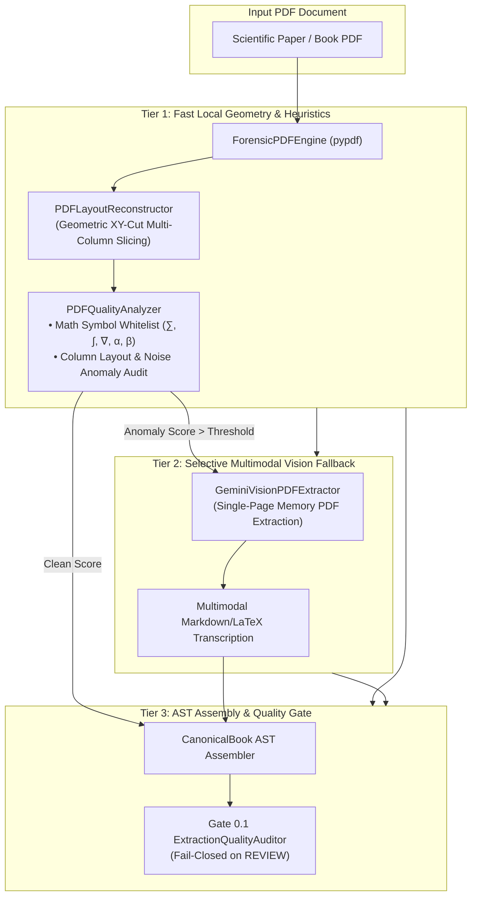

# 📄 Audiobook Studio: Document Extraction Subsystem (Pillar 1)

> **Forensic document ingestion, geometric layout reconstruction, text normalization, chapter segmentation, and Canonical AST generation engine with native support for research papers, LaTeX equations, Markdown tables, and academic abstracts.**

[](file:///c:/Users/Suraj/Documents/antigravity/optimistic-kepler/audiobook_factory/extraction)
[](file:///c:/Users/Suraj/Documents/antigravity/optimistic-kepler/audiobook_factory/extraction/contracts.py)
[](file:///c:/Users/Suraj/Documents/antigravity/optimistic-kepler/audiobook_factory/extraction/quality_gate.py)
[-brightgreen.svg)](file:///c:/Users/Suraj/Documents/antigravity/optimistic-kepler/audiobook_factory/extraction/parsers/pdf)

---

## 1. Overview

The [`audiobook_factory.extraction`](file:///c:/Users/Suraj/Documents/antigravity/optimistic-kepler/audiobook_factory/extraction) subsystem converts raw literary books, academic research papers (arXiv), and technical whitepapers (`.epub`, `.pdf`, `.txt`, `.md`) into a single source of truth: the [`CanonicalBook`](file:///c:/Users/Suraj/Documents/antigravity/optimistic-kepler/audiobook_factory/extraction/contracts.py#L231) Abstract Syntax Tree (AST).

It is engineered around four core invariants:
1. **Sacred Raw Text Invariant**: `raw_text` preserves the exact, unmutated source text including formatting characters, while `normalized_text` provides speech-ready clean text for downstream TTS.
2. **Forensic Provenance Tracking**: Every structural block is tagged with a [`SourceProvenance`](file:///c:/Users/Suraj/Documents/antigravity/optimistic-kepler/audiobook_factory/extraction/contracts.py#L58) record detailing source file path, line numbers, character offsets, PDF pages/columns, and EPUB spine anchors.
3. **Zero-Bloat Lightweight Architecture**: Eliminates 15GB–20GB local PyTorch/CUDA weights (MinerU, Docling) in favor of high-performance CPU regex/XY-cut parsing combined with selective multimodal cloud vision escalation.
4. **Native Technical Structure Support**: Full first-class classification for Markdown tables, LaTeX equations, academic abstracts, and alert callouts, bridging seamlessly into the downstream [Podcast Subsystem](file:///c:/Users/Suraj/Documents/antigravity/optimistic-kepler/audiobook_factory/podcast/README.md).

---

## 2. Architecture & File Layout

```text
audiobook_factory/extraction/
├── __init__.py           # Clean public API exports
├── contracts.py          # Strongly typed Pydantic v2 AST schemas (CanonicalBook, CanonicalBlock)
├── engine.py             # ExtractionEngine coordinator & process_book_file adapter
├── normalizer.py         # TextNormalizer (Unicode spaces, HTML decoding, bracket protection)
├── segmenter.py          # ChapterSegmenter (regex rules, 2-line title assembler, meso-tier splitting)
├── quality_gate.py       # Gate 0.1 ExtractionQualityAuditor (fail-closed on REVIEW)
├── cli.py                # Standalone extraction CLI (extract, inspect, audit)
└── parsers/              # Dedicated format parsers
    ├── __init__.py
    ├── epub.py           # ForensicEPUBParser (Hierarchical nav tree, frontmatter filter, heading dedup)
    ├── text.py           # PlainTextParser & MarkdownParser (tables, equations, callouts)
    └── pdf/              # Forensic PDF subsystem
        ├── __init__.py
        ├── forensic_engine.py       # Multi-pass PDF coordinator & text extraction
        ├── layout_reconstructor.py  # Geometric XY-cut multi-column reading order
        ├── quality_analyzer.py      # PDFQualityAnalyzer (math symbol whitelisting & anomaly scoring)
        ├── vision_extractor.py      # GeminiVisionPDFExtractor (multimodal SOTA fallback)
        └── models.py                # PDF quality audit data models
```

---

## 3. Data Contracts & Typed AST Blocks

All AST components are modeled in [`audiobook_factory/extraction/contracts.py`](file:///c:/Users/Suraj/Documents/antigravity/optimistic-kepler/audiobook_factory/extraction/contracts.py) using **Pydantic v2**:

### 3.1 `BlockType` Hierarchy

The [`BlockType`](file:///c:/Users/Suraj/Documents/antigravity/optimistic-kepler/audiobook_factory/extraction/contracts.py#L18-L32) taxonomy distinguishes standard literary prose from rich technical and academic elements:

```python
BlockType = Literal[
    "paragraph",    # Standard body narrative prose
    "heading",      # Chapter, section, or subsection title
    "dialogue",     # Spoken character dialogue
    "scene_break",  # Visual scene dividers (* * *, ---)
    "quote",        # Epigraph or blockquote
    "poetry",       # Verse or rhythmic stanza
    "list",         # Bulleted or numbered item list
    "note",         # Footnote or bibliographic reference
    "table",        # Structured Markdown table
    "equation",     # LaTeX display or inline equation
    "abstract",     # Academic paper abstract or executive summary
    "callout",      # GitHub-style alert box (> [!NOTE], etc.)
    "unknown",      # Ambiguous unclassified block
]
```

### 3.2 Technical AST Blocks Specification

| Block Type | Source Syntax Detected | Populated `semantic_metadata` | Downstream Verbalization Behavior |
|---|---|---|---|
| **`table`** | Markdown tables: `\| Col 1 \| Col 2 \|` with separator row `\|:---\|:---\|` | `table_rows: int`<br/>`table_cols: int`<br/>`headers: List[str]` | Routed to [`TableVerbalizer`](file:///c:/Users/Suraj/Documents/antigravity/optimistic-kepler/audiobook_factory/podcast/verbalizer.py#L188); converts rows and columns into auditory insights and benchmark comparisons. |
| **`equation`** | Display math `$$\mathcal{L} = ...$$` or standalone equations | `latex: str`<br/>`display: bool` | Routed to [`MathVerbalizer`](file:///c:/Users/Suraj/Documents/antigravity/optimistic-kepler/audiobook_factory/podcast/verbalizer.py#L13); converts Greek letters, vector norms, and integrals into natural spoken English math. |
| **`abstract`** | `**Abstract**: ...` or `> Abstract: ...` blocks | `is_abstract: bool` | Routed to [`AbstractCalloutVerbalizer.verbalize_abstract()`](file:///c:/Users/Suraj/Documents/antigravity/optimistic-kepler/audiobook_factory/podcast/verbalizer.py#L269); generates an engaging podcast introduction hook. |
| **`callout`** | GitHub-style alert boxes: `> [!NOTE]`, `> [!TIP]`, `> [!IMPORTANT]`, etc. | `callout_type: str` (`NOTE`, `TIP`, `WARNING`) | Routed to [`AbstractCalloutVerbalizer.verbalize_callout()`](file:///c:/Users/Suraj/Documents/antigravity/optimistic-kepler/audiobook_factory/podcast/verbalizer.py#L279); creates emphasis takeaways. |

### 3.3 Core Contract Models

- **[`CanonicalBook`](file:///c:/Users/Suraj/Documents/antigravity/optimistic-kepler/audiobook_factory/extraction/contracts.py#L231)**: Top-level document container holding `book_id`, `title`, `author`, `chapters`, `quality_report`, and `provenance_summary`. Exposes `save_canonical()` and `load_canonical()`.
- **[`CanonicalChapter`](file:///c:/Users/Suraj/Documents/antigravity/optimistic-kepler/audiobook_factory/extraction/contracts.py#L96)**: Unit representing an authentic literary chapter (`is_literary_chapter=True`) or an artificial production chunk (`is_production_chunk=True`).
- **[`CanonicalBlock`](file:///c:/Users/Suraj/Documents/antigravity/optimistic-kepler/audiobook_factory/extraction/contracts.py#L80)**: Atomic structural block storing `id`, `type`, sacred `raw_text`, `normalized_text`, `provenance`, and `semantic_metadata`.
- **[`SourceProvenance`](file:///c:/Users/Suraj/Documents/antigravity/optimistic-kepler/audiobook_factory/extraction/contracts.py#L58)**: Forensic coordinates (`source_file`, `source_type`, `page_number`, `column_index`, `line_start`, `line_end`, `char_offset`).

---

## 4. 3-Tier Zero-Bloat Hybrid PDF Extraction

Rather than forcing users to download 15GB–20GB of heavyweight local PyTorch models, the PDF subsystem utilizes a high-efficiency 3-Tier hybrid design:



---

## 5. Mathematical Symbol Whitelisting & Anomaly Detection

In standard document extractors, mathematical formulas, Greek characters, and LaTeX backslashes are frequently misclassified as "OCR symbol noise" or "corrupted encoding", causing false-positive gate failures.

The [`PDFQualityAnalyzer`](file:///c:/Users/Suraj/Documents/antigravity/optimistic-kepler/audiobook_factory/extraction/parsers/pdf/quality_analyzer.py#L11) solves this via targeted **scientific symbol whitelisting**:

```python
# Whitelist in PDFQualityAnalyzer.evaluate_extraction_quality:
symbols = len(
    re.findall(
        r"[^a-zA-Z0-9\s"
        r"\u00C0-\u024F\u1E00-\u1EFF"          # Latin accented ranges
        r"\u0900-\u097F"                      # Devanagari script (Hindi)
        r"\u0370-\u03FF"                      # Greek and Coptic alphabet (α, β, γ, θ, ω, ...)
        r"\u2200-\u22FF"                      # Mathematical Operators (∀, ∃, ∈, ∑, ∏, ∫, ∇, ...)
        r"\u2A00-\u2AFF"                      # Supplemental Mathematical Operators
        r"\u2190-\u21FF"                      # Arrows (←, →, ↔, ⇒, ...)
        r"\u2070-\u209F"                      # Superscripts and Subscripts (⁰, ¹, ², ³, ⁿ, ᵢ, ⱼ, ...)
        r"\.,'\"‘’“”\?\!\-\—\–\:\;\(\)\[\]…\/" # Punctuation & Brackets
        r"\$\\\{\}\_\^\*\+\=\<\>\|\%~"        # LaTeX Syntax: $, \, {, }, _, ^, *, +, =, <, >, |, %, ~
        r"]",
        cleaned,
    )
)
```

### Heuristic Scoring Criteria
- **Noise Ratio**: Only true non-lexical corruption characters (such as Unicode replacement `\ufffd`, random binary control codes, and broken unmapped font glyphs) increment the OCR noise counter.
- **Gibberish Token Detection**: Evaluates corrupted alphanumeric tokens (e.g. `th3r3`, `1lI0O`) while ignoring legitimate mathematical expressions.
- **LLM Refusal & Preamble Detection**: Detects conversational leakage (`"As an AI..."`, `"Here is the extracted text:"`) and cleanly strips preambles without corrupting literary text.

---

## 6. Multimodal Vision Fallback (`GeminiVisionPDFExtractor`)

When a complex PDF page exhibits severe column overlap, multi-column equations, or unextractable vector fonts, [`GeminiVisionPDFExtractor`](file:///c:/Users/Suraj/Documents/antigravity/optimistic-kepler/audiobook_factory/extraction/parsers/pdf/vision_extractor.py#L19) selectively escalates the single page:

### 1. Minimal Token Memory Slice
Rather than uploading entire books to the API, the extractor extracts solely the affected page using an in-memory `pypdf.PdfWriter` buffer (`io.BytesIO`), transmitting only the single-page bytes.

### 2. SOTA Technical Transcription Prompt
The multimodal extractor executes against Google Gemini Flash with strict structured transcription directives:

```text
Extract all text from this document page in strict, clean Markdown reading order.
- Tables: Transcribe all tables into clean, structured Markdown table syntax with headers (| Col 1 | Col 2 |).
- Mathematics: Transcribe all mathematical formulas, variables, and expressions into standard LaTeX syntax ($...$ for inline math, $$...$$ for display equations).
- Structure: Preserve section headers (#, ##, ###), bullet lists, and figure/table captions.
- Cleanliness: Strip running headers and page numbers. Do not summarize or omit text.
```

### 3. ModelGateway Control Plane Integration (Primary Path)
Multimodal page escalations are routed directly through [`ModelGateway.generate_text()`](file:///c:/Users/Suraj/Documents/antigravity/optimistic-kepler/audiobook_factory/core/models/gateway.py#L48):
- **Atomic Single-Request Leasing**: Leases an eligible API key handle with zero in-flight collision (`Concurrency = 1` mutual exclusion).
- **Session Affinity**: Binds consecutive page requests to a stable key session (`session_id=f"pdf_page_{page_num}"`), preventing suspicious edge-router key hopping.
- **Stealth SDK Headers**: Automatically attaches official SDK headers (`x-goog-api-client`, `google-genai-sdk-python/0.8.3`) to bypass edge bot heuristic filters.
- **Inline Multimodal `parts`**: Supported natively via [`GeminiProviderAdapter._build_gemini_payload()`](file:///c:/Users/Suraj/Documents/antigravity/optimistic-kepler/audiobook_factory/core/models/adapters/gemini.py#L57), which accepts base64-encoded `inlineData` alongside textual instructions without disk file uploads.
- **Preamble Stripping**: Post-processes candidate markdown to cleanly remove conversational greetings (`"Sure, here is the text:"`) and triple-backtick markdown fences.

### 4. Direct Fallback & Transparent Key Synchronization
- **Standalone API Key Fallback**: If the `ModelGateway` is not initialized or operates in offline fallback mode, `GeminiVisionPDFExtractor` resolves keys via [`PersistentKeyPool.get_key()`](file:///c:/Users/Suraj/Documents/antigravity/optimistic-kepler/audiobook_factory/key_manager.py#L276) and issues direct requests with stealth headers and universal `BLOCK_NONE` safety settings.
- **Transparent Key Pool Synchronization**: [`PersistentKeyPool`](file:///c:/Users/Suraj/Documents/antigravity/optimistic-kepler/audiobook_factory/key_manager.py#L664) synchronizes transparently with [`KeyLeaseManager`](file:///c:/Users/Suraj/Documents/antigravity/optimistic-kepler/audiobook_factory/core/models/lease_manager.py#L763) across `lease_key()`, `record_success()`, `mark_daily_quota_exhausted()`, and `mark_temporary_backoff()`, maintaining consistent daily quota and circuit breaker state across all subsystems.
- **Backward-Compatible DRY Shim**: The legacy path [`audiobook_factory/pdf/vision_extractor.py`](file:///c:/Users/Suraj/Documents/antigravity/optimistic-kepler/audiobook_factory/pdf/vision_extractor.py) acts as a clean DRY compatibility re-export of `PDFEscalationEngine` and `GeminiVisionPDFExtractor` from `audiobook_factory.extraction.parsers.pdf.vision_extractor`, preventing breaking changes in existing consumer pipelines.

### 5. Universal Permissive Safety Settings
Configured with universal `BLOCK_NONE` developer safety thresholds across harassment, hate speech, sexual content, and dangerous content categories to eliminate false-positive content moderation truncation during technical or historical literature processing.

---

## 7. Forensic EPUB Extraction & Hierarchical Navigation Engine

The [`ForensicEPUBParser`](file:///c:/Users/Suraj/Documents/antigravity/optimistic-kepler/audiobook_factory/extraction/parsers/epub.py#L225) processes digital `.epub` publications into authentic literary chapters using DOM-level element parsing and hierarchical navigation traversal:

### 7.1 Hierarchical Navigation Tree (`NavItem`)
Many complex anthologies, multi-part novels, and serialized collections nest subchapters within parent story containers:
- **Tree Parsing**: Extracts nested `<navPoint>` elements (NCX) or `<ol>`/`<li>` structures (EPUB 3 Navigation Document) into recursive `NavItem` trees.
- **Parent-Child Title Synthesis**: Preserves parent story identity when child subchapters share anchors or are titled with bare Roman numerals:
  - If a child node is titled `"I"` and has parent `"Story Collection"`, the resolved title becomes `"Story Collection - Part I"`.
  - Leaf nodes with empty block slices (0 words) due to anchor collisions are gracefully resolved, eliminating dropped parent narratives.

### 7.2 Typographic Heading Promotion & Deduplication
Publisher HTML often typesets titles using styled bold spans (e.g. `<p class="calibre1"><b class="calibre3">...</b></p>`) rather than standard `<h1>`-`<h6>` tags.
- **Typographic Promotion**: Detects standalone bold title paragraphs and promotes them to `type="heading"` AST blocks.
- **Lead Heading Deduplication**: [`_deduplicate_leading_headings`](file:///c:/Users/Suraj/Documents/antigravity/optimistic-kepler/audiobook_factory/extraction/parsers/epub.py#L182) scans the first structural blocks of each chapter. Blocks matching the chapter title, parent title, or bare numeral are tagged with `is_lead_heading=True`.
- **Zero Title Stuttering**: [`CanonicalChapter.to_markdown()`](file:///c:/Users/Suraj/Documents/antigravity/optimistic-kepler/audiobook_factory/extraction/contracts.py#L137) and [`to_plain_text()`](file:///c:/Users/Suraj/Documents/antigravity/optimistic-kepler/audiobook_factory/extraction/contracts.py#L173) automatically suppress `is_lead_heading` blocks, ensuring narration immediately begins with author prose rather than repeating the title.

### 7.3 Targeted Non-Literary Frontmatter Pruning
Commercial digital releases contain promotional and publisher marketing junk. [`_is_non_literary_frontmatter()`](file:///c:/Users/Suraj/Documents/antigravity/optimistic-kepler/audiobook_factory/extraction/parsers/epub.py#L159) surgically filters:
- **Filtered**: Title pages, copyright notices, publisher marketing, newsletters, "Also by" catalogs, retailer previews, and raw table of contents.
- **Preserved**: Authentic literary frontmatter/backmatter including prologues, epilogues, author's notes, forewords, dedications, and afterwords.

---

## 8. Downstream Bridge into Podcast Subsystem

The structured AST generated by the extraction subsystem feeds directly into the downstream [Podcast Subsystem](file:///c:/Users/Suraj/Documents/antigravity/optimistic-kepler/audiobook_factory/podcast/README.md):

```text
CanonicalBook AST
   │
   ├── CanonicalBlock (type="abstract") ──► AbstractCalloutVerbalizer.verbalize_abstract()
   │                                              └── Spoken intro hook (Host A)
   │
   ├── CanonicalBlock (type="equation") ──► MathVerbalizer.verbalize_latex()
   │                                              ├── Exact spoken math (Host A)
   │                                              └── Intuition reaction (Host B)
   │
   ├── CanonicalBlock (type="table")    ──► TableVerbalizer.verbalize_table()
   │                                              └── Comparative benchmark dialogue (Host B)
   │
   ├── CanonicalBlock (type="callout")  ──► AbstractCalloutVerbalizer.verbalize_callout()
   │                                              └── Spoken takeaway transition (Host B)
   │
   └── CanonicalBlock (type="paragraph")──► MathVerbalizer.verbalize_inline_math()
                                                  └── Alternating conversational turns ($...$ parsed)
```

---

## 9. Usage & Code Examples

### 9.1 Ingesting a Research Paper into Canonical AST

```python
from pathlib import Path
from audiobook_factory.extraction import ExtractionEngine

# Extract paper or whitepaper into Canonical AST
book = ExtractionEngine.extract(
    input_file=Path("papers/transformer_attention.pdf"),
    output_base_dir=Path("audiobooks/projects"),
    force_gate=False,
)

print(f"Title: {book.title}")
print(f"Word count: {book.quality_report.total_words}")
print(f"Gate 0.1 Status: {book.quality_report.gate_status}")

# Iterate over structured blocks
for chapter in book.chapters:
    print(f"\n--- {chapter.title} ---")
    for block in chapter.blocks:
        if block.type == "table":
            print(f"[TABLE] {block.semantic_metadata.get('table_rows')} rows: {block.raw_text[:40]}...")
        elif block.type == "equation":
            print(f"[EQUATION] LaTeX: {block.semantic_metadata.get('latex')}")
        elif block.type == "abstract":
            print(f"[ABSTRACT] {block.normalized_text[:80]}...")
```

### 9.2 Command-Line Extraction

```bash
# Ingest PDF paper and output canonical book.json
audiobook-studio extract "papers/attention.pdf"

# Bypass gate failure if processing low-word count sample
audiobook-studio extract "test_paper.pdf" --force-gate
```

---

## 10. Quality Gate 0.1 (`ExtractionQualityAuditor`)

All extractions are validated against **Gate 0.1** in [`quality_gate.py`](file:///c:/Users/Suraj/Documents/antigravity/optimistic-kepler/audiobook_factory/extraction/quality_gate.py):
- **Word Count Threshold**: Fails if total extracted word count $< 50$ words.
- **Chapter Monotonicity**: Fails if 0 chapters or sections are identified.
- **Anomaly Ceiling**: Fails if layout anomaly ratio $> 25\%$ across pages.
- **Fail-Closed Protection**: Raises `ExtractionGateAuditError` on status `REVIEW` to halt broken text from consuming downstream TTS compute, unless explicitly overridden with `--force-gate`.
