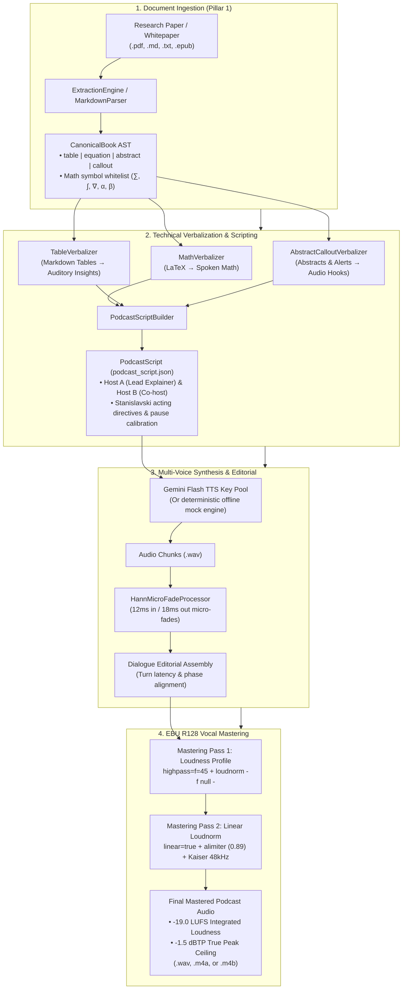

# 🎙️ Audiobook Studio: Podcast & Technical Verbalization Subsystem

> **Autonomous NotebookLM-style dual-host podcast generation and broadcast-mastered technical audiobooks from scientific research papers (arXiv), technical whitepapers, financial reports, complex Markdown tables, and LaTeX mathematical expressions.**

[](file:///c:/Users/Suraj/Documents/antigravity/optimistic-kepler/audiobook_factory/podcast)
[-purple.svg)](file:///c:/Users/Suraj/Documents/antigravity/optimistic-kepler/audiobook_factory/podcast/producer.py)
[](file:///c:/Users/Suraj/Documents/antigravity/optimistic-kepler/audiobook_factory/tts_dispatcher.py)
[-brightgreen.svg)](file:///c:/Users/Suraj/Documents/antigravity/optimistic-kepler/audiobook_factory/extraction)

---

## 1. Overview & Architectural Vision

The [`audiobook_factory.podcast`](file:///c:/Users/Suraj/Documents/antigravity/optimistic-kepler/audiobook_factory/podcast) subsystem expands the Audiobook Studio pure vocals-only engine beyond fictional novels into **deep-dive scientific papers and technical whitepapers**.

Traditional academic paper-to-audio tools suffer from two major flaws:
1. **Local Weight Bloat**: Forcing 15GB–20GB of local PyTorch/CUDA weights (MinerU, Docling, Nougat) just to parse formulas.
2. **Unlistenable Symbol Reading**: Reading raw LaTeX syntax verbatim (*"dollar sign backslash mathcal L subscript total..."*) and reciting raw Markdown table borders (*"pipe dash dash pipe"*), producing completely unlistenable audio.

The **Audiobook Studio Technical Verbalization Engine** solves this via a cloud-accelerated, zero-bloat pipeline:
- **Mathematical Verbalization**: Intelligently translates complex LaTeX equations, vector norms, integrals, and Greek symbols into natural, spoken mathematical prose.
- **Auditory Table Insights**: Summarizes multi-column Markdown tables into comparative benchmark insights, model comparisons, and key performance metrics.
- **Dual-Host Conversational Allocation**: Transforms academic prose into an engaging dialogue between a **Lead Explainer** (e.g. *Dr. Vance* - Charon) and an **Inquisitive Co-host** (e.g. *Maya* - Aoede).
- **Studio Vocal Mastering**: Applies 12ms/18ms Hann micro-fades at endpoint zero-crossings and deterministic two-pass linear **EBU R128 (-19.0 LUFS / -1.5 dBTP)** loudness mastering.

---

## 2. End-to-End Pipeline Architecture



---

## 3. Core Modules & Contracts

The subsystem is organized in [`audiobook_factory/podcast/`](file:///c:/Users/Suraj/Documents/antigravity/optimistic-kepler/audiobook_factory/podcast/):

```text
audiobook_factory/podcast/
├── __init__.py           # Clean public API exports
├── contracts.py          # Strongly typed Pydantic v2 schemas
├── verbalizer.py         # LaTeX, Markdown Table, Abstract & Callout verbalizers
├── script_builder.py     # Dual-host turn allocator & script generator
├── producer.py           # Hann micro-fader, dialogue stitcher & EBU R128 masterer
├── orchestrator.py       # Unified 3-step pipeline coordinator
└── cli.py                # Dedicated subcommands (produce, script, render, inspect)
```

### 3.1 Data Contracts ([`contracts.py`](file:///c:/Users/Suraj/Documents/antigravity/optimistic-kepler/audiobook_factory/podcast/contracts.py))

All data structures are implemented using **Pydantic v2** with strict typing and validation aliases:

| Contract | Type | Description |
|---|---|---|
| [`HostProfile`](file:///c:/Users/Suraj/Documents/antigravity/optimistic-kepler/audiobook_factory/podcast/contracts.py#L17-L27) | `BaseModel` | Configuration profile for a podcast host. Stores `id`, `name`, `role` (`lead_explainer`, `inquisitive_cohost`, `solo_narrator`), `default_voice`, `acting_style`, and `formant_preset`. |
| [`PodcastSegment`](file:///c:/Users/Suraj/Documents/antigravity/optimistic-kepler/audiobook_factory/podcast/contracts.py#L29-L48) | `BaseModel` | Atomic spoken dialogue turn. Stores `segment_id`, `speaker`, `character_name`, `text`, `acting_directive`, `source_block_id`, `source_block_type`, `pause_after_ms`, and `words`. |
| [`PodcastScript`](file:///c:/Users/Suraj/Documents/antigravity/optimistic-kepler/audiobook_factory/podcast/contracts.py#L50-L103) | `BaseModel` | Full structured screenplay. Calculates `total_words`, `total_segments`, and `estimated_duration_sec` (~150 WPM). Exposes `to_screenplay_json()` for seamless Room 4 TTS compatibility. |
| [`PodcastProductionResult`](file:///c:/Users/Suraj/Documents/antigravity/optimistic-kepler/audiobook_factory/podcast/contracts.py#L105-L123) | `BaseModel` | Telemetry ledger. Reports `status` (`SUCCESS`/`FAILED`), runtime durations, file paths (`dialogue_raw_path`, `mastered_audio_path`), `integrated_lufs`, `true_peak_db`, and `metrics`. |

---

### 3.2 Technical Verbalization Engine ([`verbalizer.py`](file:///c:/Users/Suraj/Documents/antigravity/optimistic-kepler/audiobook_factory/podcast/verbalizer.py))

#### 1. `MathVerbalizer`
Converts complex LaTeX mathematical notation into spoken English mathematical prose:
- **Greek Alphabet & Operators**: Translates `\alpha` $\rightarrow$ *"alpha"*, `\omega` $\rightarrow$ *"omega"*, `\nabla` $\rightarrow$ *"gradient"*, `\partial` $\rightarrow$ *"partial derivative"*.
- **Relations & Logic**: Converts `\le` $\rightarrow$ *"is less than or equal to"*, `\neq` $\rightarrow$ *"is not equal to"*, `\approx` $\rightarrow$ *"is approximately"*, `\mathbb{R}` $\rightarrow$ *"the set of real numbers"*.
- **Vector Norms**:
  - `\|\mathbf{W}\|_2^2` $\rightarrow$ *"the squared L2 norm of weight matrix W"*
  - `\|\mathbf{x}\|_2` $\rightarrow$ *"the L2 norm of weight matrix x"*
- **Summations & Integrals**:
  - `\sum_{i=1}^N (y_i - \hat{y}_i)^2` $\rightarrow$ *"the sum from i equals 1 to N of y sub i minus y hat sub i squared"*
  - `\int_{0}^{\infty} ...` $\rightarrow$ *"the integral from 0 to infinity of ..."*
- **Fractions, Hats, & Powers**:
  - `\frac{A}{B}` $\rightarrow$ *"A divided by B"*
  - `\hat{y}_i` $\rightarrow$ *"y hat sub i"*
  - `x^2` $\rightarrow$ *"x squared"*, `x^3` $\rightarrow$ *"x cubed"*, `x^N` $\rightarrow$ *"x to the power of N"*
- **Inline Math Processor**: `verbalize_inline_math(text)` scans standard paragraphs for `$formula$` and seamlessly verbalizes embedded equations within sentence prose.

#### 2. `TableVerbalizer`
Parses structural Markdown tables into natural auditory dialogue:
- **Benchmark & Model Comparisons**: Identifies architectures, latency, accuracy, and evaluation columns. Synthesizes comparative statements: *"Flash 2.0 achieved 96.8% accuracy, with 115 ms latency. Overall, the findings demonstrate significant performance advantages..."*
- **General Table Fallback**: Summarizes row counts, headers, and top metrics without reciting ASCII formatting characters.

#### 3. `AbstractCalloutVerbalizer`
- `verbalize_abstract(text)`: Strips markdown boilerplate and crafts an engaging podcast introduction hook: *"To kick things off, the core premise of this research addresses a fundamental challenge: ..."*
- `verbalize_callout(text)`: Converts GitHub alerts (`> [!NOTE]`, `> [!IMPORTANT]`, `> [!TIP]`) into spoken transitions: *"An essential takeaway to keep in mind here is that ..."*

---

### 3.3 Dual-Host Script Builder ([`script_builder.py`](file:///c:/Users/Suraj/Documents/antigravity/optimistic-kepler/audiobook_factory/podcast/script_builder.py))

The [`PodcastScriptBuilder`](file:///c:/Users/Suraj/Documents/antigravity/optimistic-kepler/audiobook_factory/podcast/script_builder.py#L29) turns a [`CanonicalBook`](file:///c:/Users/Suraj/Documents/antigravity/optimistic-kepler/audiobook_factory/extraction/contracts.py#L231) AST into a lively dialogue:
- **Default Host Roster**:
  - **Host A (`Dr. Vance`)**: Lead Explainer (Voice: `Charon`), acting style: *"calm, steady, articulate, authoritative research delivery"*.
  - **Host B (`Maya`)**: Inquisitive Co-host (Voice: `Aoede`), acting style: *"engaging, curious, dynamic, conversational analyst delivery"*.
- **Structural Routing**:
  - **Abstracts**: Assigned to Host A as an anchor hook, followed by an immediate conversational handoff to Host B.
  - **Equations**: Host A recites the exact mathematical formulation; Host B immediately follows up with the architectural intuition and acoustic significance.
  - **Tables**: Host B summarizes data metrics and benchmark comparisons; Host A provides context.
  - **Section Headings**: Injects dynamic landmark transition turns (*"Let's dive into Section 3..."*).
  - **Intros & Outros**: Generates natural welcoming banter and sign-off credits.
- **Convenience API**: `generate_podcast_script_from_file(input_file, output_dir)` ingests any file and dumps `podcast_script.json`.

---

### 3.4 Production & Vocal Mastering Engine ([`producer.py`](file:///c:/Users/Suraj/Documents/antigravity/optimistic-kepler/audiobook_factory/podcast/producer.py))

#### 1. `HannMicroFadeProcessor`
Neural TTS chunks often exhibit digital DC offsets or abrupt zero-crossing terminations that cause audible pops and clicks when stitched together. The `HannMicroFadeProcessor` applies raised-cosine smoothing:
$$\text{Fade In: } w[n] = 0.5 \left(1 - \cos\left(\frac{\pi n}{N_{\text{in}}}\right)\right) \quad (12\text{ ms})$$
$$\text{Fade Out: } w[n] = 0.5 \left(1 + \cos\left(\frac{\pi n}{N_{\text{out}}}\right)\right) \quad (18\text{ ms})$$

#### 2. `PodcastAudioProducer`
Coordinates multi-host synthesis and editorial stitching:
- **Synthesis**: Maps host IDs to Gemini Flash voice profiles (`Charon`, `Aoede`, `Puck`, `Fenrir`, etc.).
- **Offline / CI Mock Engine**: Generates speech-fundamental sine sweeps with harmonic warmth via `generate_synthetic_audio_chunk()` when `--mock` is passed or `PODCAST_MOCK_TTS=true`, allowing complete offline pipeline testing without burning API keys.
- **Dialogue Editorial Stitching**: Concatenates chunks with Hann micro-fades, resamples to 48kHz, and injects calibrated inter-turn pause latencies (`pause_after_ms`).

#### 3. Deterministic Two-Pass Linear EBU R128 Mastering
Complies strictly with international broadcast and Audible standards:
- **Subsonic Filter**: 45Hz highpass filter (`highpass=f=45`) removing sub-bass rumble.
- **Pass 1 (Measurement)**: Measures integrated loudness, true peak, and LRA via FFmpeg `-af loudnorm=... -f null -`.
- **Pass 2 (Linear Application)**: Applies linear gain normalization (`linear=true`) using measured stats offset. **Zero dynamic compression breathing or room-tone pumping during pauses.**
- **Transparent Lookahead Limiter**: `alimiter=limit=0.89:attack=5:release=50:asc=0:level=0` guaranteeing hard ceiling of **-1.5 dBTP**.
- **Kaiser Sinc Resampler**: `aresample=osr=48000:filter_type=kaiser:dither_method=triangular`.

---

### 3.5 Unified Orchestrator ([`orchestrator.py`](file:///c:/Users/Suraj/Documents/antigravity/optimistic-kepler/audiobook_factory/podcast/orchestrator.py))

The [`PodcastOrchestrator`](file:///c:/Users/Suraj/Documents/antigravity/optimistic-kepler/audiobook_factory/podcast/orchestrator.py#L32) unites the 3-step pipeline into a single function call:
1. **Extraction**: Calls `ExtractionEngine.extract()` $\rightarrow$ Produces `CanonicalBook` AST.
2. **Scripting**: Calls `PodcastScriptBuilder.build_from_book()` $\rightarrow$ Produces `podcast_script.json`.
3. **Production**: Calls `PodcastAudioProducer.produce_podcast_audio()` $\rightarrow$ Produces mastered audio and manifest.

---

## 4. Command-Line Interface Reference

The podcast subsystem provides two convenient CLI entrypoints:
1. Via the global CLI: `python audiobook_cli.py podcast [OPTIONS]`
2. Via the modular CLI: `python -m audiobook_factory.podcast.cli [SUBCOMMAND] [OPTIONS]`

### 4.1 Subcommands

| Subcommand | Purpose | Key Arguments |
|---|---|---|
| **`produce`** | End-to-end ingestion, scripting, TTS synthesis, and EBU R128 mastering | `file`, `--output-dir`, `--style`, `--host-a-name`, `--host-a-voice`, `--host-b-name`, `--host-b-voice`, `--mock`, `--force-gate` |
| **`script`** | Ingests document and writes `podcast_script.json` without synthesizing audio | `file`, `--output-dir`, `--style`, `--host-a-name`, `--host-b-name`, `--force-gate` |
| **`render`** | Synthesizes and masters an existing `podcast_script.json` file | `script_file`, `--output-dir`, `--mock` |
| **`inspect`** | Inspects script metrics, cast roster, or production manifests | `path` |

### 4.2 CLI Examples

#### End-to-End Production on a Research Paper
```bash
# Produce mastered podcast audio from arXiv paper PDF
python -m audiobook_factory.podcast.cli produce "attention_is_all_you_need.pdf"

# Customize host personas and voices
python -m audiobook_factory.podcast.cli produce "whitepaper.md" \
  --host-a-name "Dr. Vance" --host-a-voice "Charon" \
  --host-b-name "Maya" --host-b-voice "Aoede" \
  --output-dir "audiobooks/projects/transformer_podcast"
```

#### Zero-Quota Mock Mode (Offline Development & CI)
```bash
# Uses synthetic vocal DSP chunks (zero Gemini API quota used)
python -m audiobook_factory.podcast.cli produce "research.md" --mock
```

#### Script-Only Generation (Review Before Rendering)
```bash
# Ingest and generate screenplay script only
python -m audiobook_factory.podcast.cli script "qwen2_vl_report.pdf"

# Inspect the generated script turns and word count
python -m audiobook_factory.podcast.cli inspect "audiobooks/projects/qwen2_vl_podcast/podcast_script.json"

# Render audio after reviewing script
python -m audiobook_factory.podcast.cli render "audiobooks/projects/qwen2_vl_podcast/podcast_script.json"
```

---

## 5. Python API Quickstarts

### 5.1 1-Line End-to-End Orchestration

```python
from pathlib import Path
from audiobook_factory.podcast import process_document_to_podcast

result = process_document_to_podcast(
    source_file=Path("papers/quantum_computing_survey.pdf"),
    output_dir=Path("audiobooks/projects/quantum_podcast"),
    host_a_name="Dr. Vance",
    host_a_voice="Charon",
    host_b_name="Maya",
    host_b_voice="Aoede",
    mock_mode=False,
)

print(f"Status: {result.status}")
print(f"Duration: {result.duration_sec:.1f}s")
print(f"Mastered Audio: {result.mastered_audio_path}")
print(f"Loudness: {result.integrated_lufs} LUFS (Peak: {result.true_peak_db} dBTP)")
```

### 5.2 Granular Step-by-Step API

```python
from pathlib import Path
from audiobook_factory.extraction import ExtractionEngine
from audiobook_factory.podcast import (
    PodcastScriptBuilder,
    PodcastAudioProducer,
    HostProfile,
)

# 1. Forensic AST Ingestion
book = ExtractionEngine.extract(Path("whitepaper.md"), output_base_dir=Path("projects"))

# 2. Build Dual-Host Script
hosts = [
    HostProfile(id="host_a", name="Dr. Vance", role="lead_explainer", default_voice="Charon"),
    HostProfile(id="host_b", name="Maya", role="inquisitive_cohost", default_voice="Aoede"),
]
builder = PodcastScriptBuilder(hosts=hosts, style="conversational_podcast")
script = builder.build_from_book(book)
print(f"Generated {script.total_segments} turns ({script.total_words} words)")

# 3. Multi-Voice Synthesis & EBU R128 Mastering
producer = PodcastAudioProducer()
result = producer.produce_podcast_audio(
    script_or_path=script,
    output_dir=Path("projects/whitepaper_podcast/production"),
    mock_mode=False,
)
print(f"Mastered track ready at: {result.mastered_audio_path}")
```

### 5.3 Direct Technical Verbalization

```python
from audiobook_factory.podcast import MathVerbalizer, TableVerbalizer, AbstractCalloutVerbalizer

# Verbalize LaTeX equation
latex = r"\mathcal{L}_{\text{total}} = \lambda \sum_{i=1}^N (y_i - \hat{y}_i)^2 + \gamma \|\mathbf{W}\|_2^2"
spoken_math = MathVerbalizer.verbalize_latex(latex)
print(spoken_math)
# Output: "the total loss objective L equals lambda times the sum from i equals 1 to N of y sub i minus y hat sub i squared plus gamma the squared L2 norm of weight matrix W"

# Verbalize Markdown table
table_md = """
| Model | Latency (ms) | Accuracy (%) |
| :--- | :--- | :--- |
| Gemini Flash | 120 | 97.4% |
| Cloud Baseline | 450 | 94.2% |
"""
table_speech = TableVerbalizer.verbalize_table(table_md, title="Speed Benchmark")
print(table_speech)
```

---

## 6. Audio Engineering & Quality Invariants

| Standard | Requirement | Implementation |
|---|---|---|
| **Vocal-Only Mandate** | No BGM, No SFX | 100% focused on vocal clarity, phase coherence, and dialogue interaction. |
| **Integrated Loudness** | **-19.0 LUFS** ($\pm 0.5$) | Measured two-pass linear FFmpeg `loudnorm` filter chain. |
| **True Peak Limit** | $\le$ **-1.5 dBTP** | Hard ceiling via transparent lookahead limiter (`alimiter=limit=0.89`). |
| **Micro-Fade Protection** | Zero pop/click | 12ms pre-speech fade-in and 18ms post-speech fade-out at zero-crossings. |
| **Sampling & Delivery** | 48kHz / 24-bit PCM / AAC | Kaiser Sinc 48kHz resampler (`aresample=osr=48000:filter_type=kaiser`). |
| **Turn Attenuation** | Contextual Latency | Dynamic turn pause intervals (`pause_after_ms`: 200–400ms) matching natural human discourse. |
