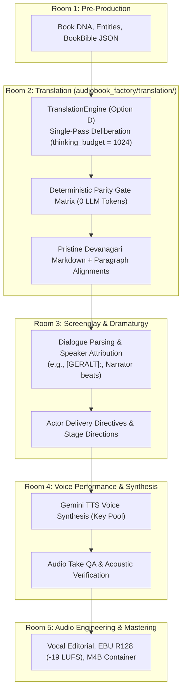

# Literary Translation Engine (Pillar 2 — Option D Decoupled Architecture)

> **Canonical System**: Audiobook Studio (`audiobook-studio`)  
> **Subsystem**: Pillar 2 — Standalone Literary English-to-Hindi Translation Subsystem  
> **Architecture Version**: `v5.3.0` (Option D: Decoupled Token-Optimized Hybrid Architecture)  
> **Target LLM Runtime**: Google Gemini Flash (`thinking_budget = 1024`, `temperature = 0.35`)  
> **Status**: Active Production Standard  

---

## 1. Subsystem Mission & Core Invariants

The **Literary Translation Engine** (`audiobook_factory/translation/`) is a **standalone, fully decoupled translation subsystem** engineered to render long-form English literature into publication-grade, dramatic, actable spoken Hindustani (Devanagari script) suitable for professional voice artists, audio dramas, and literary publishing.

### 1.1 Core Non-Negotiable Invariants

1. **Universal Novel-Agnostic Invariant**:
   - The engine **MUST NEVER** contain hardcoded novel titles, franchise lore, character rosters, file hashes, or era-specific biases in source code or regex rules.
   - All character names, honorific dynamics, pronunciation hints, and world terminology are dynamically extracted from source text into a canonical [`BookBible`](file:///data/data/com.termux/files/home/audiobook-studio/audiobook_factory/translation/book_bible.py) or supplied via dynamic in-memory glossaries.
2. **Decoupled Standalone Independence**:
   - The translation subsystem **MUST NOT** import or depend on downstream audio/TTS components (`TTSDispatcher`, `ffmpeg_agent`, `mastering`, `sound_bank`, `script_builder`, `speech_floor`, or audio hardware).
   - Zero imports of `audio`, `tts`, `screenplay`, `cinematic`, or audio hardware drivers exist within `audiobook_factory/translation/`.
   - The translation subsystem accepts an abstract LLM caller interface (`Callable[..., str]`) and can operate completely standalone as a reusable library or CLI tool.
3. **The "Nothing Above Source" Dual-Rule Invariant**:
   - **`RAW_UNRATED` Fiction**: Preserves raw street curses (*'गांड'*, *'हरामी'*), visceral combat gore, and unvarnished somatic intimacy without sanitization or puritanical moralizing. Eliminates forced "19-to-21" escalation: if the source is mild, the translation remains mild; if the source is raw, the translation remains raw.
   - **`CLASSIC_REVERENT` Literature**: Preserves sacred authorial dignity, emotional pathos, and authentic regional cadence (Awadhi, Bhojpuri, Lucknowi) with **zero** modern tapori vulgarity or forced slang.
4. **100% Full-Chapter Deterministic Quality Gate (Zero Token Waste)**:
   - Replaces token-hungry, blind 6,000-character LLM judges with **full-text deterministic parity gates** (character length ratio, paragraph count parity, dialogue quote parity, negation token parity, and entity consistency).

---

## 2. Separation of Concerns & Boundary Contracts

The audiobook production pipeline enforces strict boundary contracts across rooms to preserve modularity, prevent cross-room regressions, and enable independent scaling.



### 2.1 Boundary Invariants for Room 2

* **Strictly Text-to-Text**: Room 2 ingests raw English text and emits pristine Devanagari Markdown. It has no awareness of audio files, sample rates, or TTS engines.
* **No Screenplay Actor Tags**: Room 2 **NEVER** injects screenplay actor markers (such as `[GERALT]:`, `[JASKIER]:`, or JSON speaker attribution blocks). Dialogue parsing and speaker identification belong 100% to Room 3 (`audiobook_factory.script.script_builder`).
* **No Audio Take QA or Synthesis**: Room 2 **NEVER** attempts audio generation, spectrogram inspection, CTC alignment, or audio QA. Speech synthesis and acoustic validation belong strictly downstream to Room 4 (`audiobook_factory.tts` and `audiobook_factory.performance`).
* **Zero Prohibited Imports**: The package enforces an absolute import ban on `audio`, `tts`, `screenplay`, `cinematic`, or hardware drivers:
  ```text
  🚫 FORBIDDEN in audiobook_factory/translation/:
     - audiobook_factory.audio
     - audiobook_factory.audio_utils
     - audiobook_factory.tts
     - audiobook_factory.script (script_builder)
     - audiobook_factory.cinematic
     - sounddevice, pyaudio, wave, ffmpeg
  ```

---

## 3. Architectural Evolution: Why Option D?

```
+-------------------------------------------------------------------------------------------------------+
| ARCHITECTURE A: 32-Module Micro-Scene Pipeline (Over-Engineered)                                      |
| • Flaw: Sliced chapters into 250-word micro-scenes; fired 70-90 API calls per chapter (semantic maps, |
|   intensity evaluators, scene audits, tiered repairs). Burned RPM/RPD quotas on Gemini Free Tier.     |
| • Result: Deprived LLM of narrative context, generated literal calques, completely unviable.         |
+-------------------------------------------------------------------------------------------------------+
                                                   ↓
+-------------------------------------------------------------------------------------------------------+
| ARCHITECTURE B: 4-Pass Serial Rewrite Collective (Paraphrase Telephone Game)                           |
| • Flaw: Sliced into 1,600-word chunks, then ran 4 serial full-text LLM rewrites (Draft -> Cadence ->  |
|   Idiom -> Critic). Rewrote already translated text repeatedly.                                       |
| • Result: Recursive paraphrase drift, hallucinated idioms/curses, 300% output token waste, 29% word   |
|   loss allowed without rollback. Patched with hardcoded Witcher regexes causing racial/colorist bias.  |
+-------------------------------------------------------------------------------------------------------+
                                                   ↓
+-------------------------------------------------------------------------------------------------------+
| ARCHITECTURE D: Robust Token-Optimized Hybrid (Option D — CANONICAL STANDARD)                         |
| • Innovation 1: Single-pass, high-power generative translation with `thinking_budget = 1024`.         |
| • Innovation 2: Bilingual Rolling Context (Source + Target tail) on cohesive macro-chunks (1800-2200w).|
| • Innovation 3: Fast Full-Text Deterministic Parity Gates (0 LLM tokens, 100% chapter coverage).      |
| • Innovation 4: Zero hardcoded novel lore; full decoupling from downstream audio systems.             |
| • Innovation 5: Native backward compatibility via `MultiAgentTranslationCollective` fallback switch.  |
| • Result: 95% reduction in API calls, zero telephone-game drift, pristine literary cadence.           |
+-------------------------------------------------------------------------------------------------------+
```

### 3.1 Single-Pass Deliberation Architecture

Rather than passing text through four consecutive LLMs that degrade context like a game of telephone, Option D performs translation in a **single deliberative pass**:
- **Model**: `gemini-2.5-flash`
- **Deliberation Budget**: `thinking_budget = 1024` tokens
- **Sampling Temperature**: `temperature = 0.35` (precise literary balance)
- **Deliberative Reasoning**: Gemini Flash leverages internal reasoning tokens to:
  1. Map complex English Subject-Verb-Object (SVO) structures into natural Hindi Subject-Object-Verb (SOV) phrasing.
  2. Plan dynamic honorific dynamics (*आप* / *तुम* / *तू*) based on character intimacy and status.
  3. Resolve culturally grounded idioms (*Muhavare*) without literal transliteration.
  4. Ensure zero loss of narrative clauses or sensory description.

### 3.2 Backward Compatibility & Fallback in `MultiAgentTranslationCollective`

To ensure full compatibility with existing studio pipelines:
- [`MultiAgentTranslationCollective.translate_block()`](file:///data/data/com.termux/files/home/audiobook-studio/audiobook_factory/translation/agents/collective.py#L62-L149) defaults to [`TranslationEngine`](file:///data/data/com.termux/files/home/audiobook-studio/audiobook_factory/translation/engine.py#L30-L134) with `use_single_pass=True`.
- The legacy 4-pass serial collective (Draft Translator $\rightarrow$ Cadence Specialist $\rightarrow$ Idiom Dramaturge $\rightarrow$ Quality Critic) is preserved under [`translate_block_legacy()`](file:///data/data/com.termux/files/home/audiobook-studio/audiobook_factory/translation/agents/collective.py#L150-L241) and can be activated via `use_single_pass=False`.

```python
from audiobook_factory.translation.agents.collective import MultiAgentTranslationCollective

collective = MultiAgentTranslationCollective()

# Default: Option D Single-Pass Engine (thinking_budget = 1024)
hindi_text = collective.translate_block(
    text_block="The Witcher drew his silver blade in silence.",
    glossary={"Witcher": "विचर", "silver blade": "चांदी की तलवार"},
    block_title="Scene 1",
    adult_mode=True,
    use_single_pass=True,  # Default
)

# Backward-Compatible Fallback: Legacy 4-Agent Serial Cascade
legacy_hindi = collective.translate_block(
    text_block="The Witcher drew his silver blade in silence.",
    glossary={"Witcher": "विचर", "silver blade": "चांदी की तलवार"},
    block_title="Scene 1",
    adult_mode=True,
    use_single_pass=False,  # Routes to translate_block_legacy()
)
```

---

## 4. Adversarial Audit Bug Fixes

An adversarial audit uncovered critical edge cases in parity auditing and module boundaries. The following fixes are active in the codebase:

### 4.1 Negation Double-Counting Separation ([`parity_gate.py`](file:///data/data/com.termux/files/home/audiobook-studio/audiobook_factory/translation/parity_gate.py#L79-L88))
- **The Bug**: The regex scanner previously counted single tokens (e.g. `नहीं`) after matching compound phrases (e.g. `कभी नहीं`, `कुछ नहीं`, `कोई नहीं`). As a result, compound phrases were counted twice (once as compound, once as single token), artificially inflating the Hindi negation count and causing false parity rejections against English.
- **The Fix**: `DeterministicParityGate._count_negations_hindi()` explicitly matches and removes all compound patterns (`HINDI_COMPOUND_NEGATION_PATTERNS`) from the working text *first*, before counting single negation tokens in the remaining string:
  ```python
  @staticmethod
  def _count_negations_hindi(text: str) -> int:
      count = 0
      cleaned = text
      for pat in HINDI_COMPOUND_NEGATION_PATTERNS:
          matches = re.findall(pat, cleaned)
          count += len(matches)
          cleaned = re.sub(pat, " ", cleaned)  # Stripped to prevent double counting
      tokens = re.findall(r"[\u0900-\u097F]+", cleaned)
      count += sum(1 for t in tokens if t in HINDI_SINGLE_NEGATIONS)
      return count
  ```

### 4.2 Truncation Blind Spot Fail-Closed Logic ([`parity_gate.py`](file:///data/data/com.termux/files/home/audiobook-studio/audiobook_factory/translation/parity_gate.py#L107-L111))
- **The Bug**: The legacy gate allowed single-paragraph differences to pass without evaluating whether the source document was a macro text, creating a blind spot where multi-paragraph drops in short chapters went unnoticed.
- **The Fix**: If paragraph divergence exceeds the $\pm 15\%$ tolerance, the gate fails closed for any text with more than 2 paragraphs, or whenever the paragraph delta exceeds 1:
  ```python
  if abs(para_ratio - 1.0) > self.paragraph_tolerance:
      if src_paras > 2 or abs(tgt_paras - src_paras) > 1:
          rejection_reasons.append(
              f"Paragraph count divergence: source has {src_paras}, target has {tgt_paras} "
              f"(ratio {para_ratio:.2f}, limit +/- {self.paragraph_tolerance:.2f})"
          )
  ```

### 4.3 Purged `audio_utils` Import Leak ([`orchestrator.py`](file:///data/data/com.termux/files/home/audiobook-studio/audiobook_factory/translation/orchestrator.py#L22-L25))
- **The Bug**: `orchestrator.py` previously imported atomic file replacement functions from `audiobook_factory.audio_utils`, creating an illegal coupling between the translation orchestrator and audio utilities.
- **The Fix**: The audio import was completely eliminated and replaced with a localized, standard library implementation using `os.replace`:
  ```python
  def _atomic_replace(src: Path, dst: Path) -> None:
      """Atomically replaces destination file with source file without audio dependencies."""
      import os
      os.replace(src, dst)
  ```

---

## 5. Strongly Typed Data Contracts (`contracts.py`)

All interactions with the translation engine are strictly typed using Pydantic models in [`contracts.py`](file:///data/data/com.termux/files/home/audiobook-studio/audiobook_factory/translation/contracts.py):

```python
from enum import Enum
from typing import Any, Dict, List, Optional
from pydantic import BaseModel, Field


class FidelityTier(str, Enum):
    """Stylistic guidance tier for literary Hindustani translation."""
    RAW_UNRATED = "RAW_UNRATED"          # Mature dark fantasy, visceral combat, uncensored tavern slang
    CLASSIC_REVERENT = "CLASSIC_REVERENT"  # Heritage classics (Premchand, Tagore), dignified pathos, zero profanity


class TranslationRequest(BaseModel):
    """Input payload for a standalone translation request."""
    source_text: str = Field(..., description="Full raw source text of the chapter or document.")
    source_title: str = Field(default="", description="Optional title or chapter heading.")
    tier: FidelityTier = Field(default=FidelityTier.RAW_UNRATED, description="Stylistic guidance tier.")
    book_bible_path: Optional[str] = Field(default=None, description="Path to persistent book_bible.json.")
    dynamic_glossary: Dict[str, str] = Field(default_factory=dict, description="In-memory entity translations (en -> hi).")
    chunk_size_words: int = Field(default=1800, ge=500, le=3000, description="Target macro-chunk word count.")
    max_single_chunk_words: int = Field(default=2200, ge=1000, le=4000, description="Max word count to translate in 1 call.")
    thinking_budget: int = Field(default=1024, ge=0, le=4096, description="Gemini Flash internal deliberation budget.")
    source_language: str = Field(default="en", description="Source ISO language code.")
    target_language: str = Field(default="hi", description="Target ISO language code.")
    temperature: float = Field(default=0.35, ge=0.0, le=1.0, description="Sampling temperature.")
    metadata: Dict[str, Any] = Field(default_factory=dict, description="Optional caller metadata.")


class ParagraphAlignment(BaseModel):
    """Bilingual sentence/paragraph alignment mapping for provenance and QA."""
    index: int = Field(..., description="0-indexed sequence number of the paragraph.")
    source_paragraph: str = Field(..., description="Source English paragraph text.")
    target_paragraph: str = Field(..., description="Target Hindi Devanagari paragraph text.")
    source_hash: str = Field(..., description="SHA-256 hash (first 16 hex chars) of source paragraph.")
    target_hash: str = Field(..., description="SHA-256 hash (first 16 hex chars) of target paragraph.")


class ParityMetrics(BaseModel):
    """Deterministic full-text parity verification metrics."""
    source_paragraph_count: int
    target_paragraph_count: int
    paragraph_parity_ratio: float
    source_quote_count: int
    target_quote_count: int
    quote_parity_ratio: float
    source_word_count: int
    target_word_count: int
    length_ratio: float
    source_negations_count: int
    target_negations_count: int
    passed_all_gates: bool
    rejection_reasons: List[str] = Field(default_factory=list)


class TranslationResult(BaseModel):
    """Output payload from the standalone translation engine."""
    translated_markdown: str = Field(..., description="Pristine Hindi Devanagari translation.")
    alignments: List[ParagraphAlignment] = Field(default_factory=list, description="Paragraph-level alignment map.")
    parity: ParityMetrics = Field(..., description="Deterministic full-text validation report.")
    new_entities_discovered: Dict[str, str] = Field(default_factory=dict, description="Extracted terminology additions.")
    total_chunks: int = 1
    llm_calls_made: int = 1
    elapsed_seconds: float = 0.0
```

---

## 6. Standalone CLI & Programmatic Usage

### 6.1 Command Line Interface (`audiobook_factory.translation.cli`)

The translation subsystem includes a standalone CLI that operates without initializing any audio or screenplay pipelines.

#### Subcommand: `translate`
Translates an input text or markdown file into publication-grade Hindustani:

```bash
# Basic translation
python -m audiobook_factory.translation.cli translate chapter1.txt -o chapter1_hi.md

# Translation with specific FidelityTier and thinking budget
python -m audiobook_factory.translation.cli translate chapter1.txt \
    -o chapter1_hi.md \
    --tier RAW_UNRATED \
    --budget 1024

# Translation for classical reverent literature with glossary mapping
python -m audiobook_factory.translation.cli translate godaan_ch1.txt \
    -o godaan_ch1_hi.md \
    --tier CLASSIC_REVERENT \
    --glossary glossary.json \
    --budget 1024
```

#### Subcommand: `parity`
Audits deterministic structural and semantic parity between an English source and Hindi translation:

```bash
# Run deterministic parity verification
python -m audiobook_factory.translation.cli parity chapter1.txt chapter1_hi.md
```

**Example CLI Output for `parity`:**
```text
[*] Running Deterministic Parity Audit...
    Source:       chapter1.txt
    Translation:  chapter1_hi.md
------------------------------------------------------------
[+] Parity Gate Status: PASSED
    Paragraph Count:  14 (src) vs 14 (tgt) [Ratio: 1.00]
    Dialogue Quotes:  18 (src) vs 18 (tgt) [Ratio: 1.00]
    Word Count:       1,820 (src) vs 1,940 (tgt) [Ratio: 1.07]
    Negation Count:   12 (src) vs 11 (tgt)
```

---

### 6.2 Programmatic Usage (Python SDK)

The engine can be invoked programmatically with direct Gemini API access (via `GEMINI_API_KEY`) or with an injected LLM callable:

```python
from audiobook_factory.translation.contracts import FidelityTier, TranslationRequest
from audiobook_factory.translation.engine import TranslationEngine

# 1. Instantiate the decoupled engine
engine = TranslationEngine(model_name="gemini-2.5-flash")

# 2. Formulate the strongly typed request
request = TranslationRequest(
    source_text="The Witcher spat blood onto the cold stone. 'You fight poorly,' he muttered.",
    source_title="Chapter 1",
    tier=FidelityTier.RAW_UNRATED,
    dynamic_glossary={"Witcher": "विचर"},
    thinking_budget=1024,
    temperature=0.35,
)

# 3. Execute translation
result = engine.translate(request)

# 4. Access outputs
print(result.translated_markdown)
# Output:
# विचर ने ठंडे पत्थर पर खून थूका। "तुम बहुत घटिया लड़ते हो," वह बुदबुदाया।

print("Parity Passed:", result.parity.passed_all_gates)
print("Paragraph Alignments:", len(result.alignments))
print("Elapsed Seconds:", result.elapsed_seconds)
```

---

## 7. Developer Guidelines: "Hawa Me Kam Nahi Karenge"

When modifying or extending the translation subsystem:

1. **Zero Novel-Specific Regexes**: Never inject hardcoded regexes for specific novels (e.g., `re.sub(r"तीन कौवे", ...)`). All entities must be classified dynamically via `BookBible` or `dynamic_glossary`.
2. **Never Add Serial Paraphrasing Passes**: Do not reintroduce serial polish agents that rewrite already translated text. Consolidate stylistic directives into the primary single-pass prompt with `thinking_budget`.
3. **Preserve Subsystem Independence**: Never import downstream audio, screenplay, or TTS modules into `audiobook_factory/translation/`.
4. **Deterministic First**: Always perform validation via pure Python deterministic gates (`parity_gate.py`) rather than burning LLM tokens on speculative judges.
