# 🏛️ Architecture: Audiobook Studio (Option C Pure Vocals-Only Engine v5.2)

## Executive Overview

**Audiobook Studio (Option C Pure Vocals-Only Engine v5.2)** is an autonomous, studio-grade vocal production framework and Google Antigravity Plugin engineered specifically for **broadcast-grade spoken audio across multiple deliverables**:
1. **Audible-Standard Multi-Cast Audiobooks**: Pristine verbatim prose preservation, em-dash dialogue framing, transparent measured narration (temperature 0.32), and two-pass linear EBU R128 mastering at **-19.0 LUFS** / **-1.5 dBTP**.
2. **Conversational 2-Host Narrative Podcasts**: High-retention audio-first shows featuring calibrated host dynamics (Sameer/Priya in Hindustani, Alex/Maya in English), organic breathability ($\le 22$ words per breath, 140ms pre-roll breath pauses), 5-part retention arcs, stereo spatial staging (-0.25 Left / +0.25 Right), and **-16.0 LUFS** broadcast podcast mastering.

> [!IMPORTANT]
> **Pure Vocals-Only Architectural Invariant**:
> Background music (BGM), sound effects (SFX), 5-track stem mixdowns, and Archive.org sound scraping are **permanently decoupled and archived** in [`archive/cinematic_audio/`](file:///c:/Users/Suraj/Documents/antigravity/optimistic-kepler/archive/cinematic_audio/). Production compute is 100% focused on vocal clarity, multi-character acting nuance, conversational breathability, and Audible/EBU R128 compliance.

---

## 🏗️ High-Level Option C Architecture

The system strictly implements **Option C: Shared Understanding & Dramaturgy Core with Specialized Format Adapters**:

```mermaid
flowchart TD
    subgraph Room1["🌍 Room 1: Pre-Production & Understanding Core"]
        RawBook["Raw Document (EPUB / PDF / TXT / MD)"] --> DeepSearch["Novel DeepSearch Engine (Factual Dossier)"]
        DeepSearch --> BookDNA["Book DNA Agent (Literary Tradition & Dialects)"]
        BookDNA --> Personae["Dramatis Personae & Phonetic Lexicon (cast_lock.json)"]
        Personae --> Memory["MemoryStore 2.0 (Epistemic Boundaries & Fact Ledger)"]
    end

    subgraph Room2["🧠 Room 2: Sense-for-Sense Translation Collective (Optional)"]
        Memory --> Collective["4-Agent Translation Collective<br/>• LiteraryDraftTranslator (Canon Sacredness)<br/>• HindustaniCadenceSpecialist (Spoken Flow & Pauses)<br/>• SubtextAndIdiomDramaturge (Earthy Desi Grit & 19-to-21)<br/>• TranslationQualityCritic (Anti-Omission & Terminology)"]
        Collective --> DualRule["Dual-Rule Invariant ('Nothing Above Source')<br/>Classic Reverent Pathos vs Raw Unrated Realism"]
    end

    subgraph Room3["🎭 Room 3: Universal Dramaturgy Core (dramaturgy/)"]
        DualRule & Memory --> SceneAn["SceneAnalyzer (Organic Scene Boundary Discovery)"]
        SceneAn --> BeatPl["BeatPlanner (Stanislavski Actioning, SPU Slicing & Tension Curves)"]
        BeatPl --> PBible["PerformanceBible (Vocal Profiles & Restraint Clamping)"]
        PBible --> DramAST["Immutable Chapter Dramatic AST (dramatic_plan.json)"]
    end

    subgraph Room3Adapters["🎙️ Room 3 Adapters: Specialized Scripting Adapters (adapters/)"]
        DramAST -->|Audible Flow Standard| AudiobookAd["AudiobookAdapter (adapters/audiobook.py)<br/>• Prose-Lead Framing ('वक्ता ने पूछा—')<br/>• Unbroken Character Dialogue Turns<br/>• Transparent Measured Narration (0.32 temp)<br/>• Anti-Swap Dialogue Attribution (0% Inversion)"]
        DramAST -->|Conversational Spoken-First| PodcastAd["PodcastAdapter (adapters/podcast.py)<br/>• 2-Host Dynamic (Inquisitive Driver <-> Domain Expert)<br/>• SpokenBreathabilityTransformer (<= 22 words, 140ms breath)<br/>• 5-Part Retention Arc (Cold Open to Show Outro)<br/>• Stereo Spatial Staging (-0.25 Left / +0.25 Right)"]
    end

    subgraph Room4["🎙️ Room 4: 4D Formant Multi-Voice TTS & Editorial"]
        AudiobookAd & PodcastAd --> Caster["Character Caster & 4D Acoustic Formants<br/>Pitch Δ (+/-4-12%), Tempo & Parametric EQ Curves"]
        Caster --> TTS["Gemini Flash TTS Key Pool (120+ Active Keys)<br/>Prosodic Acting, Speech Tags & Breath Marks"]
        TTS --> Editorial["Dialogue Editorial Layer (DE-01 - DE-07)<br/>Endpoint Snapping, Hann Micro-Fades & Turn Latency"]
    end

    subgraph Room5["🎛️ Room 5: Broadcast Mastering & Multi-Format Packaging"]
        Editorial --> TrackSplit{"Format Mode Dispatch"}
        TrackSplit -->|Audiobook Track| M4BMaster["Studio Vocal Master: -19.0 LUFS / -1.5 dBTP<br/>SOXR 48kHz / 24-bit + Dual-Pass Linear Loudnorm<br/>Chaptered .m4b with Embedded Cover Art"]
        TrackSplit -->|Podcast Track| M4AMaster["Podcast Master: -16.0 LUFS / -1.0 dBTP<br/>Stereo Spatial Azimuth Staging (-0.25 / +0.25)<br/>AAC .m4a / .mp3 with Show Notes & Chapters"]
    end

    subgraph CertHarness["🎖️ 8-Pillar Studio Production Certification Harness"]
        M4BMaster & M4AMaster --> Runner["StudioCertificationRunner (certification/runner.py)<br/>P1 Extraction | P2 Translation | P3 Dramaturgy | P4 Attribution<br/>P5 Performance | P6 Loudness | P7 Spatial | P8 Packaging"]
        Runner --> Report["STUDIO_CERTIFICATION_REPORT.json (Gate 6 Compliance)"]
    end

    Room1 --> Room2
    Room2 --> Room3
    Room3 --> Room3Adapters
    Room3Adapters --> Room4
    Room4 --> Room5
    Room5 --> CertHarness
```



---

## 🏛️ The 5-Room Pure Vocals-Only Pipeline

### Room 1: Pre-Production & Understanding Core
*Modules:* [`audiobook_factory/preproduction/novel_deepsearch.py`](file:///c:/Users/Suraj/Documents/antigravity/optimistic-kepler/audiobook_factory/preproduction/novel_deepsearch.py), [`audiobook_factory/preproduction/book_dna_agent.py`](file:///c:/Users/Suraj/Documents/antigravity/optimistic-kepler/audiobook_factory/preproduction/book_dna_agent.py), [`audiobook_factory/preproduction/dramatis_personae_agent.py`](file:///c:/Users/Suraj/Documents/antigravity/optimistic-kepler/audiobook_factory/preproduction/dramatis_personae_agent.py), [`audiobook_factory/translation/memory/memory_store.py`](file:///c:/Users/Suraj/Documents/antigravity/optimistic-kepler/audiobook_factory/translation/memory/memory_store.py)

1. **Novel DeepSearch Grounding**: Multi-angle factual dossier compilation (`NovelDeepSearchEngine`, `DeepSearchNovelDossier`) executing grounded web analysis before production runs, eliminating hallucinations.
2. **Universal Book DNA Profiling**: Analyzes literary tradition, source fidelity tier (`CLASSIC_REVERENT` vs `RAW_UNRATED`), regional dialect cadence, and profanity policy without hardcoded titles or franchise lore.
3. **Dramatis Personae & Phonetic Lexicon**: Extracts novel characters, sociolect traits, vocal weight, and phonetic Devanagari transliterations into `book_bible.json` and `cast_lock.json`.
4. **Epistemic Isolation Ledger**: `MemoryStore 2.0` tracks character knowledge states (`KNOWN` vs `UNKNOWN`), preventing characters from leaking unrevealed plot secrets.

### Room 2: Sense-for-Sense Translation Collective (Optional)
*Modules:* [`audiobook_factory/translation/collective.py`](file:///c:/Users/Suraj/Documents/antigravity/optimistic-kepler/audiobook_factory/translation/collective.py), [`audiobook_factory/translation/orchestrator.py`](file:///c:/Users/Suraj/Documents/antigravity/optimistic-kepler/audiobook_factory/translation/orchestrator.py)

1. **4-Agent Translation Collective**:
   - `LiteraryDraftTranslator`: 70/30 canon sacredness maintaining authorial sentence intent.
   - `HindustaniCadenceSpecialist`: Natural spoken cadence and punctuation breath marks.
   - `SubtextAndIdiomDramaturge`: Earthy colloquial grit and the 19-to-21 intensity preservation rule.
   - `TranslationQualityCritic`: Anti-omission, terminology compliance, and translatese rejection.
2. **Dual-Rule Invariant ("Nothing Above Source")**:
   - `CLASSIC_REVERENT`: Reserved dignified pathos for epic and classical prose.
   - `RAW_UNRATED`: Unfiltered visceral combat, rustic profanity, and somatic intimacy for gritty contemporary or dark fantasy fiction.

### Room 3: Universal Dramaturgy Core
*Modules:* [`audiobook_factory/dramaturgy/scene_analyzer.py`](file:///c:/Users/Suraj/Documents/antigravity/optimistic-kepler/audiobook_factory/dramaturgy/scene_analyzer.py), [`audiobook_factory/dramaturgy/beat_planner.py`](file:///c:/Users/Suraj/Documents/antigravity/optimistic-kepler/audiobook_factory/dramaturgy/beat_planner.py), [`audiobook_factory/dramaturgy/performance_bible.py`](file:///c:/Users/Suraj/Documents/antigravity/optimistic-kepler/audiobook_factory/dramaturgy/performance_bible.py), [`audiobook_factory/dramaturgy/contracts.py`](file:///c:/Users/Suraj/Documents/antigravity/optimistic-kepler/audiobook_factory/dramaturgy/contracts.py)

1. **Organic Scene Boundary Discovery (`SceneAnalyzer`)**: Discovers natural scene boundaries using multi-signal heuristics (`TIME_PATTERNS`, `LOCATION_PATTERNS`) or 2-pass LLM scene comprehension, computing scene questions, stakes, and entry/exit states.
2. **Beat Planning & Actioning (`BeatPlanner`)**: Slices scenes into 2–5 atomic beats with Stanislavski transitive action verbs (`threaten`, `deflect`, `reassure`, `confess`), underlying desires, core fears, subtext, and continuous tension trajectories ($0.0 \to 1.0$).
3. **SPU Semantic Paragraph Unit Alignment**: Binds each scene and beat to exact paragraph indices (`start_paragraph_idx`, `end_paragraph_idx`) and cryptographic SHA-256 anchors, eliminating paragraph desynchronization.
4. **Performance Bible & Subtext Directing**: Pre-computes actor vocal profiles and locks narrator pacing, preventing double-inference drift in [`StanislavskiSubtextDirector`](file:///c:/Users/Suraj/Documents/antigravity/optimistic-kepler/audiobook_factory/dramaturgy/subtext_director.py).
5. **Immutable Dramatic AST**: Atomically serializes `chapter_XXX_dramatic_plan.json` conforming to the [`DramaticPlan`](file:///c:/Users/Suraj/Documents/antigravity/optimistic-kepler/audiobook_factory/dramaturgy/contracts.py#L353-L415) schema.

### Room 3 Adapters: Specialized Scripting Adapters
*Modules:* [`audiobook_factory/adapters/base.py`](file:///c:/Users/Suraj/Documents/antigravity/optimistic-kepler/audiobook_factory/adapters/base.py), [`audiobook_factory/adapters/audiobook.py`](file:///c:/Users/Suraj/Documents/antigravity/optimistic-kepler/audiobook_factory/adapters/audiobook.py), [`audiobook_factory/adapters/podcast.py`](file:///c:/Users/Suraj/Documents/antigravity/optimistic-kepler/audiobook_factory/adapters/podcast.py)

1. **BaseScriptAdapter Lifecycle**:
   - `pre_adapt()`: Pre-flight context validation.
   - `adapt()`: Transforms source prose and `DramaticPlan` into standardized segment dictionaries.
   - `post_adapt()`: Binds `PerformanceBible` profiles and clamps narrator transparency.
   - `validate()`: Executes Gate 2.5 `DramaticValidator`.
2. **Audiobook Script Adapter (`AudiobookAdapter`)**:
   - Preserves 100% verbatim authorial prose.
   - Prose-lead framing (`"वक्ता ने पूछा—"`) ensures seamless em-dash flow.
   - Narrator Transparency Invariant: Clamped to `0.32` temperature with calm, measured delivery.
   - Anti-Swap Dialogue Attribution Auditor guarantees 0% speaker turn inversion ($A \leftrightarrow B$).
3. **Dedicated 2-Host Podcast Adapter (`PodcastAdapter`)**:
   - Conversational persona dynamics: Sameer & Priya (Hindi) / Alex & Maya (English).
   - `SpokenBreathabilityTransformer`: Splits sentences to $\le 22$ words per breath with 140ms pre-roll breath pauses.
   - 5-part retention arc: `cold_open_hook` $\to$ `show_intro` $\to$ `scene_deepdive` $\to$ `cognitive_reset_banter` $\to$ `show_outro`.
   - Stereo spatial staging: Host A at $-0.25$ (Left-Mid) and Host B at $+0.25$ (Right-Mid).

### Room 4: 4D Formants & Voice Performance
*Modules:* [`audiobook_factory/character_caster.py`](file:///c:/Users/Suraj/Documents/antigravity/optimistic-kepler/audiobook_factory/character_caster.py), [`audiobook_factory/tts_dispatcher.py`](file:///c:/Users/Suraj/Documents/antigravity/optimistic-kepler/audiobook_factory/tts_dispatcher.py), [`audiobook_factory/dialogue_editorial.py`](file:///c:/Users/Suraj/Documents/antigravity/optimistic-kepler/audiobook_factory/dialogue_editorial.py)

1. **4D Acoustic Formants**: Modulates pitch delta ($\pm 4-12\%$), tempo rate, and 4D parametric EQ curves (`equalizer=f=...`) via FFmpeg DSP to prevent vocal convergence across shared base TTS voices.
2. **120+ Key Gemini Flash TTS Pool**: Concurrent token-bucket rate limiting with anti-bot jitter and permanent `BLOCK_NONE` safety settings.
3. **Dialogue Editorial Layer (DE-01 - DE-07)**:
   - Endpoint zero-crossing snapping (-52 dBFS speech floor).
   - Hann micro-fades (12ms pre-speech fade-in / 18ms post-speech fade-out).
   - Contextual turn latency (250ms–700ms) based on emotional pacing.

### Room 5: Broadcast Vocal Mastering & Multi-Format Packaging
*Modules:* [`audiobook_factory/mastering.py`](file:///c:/Users/Suraj/Documents/antigravity/optimistic-kepler/audiobook_factory/mastering.py), [`audiobook_factory/podcast/orchestrator.py`](file:///c:/Users/Suraj/Documents/antigravity/optimistic-kepler/audiobook_factory/podcast/orchestrator.py), [`audiobook_factory/packaging.py`](file:///c:/Users/Suraj/Documents/antigravity/optimistic-kepler/audiobook_factory/packaging.py)

1. **Audiobook Mastering & Packaging**:
   - Target Loudness: Broadcast EBU R128 **-19.0 LUFS** ($\pm 0.5$ LU) with a **-1.5 dBTP** True Peak ceiling.
   - Two-pass measured linear loudnorm (`-f null -` measurement pass, `linear=true` application pass).
   - Resampling: SOXR 48kHz / 24-bit studio pipeline.
   - Output Container: Single chapterized `.m4b` container with embedded cover art and TOC navigation.
2. **Podcast Mastering & Packaging**:
   - Target Loudness: Broadcast Podcast **-16.0 LUFS** with a **-1.0 dBTP** True Peak ceiling.
   - Stereo Spatial Staging: Hardware pan DSP panning Host A to $-0.25$ Left and Host B to $+0.25$ Right.
   - Output Container: High-fidelity 192kbps AAC `.m4a` with embedded episode metadata and show notes.

---

## 🎖️ 8-Pillar Studio Production Certification Harness

The entire production lifecycle is verified by the **8-Pillar Studio Production Certification Harness** ([`audiobook_factory/certification/runner.py`](file:///c:/Users/Suraj/Documents/antigravity/optimistic-kepler/audiobook_factory/certification/runner.py)), which generates a comprehensive JSON scorecard ([`StudioCertificationReport`](file:///c:/Users/Suraj/Documents/antigravity/optimistic-kepler/audiobook_factory/certification/contracts.py#L34-L79)):

| Pillar | Quality Gate | Target Specification | Fail Condition |
|---|---|---|---|
| **P1: Ingestion & Extraction** | Gate 0.1 | Document completeness, $\ge 50$ words coverage floor, 0 empty chapters, PDF OCR noise $< 8\%$. | Word count floor violated, missing extracted markdown files. |
| **P2: Literary Translation** | Gate 0 / T0–T15 | Sense-for-sense fidelity, "Nothing Above Source", no placeholder markers (`[UNTRANSLATED]`, `[TODO]`). | Untranslated placeholders detected, severe text truncation. |
| **P3: Dramaturgy Alignment** | Gate 2.5 | SPU paragraph alignment, monotonic segment indices, 0 orphan scene or beat references. | Non-monotonic indices, broken beat links. |
| **P4: Dialogue Attribution** | Gate 2 | Anti-Swap Attribution Auditor: 0% speaker turn inversion ($A \leftrightarrow B$), 0 quote leakage to Narrator. | Empty speaker, quotes swallowed into Narrator lines. |
| **P5: Vocal Performance** | Gate 2.8 | Clamped temperature (`0.30 - 0.52`), physical vocal anchors, ban on theatrical over-projection keywords. | Banned histrionic directives (`screeching`, `hysterical`). |
| **P6: EBU R128 Loudness** | Gate 5 / Gate 6B | Mastered files present, **-19.0 LUFS** (Audiobook) / **-16.0 LUFS** (Podcast), True Peak $\le -1.4$ dBTP. | Missing master files, loudness delta $> 1.0$ LU. |
| **P7: Spatial Staging** | Multi-Host Staging | Host A pan $\le -0.20$ (Left), Host B pan $\ge +0.20$ (Right). Mono-centered for audiobook track. | Host panning insufficiently separated ($< \pm 0.20$). |
| **P8: Container Packaging** | Gate 6C / Gate 6D | Valid `.m4b` container for Audiobooks; valid `.m4a` container for Podcasts; verified TOC seek table. | Missing deliverable container file. |

---

## 📁 Repository Directory Map

```text
audiobook-factory/
├── audiobook_cli.py                     # Unified CLI entrypoint
├── plugin.json                          # Google Antigravity Plugin manifest
├── audiobook_factory/
│   ├── adapters/                        # Option C Format Adapters
│   │   ├── base.py                      # BaseScriptAdapter abstract interface
│   │   ├── audiobook.py                 # Audible-Standard Prose Audiobook Adapter
│   │   └── podcast.py                   # 2-Host Conversational Podcast Adapter
│   ├── certification/                   # 8-Pillar Studio Production Certification Harness
│   │   ├── contracts.py                 # PillarAuditResult, StudioCertificationReport
│   │   └── runner.py                    # StudioCertificationRunner (P1 through P8)
│   ├── dramaturgy/                      # Universal Dramaturgy Core
│   │   ├── contracts.py                 # DramaticPlan, SceneDramaticPlan, DramaticBeat
│   │   ├── scene_analyzer.py            # Organic scene boundary discovery
│   │   ├── beat_planner.py              # Stanislavski actioning & SPU slicing
│   │   ├── performance_bible.py         # Character acting profiles & vocal constraints
│   │   ├── subtext_director.py          # StanislavskiSubtextDirector (constrained delivery)
│   │   └── dramatic_validator.py        # Gate 2.5 8-pillar dramatic auditor
│   ├── podcast/                         # Dedicated 2-Host Podcast Engine
│   │   ├── contracts.py                 # HostProfile, PodcastSegment, PodcastEpisodePlan
│   │   ├── persona_engine.py            # HostPersonaEngine (Sameer/Priya & Alex/Maya)
│   │   ├── spoken_transformer.py        # SpokenBreathabilityTransformer (<= 22 words)
│   │   ├── episode_generator.py         # 5-Part retention arc generator
│   │   └── orchestrator.py              # PodcastOrchestrator (-16.0 LUFS stereo mastering)
│   ├── preproduction/                   # Novel DeepSearch & Book DNA profiling
│   ├── translation/                     # 4-Agent Translation Collective & MemoryStore 2.0
│   ├── script/                          # Screenplay parsing, cleaner, and attribution auditor
│   ├── tts_dispatcher.py                # Gemini Flash TTS token-bucket key pool
│   ├── dialogue_editorial.py            # DE-01 - DE-07 micro-fades and endpoint snapping
│   ├── mastering.py                     # Two-pass linear loudnorm EBU R128 mastering
│   └── gate_auditor.py                  # Gate 0 through Gate 6 multi-gate verification
└── docs/                                # Production-grade technical documentation
```

---

## 🔗 Related Documentation
- [🎙️ Podcast System Architecture](file:///c:/Users/Suraj/Documents/antigravity/optimistic-kepler/docs/PODCAST_SYSTEM_ARCHITECTURE.md)
- [🎭 Dramaturgy & Adaptation System](file:///c:/Users/Suraj/Documents/antigravity/optimistic-kepler/docs/DRAMATURGY_AND_ADAPTATION_SYSTEM.md)
- [🛡️ Quality Gates & 8-Pillar Certification](file:///c:/Users/Suraj/Documents/antigravity/optimistic-kepler/docs/QUALITY_GATES.md)
- [💻 CLI Reference Manual](file:///c:/Users/Suraj/Documents/antigravity/optimistic-kepler/docs/CLI_REFERENCE.md)
- [🎛️ Audio Engineering & Mastering](file:///c:/Users/Suraj/Documents/antigravity/optimistic-kepler/docs/AUDIO_ENGINEERING.md)
