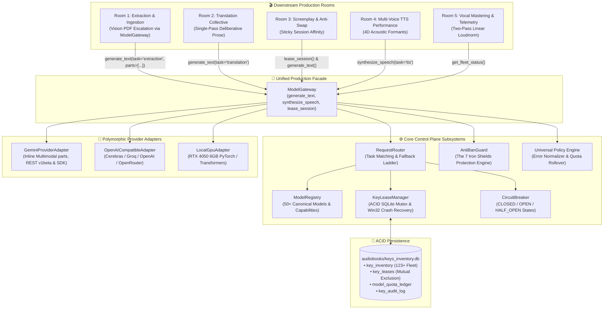

# 🏛️ Architecture: Audiobook Studio (Plugin & Pure Vocals-Only Engine v5.2)

## Executive Overview

**Audiobook Studio (Vocals-Only Studio Engine v5.2)** is an autonomous, studio-grade audiobook production framework and Google Antigravity Plugin engineered specifically for **crystal-clear, multi-voice character acting and pristine vocal narration** modeled after the benchmark standards of **Audible Studios**.

> [!IMPORTANT]
> **Active Production Engine: Pure Vocals-Only**:
> Background music (BGM), sound effects (SFX), 5-track stem mixdowns, and Archive.org sound bank harvesting are **permanently decoupled and archived** in `archive/cinematic_audio/`.
> The engine is 100% focused on Audible-standard vocal clarity, multi-character acting, dialogue nuance, and broadcast-grade vocal mastering.

---

## 🏗️ High-Level 5-Room Vocals-Only Blueprint

```mermaid
flowchart TD
    subgraph Room1["🌍 Room 1: Pre-Production Intelligence"]
        RawBook["Raw Book (PDF / EPUB / TXT)"] --> DeepSearch["Novel DeepSearch Engine (Factual Grounding)"]
        DeepSearch --> BookDNA["Book DNA Agent (Literary Tradition, Era & Dialect)"]
        BookDNA --> Personae["Dramatis Personae & Phonetic Lexicon (cast_lock.json)"]
    end

    subgraph Room2["🧠 Room 2: Sense-for-Sense Translation Collective"]
        Personae --> Collective["4-Agent Translation Collective<br/>• LiteraryDraftTranslator (70/30 Canon Sacredness)<br/>• HindustaniCadenceSpecialist (Spoken Flow & Pauses)<br/>• SubtextAndIdiomDramaturge (Earthy Desi Grit & 19-to-21)<br/>• TranslationQualityCritic (Anti-Omission & Terminology)"]
        Collective --> DualRule["Dual-Rule Invariant ('Nothing Above Source')<br/>Classic Reverent Pathos vs Raw Unrated Realism"]
    end

    subgraph Room3["🎭 Room 3: Screenplay & Forensic Attribution"]
        DualRule --> Screenplay["Sliding-Window Screenplay Dramaturgy"]
        Screenplay --> Auditor["DialogueAttributionAuditor (Anti-Swap QA)<br/>0% Speaker Flips & Quote Disentanglement"]
        Auditor --> Blocking["Physical Blocking & Spatial Headroom"]
    end

    subgraph Room4["🎙️ Room 4: 4D Formants & Voice Performance"]
        Blocking --> Caster["Character Caster (4D Acoustic Formants)<br/>Pitch Δ, Tempo, Bass Boost & Parametric EQ Profiles"]
        Caster --> TTS["Gemini Flash TTS Key Pool (120+ Active Keys)<br/>Prosodic Acting, Speech Tags & Breath Marks"]
        TTS --> Critic["TakeAuditionCritic (Climax Scene Take Selection)"]
        Critic --> Editorial["Dialogue Editorial Layer (DE-01 - DE-07)<br/>Endpoint Snapping, Hann Micro-Fades & Turn Latency"]
    end

    subgraph Room5["🎛️ Room 5: Broadcast Vocal Mastering & Packaging"]
        Editorial --> VocalMaster["Studio Vocal Mastering Engine<br/>SOXR 48kHz / 24-bit + Dual-Pass Loudnorm EBU R128 (-19 LUFS)"]
        VocalMaster --> Packager["FFMETADATA1 Chapter Generator & AAC Packager"]
        Packager --> Deliverable["Deliverable M4B Audiobook (Chapter Markers & Cover Art)"]
    end

    Room1 --> Room2
    Room2 --> Room3
    Room3 --> Room4
    Room4 --> Room5
```

---

## 🚪 Deep-Dive: The 5 Production Rooms

### Room 1: Pre-Production World & Lore Ingestion Studio
*Modules: `audiobook_factory/preproduction/` (`novel_deepsearch.py`, `book_dna_agent.py`, `dramatis_personae_agent.py`, `phonetic_lexicon_dramaturge.py`)*

1. **Novel DeepSearch Grounding**: Multi-angle factual dossier compilation (`NovelDeepSearchEngine`, `DeepSearchNovelDossier`) executing grounded web analysis to build an immutable canonical dossier before production runs, eliminating hallucinations.
2. **Universal Book DNA Profiling**: Analyzes literary tradition, source fidelity tier (`CLASSIC_REVERENT` vs `RAW_UNRATED`), regional dialect cadence, and profanity policy without hardcoded titles or era biases.
3. **Dramatis Personae & Phonetic Lexicon**: Extracts novel characters, sociolect traits, vocal weight, and phonetic Devanagari transliterations into `book_bible.json` and `cast_lock.json`.

### Room 2: Sense-for-Sense Translation Collective
*Modules: `audiobook_factory/translation/` & `audiobook_factory/translation/agents/`*

1. **4-Agent Collective Architecture**:
   - `LiteraryDraftTranslator`: Generates sense-for-sense dramatic prose maintaining 70% canon sacredness.
   - `HindustaniCadenceSpecialist`: Tunes spoken actor pauses (`—`, `...`, `,`) and honorific status transitions (`TU <-> MAAI-BAAP`).
   - `SubtextAndIdiomDramaturge`: Crafts authentic Hindustani metaphors and 19-to-21 unrated amplification for gritty fiction.
   - `TranslationQualityCritic`: Audits anti-omission parity and verifies BookBible terminology.
2. **Dual-Rule Invariant ("Nothing Above Source")**:
   - *Classical Literature*: Dignified authorial voice, emotional pathos, and sacred regional cadences.
   - *Raw Unrated Fiction*: Unapologetic preservation of raw street curses, visceral combat gore, and unvarnished somatic intimacy.

### Room 3: Screenplay Dramaturgy & Forensic Attribution
*Modules: `audiobook_factory/script/` & `audiobook_factory/script/agents/`*

1. **Sliding-Window Screenplay Dramaturgy**: Parses chapters into 500-word beat-aligned micro-chunks with 5-layer context stack, attributing dialogue turns, actioning verbs, and dramatic delivery styles.
2. **Dialogue Attribution Auditor**: Dedicated QA agent preventing $A \leftrightarrow B$ speaker turn inversions, quote misattributions to Narrator, and speech tag leakage (`"उसने कहा"`).
3. **Physical Blocking & Staging**: Encodes character blocking (`sitting`, `standing`, `leaning_close`, `retreating`) and stereo azimuth panning.

### Room 4: 4D Formants & Voice Performance Realization
*Modules: `audiobook_factory/character_caster.py`, `audiobook_factory/tts/`, `audiobook_factory/performance/take_critic.py`*

1. **4D Acoustic Formant Modulation**: Pitch delta ($\pm 4-12\%$), tempo scaling, bass boost, and parametric EQ curves (`equalizer=f=...`) dynamically applied via FFmpeg DSP to prevent vocal convergence when multiple characters share base voices.
2. **Formant-Sensitive Hash Caching**: Filename hashing incorporates the active EQ formant profile for deterministic cache invalidation.
3. **120+ Key Gemini Flash TTS Pool**: Concurrent token-bucket rate limiting with anti-bot jitter and permanent `BLOCK_NONE` safety settings.
4. **TakeAuditionCritic**: Judicial multi-take evaluation on climactic scenes.

### Room 5: Dialogue Editorial & Broadcast Vocal Mastering
*Modules: `audiobook_factory/dialogue_editing/`, `audiobook_factory/mastering.py`, `audiobook_factory/packager.py`*

1. **Dialogue Editorial Layer (DE-01 - DE-07)**: Endpoint zero-crossing snapping (-52 dBFS speech floor), Hann micro-fades (12ms pre-speech, 18ms post-speech), and dramatic turn latency.
2. **Broadcast EBU R128 Vocal Master**: Standardized `-19.0 LUFS` ($\pm 0.5$ LU) integrated loudness and `-1.5 dBTP` true-peak ceiling at 48kHz / 24-bit.
3. **Chaptered M4B Container**: Streamlined packaging into `.m4b` container with FFMETADATA1 chapter markers, TOC navigation, and embedded high-resolution cover artwork.

---

## 🎛️ Pillar 3: Model & Keys Manager Control Plane (Option C Architecture)

The **Model & Keys Manager Control Plane** ([`audiobook_factory.core.models`](file:///c:/Users/Suraj/Documents/antigravity/optimistic-kepler/audiobook_factory/core/models/)) implements **Option C: Shared Core with Specialized Modules + Unified Gateway Facade**. It eliminates direct API key handling, quota race conditions, and Google Cloud edge mass-bans across all 5 production rooms.

---

### The 5 Core Modules

#### 1. [`KeyLeaseManager`](file:///c:/Users/Suraj/Documents/antigravity/optimistic-kepler/audiobook_factory/core/models/lease_manager.py) (ACID Inventory & Atomic Leases)
- **ACID SQLite Inventory**: Manages API key inventory (123+ active healthy Gemini keys verified on `main`), lease reservations, per-model daily quota ledgers, and tamper-evident audit logs via atomic `BEGIN IMMEDIATE` transactions in SQLite (`audiobooks/keys_inventory.db`).
- **0% Concurrent Double-Leasing**: Enforces strict mutual exclusion (`Concurrency = 1` per free API key). A key can only be leased to a single active worker thread or process at any instant.
- **Autonomous Dead PID Crash Recovery**: Uses a dual liveness sweep. In addition to rolling lease TTL (default 60s), it probes the operating system process table via [`is_pid_alive`](file:///c:/Users/Suraj/Documents/antigravity/optimistic-kepler/audiobook_factory/core/models/lease_manager.py#L64):
  - On Windows 11, leverages Win32 `ctypes.windll.kernel32.OpenProcess(SYNCHRONIZE, False, pid)` to test process existence and immediately reclaims orphaned leases upon worker crashes.
  - On POSIX platforms, falls back to `os.kill(pid, 0)`.
- **One User = One Active Key per Workload**: Strict per-user quota enforcement ([`CallerIdentity`](file:///c:/Users/Suraj/Documents/antigravity/optimistic-kepler/audiobook_factory/core/models/lease_manager.py#L77)) prevents single-user resource monopolization across text and TTS workloads.
- **Zero-Secret Public Aliases**: Plaintext keys are never logged or exposed in telemetry. Keys are identified via deterministic salted public aliases (`key_a8f2`) and SHA-256 hashes.
- **Dual Timezone Quota Rollovers**: Automatically handles midnight quota resets according to provider policies: Midnight US Pacific Time (`America/Los_Angeles`) for Google AI Studio quotas, and UTC Midnight for other providers.
- **Transparent Key Pool Synchronization**: [`PersistentKeyPool`](file:///c:/Users/Suraj/Documents/antigravity/optimistic-kepler/audiobook_factory/key_manager.py#L664) transparently synchronizes with `KeyLeaseManager` across `lease_key()`, `record_success()`, `mark_daily_quota_exhausted()`, and `mark_temporary_backoff()`.

#### 2. [`AntiBanGuard`](file:///c:/Users/Suraj/Documents/antigravity/optimistic-kepler/audiobook_factory/core/models/anti_ban_guard.py) (The 7 Iron Shields)
Protects large pools of free API keys (120+ keys) against edge mass-bans and bot-detection heuristics:
- **Shield 1: Strict Request Mutual Exclusion**: Guarantees zero overlapping requests per key via atomic leasing in `KeyLeaseManager`.
- **Shield 2: Session Affinity Sticky Binding** ([`SessionAffinityTracker`](file:///c:/Users/Suraj/Documents/antigravity/optimistic-kepler/audiobook_factory/core/models/anti_ban_guard.py#L320)): Binds a production session or scene to the same key for 8–15 sequential segments, eliminating suspicious key-hopping patterns at provider edge routers.
- **Shield 3: Anti-Correlation Key-Switch Pause**: Enforces a randomized 18.0s – 32.0s delay whenever a worker must switch keys on the same IP address, breaking TCP/TLS and request-frequency correlation across distinct accounts.
- **Shield 4: Content-Aware Human Cadence & Director Breaks** ([`HumanCadenceController`](file:///c:/Users/Suraj/Documents/antigravity/optimistic-kepler/audiobook_factory/core/models/anti_ban_guard.py#L80)): Shapes inter-request latency modeled on a human director review workflow:
  $$\Delta t_{\text{wait}} = t_{\text{read}}(\text{words}) + t_{\text{review}}(\text{audio}) + t_{\text{jitter}} + t_{\text{director\_break}}$$
  Applies log-normal human pause distributions (1.5s – 7.0s) and injects 15–30s director breaks every 14 segments.
- **Shield 5: Conservative 75% Rate Limiting** ([`TokenBucketRateLimiter`](file:///c:/Users/Suraj/Documents/antigravity/optimistic-kepler/audiobook_factory/core/models/anti_ban_guard.py#L179)): Clamps requests to a conservative 11.0 RPM per key (73% of Google's 15 RPM free ceiling) with an absolute minimum burst separation of 3.5 seconds.
- **Shield 6: Official Stealth SDK Headers** (`get_stealth_sdk_headers`): Injects stealth HTTP headers identical to official provider SDKs (`x-goog-api-client`, `google-genai-sdk-python/0.8.3` with Python and platform tags), eliminating custom bot user agents.
- **Shield 7: Emergency Global Tripwire** ([`EmergencyTripwire`](file:///c:/Users/Suraj/Documents/antigravity/optimistic-kepler/audiobook_factory/core/models/anti_ban_guard.py#L248)): Monitors fleet health across all keys. If 5 consecutive 429 (Resource Exhausted) or 503 (Unavailable) errors occur within a 60-second sliding window, activates emergency pool quarantine for 45.0s to halt requests before accounts are suspended.

#### 3. [`ModelRegistry`](file:///c:/Users/Suraj/Documents/antigravity/optimistic-kepler/audiobook_factory/core/models/registry.py) (Canonical Model Catalog)
- **Comprehensive Registry (50+ Models)**: Canonical catalog spanning Google Gemini (`gemini-3.8-flash`, `gemini-3.7-flash`, `gemini-3.6-flash`, `gemini-2.5-flash`, `gemini-2.5-pro`, `gemini-3.8-flash-tts`), Cerebras (Llama 3.3 70B, Llama 3.1 8B), Groq, OpenAI, Anthropic, and Local GPU (RTX 4050 6GB).
- **Capability Profiles** ([`ModelCapability`](file:///c:/Users/Suraj/Documents/antigravity/optimistic-kepler/audiobook_factory/core/models/registry.py#L48)): Explicit context windows (up to 1M tokens), max output limits, rate ceilings (RPM, TPM, RPD), thinking budget support, structured output flags, and timezone reset schedules.
- **Quality Tiers** ([`ModelTier`](file:///c:/Users/Suraj/Documents/antigravity/optimistic-kepler/audiobook_factory/core/models/registry.py#L20)): Hierarchical taxonomy categorizing models into `TIER_1_FLAGSHIP`, `TIER_2_BALANCED`, `TIER_3_UTILITY`, `TIER_AUDIO`, and `TIER_LOCAL`.
- **Task-Based Resolution**: Maps pipeline requirements (`translation`, `screenplay`, `dramaturgy`, `extraction`, `tts`) to optimal verified models.

#### 4. [`RequestRouter`](file:///c:/Users/Suraj/Documents/antigravity/optimistic-kepler/audiobook_factory/core/models/router.py) (Intelligent Router & Fallback)
- **Capability Matching**: Resolves requests into concrete [`ExecutionPlan`](file:///c:/Users/Suraj/Documents/antigravity/optimistic-kepler/audiobook_factory/core/models/router.py#L40) blueprints containing model capabilities, leased keys, and matched provider adapters.
- **Circuit Breaker Integration** ([`CircuitBreaker`](file:///c:/Users/Suraj/Documents/antigravity/optimistic-kepler/audiobook_factory/core/models/policy_engine.py#L242)): Maintains per-(provider, model) circuit breakers with `CLOSED` $\rightarrow$ `OPEN` $\rightarrow$ `HALF_OPEN` state transitions, automatically bypassing models undergoing provider outages.
- **Dynamic Fallback Ladder**: Automatically escalates to secondary models within the eligible tier if primary candidate models encounter outages or key exhaustion.

#### 5. [`ModelGateway`](file:///c:/Users/Suraj/Documents/antigravity/optimistic-kepler/audiobook_factory/core/models/gateway.py) (Unified Production Facade)
- **Single Public Entry Point**: Exposes high-level operations: `generate_text()`, `synthesize_speech()`, `lease_session()`, and `get_fleet_status()`.
- **Multimodal Payload Routing**: [`GeminiProviderAdapter._build_gemini_payload()`](file:///c:/Users/Suraj/Documents/antigravity/optimistic-kepler/audiobook_factory/core/models/adapters/gemini.py#L57) supports inline base64 multimodal `parts` kwargs, allowing Room 1 to dispatch single-page PDF memory buffers for OCR transcription directly through `ModelGateway.generate_text(task="extraction", parts=parts)`.
- **Automatic Failover & Retry Loop**: Intercepts HTTP errors, classifies root causes via [`NormalizedApiError`](file:///c:/Users/Suraj/Documents/antigravity/optimistic-kepler/audiobook_factory/core/models/policy_engine.py#L43), marks exhausted keys/models in SQLite, applies anti-correlation pauses, and retries seamlessly on alternative keys.
- **Guaranteed Lease Release**: All operations employ `try ... finally` release blocks, ensuring 0% lease leaks under normal completion, rate limit backoff, or unexpected exceptions.

---

### Downstream Pipeline Room Integration (Zero Boundary Leakage)

All 5 production rooms interface strictly with [`ModelGateway`](file:///c:/Users/Suraj/Documents/antigravity/optimistic-kepler/audiobook_factory/core/models/gateway.py), maintaining clean boundary isolation:

1. **Room 1 (Pre-Production & Extraction)**:
   - Suspicious PDF pages route through [`GeminiVisionPDFExtractor.escalate_page()`](file:///c:/Users/Suraj/Documents/antigravity/optimistic-kepler/audiobook_factory/extraction/parsers/pdf/vision_extractor.py#L35) $\rightarrow$ `gateway.generate_text(task="extraction", parts=parts, session_id=f"pdf_page_{page_num}")`.
   - Employs atomic key leasing, session affinity, stealth SDK headers, and preamble stripping.
   - Backward-compatible legacy imports re-exported via [`audiobook_factory/pdf/vision_extractor.py`](file:///c:/Users/Suraj/Documents/antigravity/optimistic-kepler/audiobook_factory/pdf/vision_extractor.py).
2. **Room 2 (Translation Collective)**:
   - Dispatches translation prompts through `gateway.generate_text(task="translation", min_tier=ModelTier.TIER_1_FLAGSHIP)`.
   - The 4 translation agents (`LiteraryDraftTranslator`, `HindustaniCadenceSpecialist`, etc.) receive raw text output without managing rate-limiting delays or rotating key pools.
3. **Room 3 (Screenplay & Anti-Swap Attribution)**:
   - Encloses scene chunking within `with gateway.lease_session(session_id=scene_id):`.
   - Maintains sticky key affinity across 8–15 continuous dialogue turns, avoiding edge ban heuristics while analyzing speaker attribution.
4. **Room 4 (Multi-Voice TTS Performance)**:
   - Dispatches speech generation through `gateway.synthesize_speech(text=..., voice_name=..., task="tts")`.
   - The gateway leases keys explicitly for the `gemini-3.8-flash-tts` audio model, enforces the strict 10 RPD daily quota ceilings, and transparently rotates to fresh keys upon exhaustion.
5. **Room 5 (Mastering & Verification)**:
   - Queries `gateway.get_fleet_status()` for diagnostic reporting and quota telemetry without opening direct connections to `keys_inventory.db`.

---

## 📦 Decoupled & Archived Subsystems

The legacy 5-track cinematic audio engine (dynamic BGM scoring, SQLite FTS5 sound bank harvesting, and multitrack stem mixdowns) has been safely decoupled and archived in `archive/cinematic_audio/`.
The active production pipeline on `prestable-v4.0-baseline` is **100% focused on pure vocal excellence**.
