# 🏛️ Architecture: Audiobook Studio (Plugin & Pure Vocals-Only Engine v5.2)

## Executive Overview

**Audiobook Studio (Vocals-Only Studio Engine v5.2)** is an autonomous, studio-grade audiobook production framework and Google Antigravity Plugin engineered specifically for **crystal-clear, multi-voice character acting and pristine vocal narration** modeled after the benchmark standards of **Audible Studios**.

> [!IMPORTANT]
> **Active Production Engine: Pure Vocals-Only**:
> Background music (BGM), sound effects (SFX), 5-track stem mixdowns, and Archive.org sound bank harvesting are **permanently decoupled and archived** in `archive/cinematic_audio/`.
> The engine is 100% focused on Audible-standard vocal clarity, multi-character acting, dialogue nuance, and broadcast-grade vocal mastering.

---

## 🏗️ High-Level 5-Room Vocals-Only Blueprint

```mermaid
flowchart TD
    subgraph Room1["🌍 Room 1: 2-System Pre-Production Architecture"]
        direction TB
        RawBook["Raw Book (PDF / EPUB / TXT)"] --> S1["System 1: Novel Researcher Engine<br/><i>(Stateless Compute & Zero Disk I/O)</i><br/>• LexicalCorpusScanner (0-Token Full Sweep)<br/>• NovelDeepSearchEngine (Bidirectional Grounding)<br/>• BookDNAAgent + DramatisPersonaeAgent<br/>• VocalAcousticDirector (Room Impulse DSP)<br/>• PhoneticLexiconDramaturge (70/30 Devanagari)"]
        S1 -->|"Immutable Pydantic DTOs"| S2["System 2: Novel Metadata & State Maintainer<br/><i>(Canonical State Store & Atomic Persistence)</i><br/>• audiobook_factory/metadata/ (BookBible & NovelEntity)<br/>• NovelStateMaintainer (NR-GATE-06 Two-Phase Commit)<br/>• _STATE_LOCK (Thread Concurrency Protection)<br/>• Dynamic Character Locking (NR-GATE-03 Clamp [0.70, 1.30])"]
        S2 --> MasterFiles[("Locked Master State<br/>book_dna.json | book_bible.json | cast_lock.json<br/>vocal_spaces.json | voice_registry.json")]
    end

    subgraph Room2["🧠 Room 2: Sense-for-Sense Translation Collective"]
        MasterFiles --> Collective["4-Agent Translation Collective<br/>• LiteraryDraftTranslator (70/30 Canon Sacredness)<br/>• HindustaniCadenceSpecialist (Spoken Flow & Pauses)<br/>• SubtextAndIdiomDramaturge (Earthy Desi Grit & 19-to-21)<br/>• TranslationQualityCritic (Anti-Omission & Terminology)"]
        Collective --> DualRule["Dual-Rule Invariant ('Nothing Above Source')<br/>Classic Reverent Pathos vs Raw Unrated Realism"]
    end

    subgraph Room3["🎭 Room 3: Screenplay & Forensic Attribution"]
        DualRule --> Screenplay["Sliding-Window Screenplay Dramaturgy"]
        Screenplay --> Auditor["DialogueAttributionAuditor (Anti-Swap QA)<br/>0% Speaker Flips & Quote Disentanglement"]
        Auditor --> Blocking["Physical Blocking & Spatial Headroom"]
    end

    subgraph Room4["🎙️ Room 4: 4D Formants & Voice Performance"]
        Blocking --> Caster["Character Caster (4D Acoustic Formants)<br/>Pitch Δ, Tempo, Bass Boost & Parametric EQ Profiles"]
        Caster --> TTS["Gemini Flash TTS Key Pool (120+ Active Keys)<br/>Prosodic Acting, Speech Tags & Breath Marks"]
        TTS --> Critic["TakeAuditionCritic (Climax Scene Take Selection)"]
        Critic --> Editorial["Dialogue Editorial Layer (DE-01 - DE-07)<br/>Endpoint Snapping, Hann Micro-Fades & Turn Latency"]
    end

    subgraph Room5["🎛️ Room 5: Broadcast Vocal Mastering & Packaging"]
        Editorial --> VocalMaster["Studio Vocal Mastering Engine<br/>SOXR 48kHz / 24-bit + Dual-Pass Loudnorm EBU R128 (-19 LUFS)"]
        VocalMaster --> Packager["FFMETADATA1 Chapter Generator & AAC Packager"]
        Packager --> Deliverable["Deliverable M4B Audiobook (Chapter Markers & Cover Art)"]
    end

    Room1 --> Room2
    Room2 --> Room3
    Room3 --> Room4
    Room4 --> Room5
```

---

## 🚪 Deep-Dive: The 5 Production Rooms

### Room 1: Pre-Production World, Lore & Canonical State Studio
*Subsystems: System 1 Researcher Engine ([`audiobook_factory/preproduction/`](file:///data/data/com.termux/files/home/audiobook-studio/audiobook_factory/preproduction/)) & System 2 Metadata Maintainer ([`audiobook_factory/metadata/`](file:///data/data/com.termux/files/home/audiobook-studio/audiobook_factory/metadata/))*

Room 1 operates under a strict **2-System Decoupled Architecture**:
1. **System 1: Novel Researcher Engine (Pure Stateless Compute, 0 Disk I/O)**:
   - **Deterministic 0-Token Lexical Scanner** ([`LexicalCorpusScanner`](file:///data/data/com.termux/files/home/audiobook-studio/audiobook_factory/preproduction/lexical_scanner.py)): Sweeps entire novel text in under $50\text{ms}$ with UTF-8 replacement defense, indexing word counts, proper nouns, dialogue attribution frequencies, and speaker introduction quotes into [`LexicalCorpusIndex`](file:///data/data/com.termux/files/home/audiobook-studio/audiobook_factory/preproduction/lexical_scanner.py).
   - **Bidirectional Web Grounding** ([`NovelDeepSearchEngine`](file:///data/data/com.termux/files/home/audiobook-studio/audiobook_factory/preproduction/novel_deepsearch.py)): Leverages Google Search Grounding to assemble [`DeepSearchNovelDossier`](file:///data/data/com.termux/files/home/audiobook-studio/audiobook_factory/preproduction/novel_deepsearch.py). Enforces **NR-GATE-02**: entities from search results must possess $\ge 2$ mentions in the local text corpus to be granted canonical status.
   - **Universal Literary DNA** ([`BookDNAAgent`](file:///data/data/com.termux/files/home/audiobook-studio/audiobook_factory/preproduction/book_dna_agent.py)): Dynamically resolves literary tradition, source fidelity tier (`CLASSIC_REVERENT` vs `RAW_UNRATED`), regional cadence, and profanity policy without hardcoded novel titles or author biases.
   - **Dramatis Personae & Sociolects** ([`DramatisPersonaeAgent`](file:///data/data/com.termux/files/home/audiobook-studio/audiobook_factory/preproduction/dramatis_personae_agent.py)): Identifies character taxonomies, social hierarchy, vocal weight, and baseline honorific pronouns (`aap`, `tum`, `tu`).
   - **Vocal Acoustic Director** ([`VocalAcousticDirector`](file:///data/data/com.termux/files/home/audiobook-studio/audiobook_factory/preproduction/vocal_acoustic_director.py)): Designs pure vocal room acoustics (reverb wet mix, decay time, predelay) into [`VocalSpacesManifest`](file:///data/data/com.termux/files/home/audiobook-studio/audiobook_factory/preproduction/vocal_acoustic_director.py) with zero BGM/SFX artifacts (**NR-GATE-04**), with hardened pitch ratio protection against `ZeroDivisionError`.
   - **Phonetic Lexicon Dramaturge** ([`PhoneticLexiconDramaturge`](file:///data/data/com.termux/files/home/audiobook-studio/audiobook_factory/preproduction/phonetic_lexicon_dramaturge.py)): Maps names, heraldic monikers, and world lore into 70/30 Devanagari phonetics.
   - **Stateless Orchestrator** ([`PreProductionSupervisor`](file:///data/data/com.termux/files/home/audiobook-studio/audiobook_factory/preproduction/preproduction_supervisor.py)): Aggregates DTOs without direct disk writing, delegating canonical persistence to System 2.

2. **System 2: Novel Metadata & State Maintainer (Canonical Persistence & Thread Safety)**:
   - **Canonical Lore & Entity Registry** ([`BookBible`](file:///data/data/com.termux/files/home/audiobook-studio/audiobook_factory/metadata/book_bible.py) & [`NovelEntity`](file:///data/data/com.termux/files/home/audiobook-studio/audiobook_factory/metadata/book_bible.py)): Single source of truth recording character profiles, 4D acoustic vectors, and forensic [`EpistemicProvenance`](file:///data/data/com.termux/files/home/audiobook-studio/audiobook_factory/metadata/book_bible.py) (`CORPUS_EXTRACTED`, `WEB_VERIFIED`, `INFERRED_DERIVED`). Re-exported via backward-compatible facade at [`audiobook_factory/translation/book_bible.py`](file:///data/data/com.termux/files/home/audiobook-studio/audiobook_factory/translation/book_bible.py).
   - **NR-GATE-06 Two-Phase Atomic Multi-File Staging** ([`NovelStateMaintainer`](file:///data/data/com.termux/files/home/audiobook-studio/audiobook_factory/metadata/state_maintainer.py)): Atomically commits all 7 master state files (`book_dna.json`, `book_bible.json`, `vocal_spaces.json`, `sonic_bible.json`, `character_roster.json`, `voice_registry.json`, `cast_lock.json` + `translation/glossary.json`) by staging to `.tmp.{staging_id}`, snapshoting existing files to `.bak.{staging_id}`, atomically swapping via `os.replace`, and performing automated rollback if any I/O failure occurs.
   - **Thread-Safe Mid-Novel Casting** (`discover_and_lock_character`): Protected by `_STATE_LOCK = threading.RLock()`, enabling downstream translation and screenplay threads to dynamically register and cast minor characters without race conditions.
   - **NR-GATE-03 Pitch Clamping `[0.70, 1.30]`**: Step-stepping algorithm guarantees $\ge 4.0\%$ acoustic separation while bounding pitch between `0.70` and `1.30` with secondary speed micro-tuning to prevent robotic distortion across large ensembles.

### Room 2: Sense-for-Sense Translation Collective
*Modules: `audiobook_factory/translation/` & `audiobook_factory/translation/agents/`*

1. **4-Agent Collective Architecture**:
   - `LiteraryDraftTranslator`: Generates sense-for-sense dramatic prose maintaining 70% canon sacredness.
   - `HindustaniCadenceSpecialist`: Tunes spoken actor pauses (`—`, `...`, `,`) and honorific status transitions (`TU <-> MAAI-BAAP`).
   - `SubtextAndIdiomDramaturge`: Crafts authentic Hindustani metaphors and 19-to-21 unrated amplification for gritty fiction.
   - `TranslationQualityCritic`: Audits anti-omission parity and verifies BookBible terminology.
2. **Dual-Rule Invariant ("Nothing Above Source")**:
   - *Classical Literature*: Dignified authorial voice, emotional pathos, and sacred regional cadences.
   - *Raw Unrated Fiction*: Unapologetic preservation of raw street curses, visceral combat gore, and unvarnished somatic intimacy.

### Room 3: Screenplay Dramaturgy & Forensic Attribution
*Modules: `audiobook_factory/script/` & `audiobook_factory/script/agents/`*

1. **Sliding-Window Screenplay Dramaturgy**: Parses chapters into 500-word beat-aligned micro-chunks with 5-layer context stack, attributing dialogue turns, actioning verbs, and dramatic delivery styles.
2. **Dialogue Attribution Auditor**: Dedicated QA agent preventing $A \leftrightarrow B$ speaker turn inversions, quote misattributions to Narrator, and speech tag leakage (`"उसने कहा"`).
3. **Physical Blocking & Staging**: Encodes character blocking (`sitting`, `standing`, `leaning_close`, `retreating`) and stereo azimuth panning.

### Room 4: 4D Formants & Voice Performance Realization
*Modules: `audiobook_factory/character_caster.py`, `audiobook_factory/tts/`, `audiobook_factory/performance/take_critic.py`*

1. **4D Acoustic Formant Modulation**: Pitch delta ($\pm 4-12\%$), tempo scaling, bass boost, and parametric EQ curves (`equalizer=f=...`) dynamically applied via FFmpeg DSP to prevent vocal convergence when multiple characters share base voices.
2. **Formant-Sensitive Hash Caching**: Filename hashing incorporates the active EQ formant profile for deterministic cache invalidation.
3. **120+ Key Gemini Flash TTS Pool**: Concurrent token-bucket rate limiting with anti-bot jitter and permanent `BLOCK_NONE` safety settings.
4. **TakeAuditionCritic**: Judicial multi-take evaluation on climactic scenes.

### Room 5: Dialogue Editorial & Broadcast Vocal Mastering
*Modules: `audiobook_factory/dialogue_editing/`, `audiobook_factory/mastering.py`, `audiobook_factory/packager.py`*

1. **Dialogue Editorial Layer (DE-01 - DE-07)**: Endpoint zero-crossing snapping (-52 dBFS speech floor), Hann micro-fades (12ms pre-speech, 18ms post-speech), and dramatic turn latency.
2. **Broadcast EBU R128 Vocal Master**: Standardized `-19.0 LUFS` ($\pm 0.5$ LU) integrated loudness and `-1.5 dBTP` true-peak ceiling at 48kHz / 24-bit.
3. **Chaptered M4B Container**: Streamlined packaging into `.m4b` container with FFMETADATA1 chapter markers, TOC navigation, and embedded high-resolution cover artwork.

---

## 📦 Decoupled & Archived Subsystems

The legacy 5-track cinematic audio engine (dynamic BGM scoring, SQLite FTS5 sound bank harvesting, and multitrack stem mixdowns) has been safely decoupled and archived in `archive/cinematic_audio/`.
The active production pipeline on `prestable-v4.0-baseline` is **100% focused on pure vocal excellence**.
