# 🏛️ Architecture: Audiobook Studio (Plugin & Pure Vocals-Only Engine v5.2)

## Executive Overview

**Audiobook Studio (Vocals-Only Studio Engine v5.2)** is an autonomous, studio-grade audiobook production framework and Google Antigravity Plugin engineered specifically for **crystal-clear, multi-voice character acting and pristine vocal narration** modeled after the benchmark standards of **Audible Studios**.

> [!IMPORTANT]
> **Active Production Engine: Pure Vocals-Only**:
> Background music (BGM), sound effects (SFX), 5-track stem mixdowns, and Archive.org sound bank harvesting are **permanently decoupled and archived** in `archive/cinematic_audio/`.
> The engine is 100% focused on Audible-standard vocal clarity, multi-character acting, dialogue nuance, and broadcast-grade vocal mastering.

---

## 🏗️ High-Level 5-Room Vocals-Only Blueprint

```mermaid
flowchart TD
    subgraph Room1["🌍 Room 1: Pre-Production Intelligence"]
        RawBook["Raw Book (PDF / EPUB / TXT)"] --> DeepSearch["Novel DeepSearch Engine (Factual Grounding)"]
        DeepSearch --> BookDNA["Book DNA Agent (Literary Tradition, Era & Dialect)"]
        BookDNA --> Personae["Dramatis Personae & Phonetic Lexicon (cast_lock.json)"]
    end

    subgraph Room2["🧠 Room 2: Sense-for-Sense Translation Collective"]
        Personae --> Collective["4-Agent Translation Collective<br/>• LiteraryDraftTranslator (70/30 Canon Sacredness)<br/>• HindustaniCadenceSpecialist (Spoken Flow & Pauses)<br/>• SubtextAndIdiomDramaturge (Earthy Desi Grit & 19-to-21)<br/>• TranslationQualityCritic (Anti-Omission & Terminology)"]
        Collective --> DualRule["Dual-Rule Invariant ('Nothing Above Source')<br/>Classic Reverent Pathos vs Raw Unrated Realism"]
    end

    subgraph Room3["🎭 Room 3: Screenplay & Forensic Attribution"]
        DualRule --> Screenplay["Sliding-Window Screenplay Dramaturgy"]
        Screenplay --> Auditor["DialogueAttributionAuditor (Anti-Swap QA)<br/>0% Speaker Flips & Quote Disentanglement"]
        Auditor --> Blocking["Physical Blocking & Spatial Headroom"]
    end

    subgraph Room4["🎙️ Room 4: TTS Platform Core (Dialogue Stem Realization)"]
        Blocking --> Facades["Specialized Client Facades (Option C)<br/>• GenericTTSClient (Single-Utterance / Audition)<br/>• LongFormTTSClient (Prose Stream & Checkpoints)<br/>• MultiCastStudioClient (Ensemble Screenplay)"]
        Facades --> CoreEng["Shared TTS Core & Model Adapters<br/>• UniversalInputGuard & 4-Tier Semantic Chunker<br/>• Gemini Flash TTS (120+ Key Pool, BLOCK_NONE)<br/>• Qwen3-TTS (HardwareVRAMGuard)"]
        CoreEng --> EditorialDSP["Editorial DSP & Quality Gate<br/>• Two-Tier Audio Gate (Math + Phonetic)<br/>• FormantSculptor (Headroom EQ & Soft Tanh)<br/>• EditorialDSPEngine (Hann Fades & Net Silence)"]
    end

    subgraph Room5["🎛️ Room 5: Broadcast Vocal Mastering & Packaging"]
        EditorialDSP --> StemHandoff["Dialogue Stem Handoff (stage='dialogue_stem')"]
        StemHandoff --> VocalMaster["Studio Vocal Mastering Engine (mastering.py)<br/>SOXR 48kHz / 24-bit + Dual-Pass Linear Loudnorm (-19 LUFS / -1.5 dBTP)"]
        VocalMaster --> Packager["FFMETADATA1 Chapter Generator & AAC Packager"]
        Packager --> Deliverable["Deliverable M4B Audiobook (Chapter Markers & Cover Art)"]
    end

    Room1 --> Room2
    Room2 --> Room3
    Room3 --> Room4
    Room4 --> Room5
```

---

## 🚪 Deep-Dive: The 5 Production Rooms

### Room 1: Pre-Production World & Lore Ingestion Studio
*Modules: `audiobook_factory/preproduction/` (`novel_deepsearch.py`, `book_dna_agent.py`, `dramatis_personae_agent.py`, `phonetic_lexicon_dramaturge.py`)*

1. **Novel DeepSearch Grounding**: Multi-angle factual dossier compilation (`NovelDeepSearchEngine`, `DeepSearchNovelDossier`) executing grounded web analysis to build an immutable canonical dossier before production runs, eliminating hallucinations.
2. **Universal Book DNA Profiling**: Analyzes literary tradition, source fidelity tier (`CLASSIC_REVERENT` vs `RAW_UNRATED`), regional dialect cadence, and profanity policy without hardcoded titles or era biases.
3. **Dramatis Personae & Phonetic Lexicon**: Extracts novel characters, sociolect traits, vocal weight, and phonetic Devanagari transliterations into `book_bible.json` and `cast_lock.json`.

### Room 2: Sense-for-Sense Translation Collective
*Modules: `audiobook_factory/translation/` & `audiobook_factory/translation/agents/`*

1. **4-Agent Collective Architecture**:
   - `LiteraryDraftTranslator`: Generates sense-for-sense dramatic prose maintaining 70% canon sacredness.
   - `HindustaniCadenceSpecialist`: Tunes spoken actor pauses (`—`, `...`, `,`) and honorific status transitions (`TU <-> MAAI-BAAP`).
   - `SubtextAndIdiomDramaturge`: Crafts authentic Hindustani metaphors and 19-to-21 unrated amplification for gritty fiction.
   - `TranslationQualityCritic`: Audits anti-omission parity and verifies BookBible terminology.
2. **Dual-Rule Invariant ("Nothing Above Source")**:
   - *Classical Literature*: Dignified authorial voice, emotional pathos, and sacred regional cadences.
   - *Raw Unrated Fiction*: Unapologetic preservation of raw street curses, visceral combat gore, and unvarnished somatic intimacy.

### Room 3: Screenplay Dramaturgy & Forensic Attribution
*Modules: `audiobook_factory/script/` & `audiobook_factory/script/agents/`*

1. **Sliding-Window Screenplay Dramaturgy**: Parses chapters into 500-word beat-aligned micro-chunks with 5-layer context stack, attributing dialogue turns, actioning verbs, and dramatic delivery styles.
2. **Dialogue Attribution Auditor**: Dedicated QA agent preventing $A \leftrightarrow B$ speaker turn inversions, quote misattributions to Narrator, and speech tag leakage (`"उसने कहा"`).
3. **Physical Blocking & Staging**: Encodes character blocking (`sitting`, `standing`, `leaning_close`, `retreating`) and stereo azimuth panning.

### Room 4: Unified TTS Platform Core & Dialogue Stem Realization
*Modules: [`audiobook_factory/tts/`](file:///c:/Users/Suraj/Documents/antigravity/optimistic-kepler/audiobook_factory/tts/), [`audiobook_factory/character_caster.py`](file:///c:/Users/Suraj/Documents/antigravity/optimistic-kepler/audiobook_factory/character_caster.py), [`docs/TTS_PLATFORM_CORE_SPECIFICATION.md`](file:///c:/Users/Suraj/Documents/antigravity/optimistic-kepler/docs/TTS_PLATFORM_CORE_SPECIFICATION.md)*

Room 4 implements the **Studio TTS Platform Core (Option C: Layered Shared Core with Specialized Pipeline Facades)**, 100% certified with **882/882 passing tests**. It permanently decouples disparate caller patterns into three specialized high-level facades backed by a shared orchestration engine:

1. **Option C Specialized Facade Decoupling**:
   - **`GenericTTSClient`**: Ad-hoc, low-latency ($<800\text{ms}$), single-utterance synthesis for CLI interactions, UI feedback, and voice auditions (`speak()`, `speak_to_bytes()`).
   - **`LongFormTTSClient`**: Continuous full-chapter and novel narrative streaming (`synthesize_prose()`, `synthesize_chapter()`). Integrates a 4-tier semantic chunker (Scene $\to$ Paragraph $\to$ Sentence $\to$ Clause) and checkpoint caching (`checkpoint_manifest.json`) to eliminate autoregressive rate drift and redundant API costs.
   - **`MultiCastStudioClient`**: Full multi-character ensemble audio drama production (`produce_screenplay()`). Manages `cast_lock.json` persistent voice assignments, Anime Seiyū child casting patterns, anti-swap attribution verification, TakeBank multi-take auditioning, and conversational turn latencies.

2. **The 4-Tier Stack Architecture**:
   - **Tier 1 (Specialized Facades)**: High-level entrypoints isolating caller semantics from synthesis internals.
   - **Tier 2 (Shared Core Orchestration)**: `UniversalInputGuard` (preserving sacred literary text while fully phonetizing Devanagari/Arabic numerals and currencies, and stripping stage brackets into `DeliveryIntent`), `SemanticProseChunker` (80–160 word boundaries, zero mid-word cuts), `TTSCoreOrchestrator`, and `TokenBucketRateLimiter` managing a 120+ active SQLite key pool with anti-bot jitter ($0.35\text{s}-0.85\text{s}$).
   - **Tier 3 (Pluggable Model Adapters)**: `GeminiTTSAdapter` (Google Cloud REST API with permanent `BLOCK_NONE` safety thresholds, stealth SDK headers, and direct 24kHz PCM unpacking) and `QwenTTSAdapter` (local Wafer-Scale / CosyVoice inference guarded by `HardwareVRAMGuard` semaphore locking), registered in `ModelAdapterRegistry`.
   - **Tier 4 (Editorial DSP & Quality Gate)**:
     - `TwoTierAudioQualityGate`: Tier 1 mathematical waveform probe (peak $\ge 1500$, $-52 \le \text{RMS} \le -6\text{ dBFS}$, $|DC| \le 0.05$, consecutive clips $\le 5$, dead air $\le 2.5\text{s}$) plus Tier 2 phonetic duration and token integrity bounds.
     - `EditorialDSPEngine`: Snaps endpoints via `ZeroCrossingAligner` (-52 dBFS speech floor), applies raised-cosine Hann micro-fades (`HannFadeProcessor`, 12ms in / 18ms out), and dynamically subtracts acoustic room tone decay via `NetSilenceProcessor` ($\text{Injected} = \max(20\text{ms}, \text{Target} - (\text{Tail}_A + \text{Head}_B))$).
     - `FormantSculptor`: Pure Python 2nd-order biquad peaking EQ filters with headroom pre-attenuation ($10^{-G_{\max}/20}$) and soft tanh knee peak limiting ($\le 32,760$) to eliminate vocal convergence when multiple characters share base neural voices.
     - `TakeBankManager`: Multi-take auditioning (`standard`, `restraint`, `vulnerable`, `exposed`) for high-stakes dramatic turns.

3. **Room 4 vs Room 5 Pipeline Boundary**:
   - **Room 4 Output Scope**: Room 4 strictly terminates with the rendered, edited dialogue stem (`stage="dialogue_stem"`). It guarantees pristine actor performance and zero double pauses, but **strictly refrains from global EBU R128 loudness compression**.
   - **Room 5 Hand-off**: Room 5 receives the uncompressed dialogue stem and executes global two-pass linear EBU R128 (-19.0 LUFS / -1.5 dBTP) broadcast mastering, SOXR 48kHz / 24-bit resampling, and chaptered `.m4b` container packaging.

### Room 5: Broadcast Vocal Mastering & M4B Packaging
*Modules: [`audiobook_factory/mastering.py`](file:///c:/Users/Suraj/Documents/antigravity/optimistic-kepler/audiobook_factory/mastering.py), [`audiobook_factory/packager.py`](file:///c:/Users/Suraj/Documents/antigravity/optimistic-kepler/audiobook_factory/packager.py)*

1. **Two-Pass Linear EBU R128 Loudnorm**: Ingests the Room 4 dialogue stem (`stage="dialogue_stem"`), measures loudness metrics ($I$, $TP$, $LRA$) with `-f null -`, and applies linear normalization to target **-19.0 LUFS** with a hard ceiling of **-1.5 dBTP**. Zero dynamic compression pumping or room-tone breathing.
2. **SOXR Kaiser Sinc Resampling**: Resamples pristine dialogue audio from 24kHz to broadcast studio standard 48kHz / 24-bit with triangular dither.
3. **Chaptered M4B Container Packaging**: Embeds FFMETADATA1 chapter markers, TOC navigation, and embedded high-resolution cover artwork into a distributable AAC-LC `.m4b` audiobook package.

---

## 📦 Decoupled & Archived Subsystems

The legacy 5-track cinematic audio engine (dynamic BGM scoring, SQLite FTS5 sound bank harvesting, and multitrack stem mixdowns) has been safely decoupled and archived in `archive/cinematic_audio/`.
The active production pipeline on `prestable-v4.0-baseline` is **100% focused on pure vocal excellence**.
