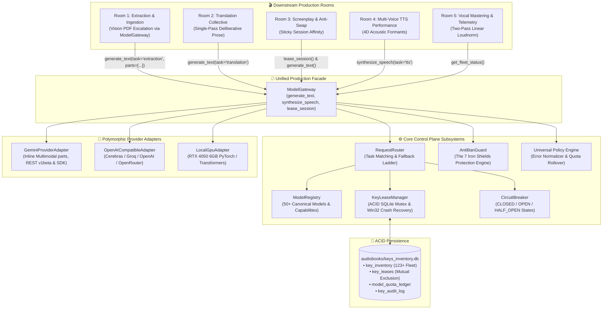

# 🏛️ Architecture: Audiobook Studio (Option C Pure Vocals-Only Engine v5.2)

## Executive Overview

**Audiobook Studio (Option C Pure Vocals-Only Engine v5.2)** is an autonomous, studio-grade vocal production framework and Google Antigravity Plugin engineered specifically for **broadcast-grade spoken audio across multiple deliverables**:
1. **Audible-Standard Multi-Cast Audiobooks**: Pristine verbatim prose preservation, em-dash dialogue framing, transparent measured narration (temperature 0.32), and two-pass linear EBU R128 mastering at **-19.0 LUFS** / **-1.5 dBTP**.
2. **Conversational 2-Host Narrative Podcasts**: High-retention audio-first shows featuring calibrated host dynamics (Sameer/Priya in Hindustani, Alex/Maya in English), organic breathability ($\le 22$ words per breath, 140ms pre-roll breath pauses), 5-part retention arcs, stereo spatial staging (-0.25 Left / +0.25 Right), and **-16.0 LUFS** broadcast podcast mastering.

> [!IMPORTANT]
> **Pure Vocals-Only Architectural Invariant**:
> Background music (BGM), sound effects (SFX), 5-track stem mixdowns, and Archive.org sound scraping are **permanently decoupled and archived** in [`archive/cinematic_audio/`](file:///c:/Users/Suraj/Documents/antigravity/optimistic-kepler/archive/cinematic_audio/). Production compute is 100% focused on vocal clarity, multi-character acting nuance, conversational breathability, and Audible/EBU R128 compliance.

---

## 🏗️ High-Level Option C Architecture

The system strictly implements **Option C: Shared Understanding & Dramaturgy Core with Specialized Format Adapters**:

```mermaid
flowchart TD
    subgraph Room1["🌍 Room 1: 2-System Pre-Production Architecture"]
        direction TB
        RawBook["Raw Book (PDF / EPUB / TXT)"] --> S1["System 1: Novel Researcher Engine<br/><i>(Stateless Compute & Zero Disk I/O)</i><br/>• LexicalCorpusScanner (0-Token Full Sweep)<br/>• NovelDeepSearchEngine (Bidirectional Grounding)<br/>• BookDNAAgent + DramatisPersonaeAgent<br/>• VocalAcousticDirector (Room Impulse DSP)<br/>• PhoneticLexiconDramaturge (70/30 Devanagari)"]
        S1 -->|"Immutable Pydantic DTOs"| S2["System 2: Novel Metadata & State Maintainer<br/><i>(Canonical State Store & Atomic Persistence)</i><br/>• audiobook_factory/metadata/ (BookBible & NovelEntity)<br/>• NovelStateMaintainer (NR-GATE-06 Two-Phase Commit)<br/>• _STATE_LOCK (Thread Concurrency Protection)<br/>• Dynamic Character Locking (NR-GATE-03 Clamp [0.70, 1.30])"]
        S2 --> MasterFiles[("Locked Master State<br/>book_dna.json | book_bible.json | cast_lock.json<br/>vocal_spaces.json | voice_registry.json")]
    end

    subgraph Room1_5["📚 Room 1.5: Standalone Chapter Glossary & Metadata Hub"]
        MasterFiles --> GloMgr["GlossaryManager (audiobook_factory/glossary/)<br/>• ChapterLexicalScanner (0-Token Fast-Path Sweep)<br/>• GlossaryClassifier (Tri-Partite Entity Taxonomy)<br/>• Alias Unification & Dynamic Character Locking<br/>• Persistent Artifact: chapter_XXX_glossary.json"]
        GloMgr --> Projections["Multi-Consumer Projections<br/>• to_translation_glossary() (Flat en -> hi Map)<br/>• to_scripting_roster() (Unified Alias Schema)<br/>• to_dramaturgy_characters() (Scene Cast List)"]
    end

    subgraph Room2["🧠 Room 2: Standalone Literary Translation Engine (Option D)"]
        Projections --> Collective["Decoupled Literary Translation Engine<br/>• Single-Pass Deliberative Generation (thinking_budget = 1024, temp = 0.35)<br/>• Bilingual Macro-Chunking (1,500 - 1,800w with Src + Tgt tail)<br/>• Fast Deterministic Parity Gate Matrix (0 LLM Tokens)<br/>• Tri-Partite Entity Partitioning (Zero Novel Hardcoding)<br/>• Strictly Text-to-Text: Pristine Devanagari Markdown Only"]
        Collective --> DualRule["Dual-Rule Invariant ('Nothing Above Source')<br/>Classic Reverent Pathos vs Raw Unrated Realism"]
    end

    subgraph Room3["🎭 Room 3: Universal Dramaturgy Core (dramaturgy/)"]
        DualRule --> SceneAn["SceneAnalyzer (Organic Scene Boundary Discovery)"]
        SceneAn --> BeatPl["BeatPlanner (Stanislavski Actioning, SPU Slicing & Tension Curves)"]
        BeatPl --> PBible["PerformanceBible (Vocal Profiles & Restraint Clamping)"]
        PBible --> DramAST["Immutable Chapter Dramatic AST (dramatic_plan.json)"]
    end

    subgraph Room3Adapters["🎙️ Room 3 Adapters: Specialized Scripting Adapters (adapters/)"]
        DramAST -->|Audible Flow Standard| AudiobookAd["AudiobookAdapter (adapters/audiobook.py)<br/>• Prose-Lead Framing ('वक्ता ने पूछा—')<br/>• Unbroken Character Dialogue Turns<br/>• Transparent Measured Narration (0.32 temp)<br/>• Anti-Swap Dialogue Attribution (0% Inversion)"]
        DramAST -->|Conversational Spoken-First| PodcastAd["PodcastAdapter (adapters/podcast.py)<br/>• 2-Host Dynamic (Inquisitive Driver <-> Domain Expert)<br/>• SpokenBreathabilityTransformer (<= 22 words, 140ms breath)<br/>• 5-Part Retention Arc (Cold Open to Show Outro)<br/>• Stereo Spatial Staging (-0.25 Left / +0.25 Right)"]
    end

    subgraph Gate29["🛡️ Gate 2.9: Pre-TTS Config & Attribution Sanity Gate (Fail-Closed Boundary)"]
        G29["PreSynthesisGate & LLMPreSynthesisJudge<br/>• Tier 1: Deterministic Fast-Path (Whitelist, Hindi Gender Inflection, Acoustic Bounds)<br/>• Tier 2: Adversarial LLM Attribution Judge (123+ Gemini Key Pool, BLOCK_NONE)<br/>• Fail-Closed: Raises GateAuditError to prevent API quota burn"]
    end

    subgraph Room4["🎙️ Room 4: 4D Formant Multi-Voice TTS & Editorial"]
        Caster["Character Caster & 4D Acoustic Formants<br/>Pitch Δ (+/-4-12%), Tempo & Parametric EQ Curves"]
        Caster --> TTS["Gemini Flash TTS Key Pool (120+ Active Keys)<br/>Prosodic Acting, Speech Tags & Breath Marks"]
        TTS --> Critic["TakeAuditionCritic & Audio Take QA"]
        Critic --> Editorial["Dialogue Editorial Layer (DE-01 - DE-07)<br/>Endpoint Snapping, Hann Micro-Fades & Turn Latency"]
    end

    subgraph Room5["🎛️ Room 5: Broadcast Mastering & Multi-Format Packaging"]
        Editorial --> TrackSplit{"Format Mode Dispatch"}
        TrackSplit -->|Audiobook Track| M4BMaster["Studio Vocal Master: -19.0 LUFS / -1.5 dBTP<br/>SOXR 48kHz / 24-bit + Dual-Pass Linear Loudnorm<br/>Chaptered .m4b with Embedded Cover Art"]
        TrackSplit -->|Podcast Track| M4AMaster["Podcast Master: -16.0 LUFS / -1.0 dBTP<br/>Stereo Spatial Azimuth Staging (-0.25 / +0.25)<br/>AAC .m4a / .mp3 with Show Notes & Chapters"]
    end

    subgraph CertHarness["🎖️ 8-Pillar Studio Production Certification Harness"]
        M4BMaster & M4AMaster --> Runner["StudioCertificationRunner (certification/runner.py)<br/>P1 Extraction | P2 Translation | P3 Dramaturgy | P4 Attribution<br/>P5 Performance | P6 Loudness | P7 Spatial | P8 Packaging"]
        Runner --> Report["STUDIO_CERTIFICATION_REPORT.json (Gate 6 Compliance)"]
    end

    Room1 --> Room1_5
    Room1_5 --> Room2
    Room1_5 -.->|"Roster & Aliases"| Room3
    Room1_5 -.->|"Dynamic Voice Lock"| Room4
    Room2 --> Room3
    Room3 --> Room3Adapters
    Room3Adapters --> Gate29
    Gate29 -->|"Audited Script (0% Swap / 0% Swallow)"| Room4
    Room4 --> Room5
    Room5 --> CertHarness
```



---

## 🏛️ The 5-Room Pure Vocals-Only Pipeline

### Room 1: Pre-Production World, Lore & Canonical State Studio
*Subsystems: System 1 Researcher Engine ([`audiobook_factory/preproduction/`](file:///c:/Users/Suraj/Documents/antigravity/optimistic-kepler/audiobook_factory/preproduction/)) & System 2 Metadata Maintainer ([`audiobook_factory/metadata/`](file:///c:/Users/Suraj/Documents/antigravity/optimistic-kepler/audiobook_factory/metadata/))*

Room 1 operates under a strict **2-System Decoupled Architecture**:
1. **System 1: Novel Researcher Engine (Pure Stateless Compute, 0 Disk I/O)**:
   - **Deterministic 0-Token Lexical Scanner** ([`LexicalCorpusScanner`](file:///c:/Users/Suraj/Documents/antigravity/optimistic-kepler/audiobook_factory/preproduction/lexical_scanner.py)): Sweeps entire novel text in under $50\text{ms}$ with UTF-8 replacement defense (`errors="replace"`), indexing word counts, proper nouns, dialogue attribution frequencies, and speaker introduction quotes into [`LexicalCorpusIndex`](file:///c:/Users/Suraj/Documents/antigravity/optimistic-kepler/audiobook_factory/preproduction/lexical_scanner.py).
   - **Bidirectional Web Grounding** ([`NovelDeepSearchEngine`](file:///c:/Users/Suraj/Documents/antigravity/optimistic-kepler/audiobook_factory/preproduction/novel_deepsearch.py)): Leverages Google Search Grounding to assemble [`DeepSearchNovelDossier`](file:///c:/Users/Suraj/Documents/antigravity/optimistic-kepler/audiobook_factory/preproduction/novel_deepsearch.py). Enforces **NR-GATE-02**: entities from search results must possess $\ge 2$ mentions in the local text corpus to be granted canonical status.
   - **Universal Literary DNA** ([`BookDNAAgent`](file:///c:/Users/Suraj/Documents/antigravity/optimistic-kepler/audiobook_factory/preproduction/book_dna_agent.py)): Dynamically resolves literary tradition, source fidelity tier (`CLASSIC_REVERENT` vs `RAW_UNRATED`), regional cadence, and profanity policy without hardcoded novel titles or author biases.
   - **Dramatis Personae & Sociolects** ([`DramatisPersonaeAgent`](file:///c:/Users/Suraj/Documents/antigravity/optimistic-kepler/audiobook_factory/preproduction/dramatis_personae_agent.py)): Identifies character taxonomies, social hierarchy, vocal weight, and baseline honorific pronouns (`aap`, `tum`, `tu`).
   - **Vocal Acoustic Director** ([`VocalAcousticDirector`](file:///c:/Users/Suraj/Documents/antigravity/optimistic-kepler/audiobook_factory/preproduction/vocal_acoustic_director.py)): Designs pure vocal room acoustics (reverb wet mix, decay time, predelay) into [`VocalSpacesManifest`](file:///c:/Users/Suraj/Documents/antigravity/optimistic-kepler/audiobook_factory/preproduction/vocal_acoustic_director.py) with zero BGM/SFX artifacts (**NR-GATE-04**), with hardened pitch ratio protection against `ZeroDivisionError` (`ratio = max(0.1, 1.0 + (eff_pitch_pct / 100.0))`).
   - **Phonetic Lexicon Dramaturge** ([`PhoneticLexiconDramaturge`](file:///c:/Users/Suraj/Documents/antigravity/optimistic-kepler/audiobook_factory/preproduction/phonetic_lexicon_dramaturge.py)): Maps names, heraldic monikers, and world lore into 70/30 Devanagari phonetics.
   - **Acoustic Worldbuilding & Legacy Projection** ([`SonicWorldArchitect`](file:///c:/Users/Suraj/Documents/antigravity/optimistic-kepler/audiobook_factory/preproduction/sonic_world_architect.py)): Synthesizes backwards-compatible `sonic_bible.json` projections without BGM/SFX pollution.
   - **Pre-Production ModelGateway Bridge** ([`gateway_bridge.py`](file:///c:/Users/Suraj/Documents/antigravity/optimistic-kepler/audiobook_factory/preproduction/gateway_bridge.py)): Authoritative routing hub implementing [`execute_preproduction_llm()`](file:///c:/Users/Suraj/Documents/antigravity/optimistic-kepler/audiobook_factory/preproduction/gateway_bridge.py#L37). Directs 100% of LLM queries through [`ModelGateway.generate_text()`](file:///c:/Users/Suraj/Documents/antigravity/optimistic-kepler/audiobook_factory/core/models/gateway.py#L98) with Concurrency=1 key leases from [`KeyLeaseManager`](file:///c:/Users/Suraj/Documents/antigravity/optimistic-kepler/audiobook_factory/core/models/lease_manager.py#L142), AntiBanGuard rate limiting (11.0 RPM), stealth SDK headers (`x-goog-api-client`), session affinity, `BLOCK_NONE` creative safety framing, and `json_repair`. Direct `urllib` or unmetered HTTP calls are completely eliminated.
   - **Stateless Orchestrator** ([`PreProductionSupervisor`](file:///c:/Users/Suraj/Documents/antigravity/optimistic-kepler/audiobook_factory/preproduction/preproduction_supervisor.py)): Aggregates DTOs without direct disk writing, delegating canonical persistence to System 2.

2. **System 2: Novel Metadata & State Maintainer (Canonical Persistence & Thread Safety)**:
   - **Canonical Lore & Entity Registry** ([`BookBible`](file:///c:/Users/Suraj/Documents/antigravity/optimistic-kepler/audiobook_factory/metadata/book_bible.py) & [`NovelEntity`](file:///c:/Users/Suraj/Documents/antigravity/optimistic-kepler/audiobook_factory/metadata/book_bible.py)): Single source of truth recording character profiles, 4D acoustic vectors, and forensic [`EpistemicProvenance`](file:///c:/Users/Suraj/Documents/antigravity/optimistic-kepler/audiobook_factory/metadata/book_bible.py) (`CORPUS_EXTRACTED`, `WEB_VERIFIED`, `INFERRED_DERIVED`). Re-exported via backward-compatible facade at [`audiobook_factory/translation/book_bible.py`](file:///c:/Users/Suraj/Documents/antigravity/optimistic-kepler/audiobook_factory/translation/book_bible.py).
   - **NR-GATE-06 Two-Phase Atomic Multi-File Staging** ([`NovelStateMaintainer`](file:///c:/Users/Suraj/Documents/antigravity/optimistic-kepler/audiobook_factory/metadata/state_maintainer.py)): Atomically commits all 7 master state files (`book_dna.json`, `book_bible.json`, `vocal_spaces.json`, `sonic_bible.json`, `character_roster.json`, `voice_registry.json`, `cast_lock.json` + `translation/glossary.json`) by staging to `.tmp.{staging_id}`, snapshoting existing files to `.bak.{staging_id}`, atomically swapping via `_atomic_replace()`, and performing automated rollback (Phases A-D) if any I/O failure occurs.
   - **Windows 11 Atomic Replace Hardening**: `_atomic_replace()` executes a 5-attempt retry loop with exponential backoff (`0.015 * (2 ** attempt)`), eliminating `WinError 5` (Access Denied) and `WinError 32` (Sharing Violation) from Windows Defender or search indexer transient file locks.
   - **Thread-Safe Mid-Novel Casting** (`discover_and_lock_character`): Protected by `_STATE_LOCK = threading.RLock()`, enabling downstream translation and screenplay threads to dynamically register and cast minor characters without race conditions.
   - **NR-GATE-03 Pitch Clamping `[0.70, 1.30]`**: Step-stepping algorithm guarantees $\ge 4.0\%$ acoustic separation while bounding pitch between `0.70` and `1.30` with secondary speed micro-tuning ($+0.02$) to prevent robotic distortion across large ensembles.

---

### Room 1.5: Standalone Chapter Glossary & Metadata Hub
*Subsystems: [`audiobook_factory/glossary/`](file:///c:/Users/Suraj/Documents/antigravity/optimistic-kepler/audiobook_factory/glossary/) (`contracts.py`, `scanner.py`, `classifier.py`, `manager.py`, `gateway_bridge.py`)*  
*(See full architectural manual: [`docs/GLOSSARY_AND_METADATA_SUBSYSTEM.md`](file:///c:/Users/Suraj/Documents/antigravity/optimistic-kepler/docs/GLOSSARY_AND_METADATA_SUBSYSTEM.md))*

Room 1.5 is the decoupled, single-pass per-chapter lexical analysis, entity discovery, and metadata projection hub. Positioned between whole-novel pre-production (Room 1) and downstream consumers (Rooms 2, 3, and 4), it enforces strict cross-chapter lexical and voice consistency:

1. **Zero-Import Architectural Isolation**:
   - 100% decoupled from downstream audio (`audiobook_factory.audio`), speech synthesis (`audiobook_factory.tts`), screenplay (`audiobook_factory.screenplay`), and direct networking (`urllib.request`, `requests`, `httpx`).
   - Continuously enforced by AST test [`tests/glossary/test_zero_import_isolation.py`](file:///c:/Users/Suraj/Documents/antigravity/optimistic-kepler/tests/glossary/test_zero_import_isolation.py).
2. **High-Speed Lexical Scanner & Zero-Token Fast-Path** ([`ChapterLexicalScanner`](file:///c:/Users/Suraj/Documents/antigravity/optimistic-kepler/audiobook_factory/glossary/scanner.py)):
   - Sweeps chapter text in under $15\text{ms}$ using regex capitalization pattern matching, mid-sentence appearance checks, and 130+ non-entity stopword filters ([`ENGLISH_NON_ENTITY_STOPWORDS`](file:///c:/Users/Suraj/Documents/antigravity/optimistic-kepler/audiobook_factory/glossary/scanner.py#L19)).
   - Filters candidate entities against known names and lore in [`BookBible`](file:///c:/Users/Suraj/Documents/antigravity/optimistic-kepler/audiobook_factory/metadata/book_bible.py). If all candidate entities are already cataloged, **zero LLM tokens are consumed** (`llm_invoked=False`).
3. **Tri-Partite Taxonomy & Alias Unification** ([`GlossaryClassifier`](file:///c:/Users/Suraj/Documents/antigravity/optimistic-kepler/audiobook_factory/glossary/classifier.py)):
   - **`PROPER_NAME`**: Phonetic Devanagari transliteration (*Corwin* $\to$ *कॉरविन*).
   - **`HERALDIC_MONIKER`**: Phonetic Devanagari transliteration (*Silver Falcon* $\to$ *सिल्वर फाल्कन*). Literal word-for-word calques (*चांदी का बाज़*) are strictly banned.
   - **`OCCUPATIONAL_ROLE`**: Natural spoken Hindustani translation (*The Stranger* $\to$ *अजनबी*, *The Butcher* $\to$ *कसाई*).
   - **Alias Unification**: Links emergent monikers and epithets to canonical characters, preventing downstream screenplay and TTS engines from splitting one persona across multiple voice actors.
4. **Dynamic Voice Allocation & Canonical Lore Sync** ([`GlossaryManager`](file:///c:/Users/Suraj/Documents/antigravity/optimistic-kepler/audiobook_factory/glossary/manager.py)):
   - Discovered characters are committed to `BookBible` with forensic provenance ([`EpistemicProvenance`](file:///c:/Users/Suraj/Documents/antigravity/optimistic-kepler/audiobook_factory/metadata/book_bible.py) with origin `CORPUS_EXTRACTED`).
   - Triggers dynamic voice allocation via [`NovelStateMaintainer.discover_and_lock_character()`](file:///c:/Users/Suraj/Documents/antigravity/optimistic-kepler/audiobook_factory/metadata/state_maintainer.py), guaranteeing collision-free 4D formants in `cast_lock.json`.
5. **Durable Chapter Artifacts & Multi-Consumer Projections** ([`ChapterGlossary`](file:///c:/Users/Suraj/Documents/antigravity/optimistic-kepler/audiobook_factory/glossary/contracts.py)):
   - Persists deterministic chapter snapshot artifacts to `glossary/chapter_XXX_glossary.json` with 16-character SHA-256 version fingerprints.
   - **Room 2 Projection** ([`to_translation_glossary()`](file:///c:/Users/Suraj/Documents/antigravity/optimistic-kepler/audiobook_factory/glossary/contracts.py#L83)): Emits flat English $\to$ Hindi dictionary for `TranslationRequest.dynamic_glossary`.
   - **Room 3 Attribution Projection** ([`to_scripting_roster()`](file:///c:/Users/Suraj/Documents/antigravity/optimistic-kepler/audiobook_factory/glossary/contracts.py#L103)): Emits structured character roster with unified aliases for `DialogueAttributionAuditor`.
   - **Room 3 Dramaturgy Projection** ([`to_dramaturgy_characters()`](file:///c:/Users/Suraj/Documents/antigravity/optimistic-kepler/audiobook_factory/glossary/contracts.py#L126)): Emits active scene character names for scene segmentation.
6. **Authoritative Control Plane Routing** ([`execute_glossary_llm()`](file:///c:/Users/Suraj/Documents/antigravity/optimistic-kepler/audiobook_factory/glossary/gateway_bridge.py#L26)):
   - Routes 100% of LLM queries through `ModelGateway.generate_text()` with atomic Concurrency=1 key leases from `KeyLeaseManager`, AntiBanGuard 11.0 RPM rate limits, official stealth SDK headers (`x-goog-api-client`), and `BLOCK_NONE` creative fiction framing.
   - Fails closed (`RuntimeError`) if ModelGateway is unavailable. Zero unmetered raw HTTP calls.

---

### Room 2: Standalone Literary Translation Engine (Option D Decoupled Architecture)
*Modules: `audiobook_factory/translation/` (`engine.py`, `contracts.py`, `book_bible.py`, `chunker.py`, `parity_gate.py`, `cli.py`, `agents/collective.py`)*

1. **Decoupled Standalone Independence**:
   - The translation engine has **zero imports** from audio, TTS, screenplay, or mastering layers. It operates as an independent, reusable library with strongly typed Pydantic models ([`TranslationRequest`](file:///c:/Users/Suraj/Documents/antigravity/optimistic-kepler/audiobook_factory/translation/contracts.py#L19-L33), [`TranslationResult`](file:///c:/Users/Suraj/Documents/antigravity/optimistic-kepler/audiobook_factory/translation/contracts.py#L61-L70), [`FidelityTier`](file:///c:/Users/Suraj/Documents/antigravity/optimistic-kepler/audiobook_factory/translation/contracts.py#L13-L17), [`ParagraphAlignment`](file:///c:/Users/Suraj/Documents/antigravity/optimistic-kepler/audiobook_factory/translation/contracts.py#L35-L42), [`ParityMetrics`](file:///c:/Users/Suraj/Documents/antigravity/optimistic-kepler/audiobook_factory/translation/contracts.py#L44-L59)).
   - Can be run standalone via CLI: `python -m audiobook_factory.translation.cli translate` and `python -m audiobook_factory.translation.cli parity`.
2. **Single-Pass Deliberation (Option D)**:
   - Replaced the lossy 4-pass serial telephone game cascade (Draft $\rightarrow$ Cadence $\rightarrow$ Idiom $\rightarrow$ Critic) with a single deliberative Gemini Flash call (`thinking_budget = 1024`, `temperature = 0.35`).
   - Gemini leverages internal deliberation tokens to plan English SVO to Hindi SOV clause structures, dynamic honorific levels (*आप* / *तुम* / *तू*), and contextual idioms in a single pass.
   - [`MultiAgentTranslationCollective.translate_block()`](file:///c:/Users/Suraj/Documents/antigravity/optimistic-kepler/audiobook_factory/translation/agents/collective.py#L62-L149) defaults to [`TranslationEngine`](file:///c:/Users/Suraj/Documents/antigravity/optimistic-kepler/audiobook_factory/translation/engine.py#L30-L134) (`use_single_pass=True`), while preserving [`translate_block_legacy()`](file:///c:/Users/Suraj/Documents/antigravity/optimistic-kepler/audiobook_factory/translation/agents/collective.py#L150-L241) as an explicit backward-compatible fallback (`use_single_pass=False`).
3. **Separation of Concerns & Strict Boundary Contracts**:
   - **Strictly Text-to-Text**: Room 2 emits pristine Devanagari Markdown only.
   - **No Screenplay Actor Tags**: Room 2 **NEVER** injects screenplay actor markers (such as `[GERALT]:`, `[JASKIER]:` or JSON attribution). Dialogue parsing and speaker identification belong 100% to Room 3 (`script_builder.py`).
   - **No Audio Take QA or Synthesis**: Room 2 **NEVER** performs audio take evaluation, acoustic checks, or speech synthesis. All audio operations belong strictly downstream to Room 4.
   - **Zero Forbidden Imports**: Zero imports of `audio`, `tts`, `screenplay`, `cinematic`, or audio hardware drivers in `audiobook_factory/translation/`.
4. **Adversarial Audit Hardening**:
   - **Negation Double-Counting Fix**: `parity_gate.py` strips compound patterns (`कभी नहीं`, `कुछ नहीं`, `कोई नहीं`) from working buffers before single-token evaluation, eliminating artificial Hindi negation inflation.
   - **Truncation Blind Spot Fix**: `parity_gate.py` fails closed on paragraph drops for texts with $> 2$ paragraphs or absolute delta $> 1$.
   - **Purged `audio_utils` Leak**: `orchestrator.py` uses localized `_atomic_replace` (via `os.replace`), completely removing the legacy `audio_utils` import leak.
5. **Bilingual Context-Aware Macro-Chunking**: Chapters $\le 2,200$ words translate in 1 cohesive pass. Longer chapters slice at 1,500–1,800 words on paragraph boundaries, injected with preceding English source context and preceding Hindi target context.
6. **Dual-Rule Invariant ("Nothing Above Source")**:
   - *Classical Literature*: Dignified authorial voice, emotional pathos, and sacred regional cadences without tapori vulgarity.
   - *Raw Unrated Fiction*: Unapologetic preservation of raw street curses, visceral combat gore, and unvarnished somatic intimacy without forced "19-to-21" escalation.
7. **Universal Novel-Agnostic Invariant**: 100% purged of novel-specific hardcoded regexes or character bindings. All entities are classified dynamically into `BookBible`.

### Room 3: Universal Dramaturgy Core
*Modules:* [`audiobook_factory/dramaturgy/scene_analyzer.py`](file:///c:/Users/Suraj/Documents/antigravity/optimistic-kepler/audiobook_factory/dramaturgy/scene_analyzer.py), [`audiobook_factory/dramaturgy/beat_planner.py`](file:///c:/Users/Suraj/Documents/antigravity/optimistic-kepler/audiobook_factory/dramaturgy/beat_planner.py), [`audiobook_factory/dramaturgy/performance_bible.py`](file:///c:/Users/Suraj/Documents/antigravity/optimistic-kepler/audiobook_factory/dramaturgy/performance_bible.py), [`audiobook_factory/dramaturgy/contracts.py`](file:///c:/Users/Suraj/Documents/antigravity/optimistic-kepler/audiobook_factory/dramaturgy/contracts.py)

1. **Organic Scene Boundary Discovery (`SceneAnalyzer`)**: Discovers natural scene boundaries using multi-signal heuristics (`TIME_PATTERNS`, `LOCATION_PATTERNS`) or 2-pass LLM scene comprehension, computing scene questions, stakes, and entry/exit states.
2. **Beat Planning & Actioning (`BeatPlanner`)**: Slices scenes into 2–5 atomic beats with Stanislavski transitive action verbs (`threaten`, `deflect`, `reassure`, `confess`), underlying desires, core fears, subtext, and continuous tension trajectories ($0.0 \to 1.0$).
3. **SPU Semantic Paragraph Unit Alignment**: Binds each scene and beat to exact paragraph indices (`start_paragraph_idx`, `end_paragraph_idx`) and cryptographic SHA-256 anchors, eliminating paragraph desynchronization.
4. **Performance Bible & Subtext Directing**: Pre-computes actor vocal profiles and locks narrator pacing, preventing double-inference drift in [`StanislavskiSubtextDirector`](file:///c:/Users/Suraj/Documents/antigravity/optimistic-kepler/audiobook_factory/dramaturgy/subtext_director.py).
5. **Immutable Dramatic AST**: Atomically serializes `chapter_XXX_dramatic_plan.json` conforming to the [`DramaticPlan`](file:///c:/Users/Suraj/Documents/antigravity/optimistic-kepler/audiobook_factory/dramaturgy/contracts.py#L353-L415) schema.

---

### Room 3 Adapters: Specialized Scripting Adapters
*Modules:* [`audiobook_factory/adapters/base.py`](file:///c:/Users/Suraj/Documents/antigravity/optimistic-kepler/audiobook_factory/adapters/base.py), [`audiobook_factory/adapters/audiobook.py`](file:///c:/Users/Suraj/Documents/antigravity/optimistic-kepler/audiobook_factory/adapters/audiobook.py), [`audiobook_factory/adapters/podcast.py`](file:///c:/Users/Suraj/Documents/antigravity/optimistic-kepler/audiobook_factory/adapters/podcast.py)

1. **BaseScriptAdapter Lifecycle**:
   - `pre_adapt()`: Pre-flight context validation.
   - `adapt()`: Transforms source prose and `DramaticPlan` into standardized segment dictionaries.
   - `post_adapt()`: Binds `PerformanceBible` profiles and clamps narrator transparency.
   - `validate()`: Executes Gate 2.5 `DramaticValidator`.
2. **Audiobook Script Adapter (`AudiobookAdapter`)**:
   - Preserves 100% verbatim authorial prose.
   - Prose-lead framing (`"वक्ता ने पूछा—"`) ensures seamless em-dash flow.
   - Narrator Transparency Invariant: Clamped to `0.32` temperature with calm, measured delivery.
   - Anti-Swap Dialogue Attribution Auditor guarantees 0% speaker turn inversion ($A \leftrightarrow B$).
3. **Dedicated 2-Host Podcast Adapter (`PodcastAdapter`)**:
   - Conversational persona dynamics: Sameer & Priya (Hindi) / Alex & Maya (English).
   - `SpokenBreathabilityTransformer`: Splits sentences to $\le 22$ words per breath with 140ms pre-roll breath pauses.
   - 5-part retention arc: `cold_open_hook` $\to$ `show_intro` $\to$ `scene_deepdive` $\to$ `cognitive_reset_banter` $\to$ `show_outro`.
   - Stereo spatial staging: Host A at $-0.25$ (Left-Mid) and Host B at $+0.25$ (Right-Mid).

---

### Room 3 $\rightarrow$ Room 4 Boundary: Gate 2.9 Pre-TTS Config & Attribution Sanity Gate
*Modules:* [`audiobook_factory/gates/pre_synthesis.py`](file:///c:/Users/Suraj/Documents/antigravity/optimistic-kepler/audiobook_factory/gates/pre_synthesis.py), [`audiobook_factory/orchestration/gates.py`](file:///c:/Users/Suraj/Documents/antigravity/optimistic-kepler/audiobook_factory/orchestration/gates.py), [`audiobook_factory/podcast/orchestrator.py`](file:///c:/Users/Suraj/Documents/antigravity/optimistic-kepler/audiobook_factory/podcast/orchestrator.py)

Gate 2.9 stands as the authoritative, fail-closed verification boundary positioned immediately before Room 4 TTS voice dispatch. In production vocal pipelines, synthesizing speech via Gemini Flash TTS consumes rate-limited API quota (10 RPD per key on `gemini-3.8-flash-tts`). Generating audio for defective screenplay segments—such as swapped character roles ($A \leftrightarrow B$), dialogue swallowed into narrator segments, unstripped Markdown fences, or out-of-bounds pitch multipliers—wastes quota and produces corrupted audio stems. Gate 2.9 eliminates this by strictly auditing scripts across both production tracks before synthesis begins:

1. **Dual-Track Execution Paths**:
   - **Audiobook Execution Path** ([`audiobook_factory.orchestration.gates.verify_pre_synthesis_gates()`](file:///c:/Users/Suraj/Documents/antigravity/optimistic-kepler/audiobook_factory/orchestration/gates.py#L92-L116)): Audits chapter screenplay scripts (`scripts/chapter_XXX_hi_script.json`) against source narrative prose (`extracted/` or `translation/`), `character_roster.json`, and `voice_registry.json`. If critical defects occur, raises `GateAuditError`, halting synthesis before `TTSDispatcher` is invoked.
   - **Dual-Track Podcast Execution Path** ([`PodcastOrchestrator.synthesize_podcast_script()`](file:///c:/Users/Suraj/Documents/antigravity/optimistic-kepler/audiobook_factory/podcast/orchestrator.py#L317-L327)): Audits 2-host conversational scripts (`scripts/chapter_XXX_podcast_script.json`) against `podcast_config.json`, verifying host whitelists, stereo spatial panning (Host A left $\le -0.20$, Host B right $\ge +0.20$), and monologue breathability ($\le 45$ words without pause punctuation).

2. **Dual-Tier Hybrid Architecture**:
   - **Tier 1 (Deterministic Fast-Path)**: Executes instant, 0-token local validation:
     - *Sequential Monotonicity*: Enforces $index_1 < index_2 < index_3$ starting at 1.
     - *Speaker Whitelist*: Verifies that every speaker token resolves in `character_roster.json`, `voice_registry.json`, `podcast_config.json`, or canonical defaults (`Narrator`, `Host_A`, `Host_B`).
     - *Anti-Swap Gender Inflection*: Checks Hindi grammatical first-person verb inflections (`रहा हूँ` / `करूँगा` vs `रही हूँ` / `करूँगी`) against roster character genders to catch gender-discordant speaker turn inversions.
     - *Speech Verb Co-Reference*: Matches dialogue attribution against preceding narrator tags (e.g. *Geralt said: ...* must be attributed to Geralt, not Renfri).
     - *Anti-Swallow Dialogue Guard*: Flags quotation marks in `Narrator` lines accompanied by speech verbs (`कहा`, `बोला`, `said`, `asked`).
     - *Acoustic Parameter Clamping*: Pitch shift clamped to $[0.65, 1.35]$ (ratio) or $[-12.0, 12.0]$ (semitones for podcast); speed multiplier clamped to $[0.75, 1.30]$; asserts non-null, assigned `voice_id`.
     - *Text Hygiene*: Blocks raw Markdown code fences (```` ```json ````) and unstripped conversational LLM preambles (*"Here is the script..."*).
   - **Tier 2 (Adversarial LLM Attribution & Dramaturgy Sanity Judge — [`LLMPreSynthesisJudge`](file:///c:/Users/Suraj/Documents/antigravity/optimistic-kepler/audiobook_factory/gates/pre_synthesis.py#L51-L237))**:
     - *ModelGateway Control Plane*: Dispatched through [`ModelGateway.generate_text()`](file:///c:/Users/Suraj/Documents/antigravity/optimistic-kepler/audiobook_factory/core/models/gateway.py#L98) utilizing the 123+ API key round-robin pool with AntiBanGuard 11.0 RPM pacing, sticky session affinity (`session_id="gate2_9_pre_tts"`), stealth SDK headers (`x-goog-api-client`), and permanent `BLOCK_NONE` creative safety framing.
     - *Deep Contextual Audit*: Stratifies script segments (head 10, middle 20, tail 10) against source narrative context and cast profiles from `BookBible`.
     - *Attribution Accuracy & Inversions*: Detects true speaker turn swaps ($A \leftrightarrow B$) where Character A speaks Character B's line, or where direct quotes were converted into passive narrator text.
     - *Pydantic v2 Verdict Contract*: Validates output against [`PreSynthesisLLMVerdict`](file:///c:/Users/Suraj/Documents/antigravity/optimistic-kepler/audiobook_factory/gates/pre_synthesis.py#L28-L49). Any detected speaker swap, swallowed dialogue, or attribution accuracy $< 0.85$ triggers immediate fail-closed abort via `GateAuditError`.

---

### Room 4: 4D Formants & Voice Performance Realization
*Modules:* [`audiobook_factory/character_caster.py`](file:///c:/Users/Suraj/Documents/antigravity/optimistic-kepler/audiobook_factory/character_caster.py), [`audiobook_factory/tts_dispatcher.py`](file:///c:/Users/Suraj/Documents/antigravity/optimistic-kepler/audiobook_factory/tts_dispatcher.py), [`audiobook_factory/dialogue_editorial.py`](file:///c:/Users/Suraj/Documents/antigravity/optimistic-kepler/audiobook_factory/dialogue_editorial.py), [`audiobook_factory/performance/take_critic.py`](file:///c:/Users/Suraj/Documents/antigravity/optimistic-kepler/audiobook_factory/performance/take_critic.py)

1. **4D Acoustic Formant Modulation**: Modulates pitch delta ($\pm 4-12\%$), tempo rate, and 4D parametric EQ curves (`equalizer=f=...`) via FFmpeg DSP to prevent vocal convergence across shared base TTS voices.
2. **Formant-Sensitive Hash Caching**: Filename hashing incorporates the active EQ formant profile for deterministic cache invalidation.
3. **120+ Key Gemini Flash TTS Pool**: Concurrent token-bucket rate limiting with anti-bot jitter and permanent `BLOCK_NONE` safety settings.
4. **TakeAuditionCritic & Audio Take QA**: Judicial multi-take evaluation on climactic scenes, evaluating acoustic alignment, audio take clarity, and pronunciation accuracy.
5. **Dialogue Editorial Layer (DE-01 - DE-07)**:
   - Endpoint zero-crossing snapping (-52 dBFS speech floor).
   - Hann micro-fades (12ms pre-speech fade-in / 18ms post-speech fade-out).
   - Contextual turn latency (250ms–700ms) based on emotional pacing.

### Room 5: Broadcast Vocal Mastering & Multi-Format Packaging
*Modules:* [`audiobook_factory/mastering.py`](file:///c:/Users/Suraj/Documents/antigravity/optimistic-kepler/audiobook_factory/mastering.py), [`audiobook_factory/podcast/orchestrator.py`](file:///c:/Users/Suraj/Documents/antigravity/optimistic-kepler/audiobook_factory/podcast/orchestrator.py), [`audiobook_factory/packaging.py`](file:///c:/Users/Suraj/Documents/antigravity/optimistic-kepler/audiobook_factory/packaging.py)

1. **Audiobook Mastering & Packaging**:
   - Target Loudness: Broadcast EBU R128 **-19.0 LUFS** ($\pm 0.5$ LU) with a **-1.5 dBTP** True Peak ceiling.
   - Two-pass measured linear loudnorm (`-f null -` measurement pass, `linear=true` application pass).
   - Resampling: SOXR 48kHz / 24-bit studio pipeline.
   - Output Container: Single chapterized `.m4b` container with embedded cover art and TOC navigation.
2. **Podcast Mastering & Packaging**:
   - Target Loudness: Broadcast Podcast **-16.0 LUFS** with a **-1.0 dBTP** True Peak ceiling.
   - Stereo Spatial Staging: Hardware pan DSP panning Host A to $-0.25$ Left and Host B to $+0.25$ Right.
   - Output Container: High-fidelity 192kbps AAC `.m4a` with embedded episode metadata and show notes.

---

## 🎛️ Pillar 3: Model & Keys Manager Control Plane (Option C Architecture)

The **Model & Keys Manager Control Plane** ([`audiobook_factory.core.models`](file:///c:/Users/Suraj/Documents/antigravity/optimistic-kepler/audiobook_factory/core/models/)) implements **Option C: Shared Core with Specialized Modules + Unified Gateway Facade**. It eliminates direct API key handling, quota race conditions, and Google Cloud edge mass-bans across all 5 production rooms.



---

### The 5 Core Modules

#### 1. [`KeyLeaseManager`](file:///c:/Users/Suraj/Documents/antigravity/optimistic-kepler/audiobook_factory/core/models/lease_manager.py) (ACID Inventory & Atomic Leases)
- **ACID SQLite Inventory**: Manages API key inventory (123+ active healthy Gemini keys verified on `main`), lease reservations, per-model daily quota ledgers, and tamper-evident audit logs via atomic `BEGIN IMMEDIATE` transactions in SQLite (`audiobooks/keys_inventory.db`).
- **0% Concurrent Double-Leasing**: Enforces strict mutual exclusion (`Concurrency = 1` per free API key). A key can only be leased to a single active worker thread or process at any instant.
- **Autonomous Dead PID Crash Recovery**: Uses a dual liveness sweep. In addition to rolling lease TTL (default 60s), it probes the operating system process table via [`is_pid_alive`](file:///c:/Users/Suraj/Documents/antigravity/optimistic-kepler/audiobook_factory/core/models/lease_manager.py#L64):
  - On Windows 11, leverages Win32 `ctypes.windll.kernel32.OpenProcess(SYNCHRONIZE, False, pid)` to test process existence and immediately reclaims orphaned leases upon worker crashes.
  - On POSIX platforms, falls back to `os.kill(pid, 0)`.
- **One User = One Active Key per Workload**: Strict per-user quota enforcement ([`CallerIdentity`](file:///c:/Users/Suraj/Documents/antigravity/optimistic-kepler/audiobook_factory/core/models/lease_manager.py#L77)) prevents single-user resource monopolization across text and TTS workloads.
- **Zero-Secret Public Aliases**: Plaintext keys are never logged or exposed in telemetry. Keys are identified via deterministic salted public aliases (`key_a8f2`) and SHA-256 hashes.
- **Dual Timezone Quota Rollovers**: Automatically handles midnight quota resets according to provider policies: Midnight US Pacific Time (`America/Los_Angeles`) for Google AI Studio quotas, and UTC Midnight for other providers.
- **Transparent Key Pool Synchronization**: [`PersistentKeyPool`](file:///c:/Users/Suraj/Documents/antigravity/optimistic-kepler/audiobook_factory/key_manager.py#L664) transparently synchronizes with `KeyLeaseManager` across `lease_key()`, `record_success()`, `mark_daily_quota_exhausted()`, and `mark_temporary_backoff()`.

#### 2. [`AntiBanGuard`](file:///c:/Users/Suraj/Documents/antigravity/optimistic-kepler/audiobook_factory/core/models/anti_ban_guard.py) (The 7 Iron Shields)
Protects large pools of free API keys (120+ keys) against edge mass-bans and bot-detection heuristics:
- **Shield 1: Strict Request Mutual Exclusion**: Guarantees zero overlapping requests per key via atomic leasing in `KeyLeaseManager`.
- **Shield 2: Session Affinity Sticky Binding** ([`SessionAffinityTracker`](file:///c:/Users/Suraj/Documents/antigravity/optimistic-kepler/audiobook_factory/core/models/anti_ban_guard.py#L320)): Binds a production session or scene to the same key for 8–15 sequential segments, eliminating suspicious key-hopping patterns at provider edge routers.
- **Shield 3: Anti-Correlation Key-Switch Pause**: Enforces a randomized 18.0s – 32.0s delay whenever a worker must switch keys on the same IP address, breaking TCP/TLS and request-frequency correlation across distinct accounts.
- **Shield 4: Content-Aware Human Cadence & Director Breaks** ([`HumanCadenceController`](file:///c:/Users/Suraj/Documents/antigravity/optimistic-kepler/audiobook_factory/core/models/anti_ban_guard.py#L80)): Shapes inter-request latency modeled on a human director review workflow:
  $$\Delta t_{\text{wait}} = t_{\text{read}}(\text{words}) + t_{\text{review}}(\text{audio}) + t_{\text{jitter}} + t_{\text{director\_break}}$$
  Applies log-normal human pause distributions (1.5s – 7.0s) and injects 15–30s director breaks every 14 segments.
- **Shield 5: Conservative 75% Rate Limiting** ([`TokenBucketRateLimiter`](file:///c:/Users/Suraj/Documents/antigravity/optimistic-kepler/audiobook_factory/core/models/anti_ban_guard.py#L179)): Clamps requests to a conservative 11.0 RPM per key (73% of Google's 15 RPM free ceiling) with an absolute minimum burst separation of 3.5 seconds.
- **Shield 6: Official Stealth SDK Headers** (`get_stealth_sdk_headers`): Injects stealth HTTP headers identical to official provider SDKs (`x-goog-api-client`, `google-genai-sdk-python/0.8.3` with Python and platform tags), eliminating custom bot user agents.
- **Shield 7: Emergency Global Tripwire** ([`EmergencyTripwire`](file:///c:/Users/Suraj/Documents/antigravity/optimistic-kepler/audiobook_factory/core/models/anti_ban_guard.py#L248)): Monitors fleet health across all keys. If 5 consecutive 429 (Resource Exhausted) or 503 (Unavailable) errors occur within a 60-second sliding window, activates emergency pool quarantine for 45.0s to halt requests before accounts are suspended.

#### 3. [`ModelRegistry`](file:///c:/Users/Suraj/Documents/antigravity/optimistic-kepler/audiobook_factory/core/models/registry.py) (Canonical Model Catalog)
- **Comprehensive Registry (50+ Models)**: Canonical catalog spanning Google Gemini (`gemini-3.8-flash`, `gemini-3.7-flash`, `gemini-3.6-flash`, `gemini-2.5-flash`, `gemini-2.5-pro`, `gemini-3.8-flash-tts`), Cerebras (Llama 3.3 70B, Llama 3.1 8B), Groq, OpenAI, Anthropic, and Local GPU (RTX 4050 6GB).
- **Capability Profiles** ([`ModelCapability`](file:///c:/Users/Suraj/Documents/antigravity/optimistic-kepler/audiobook_factory/core/models/registry.py#L48)): Explicit context windows (up to 1M tokens), max output limits, rate ceilings (RPM, TPM, RPD), thinking budget support, structured output flags, and timezone reset schedules.
- **Quality Tiers** ([`ModelTier`](file:///c:/Users/Suraj/Documents/antigravity/optimistic-kepler/audiobook_factory/core/models/registry.py#L20)): Hierarchical taxonomy categorizing models into `TIER_1_FLAGSHIP`, `TIER_2_BALANCED`, `TIER_3_UTILITY`, `TIER_AUDIO`, and `TIER_LOCAL`.
- **Task-Based Resolution**: Maps pipeline requirements (`translation`, `screenplay`, `dramaturgy`, `extraction`, `tts`) to optimal verified models.

#### 4. [`RequestRouter`](file:///c:/Users/Suraj/Documents/antigravity/optimistic-kepler/audiobook_factory/core/models/router.py) (Intelligent Router & Fallback)
- **Capability Matching**: Resolves requests into concrete [`ExecutionPlan`](file:///c:/Users/Suraj/Documents/antigravity/optimistic-kepler/audiobook_factory/core/models/router.py#L40) blueprints containing model capabilities, leased keys, and matched provider adapters.
- **Circuit Breaker Integration** ([`CircuitBreaker`](file:///c:/Users/Suraj/Documents/antigravity/optimistic-kepler/audiobook_factory/core/models/policy_engine.py#L242)): Maintains per-(provider, model) circuit breakers with `CLOSED` $\rightarrow$ `OPEN` $\rightarrow$ `HALF_OPEN` state transitions, automatically bypassing models undergoing provider outages.
- **Dynamic Fallback Ladder**: Automatically escalates to secondary models within the eligible tier if primary candidate models encounter outages or key exhaustion.

#### 5. [`ModelGateway`](file:///c:/Users/Suraj/Documents/antigravity/optimistic-kepler/audiobook_factory/core/models/gateway.py) (Unified Production Facade)
- **Single Public Entry Point**: Exposes high-level operations: `generate_text()`, `synthesize_speech()`, `lease_session()`, and `get_fleet_status()`.
- **Multimodal Payload Routing**: [`GeminiProviderAdapter._build_gemini_payload()`](file:///c:/Users/Suraj/Documents/antigravity/optimistic-kepler/audiobook_factory/core/models/adapters/gemini.py#L57) supports inline base64 multimodal `parts` kwargs, allowing Room 1 to dispatch single-page PDF memory buffers for OCR transcription directly through `ModelGateway.generate_text(task="extraction", parts=parts)`.
- **Automatic Failover & Retry Loop**: Intercepts HTTP errors, classifies root causes via [`NormalizedApiError`](file:///c:/Users/Suraj/Documents/antigravity/optimistic-kepler/audiobook_factory/core/models/policy_engine.py#L43), marks exhausted keys/models in SQLite, applies anti-correlation pauses, and retries seamlessly on alternative keys.
- **Guaranteed Lease Release**: All operations employ `try ... finally` release blocks, ensuring 0% lease leaks under normal completion, rate limit backoff, or unexpected exceptions.

---

### Downstream Pipeline Room Integration (Zero Boundary Leakage)

All production rooms interface strictly with [`ModelGateway`](file:///c:/Users/Suraj/Documents/antigravity/optimistic-kepler/audiobook_factory/core/models/gateway.py), maintaining clean boundary isolation:

1. **Room 1 (Pre-Production & Extraction)**:
   - Suspicious PDF pages route through [`GeminiVisionPDFExtractor.escalate_page()`](file:///c:/Users/Suraj/Documents/antigravity/optimistic-kepler/audiobook_factory/extraction/parsers/pdf/vision_extractor.py#L35) $\rightarrow$ `gateway.generate_text(task="extraction", parts=parts, session_id=f"pdf_page_{page_num}")`.
   - All 6 Room 1 pre-production agents route through [`execute_preproduction_llm()`](file:///c:/Users/Suraj/Documents/antigravity/optimistic-kepler/audiobook_factory/preproduction/gateway_bridge.py#L37) $\rightarrow$ `gateway.generate_text(task="directing"|"extraction")`, acquiring Concurrency=1 mutual exclusion handles from `KeyLeaseManager`.
   - Enforces AntiBanGuard 11.0 RPM token-bucket rate limiting, stealth SDK headers (`x-goog-api-client`), session affinity sticky binding, `BLOCK_NONE` creative fiction framing, and resilient `json_repair`. Rogue direct `urllib` calls are 100% eliminated.
   - Backward-compatible legacy imports re-exported via [`audiobook_factory/pdf/vision_extractor.py`](file:///c:/Users/Suraj/Documents/antigravity/optimistic-kepler/audiobook_factory/pdf/vision_extractor.py).
2. **Room 1.5 (Standalone Chapter Glossary & Metadata Hub)**:
   - All lexical classification queries route through [`execute_glossary_llm()`](file:///c:/Users/Suraj/Documents/antigravity/optimistic-kepler/audiobook_factory/glossary/gateway_bridge.py#L26) $\rightarrow$ `gateway.generate_text(task="extraction", response_json=True)`, leasing keys under Concurrency=1 mutual exclusion from `KeyLeaseManager`.
   - Zero-token fast-path bypasses ModelGateway completely when all candidates match `BookBible`, preserving daily quota budgets.
   - Injects `BLOCK_NONE` creative fiction framing to prevent false-positive censorship of villainous monikers, dramatic epithets, and gritty rustic dialogue terms.
   - Fails closed if ModelGateway is unavailable; direct `urllib` or unmetered HTTP calls are completely eliminated.
3. **Room 2 (Translation Collective)**:
   - Dispatches translation prompts through `gateway.generate_text(task="translation", min_tier=ModelTier.TIER_1_FLAGSHIP)`.
   - The translation engine receives pristine text output without managing rate-limiting delays or rotating key pools.
4. **Room 3 (Screenplay, Anti-Swap Attribution & Gate 2.9 Pre-TTS Sanity)**:
   - Encloses scene chunking within `with gateway.lease_session(session_id=scene_id):`.
   - Maintains sticky key affinity across 8–15 continuous dialogue turns, avoiding edge ban heuristics while analyzing speaker attribution.
   - Executes Gate 2.9 Pre-TTS Sanity Gate ([`LLMPreSynthesisJudge`](file:///c:/Users/Suraj/Documents/antigravity/optimistic-kepler/audiobook_factory/gates/pre_synthesis.py#L51-L237)) with sticky session affinity (`session_id="gate2_9_pre_tts"`), auditing dialogue attribution, gender inflections, and dramaturgy sanity before handing off to Room 4.
5. **Room 4 (Multi-Voice TTS Performance)**:
   - Dispatches speech generation through `gateway.synthesize_speech(text=..., voice_name=..., task="tts")`.
   - The gateway leases keys explicitly for the `gemini-3.8-flash-tts` audio model, enforces the strict 10 RPD daily quota ceilings, and transparently rotates to fresh keys upon exhaustion.
6. **Room 5 (Mastering & Verification)**:
   - Queries `gateway.get_fleet_status()` for diagnostic reporting and quota telemetry without opening direct connections to `keys_inventory.db`.

---

## 🎖️ 8-Pillar Studio Production Certification Harness

The entire production lifecycle is verified by the **8-Pillar Studio Production Certification Harness** ([`audiobook_factory/certification/runner.py`](file:///c:/Users/Suraj/Documents/antigravity/optimistic-kepler/audiobook_factory/certification/runner.py)), which generates a comprehensive JSON scorecard ([`StudioCertificationReport`](file:///c:/Users/Suraj/Documents/antigravity/optimistic-kepler/audiobook_factory/certification/contracts.py#L34-L79)):

| Pillar | Quality Gate | Target Specification | Fail Condition |
|---|---|---|---|
| **P1: Ingestion & Extraction** | Gate 0.1 | Document completeness, $\ge 50$ words coverage floor, 0 empty chapters, PDF OCR noise $< 8\%$. | Word count floor violated, missing extracted markdown files. |
| **P2: Literary Translation** | Gate 0 / T0–T15 | Sense-for-sense fidelity, "Nothing Above Source", no placeholder markers (`[UNTRANSLATED]`, `[TODO]`). | Untranslated placeholders detected, severe text truncation. |
| **P3: Dramaturgy Alignment** | Gate 2.5 | SPU paragraph alignment, monotonic segment indices, 0 orphan scene or beat references. | Non-monotonic indices, broken beat links. |
| **P4: Dialogue Attribution** | Gate 2 | Anti-Swap Attribution Auditor: 0% speaker turn inversion ($A \leftrightarrow B$), 0 quote leakage to Narrator. | Empty speaker, quotes swallowed into Narrator lines. |
| **P5: Vocal Performance** | Gate 2.8 | Clamped temperature (`0.30 - 0.52`), physical vocal anchors, ban on theatrical over-projection keywords. | Banned histrionic directives (`screeching`, `hysterical`). |
| **P6: EBU R128 Loudness** | Gate 5 / Gate 6B | Mastered files present, **-19.0 LUFS** (Audiobook) / **-16.0 LUFS** (Podcast), True Peak $\le -1.4$ dBTP. | Missing master files, loudness delta $> 1.0$ LU. |
| **P7: Spatial Staging** | Multi-Host Staging | Host A pan $\le -0.20$ (Left), Host B pan $\ge +0.20$ (Right). Mono-centered for audiobook track. | Host panning insufficiently separated ($< \pm 0.20$). |
| **P8: Container Packaging** | Gate 6C / Gate 6D | Valid `.m4b` container for Audiobooks; valid `.m4a` container for Podcasts; verified TOC seek table. | Missing deliverable container file. |

---

## 📁 Repository Directory Map

```text
audiobook-factory/
├── audiobook_cli.py                     # Unified CLI entrypoint
├── plugin.json                          # Google Antigravity Plugin manifest
├── audiobook_factory/
│   ├── core/                            # Shared Control Plane
│   │   └── models/                      # ModelGateway, KeyLeaseManager, AntiBanGuard
│   ├── extraction/                      # Pillar 1 Forensic Ingestion
│   ├── preproduction/                   # Room 1 System 1 Stateless Novel Researcher
│   ├── metadata/                        # Room 1 System 2 BookBible & NovelStateMaintainer
│   ├── glossary/                        # Room 1.5 Chapter Glossary & Metadata Hub
│   ├── translation/                     # Room 2 Decoupled Option D Translation Engine
│   ├── dramaturgy/                      # Room 3 Universal Dramaturgy Core
│   ├── adapters/                        # Room 3 Format Adapters (Audiobook & Podcast)
│   ├── podcast/                         # Dedicated 2-Host Podcast Engine
│   ├── tts/                             # Room 4 Speech synthesis & audio slicing
│   ├── dialogue_editorial.py            # DE-01 - DE-07 micro-fades and endpoint snapping
│   ├── mastering.py                     # Room 5 Two-pass linear loudnorm EBU R128
│   ├── packaging/                       # ChapterMetadataGenerator & multi-format delivery
│   └── certification/                   # 8-Pillar Studio Certification Harness (P1-P8)
└── docs/                                # Production-grade technical documentation
```

---

## 📦 Decoupled & Archived Subsystems

The legacy cinematic mix subcommands (`direct`, `render`, `bgm`, `stems`, `bank`) belong to the decoupled 5-track cinematic audio engine and are permanently archived in [`archive/cinematic_audio/`](file:///c:/Users/Suraj/Documents/antigravity/optimistic-kepler/archive/cinematic_audio/). They are not part of the active Vocals-Only studio engine.

---

## 🔗 Related Documentation
- [🎙️ Podcast System Architecture](file:///c:/Users/Suraj/Documents/antigravity/optimistic-kepler/docs/PODCAST_SYSTEM_ARCHITECTURE.md)
- [🎭 Dramaturgy & Adaptation System](file:///c:/Users/Suraj/Documents/antigravity/optimistic-kepler/docs/DRAMATURGY_AND_ADAPTATION_SYSTEM.md)
- [📚 Glossary & Chapter Metadata Subsystem](file:///c:/Users/Suraj/Documents/antigravity/optimistic-kepler/docs/GLOSSARY_AND_METADATA_SUBSYSTEM.md)
- [🛡️ Quality Gates & 8-Pillar Certification](file:///c:/Users/Suraj/Documents/antigravity/optimistic-kepler/docs/QUALITY_GATES.md)
- [💻 CLI Reference Manual](file:///c:/Users/Suraj/Documents/antigravity/optimistic-kepler/docs/CLI_REFERENCE.md)
- [🎛️ Audio Engineering & Mastering](file:///c:/Users/Suraj/Documents/antigravity/optimistic-kepler/docs/AUDIO_ENGINEERING.md)
