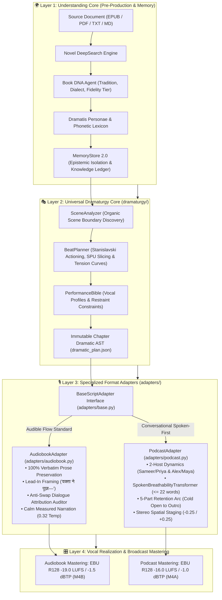
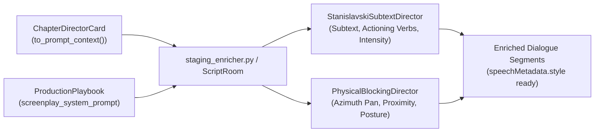

# 🎭 Dramaturgy & Multi-Format Adaptation System: Architectural Manual & Engineering Standard

**Version:** 5.2 (Option C Standard v2.0 Compliant)  
**Classification:** Core System Architecture Specification  
**Canonical Project ID:** `proj-audiobook-studio`  
**Source Directories:** [`audiobook_factory/dramaturgy/`](file:///c:/Users/Suraj/Documents/antigravity/optimistic-kepler/audiobook_factory/dramaturgy/) & [`audiobook_factory/adapters/`](file:///c:/Users/Suraj/Documents/antigravity/optimistic-kepler/audiobook_factory/adapters/)

---

## 1. Executive Summary & First-Principles Architecture

The **Dramaturgy & Multi-Format Adaptation System** is the narrative intelligence engine of Audiobook Studio. It translates raw literature (EPUB, PDF, TXT, Markdown) into structured dramatic blueprints, which are then rendered into broadcast-grade spoken audio products (Audible-standard Audiobooks or 2-Host Conversational Podcasts).

The system strictly adheres to **Option C: Shared Understanding & Dramaturgy Core with Specialized Format Adapters**:



---

## 2. The Universal Dramaturgy AST

The Dramaturgy Core decouples narrative understanding from downstream script formatting. Its central artifact is the **Chapter Dramatic Plan** (`dramatic_plan.json`), defined using Pydantic v2 schemas in [`audiobook_factory/dramaturgy/contracts.py`](file:///c:/Users/Suraj/Documents/antigravity/optimistic-kepler/audiobook_factory/dramaturgy/contracts.py).

### A. Atomic Dramatic Beat (`DramaticBeat`)
A `DramaticBeat` represents a discrete psychological or tactical shift in leverage, motivation, or emotion:

```python
class DramaticBeat(BaseModel):
    beat_id: str = Field(..., description="Unique beat identifier, e.g. 'beat_001'")
    scene_id: str = Field(..., description="Enclosing scene identifier, e.g. 'scene_001'")
    index: int = Field(..., ge=1, description="1-indexed sequence number within scene")
    dramatic_function: str = Field(default="setup", description="Dramatic role: setup, inciting, escalation, reversal, climax, resolution")
    summary: str = Field(default="", description="Concise synopsis of beat action")
    active_characters: List[str] = Field(default_factory=list)
    primary_speaker: Optional[str] = None
    target_character: Optional[str] = None
    objective: Optional[CharacterDramaticObjective] = None
    surface_emotion: str = "neutral"
    underlying_emotion: Optional[str] = None
    subtext: Optional[str] = None
    subtext_confidence: float = Field(default=0.0, ge=0.0, le=1.0)
    subtext_classification: SubtextClassification = "SOURCE_SUPPORTED"
    tension_before: float = Field(default=0.5, ge=0.0, le=1.0)
    tension_after: float = Field(default=0.5, ge=0.0, le=1.0)
    intensity: str = Field(default="medium", description="Acoustic dynamic headroom: low, medium, high, explosive")
    causal_trigger: Optional[str] = None
    character_response: Optional[str] = None
    consequence: Optional[str] = None
    causal_link_type: CausalLinkType = "therefore"
    start_paragraph_idx: Optional[int] = None
    end_paragraph_idx: Optional[int] = None
```

#### The Stanislavski Objective Schema (`CharacterDramaticObjective`):
- `immediate_goal`: Tactical goal within the current beat (e.g. *"Force the alderman to sign the deed"*).
- `obstacle`: Immediate counter-force or resistance (e.g. *"The alderman threatens to call the city guard"*).
- `underlying_desire`: Core psychological motivation (e.g. *"Secure food and shelter before winter"*).
- `core_fear`: Concealed vulnerability or dread (e.g. *"Fear of dying impoverished and forgotten"*).
- `strategy`: Chosen behavioral path (e.g. *"Feign cold indifference to mask desperation"*).
- `actioning`: Transitive acting verb (e.g. `threaten`, `deflect`, `reassure`, `confess`, `probe`, `intimidate`).

### B. Scene Dramatic Architecture (`SceneDramaticPlan`)
Each scene represents an unbroken dramatic encounter discovered by [`SceneAnalyzer`](file:///c:/Users/Suraj/Documents/antigravity/optimistic-kepler/audiobook_factory/dramaturgy/scene_analyzer.py):

```python
class SceneDramaticPlan(BaseModel):
    scene_id: str
    chapter_num: int = 1
    scene_title: str = ""
    scene_type: str = "dialogue"  # dialogue, action, internal_monologue, transition
    location: str = "Unspecified"
    time_context: str = "Unspecified"
    dramatic_purpose: str = ""
    scene_question: str = ""
    stakes: str = ""
    opening_state: str = ""
    closing_state: str = ""
    primary_conflict: str = ""
    secondary_conflicts: List[str] = Field(default_factory=list)
    participants: List[str] = Field(default_factory=list)
    dramatic_complexity: str = "MEDIUM"  # LOW, MEDIUM, HIGH, CRITICAL
    listener_knowledge_state: str = ""
    character_knowledge_states: Dict[str, List[str]] = Field(default_factory=dict)
    tension_curve: List[float] = Field(default_factory=list)
    beats: List[DramaticBeat] = Field(default_factory=list)
    start_paragraph_idx: int = 0
    end_paragraph_idx: int = 0
    spu_ids: List[str] = Field(default_factory=list)
    state_delta: Optional[DramaticStateDelta] = None
```

### C. Chapter Dramatic Plan (`DramaticPlan`)
Encodes the macro dramatic progression of an entire chapter:
- `chapter_id`: e.g. `"chapter_001"`.
- `chapter_num`: 1-indexed chapter number.
- `scenes`: Ordered list of `SceneDramaticPlan` instances.
- `overall_arc_summary`: Narrative synopsis of the chapter arc.
- `total_beats`: Sum of beats across all constituent scenes.
- `adaptation_policy`: Strict rules of engagement (`preserve_plot_events=True`, `disallow_fabricated_reveals=True`).

---

## 3. SPU Paragraph Alignment & Organic Chunk Slicing

### A. Semantic Paragraph Unit (SPU) Anchors
In earlier systems, naive integer division (`total_paras // num_scenes`) severed scenes mid-sentence or assigned Scene 1's beats to Scene 2's dialogue. 

In the Option C architecture:
1. Every paragraph is indexed as a **Semantic Paragraph Unit (SPU)** with a deterministic SHA-256 hash.
2. `SceneDramaticPlan` explicitly records `start_paragraph_idx` and `end_paragraph_idx`.
3. `DramaticBeat` records its precise paragraph span (`start_paragraph_idx`, `end_paragraph_idx`).

### B. Organic Chunk Slicing via `BeatPlanner.slice_chapter_by_beats()`
When chapter text exceeds the LLM context window (default: 500 words), [`BeatPlanner.slice_chapter_by_beats()`](file:///c:/Users/Suraj/Documents/antigravity/optimistic-kepler/audiobook_factory/dramaturgy/beat_planner.py#L850-L930) partitions the source text along **true beat and scene boundaries**:
- Chunks never split a dramatic beat in half.
- Each chunk inherits its exact enclosing `scene_id` and active `beat_ids`.
- Context from the preceding chunk (last 3 dialogue exchanges) is carried forward to resolve opening pronoun attributions (`"उसने कहा"`, `"he said"`).

---

## 4. Performance Bible (`PerformanceBible`)

The [`PerformanceBible`](file:///c:/Users/Suraj/Documents/antigravity/optimistic-kepler/audiobook_factory/dramaturgy/performance_bible.py) establishes the immutable project-level acting bible (`performance_bible.json`). It maps characters to voice acting constraints:

```python
class CharacterPerformanceProfile(BaseModel):
    character_name: str
    baseline_pace: float = Field(default=1.0, ge=0.7, le=1.4)
    vocal_register: str = "chest"  # chest, throat, nasal, head
    articulation: str = "standard"  # crisp, relaxed, slurred, clipped, formal
    restraint_level: float = Field(default=0.5, ge=0.0, le=1.0)
    speech_quirks: List[str] = Field(default_factory=list)
    performance_rules: List[str] = Field(default_factory=list)
    emotional_behaviors: Dict[str, str] = Field(default_factory=dict)
```

### Narrator Transparency Invariant
The `PerformanceBible` codifies the **Narrator Transparency Invariant**:
- Narrator delivery style is locked to `"calm_authoritative"`.
- Narrator baseline pace is locked to `1.0`.
- Narration segments have `subtext = ""` and `underlying_emotion = "neutral"`.
- Eliminates theatrical over-projection or melodrama during narrative passages.

---

## 5. Stanislavski Subtext Director (`StanislavskiSubtextDirector`)

Located in [`audiobook_factory/script/agents/stanislavski_director.py`](file:///c:/Users/Suraj/Documents/antigravity/optimistic-kepler/audiobook_factory/script/agents/stanislavski_director.py), the `StanislavskiSubtextDirector` operates as Room 3 Agent B.

### Eliminating Double-Inference Subtext Drift
1. **The Pre-Computation Invariant**: `StanislavskiSubtextDirector` consumes the pre-computed `DramaticPlan` as its primary constraint.
2. If `actioning`, `subtext`, or `underlying_emotion` was already defined during `BeatPlanner` derivation, the director **preserves it without overwriting**:
   ```python
   if e.get("actioning") and not seg.get("actioning"):
       seg["actioning"] = e["actioning"]
   if e.get("subtext") and not seg.get("subtext"):
       seg["subtext"] = e["subtext"]
   ```
3. The director solely resolves micro-level delivery styles (`whispering_fear`, `cold_menace`, `breathless_exhaustion`) and subtle pacing adjustments without re-inventing macro character objectives.

---

## 6. The Script Adapters Architecture (`BaseScriptAdapter`)

Option C introduces the abstract contract [`BaseScriptAdapter`](file:///c:/Users/Suraj/Documents/antigravity/optimistic-kepler/audiobook_factory/adapters/base.py#L14-L88):

```python
class BaseScriptAdapter(ABC):
    adapter_id: str = "base"
    format_name: str = "Base Script Format"

    def pre_adapt(self, chapter_text: str, dramatic_plan: DramaticPlan, **kwargs) -> Dict[str, Any]:
        return kwargs

    @abstractmethod
    def adapt(self, chapter_text: str, dramatic_plan: DramaticPlan, ...) -> List[Dict[str, Any]]:
        pass

    def post_adapt(self, segments: List[Dict[str, Any]], dramatic_plan: DramaticPlan, ...) -> List[Dict[str, Any]]:
        return segments

    def validate(self, segments: List[Dict[str, Any]], dramatic_plan: DramaticPlan, ...) -> DramaticValidationResult:
        from audiobook_factory.dramaturgy.dramatic_validator import DramaticValidator
        return DramaticValidator.validate_screenplay_and_plan(...)
```

### Concrete Adapter Implementations

#### 1. Audiobook Adapter ([`AudiobookAdapter`](file:///c:/Users/Suraj/Documents/antigravity/optimistic-kepler/audiobook_factory/adapters/audiobook.py))
- **Audible Flow Standard**: 100% preservation of authorial prose.
- **Prose-Lead Framing**: Dialogue split across narrative tags (`"No," said Character A, "I will not leave."`) is unified into an unbroken character speech turn with em-dash lead-in (`"वक्ता ने इंकार किया— 'नहीं, मैं नहीं जाऊँगा।'"`) or clean speaker turn separation.
- **Anti-Swap Dialogue Attribution Auditor**: Screenplay segments pass Gate 2 attribution audit, ensuring 0% speaker turn inversion ($A \leftrightarrow B$).
- **Performance Bible Binding**: Automatically enriches character lines with pacing, restraint, and articulation guidelines.

#### 2. Podcast Adapter ([`PodcastAdapter`](file:///c:/Users/Suraj/Documents/antigravity/optimistic-kepler/audiobook_factory/adapters/podcast.py))
- Consumes the `DramaticPlan` and invokes [`PodcastEpisodeGenerator`](file:///c:/Users/Suraj/Documents/antigravity/optimistic-kepler/audiobook_factory/podcast/episode_generator.py).
- Synthesizes dynamic 2-host conversational dialogue (Host A & Host B).
- Applies [`SpokenBreathabilityTransformer`](file:///c:/Users/Suraj/Documents/antigravity/optimistic-kepler/audiobook_factory/podcast/spoken_transformer.py) ($\le 22$ words per breath, 140ms pre-roll breath pauses).
- Returns downstream screenplay-compatible segments tagged with `section_type`, `pan` ($-0.25$ Left / $+0.25$ Right), and `acoustic_env = "podcast_studio"`.

---

## 6B. Room 3 Dynamic Directing Injection (Stanislavski Subtext & Physical Staging)

Prior to the 2-tier subsystem, Stanislavski subtext coaching and physical staging fell back to a generic static string (`"Standard narrative encounter."`) whenever explicit scene blueprints were absent. Room 3 now dynamically injects the **Tier 2 Chapter Director Card** ([`ChapterDirectorCard`](file:///c:/Users/Suraj/Documents/antigravity/optimistic-kepler/audiobook_factory/contracts/playbook.py#L42)) and **Tier 1 Master Playbook** ([`ProductionPlaybook`](file:///c:/Users/Suraj/Documents/antigravity/optimistic-kepler/audiobook_factory/contracts/playbook.py#L13)) across all dramaturgical agents:



### 1. Stanislavski Subtext Director ([`StanislavskiSubtextDirector`](file:///c:/Users/Suraj/Documents/antigravity/optimistic-kepler/audiobook_factory/script/agents/stanislavski_director.py))
- **Method Signature**:
  ```python
  def direct_subtext(
      self,
      segments: List[Dict[str, Any]],
      dramatic_context: str = "",
      is_hindi: bool = False,
      call_llm_fn: Optional[Callable[..., Any]] = None,
      director_card: Optional[ChapterDirectorCard] = None,
      playbook: Optional[ProductionPlaybook] = None,
  ) -> List[Dict[str, Any]]:
  ```
- **Context Replacement**: Evaluates `dramatic_context`. If empty and `director_card` is provided, automatically assigns `eff_context = director_card.to_prompt_context()`.
- **Authorial Style & Dialogue Subtext Guidance**: If `playbook.screenplay_system_prompt` is provided, appends tailored delivery rules directly into the system prompt:
  ```markdown
  Authorial Style & Dialogue Subtext Guidance:
  {playbook.screenplay_system_prompt}
  ```
- **Output Enrichment**: Enriches every dialogue turn with transitive actioning verbs (`threaten`, `deflect`, `reassure`, `probe`), unsaid subtext, underlying concealed emotion, and calibrated intensity headroom (`low`, `medium`, `high`, `explosive`).

### 2. Physical Blocking Director ([`PhysicalBlockingDirector`](file:///c:/Users/Suraj/Documents/antigravity/optimistic-kepler/audiobook_factory/script/agents/physical_blocking_director.py))
- **Method Signature**:
  ```python
  def direct_blocking(
      self,
      segments: List[Dict[str, Any]],
      dramatic_context: str = "",
      call_llm_fn: Optional[Callable[..., Any]] = None,
      director_card: Optional[ChapterDirectorCard] = None,
  ) -> List[Dict[str, Any]]:
  ```
- **Spatial Positioning Grounded in Chapter Atmosphere**: Replaces static `"Standard narrative encounter."` with `director_card.to_prompt_context()`, enabling the LLM to choreograph stereo azimuth pan ($-0.8$ to $+0.8$), proximity zones (`intimate_close`, `normal_room`, `distant`), physical posture (`sitting`, `standing`, `pacing`, `leaning_close`), and the specific acoustic environment matching the chapter's actual physical setting.

### 3. Pipeline Wiring & Auto-Resolution
- **[`AudiobookAdapter.adapt()`](file:///c:/Users/Suraj/Documents/antigravity/optimistic-kepler/audiobook_factory/adapters/audiobook.py#L120)**:
  1. Inspects the project directory for `metadata/chapters/chapter_XXX_director_card.json` via [`ChapterSteeringDirector.load_director_card(p_dir, chapter_num)`](file:///c:/Users/Suraj/Documents/antigravity/optimistic-kepler/audiobook_factory/glossary/chapter_director.py#L210).
  2. Inspects `p_dir / "production_playbook.json"` for [`ProductionPlaybook`](file:///c:/Users/Suraj/Documents/antigravity/optimistic-kepler/audiobook_factory/contracts/playbook.py#L13).
  3. Forwards `director_card=eff_card` and `playbook=eff_playbook` directly into `staging_enricher.process_chunk()`.
- **[`staging_enricher`](file:///c:/Users/Suraj/Documents/antigravity/optimistic-kepler/audiobook_factory/script/staging_enricher.py#L157)** & **[`ScriptRoom`](file:///c:/Users/Suraj/Documents/antigravity/optimistic-kepler/audiobook_factory/script/agents/script_room.py#L43)**: Transparently forward `director_card` and `playbook` into Pass 2A (Stanislavski subtext) and Pass 2B (physical blocking), ensuring zero loss of chapter atmospheric context.

---

## 7. Gate 2.5: Dramatic Validation & Integrity Audit

The [`DramaticValidator`](file:///c:/Users/Suraj/Documents/antigravity/optimistic-kepler/audiobook_factory/dramaturgy/dramatic_validator.py#L42-L340) runs an 8-pillar verification audit on screenplay segments before audio synthesis begins:

1. **Structural & Index Integrity**: Strict 1-based monotonic numbering (`index = 1, 2, 3...`) and zero orphan `scene_id` or `beat_id` references.
2. **Character Epistemics & Knowledge Containment**: Cross-references spoken dialogue against `MemoryContext` epistemic boundaries; blocks unrevealed secrets (`EPISTEMIC_ISOLATION_BREACH`).
3. **Anti-Emotional Teleportation**: Flags volatile, ungrounded emotional jumps across consecutive turns by the same character (e.g. `calm` $\to$ `bellowing_rage`).
4. **Dramatic Fidelity Guard**: Compares dialogue coverage against source narrative quotes; flags dropped quotes (`DROPPED_SOURCE_DIALOGUE`).
5. **Creative Overreach Guard**: Enforces "Nothing Above Source"; flags unsupported subtext or fabricated physical action cues (`CREATIVE_OVERREACH_SUBTEXT`).
6. **Beat Causality Guard**: Asserts continuous causal links (`therefore`/`but`) across consecutive beats in multi-beat scenes.
7. **Dramatic State Delta Audit**: Asserts that scenes of medium or high complexity produce measurable state deltas across knowledge, relationships, danger, or decisions.
8. **Adaptation Fidelity Policy**: Validates adherence to the immutable `AdaptationFidelityPolicy` settings.

---

## 8. Programmatic Usage Guide

```python
from pathlib import Path
from audiobook_factory.dramaturgy.scene_analyzer import SceneAnalyzer
from audiobook_factory.dramaturgy.beat_planner import BeatPlanner
from audiobook_factory.dramaturgy.contracts import DramaticPlan
from audiobook_factory.adapters.audiobook import AudiobookAdapter
from audiobook_factory.adapters.podcast import PodcastAdapter

# 1. Ingest Chapter Text
chapter_text = Path("extracted/chapter_001.md").read_text(encoding="utf-8")

# 2. Organic Scene Boundary Discovery
scenes = SceneAnalyzer.segment_and_analyze_scenes(
    chapter_text=chapter_text,
    chapter_num=1,
    chapter_title="Chapter 1",
    known_characters=["Character A", "Character B"],
)

# 3. Plan Atomic Dramatic Beats & SPU Alignment
scenes = BeatPlanner.plan_chapter_beats(
    chapter_text=chapter_text,
    scenes=scenes,
    known_characters=["Character A", "Character B"],
)

# 4. Serialize Immutable Dramatic AST
dramatic_plan = DramaticPlan(
    chapter_id="chapter_001",
    chapter_num=1,
    scenes=scenes,
    total_beats=sum(len(s.beats) for s in scenes),
)
dramatic_plan.save_to_file("dramaturgy/chapter_001_dramatic_plan.json")

# 5A. Adapt for Audible Audiobook
audiobook_adapter = AudiobookAdapter()
book_segments = audiobook_adapter.adapt(
    chapter_text=chapter_text,
    dramatic_plan=dramatic_plan,
    is_hindi=True,
    chapter_num=1,
)

# 5B. Adapt for 2-Host Podcast
podcast_adapter = PodcastAdapter()
pod_segments, pod_plan = podcast_adapter.adapt(
    chapter_text=chapter_text,
    dramatic_plan=dramatic_plan,
    is_hindi=True,
    chapter_num=1,
    return_plan=True,
)
```

---

## 🔗 Related Documentation
- [🏛️ Option C Architecture Blueprint](file:///c:/Users/Suraj/Documents/antigravity/optimistic-kepler/docs/ARCHITECTURE.md)
- [🎙️ Podcast System Architecture](file:///c:/Users/Suraj/Documents/antigravity/optimistic-kepler/docs/PODCAST_SYSTEM_ARCHITECTURE.md)
- [🛡️ Quality Gates & 8-Pillar Certification](file:///c:/Users/Suraj/Documents/antigravity/optimistic-kepler/docs/QUALITY_GATES.md)
- [💻 CLI Reference Manual](file:///c:/Users/Suraj/Documents/antigravity/optimistic-kepler/docs/CLI_REFERENCE.md)
