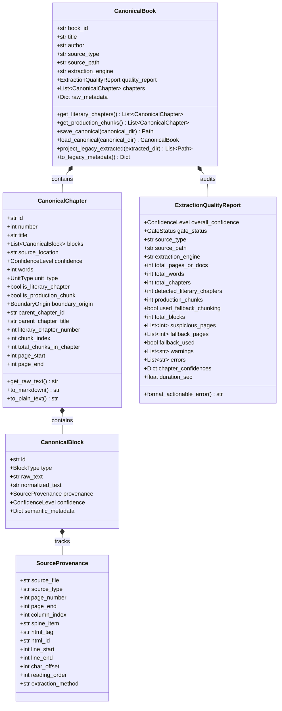

# 📜 Forensic Literary Document Ingestion & Canonical AST Engine (Pillar 1 v5.3)

## 1. Executive Summary & Purpose

The **Forensic Literary Document Ingestion Engine** represents the foundational architectural tier (Pillar 1) of the **Audiobook Studio Engine (v5.3)**. In studio-grade multi-voice audiobook production, downstream production rooms—such as literary Hindustani translation (Room 2), anti-swap multi-cast screenplay attribution (Room 3), neural speech synthesis with 4D formants (Room 4), and broadcast EBU R128 loudness mastering (Room 5)—are fundamentally constrained by the structural fidelity, lexical purity, and provenance accuracy of the ingested text.

Traditional audiobook extractors suffer from severe architectural vulnerabilities:
- **Destructive Flattening:** Arbitrary regex and naive string stripping erase scene dividers (`* * *`), section subheadings (`###`), typographic dialogue quotes, and structural chapter hierarchies.
- **Lost Forensic Provenance:** Extracted paragraphs cannot be traced back to their source coordinates (e.g., EPUB spine item, HTML anchor ID, or PDF page number and line bounds).
- **Silent Failures & Hallucination Cascades:** 0-word scanned pages, OCR noise, multi-column reading order interleaving, and table-of-contents misfires pass silently into downstream LLM translation and TTS stages, burning scarce API quotas on corrupted text.
- **Role Inversion in Passive Constructions:** Naive entity mapping assigns the first mentioned entity to the actor role, inverting dramatic actions (e.g., *"Geralt was struck by the assassin"* $\rightarrow$ *Geralt struck assassin*).
- **Context Blindspots:** Truncating chapter scans to 4,000–8,000 characters misses characters introduced late in long chapters, leaving them uncast in `BookBible`.
- **Uncontrolled Context Explosions:** Mammoth chapters ($> 12,000$ words) overflow LLM attention windows, causing truncated speech or context degradation.

The Pillar 1 v5.3 engine resolves these challenges through a **Dual-Layer Lean Architecture**:
1. **Sacred Canonical Layer (`canonical/book.json`):** Strongly typed Pydantic v2 AST capturing the immutable, unmutated raw source text (`raw_text`), sanitized speech text (`normalized_text`), hierarchical chapter-block relationships, and granular block-level forensic provenance.
2. **Backward-Compatible Projection Layer (`extracted/chapter_XXX.md`):** Deterministic markdown projection guaranteeing 100% interoperability with downstream translation, screenplay parsing, and packaging stages.
3. **Independent Fail-Closed Ingestion Gate (Gate 0.1):** Rigorous heuristic audit evaluating document completeness, word floors, empty chapters, and page layout/OCR noise before downstream execution begins.
4. **AST Roundtrip Rehydration:** Downstream rooms load the validated AST directly via [`CanonicalBook.load_canonical()`](file:///c:/Users/Suraj/Documents/antigravity/optimistic-kepler/audiobook_factory/book_model.py) without re-extracting raw archives.

---

## 2. Ingestion Pipeline Architecture

The following diagram illustrates the complete ingestion lifecycle from raw multi-format book containers to the audited canonical AST, crash isolation boundary, and downstream legacy markdown projections.

```mermaid
flowchart TD
    subgraph Input["📥 Input Stage"]
        Doc["Raw Book Document<br/>(.epub, .pdf, .txt, .md)"]
    end

    subgraph Archival["🔒 Source Preservation"]
        Doc --> IngestFacade["Universal Extractor Facade<br/>process_book_file()"]
        IngestFacade --> SHA["Compute SHA-256"]
        SHA --> RawDir["raw/ Archive<br/>• source_original.ext<br/>• source_manifest.json"]
    end

    subgraph Parsing["⚙️ Structural Parsers"]
        IngestFacade -->|EPUB 2 / 3| EPUBParser["ForensicEPUBParser<br/>• Single-pass OPF & Spine<br/>• EPUB 3 HTML5 nav & EPUB 2 NCX<br/>• Node-Level Anchor Isolation<br/>• _safe_xml_fromstring Entity Parsing"]
        IngestFacade -->|PDF| PDFEngine["ForensicPDFEngine<br/>• PDFLayoutReconstructor (XY-Cut)<br/>• _PDFPageSpanRecord Indexing<br/>• PDFQualityAnalyzer (Scanned 0-Word)<br/>• Candidate Comparison Gate<br/>• Context Manager Stream Safety"]
        IngestFacade -->|TXT / MD| TextParser["Text / Markdown Parser<br/>• clean_book_text()<br/>• Line-Offset Lookup Table<br/>• Character Span Provenance"]
    end

    subgraph Normalization["🧹 Non-Destructive Normalizer"]
        EPUBParser --> Norm["normalizer.py<br/>• Unicode NFC Normalization<br/>• Unicode Space Variants (\u00a0, \u2009, \u3000)<br/>• HTML Entity Decoding (html.unescape)<br/>• Indic ZWJ / ZWNJ Preservation<br/>• Coordinate Protection (Sector [4])<br/>• Sacred raw_text Unmutated"]
        PDFEngine --> Norm
        TextParser --> Norm
    end

    subgraph Segmentation["✂️ Chapter Segmentation & Meso Guard"]
        Norm --> Segmenter["chapter_segmenter.py<br/>• Multi-Tier Regex (EN / HI / Roman / Words)<br/>• Isolated 'I' Guard & Quoted Title Immunity<br/>• 2-Line Subtitle Lookahead Assembly<br/>• Literary vs. Chunk Tracking"]
        Segmenter --> MesoGuard["Meso-Tier Semantic Splitter<br/>• 12,000 Word Ceiling<br/>• Priority 1: Scene Break (* * *)<br/>• Priority 2: Subheading (###)<br/>• Priority 3: Paragraph Break<br/>• Priority 4: Sentence (Abbreviation Guard)<br/>• Priority 5: Word Boundary"]
    end

    subgraph AST["📦 Canonical AST Assembly"]
        MesoGuard --> CanBook["CanonicalBook AST<br/>• SourceProvenance (page_end, line, col)<br/>• CanonicalChapter[] (unit_type, boundary_origin)<br/>• CanonicalBlock[] (sacred raw + normalized)<br/>• get_literary_chapters() & get_production_chunks()"]
    end

    subgraph GateAudit["🛡️ Gate 0.1: Extraction Quality Gate"]
        CanBook --> Gate["ExtractionQualityAuditor<br/>• Evaluates Literary & Chunk Telemetry<br/>• Status: PASS / WARN / REVIEW<br/>• Fail-Closed Guard"]
        Gate -->|REVIEW (Default)| Error["ExtractionGateAuditError<br/>• Actionable Diagnostics<br/>• Affected Pages & Chunks Ledger"]
        Gate -->|REVIEW + --force-gate| Override["Bypass Override Logged"]
        Gate -->|PASS / WARN| DiskPersist["Persistence Stage"]
        Override --> DiskPersist
    end

    subgraph CrashBoundary["🛑 Crash Isolation Boundary"]
        IngestFacade -.->|On Unhandled Exception| ErrDump["extraction_error.json<br/>• error_type & message<br/>• timestamp & book_id"]
    end

    subgraph Storage["💾 Project Storage Layout"]
        DiskPersist --> SaveCanonical["canonical/<br/>• book.json<br/>• quality_report.json"]
        DiskPersist --> ProjectLegacy["extracted/<br/>• chapter_001.md<br/>• chapter_002.md..."]
        DiskPersist --> SaveMeta["metadata.json<br/>(Legacy Project State)"]
    end
```

---

## 3. Project Storage Layout & Sacred Provenance Archive

When [`process_book_file()`](file:///c:/Users/Suraj/Documents/antigravity/optimistic-kepler/audiobook_factory/extractor.py) processes an input file, it creates an isolated project workspace under `audiobooks/projects/<BOOK_SLUG>/` structured into three distinct layers:

```text
audiobooks/projects/<BOOK_SLUG>/
├── raw/                                  # Sacred unmutated archive
│   ├── source_original.epub              # Bit-for-bit verbatim source copy
│   └── source_manifest.json              # Forensic metadata, file size, SHA-256 hash
├── canonical/                            # Pillar 1 Strongly-Typed AST
│   ├── book.json                         # Complete CanonicalBook Pydantic v2 JSON
│   └── quality_report.json               # ExtractionQualityReport machine audit
├── extracted/                            # Backward-compatible projection layer
│   ├── chapter_001.md                    # Standard markdown for Translation & Scripting
│   ├── chapter_002.md
│   └── chapter_003.md
├── metadata.json                         # Backward-compatible project metadata summary
└── extraction_error.json                 # (Only created if extraction crashes)
```

### 1. Raw Source Manifest (`raw/source_manifest.json`)
Before any byte parsing or extraction occurs, the original file is hashed using SHA-256 and copied to `raw/source_original.<ext>`. The manifest locks the provenance:

```json
{
  "book_id": "the_last_wish",
  "original_path": "C:/Books/the_last_wish.epub",
  "source_format": "epub",
  "file_size_bytes": 1459203,
  "sha256": "4a7d1e8e50b86a87c18a9ef388f8d689b9d3b4b8a1c890f576e3efb6a78c0012",
  "archived_copy": "C:/.../audiobooks/projects/the_last_wish/raw/source_original.epub",
  "ingested_at": "2026-10-09T10:15:00Z"
}
```

### 2. Crash Isolation Boundary (`extraction_error.json`)
If an unhandled exception or parsing corruption occurs during extraction, `process_book_file()` catches the failure, writes a standardized diagnostic ledger to `extraction_error.json`, and re-raises the error. This isolates failures and prevents downstream rooms from executing against corrupted workspaces:

```json
{
  "status": "EXTRACTION_FAILED",
  "error_type": "PDFSyntaxError",
  "error_message": "Stream ends abruptly at byte offset 409600",
  "book_id": "corrupted_scan",
  "source_file": "C:/Books/corrupted_scan.pdf",
  "failed_at": "2026-10-09T10:15:30Z"
}
```

---

## 4. Canonical AST Data Models

Defined in [`audiobook_factory/book_model.py`](file:///c:/Users/Suraj/Documents/antigravity/optimistic-kepler/audiobook_factory/book_model.py), the Canonical AST is built with **Pydantic v2** (`BaseModel`, `ConfigDict(extra="ignore")`) and establishes the single source of truth for the entire pipeline.



### Core Schema Specifications

| Class | Purpose | Key Attributes & Methods |
|---|---|---|
| [`CanonicalBook`](file:///c:/Users/Suraj/Documents/antigravity/optimistic-kepler/audiobook_factory/book_model.py) | Top-level representation of an entire literary volume | `book_id`, `title`, `author`, `source_type`, `chapters`, `quality_report`, `raw_metadata`, `get_literary_chapters()`, `get_production_chunks()`, `save_canonical()`, `load_canonical()`, `project_legacy_extracted()` |
| [`CanonicalChapter`](file:///c:/Users/Suraj/Documents/antigravity/optimistic-kepler/audiobook_factory/book_model.py) | Structured chapter or production chunk container | `id`, `number`, `title`, `blocks`, `source_location`, `confidence`, `words`, `unit_type`, `is_literary_chapter`, `is_production_chunk`, `boundary_origin`, `parent_chapter_id`, `page_start`, `page_end` |
| [`CanonicalBlock`](file:///c:/Users/Suraj/Documents/antigravity/optimistic-kepler/audiobook_factory/book_model.py) | Atomic content unit (e.g. paragraph, heading, scene break) | `id`, `type`, `raw_text` (sacred/unmutated), `normalized_text` (sanitized speech), `provenance`, `confidence`, `semantic_metadata` |
| [`SourceProvenance`](file:///c:/Users/Suraj/Documents/antigravity/optimistic-kepler/audiobook_factory/book_model.py) | Forensic origin tracking (Where did this come from?) | `source_file`, `source_type`, `page_number`, `page_end`, `column_index`, `spine_item`, `html_tag`, `html_id`, `line_start`, `line_end`, `char_offset`, `reading_order`, `extraction_method` |
| [`ExtractionQualityReport`](file:///c:/Users/Suraj/Documents/antigravity/optimistic-kepler/audiobook_factory/book_model.py) | Machine-readable ingestion quality audit | `overall_confidence`, `gate_status`, `total_words`, `total_chapters`, `detected_literary_chapters`, `production_chunks`, `used_fallback_chunking`, `suspicious_pages`, `warnings`, `errors` |
| [`ExtractionGateAuditError`](file:///c:/Users/Suraj/Documents/antigravity/optimistic-kepler/audiobook_factory/book_model.py) | Exception raised when Gate 0.1 fails closed | Subclass of `ValueError`, encapsulates `ExtractionQualityReport` and actionable formatting |

### Enumerated Literal Types
- **`BlockType`**: `"paragraph" | "heading" | "dialogue" | "scene_break" | "quote" | "poetry" | "list" | "note" | "unknown"` (Conservative: defaults to `"paragraph"` or `"unknown"` unless structural evidence is unambiguous).
- **`UnitType`**: `"literary_chapter" | "production_chunk"` (Distinguishes authentic source literary chapters from artificial chunks created for processing limits or fallback chunking).
- **`BoundaryOrigin`**: `"detected_heading" | "toc_navigation" | "inferred_prologue" | "semantic_split_chunk" | "fallback_production_chunk" | "spine_fallback"`.
- **`ConfidenceLevel`**: `"HIGH" | "MEDIUM" | "LOW"`
- **`GateStatus`**: `"PASS" | "WARN" | "REVIEW"`

---

## 5. Non-Destructive Literary Normalizer

Implemented in [`audiobook_factory/normalizer.py`](file:///c:/Users/Suraj/Documents/antigravity/optimistic-kepler/audiobook_factory/normalizer.py), the normalizer sanitizes literary prose for speech synthesis without destroying source fidelity or muting literary typography.

### Normalization Pipeline Stages


1. **Stage 0: Unicode NFC, Space Hygiene, HTML Entity Decoding & Zero-Width Control:**
   - Applies canonical decomposition followed by canonical composition (`unicodedata.normalize("NFC", text)`).
   - Purges disruptive invisible zero-width characters: `\u200b` (Zero-Width Space), `\ufeff` (BOM), `\u2060` (Word Joiner), and `\u00ad` (Soft Hyphen).
   - **Indic Script Safeguard:** Explicitly preserves `\u200c` (Zero-Width Non-Joiner, ZWNJ) and `\u200d` (Zero-Width Joiner, ZWJ) to protect Hindi/Devanagari conjunct consonants, eyelash-ra (र्), and explicit halants (्).
   - Normalizes non-standard Unicode space variants to standard ASCII space (`" "`):
     ```python
     UNICODE_SPACES = (
         "\u00a0",  # Non-breaking space
         "\u1680",  # Ogham space mark
         "\u2000", "\u2001", "\u2002", "\u2003", "\u2004", "\u2005", "\u2006", "\u2007", "\u2008", "\u2009", "\u200a",  # En/Em/Thin/Hair
         "\u202f",  # Narrow no-break space
         "\u205f",  # Medium mathematical space
         "\u3000",  # Ideographic space
     )
     ```
   - Unescapes raw HTML entities (e.g. `&mdash;` $\rightarrow$ `—`, `&quot;` $\rightarrow$ `"`, `&amp;` $\rightarrow$ `&`) via `html.unescape(text)`.
   - Sanitizes C0/C1 binary and terminal control codes via `CONTROL_CHARS_RE = re.compile(r"[\x00-\x08\x0b\x0c\x0e-\x1f\x7f-\x9f]")`, removing null bytes (`\x00`) and bell alerts (`\x07`).
   - **Sacred Source Invariant:** These sanitizations apply strictly to `normalized_text` for neural speech synthesis; `CanonicalBlock.raw_text` preserves the bit-accurate original source text untouched.
2. **Stage 1: Multilingual Hyphenated Linebreak Healing:**
   - Detects words broken across line wraps (common in justified book typography) and welds them seamlessly across ASCII, Accented Latin (`\u00C0-\u024F\u1E00-\u1EFF`), and Devanagari (`\u0900-\u097F`) Unicode scripts:
     ```python
     re.sub(
         r"(\b[a-zA-Z\u00C0-\u024F\u1E00-\u1EFF\u0900-\u097F]{2,})-\n+([a-zA-Z\u00C0-\u024F\u1E00-\u1EFF\u0900-\u097F]{2,}\b)",
         r"\1\2",
         text,
     )
     ```
   - Heals `"impor-\ntant"` to `"important"`, `"dé-\njà"` to `"déjà"`, and `"प्र-\nस्तावना"` to `"प्रस्तावना"`.
3. **Stage 2: Typographic Quote & Dash Normalization:**
   - Standardizes directional curly quotes (`\u2018`, `\u2019` $\rightarrow$ `'`, `\u201c`, `\u201d` $\rightarrow$ `"`).
   - Spaces em dashes (`\u2014` $\rightarrow$ ` — `) and en dashes (`\u2013` $\rightarrow$ ` – `) to give neural TTS models natural cadence pauses.
   - Converts ellipses (`\u2026` $\rightarrow$ `...`).
   - Supports `preserve_literary_quotes=True` when raw typographic quotes are desired.
4. **Stage 3: Coordinate-Safe Footnote Reference Stripping:**
   - Strips non-spoken citation brackets such as `[1]`, `[23]`, and `[104]` while strictly protecting Sci-Fi, military, and narrative coordinates like `Sector [4]`, `Unit [12]`, `Level [3]`, `Protocol [9]`, `Gate [2]`:
     ```python
     text = re.sub(
         r"(\b(?:sector|unit|level|grid|vault|protocol|section|gate|node|channel|sample|group|matrix|model|phase|tier|type|class|port|district|block|row|column|area|chapter|part|book)\s+)?\[\d{1,3}\]",
         lambda m: m.group(0) if m.group(1) else "",
         text,
         flags=re.IGNORECASE,
     )
     ```
5. **Stage 4: Running Header & Page Number Stripping:**
   - Strips isolated lines matching `"Page X of Y"`, `"- 42 -"`, or bare page integers.
6. **Stage 5: Whitespace Collapsing:**
   - Collapses consecutive spaces and tabs (`[ \t]+` $\rightarrow$ `" "`).
   - Preserves double newline paragraph breaks while collapsing $\ge 3$ newlines to `\n\n`.

### Public Normalizer APIs
- [`clean_book_text(text: str, preserve_literary_quotes: bool = False) -> str`](file:///c:/Users/Suraj/Documents/antigravity/optimistic-kepler/audiobook_factory/normalizer.py)
- [`normalize_block_text(raw_text: str, preserve_literary_quotes: bool = False) -> Tuple[str, List[str]]`](file:///c:/Users/Suraj/Documents/antigravity/optimistic-kepler/audiobook_factory/normalizer.py): Returns normalized text along with forensic warning diagnostics (e.g., presence of `\ufffd` or excessive broken hyphens).

---

## 6. Single-Pass Structural EPUB Parser

Implemented in [`audiobook_factory/epub_parser.py`](file:///c:/Users/Suraj/Documents/antigravity/optimistic-kepler/audiobook_factory/epub_parser.py), [`ForensicEPUBParser`](file:///c:/Users/Suraj/Documents/antigravity/optimistic-kepler/audiobook_factory/epub_parser.py) extracts structured canonical representations and metadata from EPUB 2 and modern EPUB 3 archives.

### Key Capabilities

1. **Single-Pass OPF & Spine Reading:**
   - Locates `META-INF/container.xml` using [`_safe_xml_fromstring()`](file:///c:/Users/Suraj/Documents/antigravity/optimistic-kepler/audiobook_factory/epub_parser.py) to discover the package rootfile.
   - Extracts metadata (`dc:title`, `dc:creator`, `dc:language`) with automatic HTML entity decoding (`html.unescape`).
   - Traverses `<spine>` item references (`<itemref idref="...">`), reading each XHTML document exactly once.
2. **Dual-Mode Navigation (EPUB 3 HTML5 `<nav>` & EPUB 2 NCX):**
   - **Mode 1 (EPUB 3):** Discovers HTML5 Navigation Documents (`properties="nav"`, `<nav epub:type="toc">`, or `<nav id="toc">`), extracting chapter titles and relative target links directly.
   - **Mode 2 (EPUB 2 Fallback):** If HTML5 nav is absent, parses `.ncx` files using `<navPoint>` hierarchy.
3. **Node-Level Anchor Isolation (Zero Tag-Bleed Slicing):**
   - Standard extractors concatenate and slice raw XHTML strings across spine files, capturing broken `<head>` tags that lock `ignore_depth > 0` and cause silent text drops.
   - `ForensicEPUBParser` parses each spine file into discrete [`CanonicalBlock`](file:///c:/Users/Suraj/Documents/antigravity/optimistic-kepler/audiobook_factory/book_model.py) instances first.
   - Table of contents targets (`file.xhtml#anchor`) are resolved by matching `block.provenance.html_id == anchor`. Slicing operates at the clean block level, completely eliminating XHTML tag bleeding.
4. **Resilient XML Parsing ([`_safe_xml_fromstring`](file:///c:/Users/Suraj/Documents/antigravity/optimistic-kepler/audiobook_factory/epub_parser.py)):**
   - Standard Python `xml.etree.ElementTree` crashes when encountering unescaped HTML entities (e.g. `&mdash;`, `&nbsp;`, `&hellip;`) inside XML metadata or NCX files.
   - `_safe_xml_fromstring` intercepts `ET.ParseError`, dynamically resolves named HTML entities to numeric character references (e.g. `&#8212;`), and retries parsing seamlessly.
5. **DOM-Aware Structural Parser ([`EPUBStructuralHTMLParser`](file:///c:/Users/Suraj/Documents/antigravity/optimistic-kepler/audiobook_factory/epub_parser.py)):**
   - Subclasses `html.parser.HTMLParser` to parse XHTML fragments directly into ordered [`CanonicalBlock`](file:///c:/Users/Suraj/Documents/antigravity/optimistic-kepler/audiobook_factory/book_model.py) elements:
     - Heading levels (`h1` through `h6` $\rightarrow$ `type="heading"`, `metadata={"level": N}`).
     - Scene breaks (`<hr>` or paragraphs containing `* * *`, `---`, `___` $\rightarrow$ `type="scene_break"`).
     - Blockquotes (`<blockquote>` $\rightarrow$ `type="quote"`).
     - Paragraphs (`<p>` $\rightarrow$ `type="paragraph"`).
   - Records block provenance: `spine_item`, `html_tag`, `html_id`, `line_start`, `char_offset`, and global `reading_order`.

---

## 7. Layout-Aware PDF Engine & Quality Analyzer

Implemented across the modular [`audiobook_factory/pdf/`](file:///c:/Users/Suraj/Documents/antigravity/optimistic-kepler/audiobook_factory/pdf/) package (and re-exported by [`audiobook_factory/pdf_engine.py`](file:///c:/Users/Suraj/Documents/antigravity/optimistic-kepler/audiobook_factory/pdf_engine.py)), the PDF engine combines ultra-fast local digital extraction, recursive XY-cut geometric reading order reconstruction, character-accurate source provenance, and multi-signal quality gate evaluation with selective multimodal vision escalation.

### 1. Multi-Column XY-Cut Decomposition ([`PDFLayoutReconstructor`](file:///c:/Users/Suraj/Documents/antigravity/optimistic-kepler/audiobook_factory/pdf/layout_reconstructor.py))
Multi-column layouts cause naive extractors to interleave text horizontally across columns. `PDFLayoutReconstructor` resolves human reading order:
- **Geometric Content Operators:** Extracts glyph spans with `(x0, y, x1, font_height, space_width, seq_order)`.
- **Baseline Merging:** Clusters glyphs on the same baseline ($\pm 0.45 \times fh$). Splits lines on horizontal gutters exceeding $\max(3.5 \times sw, 14.0\text{ pt})$.
- **Vertical Column Gutter Validation:** Prevents false splits on centered poetry or dialogue by requiring $\ge 2$ parallel baseline pairs or dense column stacks (median spacing $\le 2.2 \times fh$).
- **Recursive Decomposition:** Horizontally segments around full-width spanning banners; vertically segments across clean column gutters (Left Column $\rightarrow$ Right Column).
- **Cross-Column Unwrapping:** Welds mid-sentence line breaks and trailing hyphens across column transitions.

### 2. End-to-End Character-Accurate Provenance ([`ForensicPDFEngine`](file:///c:/Users/Suraj/Documents/antigravity/optimistic-kepler/audiobook_factory/pdf/forensic_engine.py))
- Constructs contiguous character memory maps ([`_PDFPageSpanRecord`](file:///c:/Users/Suraj/Documents/antigravity/optimistic-kepler/audiobook_factory/pdf/forensic_engine.py)):
  ```python
  @dataclass
  class _PDFPageSpanRecord:
      page_number: int
      doc_char_start: int
      doc_char_end: int
      page_text: str
      line_offsets: List[Tuple[int, int, int]]  # (page_rel_start, page_rel_end, line_1based)
      confidence: ConfidenceLevel
      extraction_method: str
  ```
- Joins cross-page mid-sentence blocks with multi-page bounds (`page_number`, `page_end`, `line_start`, `line_end`).
- Preserves full provenance through chapter segmentation and meso-tier splitting.

### 3. Multi-Signal Quality Gate & Scanned PDF Escalation ([`PDFQualityAnalyzer`](file:///c:/Users/Suraj/Documents/antigravity/optimistic-kepler/audiobook_factory/pdf/quality_analyzer.py))
- **Scanned PDF 0-Word Escalation:**
  In legacy pipelines, `0 < word_count < 15` missed 100% scanned PDF pages (`word_count == 0`), silently passing them as empty. The hardened analyzer explicitly flags `word_count == 0`:
  ```python
  if word_count == 0:
      warnings.append("Zero extractable text on page (likely scanned image, image-only page, or missing font encoding).")
      is_suspicious = True
  elif word_count < 15 and char_count < 80:
      warnings.append(f"Low text density ({word_count} words on page).")
      is_suspicious = True
  ```
  Suspicious pages are routed to [`GeminiVisionPDFExtractor`](file:///c:/Users/Suraj/Documents/antigravity/optimistic-kepler/audiobook_factory/pdf/vision_extractor.py) for visual OCR escalation.
- **Candidate Quality Scoring:** Evaluates composite score ($0.40 \times \text{Reading Order} + 0.45 \times \text{Text Integrity} + 0.15 \times \text{Sentence Coherence}$).
- **Escalation Disqualification Guards:** Disqualifies vision escalation output if it contains conversational refusals (`"I cannot extract"`), repetition loops ($\ge 5\times$ 4-gram), new `\ufffd` corruption, or truncates $> 45\%$ of clean local words.
- **Running Header/Footer Elimination:** Tracks repeating lines across $\ge 3$ distinct pages. Explicitly preserves scene breaks (`* * *`, `---`) and chapter headings from accidental removal.
- **Windows File Stream Context Managers:** Uses `with open(self.file_path, "rb") as f:` across all PDF readers and writers, preventing locked file handles (`PermissionError: [WinError 32]`).

---

## 8. Multi-Tier Chapter Segmentation & Meso-Tier Splitter

Implemented in [`audiobook_factory/chapter_segmenter.py`](file:///c:/Users/Suraj/Documents/antigravity/optimistic-kepler/audiobook_factory/chapter_segmenter.py), this component segments continuous book text into dramatic chapters and enforces the **Meso-Tier 12,000-word ceiling**.

### 1. Multi-Tier Heading Recognition Patterns

```python
CHAPTER_PATTERNS = [
    # Tier 1: Markdown Headings (# The Boy Who Lived, ## The Council)
    r"^#{1,2}\s+[A-Z0-9\u0900-\u097F][^\n]{1,80}$",
    # Tier 2: English Chapter / Book / Part / Act / Scene (allows quoted subtitles)
    r"^(?:\s*#+\s*)?(?:chapter|book|part|act|scene)\s+(?:\d+|[ivxlcdm]+|[a-z]+)\b.*$",
    # Tier 3: Story Landmarks (Prologue, Epilogue, Interlude, Introduction, Afterword)
    r"^(?:\s*#+\s*)?(?:prologue|epilogue|interlude|introduction|preface|afterword)\b.*$",
    # Tier 4: Devanagari / Hindi Markers (अध्याय, भाग, खंड, काण्ड, प्रस्तावना, उपसंहार)
    r"^(?:\s*#+\s*)?(?:अध्याय|भाग|खंड|काण्ड|प्रस्तावना|उपसंहार)\s*(?:\d+|[०-९]+|[a-z]+)?\b.*$",
    # Tier 5: Standalone Roman Numerals (disallows single isolated 'I')
    r"^(?:(?:[IVXLCDM]{2,8}|[VXLCDM])(?:\.|\:|\s*[\:\-–—])?(?:\s+[A-Z0-9\u0900-\u097F][^\n]{1,60})?|I(?:\.|\:|\s*[\:\-–—])(?:\s+[A-Z0-9\u0900-\u097F][^\n]{1,60})?)$",
    # Tier 6: Standalone Word Numbers (ONE, TWENTY-TWO, THREE: The Journey)
    r"^(?:(?:(?:ONE|TWO|THREE|FOUR|...|NINETEEN)|(?:TWENTY|...|NINETY)(?:[\s\-]+(?:ONE|...|NINE))?|HUNDRED)(?:\s*[\:\-–—]\s*[A-Z][^\n]{2,60})?)$",
]
```

### 2. Heading Candidate Validation ([`is_valid_heading_candidate`](file:///c:/Users/Suraj/Documents/antigravity/optimistic-kepler/audiobook_factory/chapter_segmenter.py))
- **Standalone Pronoun Guard:** Isolated single letter `'I'` on a line is strictly prohibited from creating a chapter boundary. Roman numeral `I` is accepted only if followed by punctuation (`I.`, `I:`) or an explicit title (`I - The Awakening`).
- **Quoted Chapter Title Immunity:** Chapters with quoted titles (e.g. `Chapter 1: "The Voice of Reason"`) are accepted. Dialogue starting and ending with quotes is only rejected if it lacks chapter keywords.
- **Lookahead 2-Line Title Assembly:** When an author formats titles as `CHAPTER ONE\n\nThe Awakening`, the segmenter looks ahead to combine them into `"CHAPTER ONE: The Awakening"`, preventing lost chapter names.
- **Boundary & Context Verification:** Must be preceded by document start or double newline; must be followed by body prose ($\ge 1$ word for keyword headings, $\ge 4$ words for bare numbers).

### 3. Meso-Tier 12,000-Word Semantic Splitter ([`split_large_chapter_on_semantic_boundary`](file:///c:/Users/Suraj/Documents/antigravity/optimistic-kepler/audiobook_factory/chapter_segmenter.py))
When a chapter exceeds 12,000 words, it is partitioned into `"(Part 1)"` and `"(Part 2)"` using a **5-Tier Priority Hierarchy**:
1. **Priority 1 (Scene Breaks):** `* * *`, `---`, `___` in 20%–80% central zone (stays at the tail of Part 1).
2. **Priority 2 (Markdown Subheadings):** `###`, `##` in 20%–80% zone (stays at the top of Part 2 with `#` prefix intact).
3. **Priority 3 (Paragraph Boundaries):** `\n\n` in 25%–75% central zone.
4. **Priority 4 (Sentence Boundaries with Abbreviation Guard):** `.`, `?`, `!`, `।` in 30%–70% central zone.
   - **Abbreviation Guard:** Skips periods belonging to honorifics or abbreviations (`Mr.`, `Mrs.`, `Ms.`, `Dr.`, `Prof.`, `Capt.`, `Lt.`, `Col.`, `Gen.`, `Sgt.`, `St.`, `Jr.`, `Sr.`, `vs.`, `etc.`, `e.g.`, `i.e.`).
5. **Priority 5 (Emergency Word Boundary):** Nearest space to midpoint.

### 4. Literary Chapter vs. Production Chunk Distinction
- Authentic authorial chapters: `unit_type="literary_chapter"`, `is_literary_chapter=True`.
- Execution chunks (Meso splits or fallback unheaded chunks): `unit_type="production_chunk"`, `is_production_chunk=True`.
- **Dual Accessors on CanonicalBook:**
  - [`book.get_literary_chapters()`](file:///c:/Users/Suraj/Documents/antigravity/optimistic-kepler/audiobook_factory/book_model.py): Combines split chunks (`Part 1`, `Part 2`) back into unified authorial chapters. Used for M4B metadata and table of contents.
  - [`book.get_production_chunks()`](file:///c:/Users/Suraj/Documents/antigravity/optimistic-kepler/audiobook_factory/book_model.py): Returns atomic production chunks used by translation and TTS workers.

---

## 9. Semantic Role Alignment & Full Chapter Entity Harvesting

Hardened in Phase 2, these components eliminate entity distortion and blindspots in downstream stages:

### 1. Passive-Voice Semantic Role Alignment ([`audiobook_factory/translation/source_semantic_map.py`](file:///c:/Users/Suraj/Documents/antigravity/optimistic-kepler/audiobook_factory/translation/source_semantic_map.py))
Standard regex-based semantic extraction maps the first named entity to `actors`. For passive constructions (e.g. *"Geralt was struck by the assassin"*), this inverted the speaker and recipient roles.

The hardened `_extract_source_action_and_actors()` detects passive constructions:
```python
# Detect passive construction: e.g. "X was struck by Y"
passive_match = re.search(
    r"\b(?:was|were|is|are|been|being|became)\s+([a-z]+)\s+by\s+((?:the|a|an\s+)?[a-zA-Z\s]+?)(?:[.,;!?]|\s+(?:with|in|at|on|using|for|from|to|while|after|before)\b|$)",
    s_norm,
    re.IGNORECASE,
)
```
- Maps the agent following `"by"` to `actors` (`["the assassin"]`).
- Maps the patient from the preceding clause to `recipients` (`["Geralt"]`).
- Corrects action beat semantics before downstream screenplay attribution (Gate 2).

### 2. 100% Full Chapter Entity Harvesting ([`audiobook_factory/translation/entity_discovery.py`](file:///c:/Users/Suraj/Documents/antigravity/optimistic-kepler/audiobook_factory/translation/entity_discovery.py))
Legacy harvesting extracted only the first 8,000 characters and middle 4,000 characters of a chapter, leaving a 70% blindspot in long chapters. Characters introduced late in a scene (e.g. at character 35,000+) were completely missed.

`ChapterEntityHarvester` now ingests up to 100,000 characters per chapter:
- 100% entity scanning ensures late-introduced characters and titles are discovered.
- Synchronizes discovered entities, aliases, and Devanagari transliterations directly into [`BookBible`](file:///c:/Users/Suraj/Documents/antigravity/optimistic-kepler/audiobook_factory/translation/book_bible.py).

---

## 10. Ingestion Quality Gate (Gate 0.1 / Forensic Gate)

Implemented in [`audiobook_factory/quality_gate.py`](file:///c:/Users/Suraj/Documents/antigravity/optimistic-kepler/audiobook_factory/quality_gate.py), [`ExtractionQualityAuditor`](file:///c:/Users/Suraj/Documents/antigravity/optimistic-kepler/audiobook_factory/quality_gate.py) acts as an independent, fail-closed gate keeper evaluating the canonical book model before any downstream stages can run.

### Gate Audit Statuses
- **`PASS`**: All chapters exceed word count floors; zero empty chapters; page noise ratio $\le 0\%$; overall confidence `HIGH`.
- **`WARN`**: Minor anomalies detected (e.g. $1$ to $25\%$ of pages exhibit layout or OCR noise, healed via escalation); overall confidence `MEDIUM`. Pipeline proceeds with logged warnings.
- **`REVIEW`**: Critical quality defects detected; overall confidence `LOW`. **The pipeline fails closed and aborts immediately with [`ExtractionGateAuditError`](file:///c:/Users/Suraj/Documents/antigravity/optimistic-kepler/audiobook_factory/book_model.py)**.

### Critical Defect Triggers (Status: `REVIEW`)
1. **Zero Chapters Detected:** Document failed chapter regex and semantic chunking fallback.
2. **Dangerously Low Word Count:** Total extracted text $< 50$ words for EPUB or PDF documents.
3. **Empty or Stub Chapters:** Any chapter contains $< 5$ words.
4. **High Suspicious Page Ratio:** Suspicious pages exceed $25\%$ of total document pages ($\frac{\text{suspicious}}{\text{total}} > 0.25$).

### Actionable Diagnostic Failure Report
When Gate 0.1 fails closed, it produces an actionable terminal diagnostic:

```text
==============================================================================
  [FATAL] EXTRACTION QUALITY GATE AUDIT: REVIEW REQUIRED
==============================================================================
Source Document : books/corrupted_scan.pdf
Format / Engine : PDF via pdf_layout_selective
Extraction Stats: 0 chapters, 24 words, 2 blocks
Overall Status  : REVIEW (Confidence: LOW)

CRITICAL QUALITY DEFECTS DETECTED:
  • Zero chapters were detected in the source document.
  • Total extracted word count (24 words) is below the minimum threshold for literary documents.
  • Severe layout/OCR anomalies detected on 18/20 pages (90.0%).

Affected Suspicious Pages (18): [1, 2, 3, 4, 5, 6, 7, 8, 9, 10, 11, 12, 13, 14, 15, 16, 17, 18]

RECOMMENDED REMEDIATION:
  1. Verify the source file integrity (e.g. check for corrupt scanned pages, DRM, or multi-column layout).
  2. For scanned or complex layout PDFs, ensure GEMINI_API_KEY is configured to enable visual OCR escalation.
  3. If you have verified the extracted chapters manually and wish to proceed anyway,
     rerun with the '--force-gate' flag to bypass the Quality Gate fail-closed check.
==============================================================================
```

### The `--force-gate` Override
For edge cases where an operator has manually inspected the extracted markdown files and chooses to proceed despite gate warnings, the fail-closed behavior can be explicitly bypassed using the `--force-gate` CLI flag.

---

## 11. CLI Usage Guide

### 1. Extracting a Book Document (`extract`)

Extracts an EPUB, PDF, TXT, or Markdown book into the canonical AST, archives raw sources, and projects legacy markdown chapters:

```bash
# Standard extraction with fail-closed gate enforcement
python audiobook_cli.py extract books/the_witcher.epub

# PDF extraction with automatic layout analysis
python audiobook_cli.py extract books/dracula.pdf

# Bypassing Quality Gate REVIEW failure (operator override)
python audiobook_cli.py extract books/scanned_book.pdf --force-gate
```

### 2. Autonomous End-to-End Pipeline (`auto`)

Runs all 6 production stages in a single command, incorporating Gate 0.1 before translation:

```bash
# Autonomous run with default fail-closed protection
python audiobook_cli.py auto books/the_witcher.epub \
  --hindi \
  --dramatized \
  --voice Charon \
  --cover covers/witcher.jpg

# Autonomous run with Quality Gate override
python audiobook_cli.py auto books/unorthodox_layout.epub \
  --hindi \
  --dramatized \
  --voice Aoede \
  --force-gate
```

---

## 12. Python API Reference & Quickstart

Programmatic integration via the unified extractor facade:

```python
from pathlib import Path
from audiobook_factory.extractor import process_book_file
from audiobook_factory.book_model import CanonicalBook, ExtractionGateAuditError

projects_base = Path("audiobooks/projects")
input_file = Path("books/dune.epub")

try:
    # Ingest document, enforce Gate 0.1, archive raw, and project markdown
    metadata = process_book_file(
        input_file=input_file,
        output_base_dir=projects_base,
        force_gate=False,
    )
    print(f"Ingested {metadata['title']} ({metadata['total_chapters']} chapters)")

except ExtractionGateAuditError as e:
    print(f"Extraction halted by Quality Gate:\n{e}")
    # Inspect the machine-readable report
    report = e.report
    print(f"Suspicious pages: {report.suspicious_pages}")
```

### Direct Canonical AST Rehydration (`load_canonical`)

Downstream production stages (Rooms 2–5) reload the full canonical AST and forensic quality report directly from disk using the high-level `load_canonical()` loader without re-extracting source archives:

```python
from pathlib import Path
from audiobook_factory.book_model import CanonicalBook

canonical_dir = Path("audiobooks/projects/dune/canonical")

# Rehydrates CanonicalBook & ExtractionQualityReport models with 100% validation
book_ast = CanonicalBook.load_canonical(canonical_dir)

print(f"Book: {book_ast.title} by {book_ast.author}")
print(f"Quality Gate Status: {book_ast.quality_report.gate_status} (Confidence: {book_ast.quality_report.overall_confidence})")
print(f"Total Literary Chapters: {len(book_ast.get_literary_chapters())}")

for chapter in book_ast.chapters:
    print(f"  Chapter {chapter.number}: {chapter.title} ({chapter.words} words, {len(chapter.blocks)} blocks)")
    for block in chapter.blocks[:3]:
        print(f"    [{block.type}] (Origin: {block.provenance.spine_item or block.provenance.page_number}) -> {block.normalized_text[:50]}...")
```

---

## 13. Summary Matrix of Architectural Upgrades (Pillar 1 v5.3)

| Capability | Legacy Pipeline (v3.x) | Forensic Ingestion Engine (Pillar 1 v5.3 Hardened) |
|---|---|---|
| **Data Representation** | Ephemeral, flat string chunks | Strongly typed Pydantic v2 AST ([`CanonicalBook`](file:///c:/Users/Suraj/Documents/antigravity/optimistic-kepler/audiobook_factory/book_model.py)) with sacred raw text, clean normalized text, and `load_canonical()` rehydration |
| **PDF Multi-Column Layout** | Left-to-right interleaving across columns; severed sentences | Geometric XY-cut decomposition ([`PDFLayoutReconstructor`](file:///c:/Users/Suraj/Documents/antigravity/optimistic-kepler/audiobook_factory/pdf/layout_reconstructor.py)), gutter detection, spanning banner cuts, and column wrap healing |
| **Scanned PDF Escalation** | 0-word scanned pages silently passed as empty | 0-word pages flagged as `is_suspicious=True`, triggering selective visual OCR escalation via `GeminiVisionPDFExtractor` |
| **Source Provenance** | None (lost upon extraction) | Character-accurate `_PDFPageSpanRecord` indexing, tracking `page_number`, `page_end`, `line_start`, `line_end`, `char_offset`, `reading_order`, `extraction_method` |
| **Source Preservation** | None (ephemeral) | Sacred `raw/` archive with SHA-256 verification manifest; unmutated `raw_text` vs sanitized `normalized_text` (purging `\x00`, `\x07`, `\u00ad`) |
| **EPUB Parsing** | Double zip read, naive regex split, broken tags | Single-pass OPF/spine, HTML5 `<nav epub:type="toc">` landmarks, node-level anchor isolation, and resilient entity resolution (`_safe_xml_fromstring`) |
| **Heading Disambiguation** | Standalone 'I' created false chapters; lost quoted subtitles | Isolated 'I' guard, dialogue quote immunity, 2-line title lookahead assembly, and meso-tier Priority 4 abbreviation protection |
| **Semantic Role Alignment** | Passive sentences inverted actors ($A \leftrightarrow B$) | Passive-voice semantic extraction (`source_semantic_map.py`) ensuring agents map to Actors and patients map to Recipients |
| **Entity Discovery** | 4k/8k character truncation missed late-introduced cast | 100% full chapter entity scanning (`entity_discovery.py`) harvesting up to 100,000 characters into `BookBible` |
| **Coordinate Normalization** | Bracketed coords (`Sector [4]`) stripped as footnotes | Citation footnotes stripped while coordinates (`Sector [4]`, `Unit [12]`) and Indic ZWJ/ZWNJ characters are 100% preserved |
| **Resource Safety** | Open file handle locks on Windows (Error 32) | Context managers (`with open(...)`) across PDF and EPUB readers with `extraction_error.json` crash isolation |
| **Quality Verification** | None (corrupted text passed downstream) | Independent fail-closed **Gate 0.1** ([`ExtractionQualityAuditor`](file:///c:/Users/Suraj/Documents/antigravity/optimistic-kepler/audiobook_factory/quality_gate.py)) auditing word floors, empty chapters, suspicious pages, and chunk telemetry |
| **Downstream Compatibility** | `extracted/chapter_XXX.md` | 100% backward-compatible projection via `project_legacy_extracted()` and `metadata.json` |

---

## 14. Invariants & Remediation Specification (v5.3)

For the complete forensic audit, edge-case risk matrices, and step-by-step P0/P1/P2 remediation blueprint, consult the companion [Source Extraction Hardening Specification (v5.3)](file:///c:/Users/Suraj/Documents/antigravity/optimistic-kepler/docs/SOURCE_EXTRACTION_HARDENING_SPEC.md).
