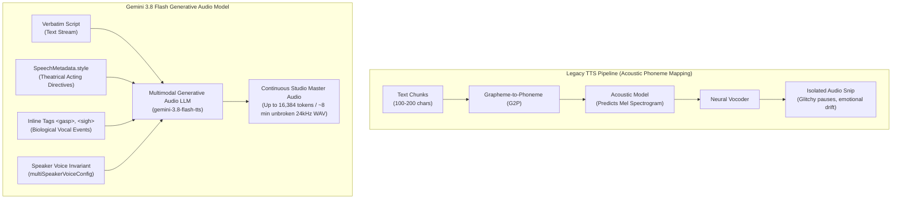
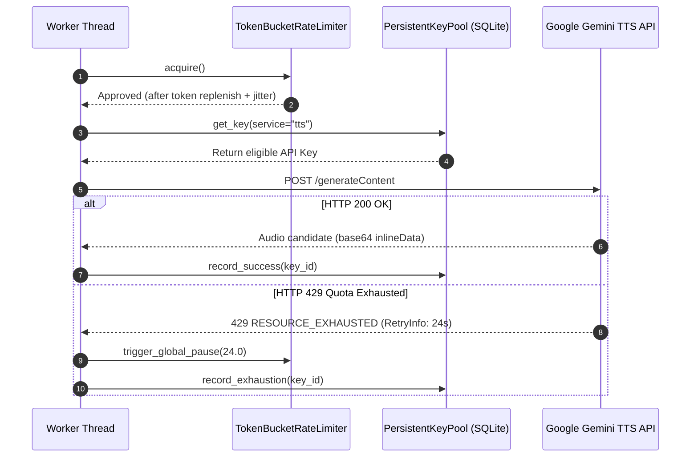
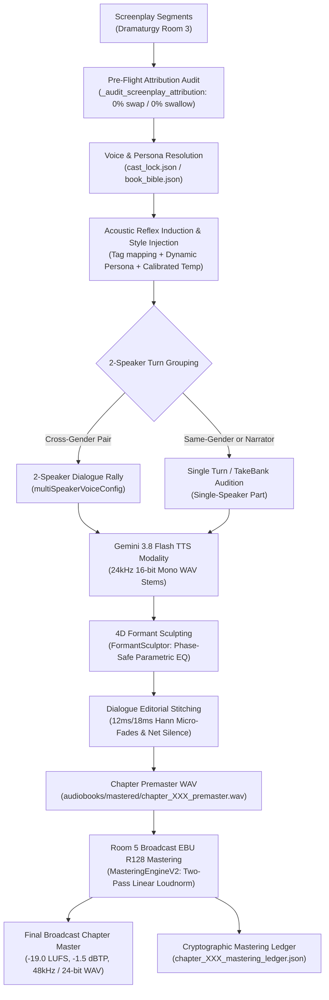

# 🎙️ Gemini 3.8 Flash TTS Engine & Theatrical Directing Manual (Stage 4 / Pillar 3)

> **Architectural Status**: Verified Production Standard against Google Gemini API v1beta (`gemini-3.8-flash-tts` & `gemini-3.8-flash-lite-tts`).  
> **Target Audience**: Audio Drama Directors, Screenplay Engineers, Full-Cast System Architects, Audio DSP Masters.  
> **Key Capabilities**: Multimodal Generative Speech, Continuous 16k Audio Token Windows, Turn-Level Style Directing, Physical Inline Vocal Tags, Native Devanagari Synthesis, Mathematical SNR Gatekeeping, and EBU R128 Multitrack Mastering.

---

## 🧭 Executive Overview: The Generative Speech Paradigm Shift

Traditional Text-to-Speech engines (Google Cloud TTS, Amazon Polly, ElevenLabs legacy, standard VITS/Tacotron) treat speech synthesis as an acoustic mapping problem: normalized text is converted to phonemes, which predict mel-spectrograms for a vocoder. In dramatic full-cast audiobook production, this legacy paradigm fails across three critical dimensions:

1. **Script Contamination & Hallucinated Punctuation**: Directing cues (e.g., `[whispers]`, `(angrily)`, `[sighs]`) are either read aloud literally by the synthesizer or cause severe digital glitches and phoneme distortion.
2. **Context Blindness & Pacing Discontinuity**: Sentences are rendered in isolated buffers (typically 50–200 characters), causing catastrophic emotional drift, pitch mismatch across dialogue turns, and robotic, unnatural pacing.
3. **Absence of Biological Vocal Acoustics**: Reflexive human vocal tract events—such as gasping for air mid-sentence, laughing while speaking, sobbing during grief, or weary sighs—cannot be synthesized naturally; they must be clumsily spliced from external sound libraries.



**Audiobook Maker v4.0** leverages **Gemini 3.8 Flash TTS** (`models/gemini-3.8-flash-tts`) and **Gemini 3.8 Flash-Lite TTS** (`models/gemini-3.8-flash-lite-tts`) to redefine speech synthesis as **Multimodal Generative Audio Modeling**:
- **Massive Context Windows**: Up to **8,192 input text tokens** and an unprecedented **16,384 output audio tokens** per API invocation.
- **Continuous Unbroken Cadence**: 16,384 audio tokens yield **~7 to 8 minutes of continuous dramatic speech** in a single API call, eliminating unnatural sentence splicing.
- **Dual-Channel Acting Pipeline**: Absolute physical separation between the verbatim spoken dialogue (`text`) and the theatrical performance instructions (`speechMetadata.style`).
- **Endogenous Biological Synthetics**: Involuntary human vocal tract phenomena (`<gasp>`, `<sigh>`, `<sob>`, `<laugh>`, `<pant>`) generated organically inside the speech waveform.
- **Deterministic Multi-Speaker Turn State**: Multi-character rallies synthesized in a single session with sample-accurate conversational turn-taking.

---

## 📊 Empirical Ground-Truth Specifications

The following parameters represent verified specifications across the Google Gemini API `v1beta` endpoint:

| Parameter | Standard Flash TTS | Flash-Lite TTS | Verified Ground Truth & Rationale |
|---|---|---|---|
| **Model Identifier** | `gemini-3.8-flash-tts` | `gemini-3.8-flash-lite-tts` | Production endpoint in `v1beta/models`. |
| **Primary Domain** | Flagship studio audiobooks, audio dramas | High-throughput narration, real-time agent speech | Shared schema across both engines. |
| **Sampling Rate** | **24,000 Hz** (24 kHz) | **24,000 Hz** (24 kHz) | Studio voice benchmark (verified via Python `wave` analysis). |
| **Bit Depth** | **16-bit Linear PCM** (`sampwidth = 2`) | **16-bit Linear PCM** | Uncompressed broadcast dynamic range. |
| **Channel Layout** | **Mono** (`channels = 1`) | **Mono** (`channels = 1`) | Industry standard vocal stems. |
| **Unary Container** | **RIFF / WAV** (`audio/wav`) | **RIFF / WAV** (`audio/wav`) | Contains 44-byte standard RIFF header. |
| **Streaming Container** | Raw **PCM L16** (`audio/l16`) | Raw **PCM L16** (`audio/l16`) | Headerless signed 16-bit little-endian bytes. |
| **Audio Token Rate** | ~32–40 audio tokens / sec | ~32–40 audio tokens / sec | Telemetry confirmed: 402 audio tokens $\approx$ 12.56 seconds. |
| **Input Token Ceiling** | 8,192 tokens | 8,192 tokens | Context window capacity. |
| **Output Audio Ceiling**| 16,384 tokens | 16,384 tokens | ~7.5 to 8.5 minutes continuous speech. |
| **Free-Tier Daily Pool** | 10 requests / day / key | Independent quota pool | Managed via persistent SQLite key pool (`PersistentKeyPool`). |

---

## 📡 Direct REST API Contracts

### 1. Single-Speaker Unary Synthesis (`generateContent`)

Single-speaker requests configure `voiceConfig.prebuiltVoiceConfig` inside `speechConfig`. Directing instructions are passed via `speechMetadata.style` inside each text part.

```http
POST https://generativelanguage.googleapis.com/v1beta/models/gemini-3.8-flash-tts:generateContent?key={{GEMINI_API_KEY}}
Content-Type: application/json

{
  "contents": [
    {
      "parts": [
        {
          "text": "The wind howled through the ruined stone keep. <short pause> He knew they were coming.",
          "speechMetadata": {
            "style": "gravelly, somber, cinematic narrator cadence, close-mic proximity"
          }
        }
      ]
    }
  ],
  "generationConfig": {
    "responseModalities": ["AUDIO"],
    "speechConfig": {
      "voiceConfig": {
        "prebuiltVoiceConfig": {
          "voiceName": "Algenib"
        }
      }
    },
    "temperature": 0.38
  },
  "safetySettings": [
    {"category": "HARM_CATEGORY_HARASSMENT", "threshold": "BLOCK_NONE"},
    {"category": "HARM_CATEGORY_HATE_SPEECH", "threshold": "BLOCK_NONE"},
    {"category": "HARM_CATEGORY_SEXUALLY_EXPLICIT", "threshold": "BLOCK_NONE"},
    {"category": "HARM_CATEGORY_DANGEROUS_CONTENT", "threshold": "BLOCK_NONE"}
  ]
}
```

---

### 2. Multi-Speaker Dialogue Generation (`multiSpeakerVoiceConfig`)

> [!CAUTION]
> **API Structural Invariant**:
> Attempting to pass multiple speakers in a single concatenated string (e.g., `"Character A: ...\nCharacter B: ..."`) will immediately trigger:
> `HTTP 400 Bad Request: "Multi-speaker generation requests must specify speaker names for each part in the contents."`
> 
> You **MUST** pass each character turn as an independent part object inside `contents[0].parts`, explicitly declaring `speechMetadata.speaker`. Furthermore, `multiSpeakerVoiceConfig` in `v1beta` currently requires **exactly 2 speakers** per API batch.

```http
POST https://generativelanguage.googleapis.com/v1beta/models/gemini-3.8-flash-tts:generateContent?key={{GEMINI_API_KEY}}
Content-Type: application/json

{
  "contents": [
    {
      "role": "user",
      "parts": [
        {
          "text": "Run, Character B! <gasp> Into the trees, now!",
          "speechMetadata": {
            "speaker": "Character A",
            "style": "urgent commanding shout, raspy breath, high adrenaline"
          }
        },
        {
          "text": "I won't leave you, Character A! <sob> Look out behind you!",
          "speechMetadata": {
            "speaker": "Character B",
            "style": "tearful defiant plea, cracking voice, terrified speed"
          }
        }
      ]
    }
  ],
  "generationConfig": {
    "responseModalities": ["AUDIO"],
    "speechConfig": {
      "multiSpeakerVoiceConfig": {
        "speakerVoiceConfigs": [
          {
            "speaker": "Character A",
            "voiceConfig": {
              "prebuiltVoiceConfig": { "voiceName": "Fenrir" }
            }
          },
          {
            "speaker": "Character B",
            "voiceConfig": {
              "prebuiltVoiceConfig": { "voiceName": "Kore" }
            }
          }
        ]
      }
    },
    "temperature": 0.70
  },
  "safetySettings": [
    {"category": "HARM_CATEGORY_HARASSMENT", "threshold": "BLOCK_NONE"},
    {"category": "HARM_CATEGORY_HATE_SPEECH", "threshold": "BLOCK_NONE"},
    {"category": "HARM_CATEGORY_SEXUALLY_EXPLICIT", "threshold": "BLOCK_NONE"},
    {"category": "HARM_CATEGORY_DANGEROUS_CONTENT", "threshold": "BLOCK_NONE"}
  ]
}
```

---

## 🐍 Python Implementation Architectures

### 1. Modern SDK Implementation (`google-genai`)

When using the official Google GenAI Python SDK (`pip install google-genai`), speech generation is structured via `types.SpeechConfig`:

```python
from pathlib import Path
from google import genai
from google.genai import types

client = genai.Client()

# Multi-speaker setup
speech_config = types.SpeechConfig(
    multi_speaker_voice_config=types.MultiSpeakerVoiceConfig(
        speaker_voice_configs=[
            types.SpeakerVoiceConfig(
                speaker="Narrator",
                voice_config=types.VoiceConfig(
                    prebuilt_voice_config=types.PrebuiltVoiceConfig(voice_name="Algenib")
                )
            ),
            types.SpeakerVoiceConfig(
                speaker="Protagonist",
                voice_config=types.VoiceConfig(
                    prebuilt_voice_config=types.PrebuiltVoiceConfig(voice_name="Puck")
                )
            )
        ]
    )
)

response = client.models.generate_content(
    model="gemini-3.8-flash-tts",
    contents=[
        types.Content(
            parts=[
                types.Part(
                    text="Night fell over the horizon without a sound.",
                    speech_metadata=types.SpeechMetadata(
                        speaker="Narrator",
                        style="mysterious, slow deliberate cadence"
                    )
                ),
                types.Part(
                    text="Is someone there? <gasp> Show yourself!",
                    speech_metadata=types.SpeechMetadata(
                        speaker="Protagonist",
                        style="frightened whisper, rapid pulse"
                    )
                )
            ]
        )
    ],
    config=types.GenerateContentConfig(
        response_modalities=["AUDIO"],
        speech_config=speech_config,
        temperature=0.38
    )
)

# Extract 24kHz WAV bytes
audio_bytes = response.candidates[0].content.parts[0].inline_data.data
Path("scene_master.wav").write_bytes(audio_bytes)
```

---

### 2. Zero-Dependency Production Client with `RetryInfo` Quota Backoff

In production environments (e.g., [`audiobook_factory/tts_dispatcher.py`](file:///c:/Users/Suraj/Documents/Antigravity/Audiobook/audiobook_factory/tts_dispatcher.py)), standard library `urllib` is used to eliminate heavy SDK dependencies and parse exact `google.rpc.RetryInfo` backoff durations:

```python
import os
import json
import time
import base64
import urllib.request
import urllib.error
from typing import Dict, Any, Optional

class ProductionGeminiTTSClient:
    """Production Gemini 3.8 Flash TTS Client with automated RetryInfo backoff handling."""

    def __init__(self, api_key: Optional[str] = None, model: str = "gemini-3.8-flash-tts"):
        self.api_key = api_key or os.environ.get("GEMINI_API_KEY") or os.environ.get("GOOGLE_API_KEY")
        if not self.api_key:
            raise ValueError("GEMINI_API_KEY is required.")
        self.model = model
        self.base_url = f"https://generativelanguage.googleapis.com/v1beta/models/{self.model}:generateContent?key={self.api_key}"

    def synthesize(self, payload: Dict[str, Any], max_retries: int = 4) -> bytes:
        body = json.dumps(payload).encode("utf-8")
        req = urllib.request.Request(
            self.base_url,
            data=body,
            headers={
                "Content-Type": "application/json",
                "User-Agent": "AudiobookMaker/4.0 (Autonomous Audio Drama Engine)"
            },
            method="POST"
        )

        for attempt in range(max_retries):
            try:
                with urllib.request.urlopen(req, timeout=90.0) as resp:
                    data = json.loads(resp.read().decode("utf-8"))
                    candidates = data.get("candidates", [])
                    if not candidates:
                        raise ValueError(f"Generation blocked: {data.get('promptFeedback', {})}")

                    parts = candidates[0].get("content", {}).get("parts", [])
                    for part in parts:
                        if "inlineData" in part:
                            return base64.b64decode(part["inlineData"]["data"])
                    raise RuntimeError("No inline audio data found in response parts.")

            except urllib.error.HTTPError as e:
                err_text = e.read().decode("utf-8")
                if e.code == 429:
                    retry_delay = 10.0
                    try:
                        err_json = json.loads(err_text)
                        for detail in err_json.get("error", {}).get("details", []):
                            if detail.get("@type", "").endswith("RetryInfo"):
                                retry_delay = float(detail.get("retryDelay", "10s").replace("s", "")) + 1.0
                    except Exception:
                        retry_delay = 2.0 ** attempt * 5.0

                    time.sleep(retry_delay)
                    continue

                raise RuntimeError(f"HTTP {e.code}: {err_text}")

        raise TimeoutError(f"Exceeded {max_retries} attempts on Gemini TTS endpoint.")
```

---

## 🎭 The Theatrical Directing Engine

The Gemini 3.8 Flash architecture provides a dual-channel directing interface: **Physical Inline Vocal Tags** for momentary physiological events, and **Turn-Level Metadata Directives** for sustained emotional tone.

### 1. Physical Inline Vocal Tags & Certified Acoustic Reflexes

Inline tags represent involuntary human respiratory, reflexive, or emotional sounds. They must be inserted inside the verbatim text string at the exact acoustic position where the event occurs.

Both angle brackets (`<gasp>`, `<sigh>`) and certified square-bracket acoustic reflex tags (`[laughs]`, `[chuckles]`, `[growls]`, `[whispers]`, `[sighs]`, `[gasp]`, `[pant]`, `[groan]`) are supported.

```text
"[growls] चुप रहो, एल्डरमैन, और बीच में मत पड़ो! [chuckles] सच है, पर मुझे ज़रूरत भी नहीं!"
```

| Tag Category | Verified Tags | Acoustic Effect & Performance Behavior in Gemini 3.8 Flash Audio |
|---|---|---|
| **Laughter & Mirth** | `[laughs]`, `[chuckles]`, `[snicker]`, `<laugh>` | Real physiological chuckle, sarcastic snicker, or amusement embedded naturally in voice. |
| **Aggression & Threat** | `[growls]`, `[growl]` | Visceral low-pitch throat friction, guttural snarling, intimidating street aggression. |
| **Respiration & Fear** | `[whispers]`, `[gasp]`, `[pant]`, `<breath>`, `<sigh>` | Sharp inhalation, rapid panicky breathing, breathless intimacy, weary exhalation. |
| **Grief & Exhaustion** | `[sighs]`, `[groan]`, `<sob>` | Resigned heavy sigh, ragged vocal tract strain, vocal cracking. |
| **Dramatic Cadence** | `<short pause>` | Natural dramatic beat (~300–600ms acoustic silence with room presence). |

> [!IMPORTANT]
> **Acoustic Reflex vs. Stage Direction Routing Protocol**:
> 1. **Certified Acoustic Reflex Tags (`CERTIFIED_ACOUSTIC_REFLEX_TAGS`)**: Tags like `[laughs]`, `[growls]`, `[chuckles]`, `[whispers]`, `[sighs]`, `[gasp]` represent physical sounds that Gemini 3.8 Flash Audio modality renders natively. They are PRESERVED in the spoken text sent to the Gemini engine.
> 2. **Non-Acoustic Acting Descriptors (`[cold menace]`, `[angrily]`, `[धीमी आवाज़ में]`)**: These are structural directing instructions. They MUST be stripped from spoken text and routed directly to `speechMetadata.style` so they are never read aloud as literal words.
> 3. **NO Non-Vocal Sound Effects (`[gunshot]`, `[explosion]`, `<door opens>`)**: Gemini TTS is exclusively a biological vocal synthesizer. Non-vocal SFX are permanently decoupled on this pure vocals-only pipeline.

---

### 2. Turn-Level Acting Directives (`speechMetadata.style`)

Sustained performance direction belongs exclusively in the `style` string of `speechMetadata`:

```json
"speechMetadata": {
  "speaker": "Villain",
  "style": "menacing aggression, low furious growl, deadly street thug threat"
}
```

#### Tested Directing Descriptors:
- **Tonal Pitch & Vocal Weight**: `"deep gravelly baritone"`, `"low resonant chest register"`, `"husky chest resonance"`, `"dry thin elder timbre"`.
- **Emotional States**: `"venomous amusement"`, `"quiet menace"`, `"hesitant pleading"`, `"callous greed"`, `"furious indignation"`.
- **Vocal Delivery Mechanics**: `"measured, steady pacing"`, `"slow regal cadence"`, `"intimate, close-mic proximity"`, `"weary soldier drawl"`.
- **Linguistic/Cultural Registers**: `"authentic rustic Bundeli inflection"`, `"refined aristocrat Urdu cadence"`, `"harsh northern brogue"`.

#### 🎯 Expressive Performance & Calibrated Temperature Architecture:
- **Root Cause of Vocoder Runaway Dead-Air**: Empirically verified on `gemini-3.8-flash-tts` that low temperatures ($\le 0.50$) cause vocoder runaway silence loops (>40s dead air) and robotic monotone delivery.
- **Calibrated Operating Temperature Range (`0.65 - 0.85`)**:
  - **Narrator**: Locked strictly to `0.65` (steady, calm, articulate, measured audiobook delivery).
  - **Dialogue Baseline**: Standard conversational turns operate at `0.70 - 0.72`.
  - **Amusement & Mockery**: Confident dark humor, banter, swagger at `0.75`.
  - **Rage & Aggression**: Furious anger, threats, combat shouting at `0.78 - 0.82`.
  - **Subdued & Whispers**: Intimate, vulnerable, terrified whispers at `0.65`.
- **Dynamic Intent Extraction (`MultiCastStudioClient`)**:
  - Automatically extracts `emotion`, `actioning`, `intensity_level`, and `character_objective` from screenplay segments.
  - Automatically induces contextual acoustic reflex tags from preceding narrator cues (e.g. `गुर्राया` $\to$ `[growls]`, `हँसा` $\to$ `[laughs]`, `मुस्कुराया` $\to$ `[chuckles]`, `फुसफुसाया` $\to$ `[whispers]`).
  - Ensures 0% flatline default `neutral / standard / medium` fallbacks.

---

### 3. Punctuation-Driven Prosodic Phrasing (The Native Prosody Engine)

Autoregressive generative audio models like Gemini 3.8 Flash do NOT rely on heavy SSML tags for prosody; they react organically to **literary dramatic punctuation**:

| Punctuation Mark | Acoustic Performance Effect in Gemini Flash TTS | Example Script Usage |
|---|---|---|
| **Em-Dash (`—`)** | Breathless interruption, sudden violent stop, or pivot | `चुप रहो, एल्डरमैन, और बीच में मत पड़ो— वर्ना खाल उधेड़ दूँगा!` |
| **Ellipses (`...`)** | Pitch trail-off, weary hesitation, dark brooding drawl | `सच है... मेरे पास कोई हथियार नहीं है...` |
| **Interrobang (`?!` or `!`)** | Sharp rising-pitch indignation, explosive disbelief | `क्या?! तुम होश में तो हो?!` |
| **Comma (`,`)** | 80–120ms organic micro-breath pause without dead air | `रुको, पहले मेरी बात सुनो, फिर फ़ैसला करना।` |
| **Semicolon (`;`)** | Deliberate, weighty dramatic beat (~250ms cadence) | `उसका नाम कोई नहीं जानता था; पर डर सबको था।` |

> [!TIP]
> **Input Guard Preservation Rule**:
> `NumeralAndTokenExpander` and `DeliveryIntentExtractor` MUST NEVER strip or flatten em-dashes `—`, ellipses `...`, or interrobangs `?!` into ordinary periods. They are sacred acoustic prosody markers.

---

### 4. 2-Speaker Dialogue Rally Staging (`multiSpeakerVoiceConfig`) & Cross-Gender Gating

When two characters engage in consecutive dialogue ($A \leftrightarrow B$) within the same scene, synthesizing each line as an isolated API call introduces unnatural conversational latency and eliminates cross-speaker acoustic reaction.

`MultiCastStudioClient` groups qualifying adjacent character turns into **2-Speaker Conversational Rallies**:
- **Payload Structure**: Both character utterances are packaged into a single `generateContent` invocation with `multiSpeakerVoiceConfig`:
  ```json
  {
    "speechConfig": {
      "multiSpeakerVoiceConfig": {
        "speakerVoiceConfigs": [
          {"speaker": "Speaker_A", "voiceConfig": {"prebuiltVoiceConfig": {"voiceName": "Voice_A"}}},
          {"speaker": "Speaker_B", "voiceConfig": {"prebuiltVoiceConfig": {"voiceName": "Voice_B"}}}
        ]
      }
    },
    "contents": [{
      "parts": [
        {"text": "...", "speechMetadata": {"speaker": "Speaker_A", "style": "..."}},
        {"text": "...", "speechMetadata": {"speaker": "Speaker_B", "style": "..."}}
      ]
    }]
  }
  ```
- **Organic Turn Reaction**: Speaker B's pitch, cadence, and breath dynamically react to Speaker A's tone.
- **Micro-Timing**: The pause between lines is rendered organically by the neural vocoder, eliminating artificial silence splicing.

#### 🛡️ The Cross-Gender Gating Rule (ADR-029 & ADR-030)
Gemini 3.8 Flash TTS shares an underlying acoustic vocoder latent space across prebuilt voices of the same gender in Devanagari/Hindi synthesis (clustering male voices into a tight ~40Hz fundamental pitch band). Coupling two speakers of the same gender into a single `multiSpeakerVoiceConfig` payload causes acoustic feature bleeding, creating the audible impression of a single actor attempting to modulate their voice.

To guarantee pristine acoustic contrast:
1. **Strict Cross-Gender Gating**:
   ```python
   is_cross_gender = (
       gen_a in ("male", "female")
       and gen_b in ("male", "female")
       and gen_a != gen_b
   )
   ```
2. **Coupling Policy**: Only qualifying **Cross-Gender** pairs (Male $\leftrightarrow$ Female) are grouped into `multiSpeakerVoiceConfig` rallies.
3. **Same-Gender Decoupling**: Dialogue between same-gender speakers (Male $\leftrightarrow$ Male or Female $\leftrightarrow$ Female) is strictly decoupled into independent single-turn synthesis requests. These turns are processed individually with character-specific 4D parametric EQ formants and assembled via Room 4 Dialogue Editorial Net Silence.
4. **TakeBank Priority Bypass**: High-priority dramatic or climactic dialogue turns (`performance_priority in ("focused", "high", "climactic")`) bypass rally grouping to allow multi-take auditioning via `TakeBankManager`.


---

### 5. Screenplay Directing & Dynamic Narrator Vocal Tinting (`resolve_speech_metadata_style`)

Implemented in [`audiobook_factory/tts/providers/gemini.py`](file:///c:/Users/Suraj/Documents/antigravity/optimistic-kepler/audiobook_factory/tts/providers/gemini.py#L77), [`resolve_speech_metadata_style`](file:///c:/Users/Suraj/Documents/antigravity/optimistic-kepler/audiobook_factory/tts/providers/gemini.py#L77) transforms Pydantic screenplay acting directives, emotion tags, dynamic intensity, Memory 2.0 physical vocal constraints, and chapter-level narrator vocal tints into a concise natural language style descriptor for Gemini's `speechMetadata.style`:

```python
def resolve_speech_metadata_style(
    acting: Any,
    emotion: str = "neutral",
    intensity: str = "medium",
    memory_vocal_constraint: Optional[str] = None,
    narrator_tint: Optional[str] = None,
    is_narrator: bool = False,
) -> str:
    """
    Transforms Pydantic screenplay acting directives, emotion, conservative Memory 2.0
    physical vocal constraints, and chapter narrator tint into a concise natural language style
    descriptor for Gemini speechMetadata.style.
    """
    descriptors = []

    style_val = getattr(acting, "delivery_style", None) if acting else None
    if not style_val and isinstance(acting, dict):
        style_val = acting.get("delivery_style")

    if style_val and str(style_val).lower() not in ("neutral", "standard"):
        descriptors.append(str(style_val).replace("_", " "))

    if emotion and emotion.lower() not in ("neutral", "standard"):
        descriptors.append(emotion.lower().replace("_", " "))

    if intensity == "explosive":
        descriptors.append("extreme intensity")
    elif intensity == "low":
        descriptors.append("subdued")

    # Conservative physical vocal constraint from Memory 2.0 (e.g. "throat injury", "breathless running")
    eff_constraint = memory_vocal_constraint
    if not eff_constraint and isinstance(acting, dict):
        eff_constraint = acting.get("memory_vocal_constraint")
    if eff_constraint and str(eff_constraint).lower() not in ("none", "normal", "neutral"):
        constraint_str = str(eff_constraint).replace("_", " ")
        if constraint_str not in descriptors:
            descriptors.append(constraint_str)

    # Dynamic Chapter Narrator Vocal Tinting (from ChapterDirectorCard)
    if is_narrator and narrator_tint and str(narrator_tint).strip():
        tint_clean = str(narrator_tint).strip().rstrip(".")
        if tint_clean not in descriptors:
            descriptors.append(tint_clean)

    if not descriptors:
        if narrator_tint and str(narrator_tint).strip():
            return f"{str(narrator_tint).strip().rstrip('.')}, articulate measured audiobook delivery"
        return "calm, steady, articulate, measured audiobook delivery"

    descriptors.append("grounded, natural spoken dialogue")
    return ", ".join(descriptors)
```

#### Dynamic Narrator Tinting vs. Narrator Transparency Invariant
- **The Balance**: The Narrator Transparency Invariant requires the lead narrator to remain transparent and unhistrionic, delivering steady measured prose. However, long-form audiobooks benefit from subtle atmospheric coloring matching chapter stakes (e.g., *"ominous, low, watchful dread"* during a tense confrontation vs. *"gentle, reflective, poignantly understated"* during a solemn scene).
- **Automated Resolution**: During synthesis in [`GeminiTTSClient._synthesize_batch_multispeaker`](file:///c:/Users/Suraj/Documents/antigravity/optimistic-kepler/audiobook_factory/tts/providers/gemini.py#L599), the segment's `narrator_tint` (derived from [`ChapterDirectorCard.narrator_vocal_tint`](file:///c:/Users/Suraj/Documents/antigravity/optimistic-kepler/audiobook_factory/contracts/playbook.py#L64)) is passed into `resolve_speech_metadata_style(..., is_narrator=True)`.
- **Zero Inline Leakage**: [`sanitize_spoken_text_and_extract_stage_directions()`](file:///c:/Users/Suraj/Documents/antigravity/optimistic-kepler/audiobook_factory/tts/providers/gemini.py#L131) strips any bracketed directions (e.g., `[whispers]`, `[cold menace]`, `[धीमी आवाज में]`) from spoken text and folds them into `speechMetadata.style` so the synthesizer never speaks stage directions aloud.

#### 🎭 Automatic Character Persona Style Injection (`MultiCastStudioClient`)
In multi-character dramatic screenplays, characters must retain distinct vocal weight, dialect, and social presence across turns without manual prompt engineering. `MultiCastStudioClient.produce_screenplay()` executes automatic persona injection:
1. **Base Persona Resolution**: For each non-Narrator speaker, the character's base vocal persona (`persona_description`) is resolved directly from `cast_lock.json` or `book_bible.json` (e.g., *"deep gravelly baritone, menacing street cadence"*).
2. **Subtext & Objective Fusion**: The scene-level `character_objective` or `subtext` from the dramatic plan is merged with the base persona:
   ```python
   vocal_constraints = []
   if speaker != "Narrator":
       vocal_persona = resolved_personas.get(speaker, "")
       if vocal_persona:
           vocal_constraints.append(vocal_persona)
   if char_obj and char_obj not in vocal_constraints:
       vocal_constraints.append(char_obj)
   combined_constraint = ", ".join(vocal_constraints) if vocal_constraints else None
   ```
3. **Intent Formulation**: `combined_constraint` is injected into `DeliveryIntent(memory_vocal_constraint=combined_constraint)` and converted by `resolve_speech_metadata_style()` into Gemini's `speechMetadata.style`.
4. **Universal Agnostic Delivery**: This dynamic resolution operates with 0 hardcoded character names or lore bias, preserving the Universal Novel-Agnostic Invariant.


---

## 🇮🇳 Multilingual Mastery: Hindi, Urdu & Hinglish Synthesis

Gemini 3.8 Flash TTS natively understands Devanagari script, Urdu Nastaliq transliterations, and nuanced Hinglish dialogue without requiring phonemic pre-processing or IPA translation:

```json
{
  "contents": [
    {
      "parts": [
        {
          "text": "अरे सरदार! <laugh> हमने तो सोचा था कि आप मैदान छोड़कर भाग गए। <short pause> लेकिन मौत खुद चलकर हमारे दरवाज़े पर आ गई।",
          "speechMetadata": {
            "speaker": "Dacoit",
            "style": "gritty rustic Hindi dialect, arrogant mocking laughter, deep menacing delivery"
          }
        }
      ]
    }
  ],
  "generationConfig": {
    "responseModalities": ["AUDIO"],
    "speechConfig": {
      "voiceConfig": {
        "prebuiltVoiceConfig": {
          "voiceName": "Algenib"
        }
      }
    }
  }
}
```

### Empirical Synthesis Benchmarks:
- **Devanagari Pronunciation Parity**: Flawless articulation of aspirated stops (`ख`, `घ`, `छ`, `झ`, `थ`, `ध`, `फ`, `भ`) and retroflex flaps (`ड़`, `ढ़`).
- **Hindustani Nuqta Accuracy**: Precise realization of Perso-Arabic loan consonants (`क़`, `ख़`, `ग़`, `ज़`, `फ़`).
- **Devanagari Numeral Normalization**: In [`audiobook_factory/tts_dispatcher.py`](file:///c:/Users/Suraj/Documents/Antigravity/Audiobook/audiobook_factory/tts_dispatcher.py#L151-L160), all chapter headings with Devanagari, Arabic, or Roman numerals are normalized before synthesis (e.g., `१` $\rightarrow$ `भाग एक`, `IV` $\rightarrow$ `भाग चार`), preventing raw numeral mispronunciations.

---

## ⚡ Concurrency, Quotas & Token-Bucket Architecture

### 1. The Two-Tier Production Strategy

```text
┌──────────────────────────────────────────────────────────────────┐
│                    TTS DISPATCH ORCHESTRATOR                     │
└─────────────────────────────────┬────────────────────────────────┘
                                  │
                   Is Scene High-Drama / Climactic?
                   ├── YES ──► gemini-3.8-flash-tts (Flagship Nuance)
                   └── NO  ──► gemini-3.8-flash-lite-tts (High Throughput)
```

- **Climactic Dialogue & Main Audiobooks**: Route dramatic dialogue rallies, whispered emotional confessions, and high-tension narrative climaxes to `gemini-3.8-flash-tts`.
- **Background Exposition & Secondary Scenes**: Route informational prose, minor transitions, and bulk chapters to `gemini-3.8-flash-lite-tts` for high-throughput processing.

---

### 2. Thread-Safe Token-Bucket Rate Limiter (`TokenBucketRateLimiter`)

To prevent API rate-limit penalties while maintaining natural, non-automated traffic characteristics, [`TokenBucketRateLimiter`](file:///c:/Users/Suraj/Documents/Antigravity/Audiobook/audiobook_factory/tts_dispatcher.py#L90-L150) enforces:
- **Calibrated Dispatch Frequency**: Strict 15 RPM (1 request per 4.0 seconds).
- **Organic Human Jitter**: Random uniform delay between **350ms and 850ms** added to every network transaction to disguise automated polling heuristics.
- **Global Quota Pause**: Simultaneous worker pause across all threads upon receiving HTTP 429 until the `RetryInfo` period elapses.



---

## 🛡️ Audio Quality Gatekeeper & Mathematical PCM Probing

Before an audio segment is accepted into the production timeline, [`tts_dispatcher.py`](file:///c:/Users/Suraj/Documents/Antigravity/Audiobook/audiobook_factory/tts_dispatcher.py#L320-L380) applies mathematical Signal-to-Noise Ratio (SNR) and structural waveform analysis:

```python
# Unpack 16-bit signed PCM samples
samples = struct.unpack(f"<{sample_count}h", raw_pcm)
peak_amp = max(abs(s) for s in samples)
rms = math.sqrt(sum(s * s for s in samples) / sample_count)
dc_offset = abs(sum(samples) / sample_count)

# Flat-top clipping detection: >= 6 consecutive samples pinned at rail (+/- 32760)
consec = 0
max_consec = 0
for s in samples:
    if abs(s) >= 32760:
        consec += 1
        if consec > max_consec:
            max_consec = consec
    else:
        consec = 0

is_clipped = (max_consec >= 6)
is_faint = (peak_amp > 0 and word_count >= 3 and rms < 15.0)
is_dc_corrupted = (peak_amp > 0 and dur_sec >= 2.0 and dc_offset > 1500.0)
is_stutter = (word_count > 3 and ratio > 3.2 and dur_sec >= 15.0)
```

| Quality Defect | Mathematical Detection Threshold | Production Remediation |
|---|---|---|
| **Hard Rail Clipping** | $\ge 6$ consecutive samples at $|\text{sample}| \ge 32,760$ | Discard chunk; re-synthesize with slightly lower temperature. |
| **DC Bias Offset** | Mean sample amplitude $> 1,500.0$ | Flag DC bias; apply high-pass filter ($35\text{ Hz}$). |
| **Dead Air / Silence** | $\ge 4.0\text{s}$ window with $\text{RMS} < 15.0$ in $\ge 6\text{s}$ chunk | Trim internal silence run; alert dramaturgy scheduler. |
| **Severe Vocal Stutter** | Duration-to-word ratio $> 3.2$ and duration $\ge 15.0\text{s}$ | Automatic regeneration to eliminate repeating syllable loops. |

---

## 🎛️ Unified MultiCastStudioClient Pipeline, 4D Formants & Room 5 Mastering

In the Option C architecture, speech synthesis, formant sculpting, dialogue editorial stitching, and broadcast vocal mastering are unified into a single autonomous engine: [`MultiCastStudioClient`](file:///c:/Users/Suraj/Documents/antigravity/optimistic-kepler/audiobook_factory/tts/facades/multi_cast_client.py#L34).



### 1. The 7-Stage MultiCastStudioClient Pipeline (`produce_screenplay`)

1. **Pre-Flight Attribution Audit (`_audit_screenplay_attribution`)**: Validates that all dialogue turns are explicitly assigned to registered characters, verifying 0% speaker turn inversion ($A \leftrightarrow B$) and 0% quote swallowing by the narrator before synthesis.
2. **Dynamic Voice & Persona Resolution**: Resolves voice assignments, gender profiles, and base character personas from `cast_lock.json` (falling back to `book_bible.json`).
3. **Contextual Reflex Induction & Dynamic Intent**: Automatically maps Devanagari narrative action tags (`गुर्राया` $\to$ `[growls]`, `हँसा` $\to$ `[laughs]`, `मुस्कुराया` $\to$ `[chuckles]`, etc.), merges character base personas with scene objectives, and calibrates temperature across turns (`0.65` narrator, `0.70-0.72` standard, `0.75` amusement, `0.78-0.82` rage).
4. **Cross-Gender Dialogue Rally Batching**: Groups adjacent character turns into `multiSpeakerVoiceConfig` rallies strictly when speakers are cross-gender (male $\leftrightarrow$ female). Same-gender turns are synthesized individually.
5. **4D Acoustic Formant Sculpting (`FormantSculptor`)**: Applies surgical 2nd-order biquad parametric EQ curves to character vocal stems without pitch or time resampling.
6. **Dialogue Editorial Stitching (`_stitch_screenplay`)**: Concatenates vocal chunks with contextual turn latencies (280ms dialogue switch, 380ms narrator intro), 12ms/18ms Hann micro-fades, and Net Silence pause subtraction.
7. **Room 5 Broadcast EBU R128 Linear Mastering (`MasteringEngineV2`)**: Invokes two-pass linear loudness normalization (-19.0 LUFS, -1.5 dBTP), Kaiser sinc 48kHz upsampling, and triangular dither, producing a verified `ChapterMasterResult`.

---

### 2. 4D Acoustic Formants: Surgical Non-Destructive Parametric EQ

To guarantee auditory separation when two characters share a base voice model, [`FormantSculptor`](file:///c:/Users/Suraj/Documents/antigravity/optimistic-kepler/audiobook_factory/tts/formant_sculptor.py) modulates the acoustic formant envelope via phase-safe biquad parametric EQ curves:

```python
# Phase-safe biquad parametric EQ sculpting (Zero resampling artifacts)
FormantSculptor.apply_formant_eq(
    pcm_bytes=chunk.pcm_bytes,
    profile=speaker_formant,
    sample_rate=chunk.sample_rate,
)
```

- **Acoustic Profiling**:
  - `WARM_BARITONE`: Low-mid boost at 180 Hz (+2.0 dB), high-presence softening at 3.2 kHz (-1.5 dB).
  - `CRISP_TENOR`: Subsonic cleanup at 120 Hz (-2.0 dB), articulation boost at 2.8 kHz (+2.5 dB).
  - `DEEP_RESONANT`: Chest cavity enhancement at 110 Hz (+3.0 dB, Q=1.2).
  - `ELDERLY_TEXTURED`: Upper formant lift at 3.5 kHz (+2.0 dB) with slight low-end thinning.
- **The Phase-Safe Invariant (ADR-028 & ADR-030)**:
  - Resampling-based pitch shifting (`asetrate`, `atempo`) is **permanently prohibited**. Artificial time/pitch warping degrades the natural vocoder realism of Gemini 3.8 Flash neural speech.
  - All character contrast is achieved through authentic neural roster selection (`VoiceProfileRegistry`), stylistic directing (`speechMetadata.style`), and gentle parametric EQ shaping.

---

### 3. Room 5 Broadcast EBU R128 Mastering Engine (`MasteringEngineV2`)

Implemented in [`audiobook_factory/mastering_engine.py`](file:///c:/Users/Suraj/Documents/antigravity/optimistic-kepler/audiobook_factory/mastering_engine.py), `MasteringEngineV2` executes authentic broadcast mastering directly inside `produce_screenplay()`:

```python
from audiobook_factory.mastering_contracts import MasteringRequest, MasteringProfile
from audiobook_factory.mastering_engine import MasteringEngineV2

profile = MasteringProfile(
    target_integrated_lufs=-19.0,
    true_peak_ceiling_dbtp=-1.5,
    target_sample_rate_hz=48000,
    dither_type="triangular",
)
master_req = MasteringRequest(
    chapter_id=f"chapter_{chapter_num:03d}",
    premaster_path=premaster_path,
    output_master_path=master_path,
    profile=profile,
    is_premaster=True,
)
mastering_engine = MasteringEngineV2()
m_res = mastering_engine.master(master_req)
```

#### Dual-Pass Linear Loudnorm Architecture
1. **Pass 1 (Forensic Analysis)**: Computes true integrated loudness ($I$), loudness range ($\text{LRA}$), and true peak ($\text{TP}$) using libebur128.
2. **Pass 2 (Linear Normalization)**: Applies exact linear gain offset (`measured_I`, `measured_TP`, `measured_LRA`, `measured_thresh`) rather than dynamic compression, preserving the pristine natural dynamic range of character whispers and shouted climaxes.
3. **Studio Resampling**: Upsamples from 24kHz to **48,000 Hz / 24-bit** via Kaiser windowed sinc interpolation.
4. **Cryptographic Ledger**: Writes `*_mastering_ledger.json` containing SHA-256 audio hashes, measured loudness metrics, and filter parameters for Gate 6 release verification.

---

## 📋 Production Verification Checklist

Before dispatching audiobook chapters to the Gemini TTS engine, ensure all items pass:

- [ ] **Model Identifier**: Specified as `gemini-3.8-flash-tts` or `gemini-3.8-flash-lite-tts`. Legacy stubs (`gemini-2.5-flash-preview-tts`) are disabled.
- [ ] **Permanent Safety Filter Unlock**: Explicit `BLOCK_NONE` thresholds configured across all 4 harm categories.
- [ ] **Cross-Gender Rally Gating**: 2-Speaker dialogue rallies are restricted to male $\leftrightarrow$ female pairs; same-gender pairs are synthesized as individual turns.
- [ ] **Automatic Persona Injection**: Character base personas and scene subtext are merged into `speechMetadata.style` without novel hardcoding.
- [ ] **Angle Bracket Tag Hygiene**: Only certified biological tags (`<gasp>`, `<sigh>`, `<laugh>`, `<sob>`, `[laughs]`, `[growls]`, `[chuckles]`) are used in text. Non-vocal SFX are permanently decoupled.
- [ ] **Quota Isolation**: Auxiliary tasks use `service="text"`, preserving the dedicated `service="tts"` key pool.
- [ ] **Fail-Closed Attribution Gate**: All speaker names in screenplay segments exist in `cast_lock.json` or `book_bible.json` before synthesis.
- [ ] **Phase-Safe Audio Invariant**: Zero `asetrate` / `atempo` DSP resampling; 4D formants apply biquad parametric EQ only.
- [ ] **Room 5 Mastering Calibration**: Output audio is mastered to EBU R128 -19.0 LUFS ($\pm 1.0$) and -1.5 dBTP True Peak ceiling via `MasteringEngineV2`.

