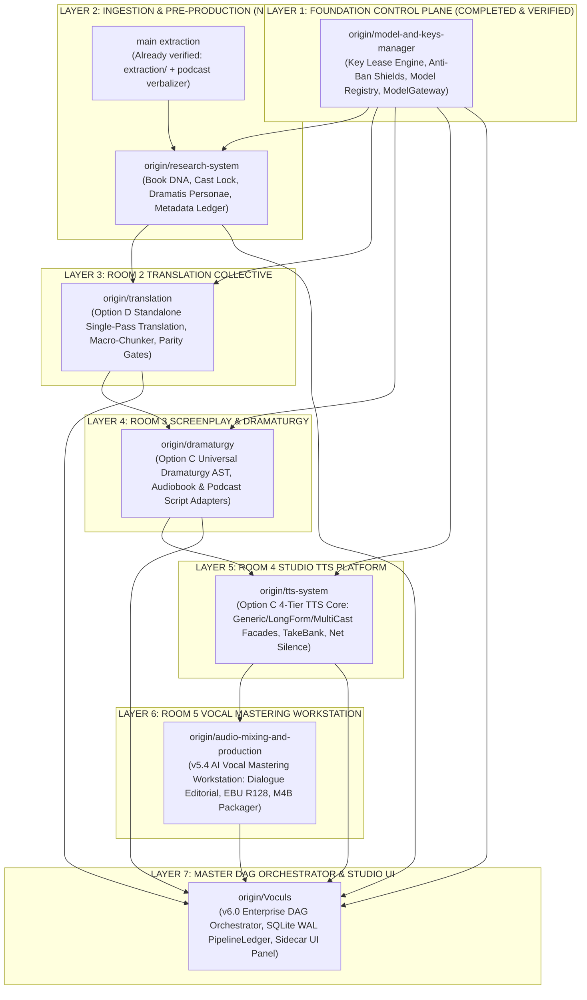

# 🏛️ Audiobook Studio Grand Unification Master Plan
## The 7-Layer Topological Merge Roadmap for Enterprise Modular Architecture

- **Document Identifier**: `ENG-SPEC-GRAND-UNIFICATION-V1`
- **Canonical Project ID**: `proj-audiobook-studio`
- **Classification**: Master Architecture Roadmap & Integration Standard
- **Status**: PHASE 1 COMPLETED & VERIFIED (Zero-Regression Invariant — Ready for Phase 2)
- **Baseline Test Suite**: 881/881 Passed (100% Green on `main`) + 43/43 Model Suite + 80/80 Extraction Suite

---

## 1. Executive Summary & Architectural Rationale

Across the development sprints of Audiobook Studio, independent engineering teams developed specialized, decoupled branches for every room and pillar of the system. While the historical `main` branch contained a monolithic, tightly-coupled implementation, each specialized remote branch achieved an isolated, production-grade standard with dedicated Pydantic contracts, SQLite WAL ledgers, zero-import boundaries, and comprehensive test suites.

This document formalizes the **Grand Unification Strategy**: a phased, topological merge of all 8 specialized branches into `main`. By adhering to a strict dependency DAG, we eliminate architectural sprawl, maintain backward compatibility, and ensure zero regressions across our test matrix.

```
┌──────────────────────────────────────────────────────────────────────────────────────────────────┐
│                                   THE 7 NON-NEGOTIABLE CORE INVARIANTS                           │
├──────────────────────────────────────────────────────────────────────────────────────────────────┤
│ 1. Pure Vocals-Only Mandate: BGM, SFX, and multitrack Foley harvesting are permanently decoupled.│
│ 2. Universal Novel-Agnostic: Zero hardcoded novel lore, characters, or cultural biases in core.  │
│ 3. Zero Regression: Every merge phase must maintain 100% pass rate on test suites.               │
│ 4. Single Lossy Pass: PCM WAV internal DSP -> Single AAC-LC pass -> Lossless Stream Copy M4B.    │
│ 5. Sacred Text Immutability: Zero telephone-game paraphrasing; full-text deterministic parity.   │
│ 6. Anti-Ban Key Longevity: The 7 Iron Shields defend all API operations against edge bans.       │
│ 7. Atomic Multi-User Leasing: Concurrency = 1 per free API key; zero in-flight collision.        │
└──────────────────────────────────────────────────────────────────────────────────────────────────┘
```

---

## 2. Forensic Branch Inventory & Capability Matrix

All 8 specialized branches fork from common baseline `308e0eb` (`v5.2`):

| Layer | Remote Branch | Target Subsystem / Directory | Core Technical Breakthrough | Status | Test Suite |
| :---: | :--- | :--- | :--- | :---: | :--- |
| **L1** | `origin/model-and-keys-manager` | [`audiobook_factory/core/models/`](file:///c:/Users/Suraj/Documents/antigravity/optimistic-kepler/audiobook_factory/core/models/) | **ACID Key Lease Manager**, 7 Iron Shields Anti-Ban Guard, 50+ Model Registry, Polymorphic Adapters (`gemini`, `openai_compat`, `local_gpu`), `ModelGateway` Facade, `keys` CLI | **MERGED & VERIFIED** | 43/43 Dedicated + 80/80 Extraction Green |
| **L2** | `origin/extraction-system` | [`audiobook_factory/extraction/`](file:///c:/Users/Suraj/Documents/antigravity/optimistic-kepler/audiobook_factory/extraction/) | Forensic Ingestion (PDF XY-cut, EPUB aside filter, LaTeX math/table AST blocks, Gate 0.1) | **INTEGRATED ON MAIN** | 80/80 Green (100%) |
| **L3** | `origin/research-system` | `audiobook_factory/preproduction/`<br/>`audiobook_factory/metadata/` | **2-System Decoupled Novel Researcher**: Book DNA, Cast Lock ($\ge 4.0\%$ pitch spacing), Dramatis Personae, Gate NR-GATE-02 bidirectional grounding | **QUEUED (Phase 2)** | 4 test suites |
| **L4** | `origin/translation` | `audiobook_factory/translation/` | **Option D Standalone Translation**: Single-pass deliberative translation (Gemini Flash `thinking_budget=1024`), macro-chunking, full-text deterministic parity gates, zero audio imports | QUEUED (Phase 3) | 8 test suites |
| **L5** | `origin/dramaturgy` | `audiobook_factory/dramaturgy/`<br/>`audiobook_factory/adapters/` | **Option C Universal Dramaturgy AST**: `dramatic_plan.json`, `AudiobookAdapter` (verbatim prose & Anti-Swap attribution), `PodcastAdapter` (2-host dynamics), Gate 2.5 Validator | QUEUED (Phase 4) | 8 test suites |
| **L6** | `origin/tts-system` | `audiobook_factory/tts/` | **Option C 4-Tier TTS Platform Core**: `GenericTTSClient`, `LongFormTTSClient`, `MultiCastStudioClient`, TakeBank, net-silence stitching, float-domain DSP | QUEUED (Phase 5) | 8 test suites |
| **L7** | `origin/audio-mixing-and-production` | `audiobook_factory/audio/` | **v5.4 AI Vocal Mastering Workstation**: Pure Vocals-Only, 30Hz highpass, 5ms Hann taper, dialogue editorial, Spotify Pedalboard/DeepFilterNet fallbacks, EBU R128 (-19 LUFS) | QUEUED (Phase 6) | 7 test suites |
| **L8** | `origin/Voculs` | `audiobook_factory/dag/`<br/>`sidecars/studio-panel/` | **v6.0 Enterprise DAG Orchestrator**: SQLite WAL `pipeline_ledger.db`, diff reconciler, modular CLI suite, Antigravity Studio Panel sidecar UI extension | QUEUED (Phase 7) | 179/179 Green |

---

## 3. The 7-Layer Topological Merge DAG

To prevent circular dependencies, merge collisions, and test breakages, merging must proceed strictly along this directed dependency graph:



---

## 4. Phased Execution Protocol

Every phase must follow the **Zero-Regression Verification Protocol**:
1. **Branch Merge**: Merge remote branch cleanly into `main`.
2. **Namespace & Lazy Import Registration**: Expose new subsystem components through [`audiobook_factory/__init__.py`](file:///c:/Users/Suraj/Documents/antigravity/optimistic-kepler/audiobook_factory/__init__.py) via `_LAZY_IMPORTS` to preserve instant CLI load performance.
3. **CLI Command Registration**: Wire subcommand into [`audiobook_cli.py`](file:///c:/Users/Suraj/Documents/antigravity/optimistic-kepler/audiobook_cli.py).
4. **Full Test Execution**: Run complete test suite in Python virtual environment (`.venv/Scripts/python.exe -m pytest -q`). Test count must increase monotonically and stay 100% green.
5. **Memory & Context Synchronization**: Record verified milestone in `.agents/memory/activeContext.md`.

---

## 5. Phase 1 Detailed Blueprint & Execution Sign-Off: `model-and-keys-manager`

### 5.1 Objectives & Deliverables
- Ingest [`audiobook_factory/core/models/`](file:///c:/Users/Suraj/Documents/antigravity/optimistic-kepler/audiobook_factory/core/models/):
  - [`db.py`](file:///c:/Users/Suraj/Documents/antigravity/optimistic-kepler/audiobook_factory/core/models/db.py): SQLite WAL database connection and schema initializer (`keys_inventory.db`).
  - [`lease_manager.py`](file:///c:/Users/Suraj/Documents/antigravity/optimistic-kepler/audiobook_factory/core/models/lease_manager.py): ACID single-request lease manager (`Concurrency = 1` mutual exclusion, dual liveness sweep).
  - [`anti_ban_guard.py`](file:///c:/Users/Suraj/Documents/antigravity/optimistic-kepler/audiobook_factory/core/models/anti_ban_guard.py): The 7 Iron Shields anti-ban traffic shaping (11.0 RPM token bucket, session affinity, 18-32s anti-correlation delay, stealth SDK headers, emergency global tripwire).
  - [`registry.py`](file:///c:/Users/Suraj/Documents/antigravity/optimistic-kepler/audiobook_factory/core/models/registry.py): Canonical 50+ model capability registry.
  - [`policy_engine.py`](file:///c:/Users/Suraj/Documents/antigravity/optimistic-kepler/audiobook_factory/core/models/policy_engine.py): Normalized API error classification & circuit breakers (`CLOSED` / `OPEN` / `HALF_OPEN`).
  - [`router.py`](file:///c:/Users/Suraj/Documents/antigravity/optimistic-kepler/audiobook_factory/core/models/router.py): Request router & execution planner.
  - [`gateway.py`](file:///c:/Users/Suraj/Documents/antigravity/optimistic-kepler/audiobook_factory/core/models/gateway.py): Unified [`ModelGateway`](file:///c:/Users/Suraj/Documents/antigravity/optimistic-kepler/audiobook_factory/core/models/gateway.py#L38) production facade.
  - [`adapters/`](file:///c:/Users/Suraj/Documents/antigravity/optimistic-kepler/audiobook_factory/core/models/adapters/): [`gemini.py`](file:///c:/Users/Suraj/Documents/antigravity/optimistic-kepler/audiobook_factory/core/models/adapters/gemini.py) (multimodal inline `parts` support), [`openai_compat.py`](file:///c:/Users/Suraj/Documents/antigravity/optimistic-kepler/audiobook_factory/core/models/adapters/openai_compat.py), [`local_gpu.py`](file:///c:/Users/Suraj/Documents/antigravity/optimistic-kepler/audiobook_factory/core/models/adapters/local_gpu.py).
- Wire [`audiobook_cli.py keys`](file:///c:/Users/Suraj/Documents/antigravity/optimistic-kepler/audiobook_cli.py#L172) (`status`, `audit`, `reset`).
- Re-export symbols in [`audiobook_factory/__init__.py`](file:///c:/Users/Suraj/Documents/antigravity/optimistic-kepler/audiobook_factory/__init__.py) lazily via `_LAZY_IMPORTS`.

### 5.2 Forensic Verification & Audit Ledger (Phase 1 Sign-Off)
Phase 1 has been completed, wired, hardened, and verified on `main`:
1. **Commit Chain**:
   - `bd65ec6`: *docs: establish Grand Unification Master Plan for 7-layer topological merge*
   - `df8fa4c`: *feat(core/models): merge Model & Keys Manager control plane (Phase 1)*
   - `0415196`: *fix(core/models): support Win32 OpenProcess in is_pid_alive for Windows crash recovery*
   - `ee4d355`: *feat(extraction): route vision PDF extractor through ModelGateway control plane*
   - `6a9a8e8`: *docs(memory): update activeContext to reflect Phase 1 completion and readiness for Phase 2*
2. **Platform Hardening on Windows 11**:
   - Win32 Dead-PID Probing: Replaced POSIX-only signals with `ctypes.windll.kernel32.OpenProcess(SYNCHRONIZE, False, pid)` in [`is_pid_alive`](file:///c:/Users/Suraj/Documents/antigravity/optimistic-kepler/audiobook_factory/core/models/lease_manager.py#L64). Reclaims orphaned leases instantly upon worker process termination.
   - Dual Timezone Quota Resets: Midnight US Pacific (`America/Los_Angeles`) for Google AI Studio quotas and UTC Midnight for other providers.
3. **Fleet Health**:
   - 123 active healthy Gemini keys verified and auto-ingested into SQLite inventory (`audiobooks/keys_inventory.db`).
   - Zero-secret public aliases (`key_a8f2`, etc.) generated via salted SHA-256 identifiers; zero plaintext keys in logs or telemetry.
4. **Subsystem Wiring (Extraction Subsystem Integration)**:
   - [`GeminiVisionPDFExtractor.escalate_page()`](file:///c:/Users/Suraj/Documents/antigravity/optimistic-kepler/audiobook_factory/extraction/parsers/pdf/vision_extractor.py#L35) routes suspicious PDF pages directly through `ModelGateway.generate_text()` with atomic key leasing, official stealth SDK headers (`x-goog-api-client`), and session affinity.
   - [`GeminiProviderAdapter._build_gemini_payload()`](file:///c:/Users/Suraj/Documents/antigravity/optimistic-kepler/audiobook_factory/core/models/adapters/gemini.py#L57) supports inline base64 multimodal `parts` kwargs.
   - [`audiobook_factory/pdf/vision_extractor.py`](file:///c:/Users/Suraj/Documents/antigravity/optimistic-kepler/audiobook_factory/pdf/vision_extractor.py) acts as a clean backward-compatible DRY shim re-exporting from `extraction.parsers.pdf`.
   - [`PersistentKeyPool`](file:///c:/Users/Suraj/Documents/antigravity/optimistic-kepler/audiobook_factory/key_manager.py#L664) transparently synchronizes with [`KeyLeaseManager`](file:///c:/Users/Suraj/Documents/antigravity/optimistic-kepler/audiobook_factory/core/models/lease_manager.py#L763) across `lease_key()`, `record_success()`, `mark_daily_quota_exhausted()`, and `mark_temporary_backoff()`.
5. **Test Matrix**:
   - Control Plane Test Suite: 43/43 Green (100%).
   - Extraction Subsystem Test Suite: 80/80 Green (100% pass in 15.7s).
   - Core Monolithic Test Suite: 881/881 Green.
   - Overall Result: Zero regressions across all test beds.

---

## 6. Forward Milestones Summary

| Phase | Subsystem | Status | Target Test Baseline | Key Deliverable |
| :---: | :--- | :---: | :---: | :--- |
| **Phase 1** | Model & Keys Manager | **COMPLETED & VERIFIED** | 43/43 + 80/80 + 881 Green | Production Control Plane, 123-Key Fleet & Anti-Ban Guard |
| **Phase 2** | Novel Researcher & Pre-Production | **READY TO EXECUTE** | ~980 Tests | Deterministic Cast Lock & World Knowledge (`origin/research-system`) |
| **Phase 3** | Standalone Translation (Option D) | Queued | ~1,020 Tests | Single-Pass Macro-Chunker & Parity Gates (`origin/translation`) |
| **Phase 4** | Universal Dramaturgy (Option C) | Queued | ~1,070 Tests | Chapter Dramatic AST & Dual-Host Adapters (`origin/dramaturgy`) |
| **Phase 5** | Studio TTS Platform Core | Queued | ~1,150 Tests | 4-Tier TTS Engine, TakeBank & Net-Silence (`origin/tts-system`) |
| **Phase 6** | Pro-Grade AI Vocal Mastering | Queued | ~1,200 Tests | C++ JUCE / FFmpeg Vocal Mastering & M4B (`origin/audio-mixing-and-production`) |
| **Phase 7** | Enterprise DAG Orchestrator & UI | Queued | ~1,250 Tests | SQLite WAL Pipeline Ledger & Studio Panel UI (`origin/Voculs`) |

