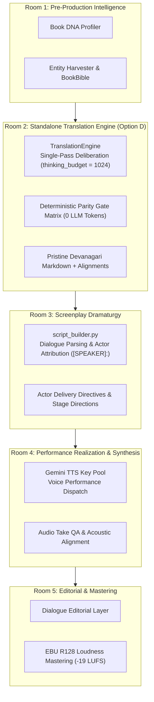

# Literary Translation Intelligence Engine (Pillar 2 — Option D Decoupled Architecture)

> **Canonical System**: Audiobook Studio (`audiobook-studio`)  
> **Subsystem**: Pillar 2 — Literary English-to-Hindi Translation Engine  
> **Architecture Version**: `v5.3.0` (Option D: Decoupled Token-Optimized Hybrid Architecture)  
> **Target LLM Runtime**: Google Gemini Flash (`thinking_budget = 1024`, `temperature = 0.35`)  
> **Status**: Active Production Standard  

---

## 1. Executive Summary & Design Rationale

The **Literary Translation Intelligence Engine** is the standalone, decoupled subsystem responsible for translating English literary fiction and classic literature into publication-grade, dramatic, actable spoken Hindustani (Devanagari script).

In **Architecture Version 5.3.0 (Option D)**, the engine achieves two foundational goals:
1. **Total Subsystem Independence & Decoupling**: The translation engine has zero imports and zero operational dependencies on downstream audio hardware, TTS engines (`TTSDispatcher`), FFmpeg DSP, screenplay staging, or mastering layers. It functions as an independent, scalable, and reusable library or microservice.
2. **Robust Token-Optimized Hybrid Execution**: It replaces both the flawed 80-call micro-scene pipeline (Architecture A) and the destructive 4-pass serial rewrite cascade (Architecture B) with a **Single-Pass Generative Pass with Internal Deliberation (`thinking_budget = 1024`, `temperature = 0.35`)**, supported by **Bilingual Macro-Chunking** and **Fast Full-Text Deterministic Parity Gates**.

---

## 2. Forensic Evolution: Why Option D Was Chosen

To ensure transparent reasoning across all teams ("Hawa me kam nahi karenge"), the architectural failure modes and evolutionary choices are documented below:

```
+-------------------------------------------------------------------------------------------------------+
| ARCHITECTURE A: 32-Module Micro-Scene Pipeline (Over-Engineered)                                      |
| • Flaw: Sliced chapters into 250-word micro-scenes; fired 70-90 API calls per chapter (semantic maps, |
|   intensity evaluators, scene audits, tiered repairs). Burned RPM/RPD quotas on Gemini Free Tier.     |
| • Result: Deprived LLM of narrative context, generated literal calques, completely unviable.         |
+-------------------------------------------------------------------------------------------------------+
                                                   ↓
+-------------------------------------------------------------------------------------------------------+
| ARCHITECTURE B: 4-Pass Serial Rewrite Collective (Paraphrase Telephone Game)                           |
| • Flaw: Sliced into 1,600-word chunks, then ran 4 serial full-text LLM rewrites (Draft -> Cadence ->  |
|   Idiom -> Critic). Rewrote already translated text repeatedly.                                       |
| • Result: Recursive paraphrase drift, hallucinated idioms/curses, 300% output token waste, 29% word   |
|   loss allowed without rollback. Patched with hardcoded Witcher regexes causing racial/colorist bias.  |
+-------------------------------------------------------------------------------------------------------+
                                                   ↓
+-------------------------------------------------------------------------------------------------------+
| ARCHITECTURE D: Robust Token-Optimized Hybrid (Option D — CANONICAL STANDARD)                         |
| • Innovation 1: Single-pass, high-power generative translation with `thinking_budget = 1024`.         |
| • Innovation 2: Bilingual Rolling Context (Source + Target tail) on cohesive macro-chunks (1800-2200w).|
| • Innovation 3: Fast Full-Text Deterministic Parity Gates (0 LLM tokens, 100% chapter coverage).      |
| • Innovation 4: Zero hardcoded novel lore; full decoupling from downstream audio systems.             |
| • Innovation 5: Native backward compatibility via `MultiAgentTranslationCollective` fallback switch.  |
| • Result: 95% reduction in API calls, zero telephone-game drift, pristine literary cadence.           |
+-------------------------------------------------------------------------------------------------------+
```

---

## 3. Separation of Concerns & Boundary Contracts

A core architectural invariant of Audiobook Studio is rigorous boundary separation between production rooms:



### 3.1 Strict Room 2 Boundary Rules

1. **Strictly Text-to-Text**: Room 2 ingests raw English text and emits pristine Devanagari Markdown. It does not touch audio, speech engines, or timestamps.
2. **Never Inject Screenplay Actor Tags**: Room 2 **NEVER** injects screenplay actor markers (such as `[GERALT]:` or JSON speaker attribution dictionaries). Dialogue parsing and speaker identification belong 100% to Room 3 (`audiobook_factory.script.script_builder`).
3. **Never Attempt Audio Take QA or Synthesis**: Room 2 **NEVER** attempts audio generation or audio take QA. Acoustic verification and speech synthesis belong strictly to Room 4.
4. **Zero Forbidden Imports**: `audiobook_factory/translation/` strictly bans imports from:
   - `audiobook_factory.audio` and `audiobook_factory.audio_utils`
   - `audiobook_factory.tts`
   - `audiobook_factory.script` (or `screenplay`)
   - `audiobook_factory.cinematic`
   - Audio drivers (`sounddevice`, `pyaudio`, `ffmpeg`, `wave`)

---

## 4. The 5 Core Pillars of Option D

### Pillar 1: Pre-Ingestion Entity Partitioning & Lore Harmonization
To eradicate comic-book transliterations (*"द बुचर"*, *"स्पॉटी-फेस्ड मैन"*) and eliminate hardcoded novel names from python code, the engine enforces a **Tri-Partite Entity Partition**:
1. **Personal Proper Names & Heraldic Surnames** (*Victor, Marcus, Elena, Borch Three Jackdaws*): Phonetically transliterated into clean Devanagari (*विक्टर, मार्कस, एलेना, बोर्च थ्री जैकडॉज*).
2. **Occupational Roles & Descriptive Epithets** (*The Butcher, The Spotty-faced Man, The Alderman, The Innkeeper*): Translated into evocative, natural Hindustani (*कसाई, दाग़दार चेहरे वाला आदमी, एल्डरमैन/नगर प्रमुख, सरायवाला*).
3. **World Lore, Currencies & Weapons** (*Silver Blade, Orens, Council*): Mapped to consistent canon Devanagari without Indian village panchayat clichés (*'पंच जी', 'लंबरदार', 'अशर्फी'* banned for European fantasy; *'मेयर', 'सिक्के'* permitted).

### Pillar 2: Bilingual Context-Aware Macro-Chunking
- Chapters $\le 2,200$ words are translated in **a single cohesive generation pass**.
- Chapters $> 2,200$ words are segmented along paragraph boundaries at 1,500–1,800 words.
- To prevent pronoun flips, character amnesia, and abrupt tonal shifts across chunk seams, every chunk after Chunk 1 is supplied with **Bilingual Rolling Context**:
  - Preceding 150 words of source English text.
  - Preceding 150 words of target Hindi Devanagari text.

### Pillar 3: Single-Pass Generative Translation with Deliberation
Instead of cascading through 4 serial paraphrasing agents, Option D utilizes a single, authoritative generation pass with `thinking_budget = 1024` and `temperature = 0.35`:
- Gemini Flash deliberates internally on:
  - English SVO to Hindi SOV clause restructuring.
  - Dynamic honorific status (*आप* vs *तुम* vs *तू*).
  - Contextual idioms (*Muhavare*) without literal calques.
  - Authentic register without gratuitous escalation ("Nothing Above Source").
- Emits pristine Devanagari Markdown with paragraph breaks (`\n\n`) preserved.

### Pillar 4: Deterministic Parity Gate Matrix (0 LLM Tokens)
Replaces the 70% blind 6,000-character LLM judges with five zero-token deterministic checks running on the complete chapter:
1. **Word Count & Length Ratio Gate**: Target word count must achieve $\ge 75\%$ of source length ratio.
2. **Paragraph Count Parity Gate**: Target paragraph count must match source paragraph count within $\pm 15\%$ (fails closed for texts $> 2$ paragraphs).
3. **Dialogue Quote Count Parity Gate**: Double-quotation dialogue count pairs must match source within $\pm 10\%$.
4. **Negation Marker Parity Gate**: Evaluates negation polarity parity while preventing double counting between compound and single tokens.
5. **Zero Leaked Latin / Entity Spelling Gate**: Scans for untranslated English entity names and verifies exact Devanagari spellings.

### Pillar 5: Backward-Compatible Collective Integration
[`MultiAgentTranslationCollective`](file:///data/data/com.termux/files/home/audiobook-studio/audiobook_factory/translation/agents/collective.py) serves as the backwards-compatible facade:
- **Default (`use_single_pass=True`)**: Calls `TranslationEngine` directly with `thinking_budget = 1024` and audits output via `quality_critic.audit_and_certify()`.
- **Legacy Fallback (`use_single_pass=False`)**: Calls `translate_block_legacy()` executing the original 4-pass serial cascade (Draft $\rightarrow$ Cadence $\rightarrow$ Idiom $\rightarrow$ Critic).

---

## 5. Adversarial Audit Bug Fixes

Recent adversarial audits identified edge cases in parity validation and module imports. The following hardening fixes have been incorporated:

### 5.1 Negation Double-Counting Separation
In [`parity_gate.py`](file:///data/data/com.termux/files/home/audiobook-studio/audiobook_factory/translation/parity_gate.py#L79-L88):
- **Problem**: When auditing Hindi negations, compound phrases (e.g. `कभी नहीं`, `कुछ नहीं`, `कोई नहीं`) were matched, and then a subsequent token scan matched single words (`नहीं`, `मत`, etc.). Consequently, compound phrases were counted twice, causing artificial negation inflation.
- **Solution**: Compound patterns are matched, tallied, and **removed** from the text before single-token evaluation:
  ```python
  @staticmethod
  def _count_negations_hindi(text: str) -> int:
      count = 0
      cleaned = text
      for pat in HINDI_COMPOUND_NEGATION_PATTERNS:
          matches = re.findall(pat, cleaned)
          count += len(matches)
          cleaned = re.sub(pat, " ", cleaned)
      tokens = re.findall(r"[\u0900-\u097F]+", cleaned)
      count += sum(1 for t in tokens if t in HINDI_SINGLE_NEGATIONS)
      return count
  ```

### 5.2 Truncation Blind Spot Fail-Closed Logic
In [`parity_gate.py`](file:///data/data/com.termux/files/home/audiobook-studio/audiobook_factory/translation/parity_gate.py#L107-L111):
- **Problem**: Short passages with $> 2$ paragraphs could drop paragraphs without triggering a failure if the divergence was within a loose delta window.
- **Solution**: The gate fails closed for any text containing more than 2 paragraphs, or whenever the paragraph delta exceeds 1:
  ```python
  if abs(para_ratio - 1.0) > self.paragraph_tolerance:
      if src_paras > 2 or abs(tgt_paras - src_paras) > 1:
          rejection_reasons.append(
              f"Paragraph count divergence: source has {src_paras}, target has {tgt_paras} "
              f"(ratio {para_ratio:.2f}, limit +/- {self.paragraph_tolerance:.2f})"
          )
  ```

### 5.3 Purged `audio_utils` Import Leak
In [`orchestrator.py`](file:///data/data/com.termux/files/home/audiobook-studio/audiobook_factory/translation/orchestrator.py#L22-L25):
- **Problem**: `orchestrator.py` previously imported atomic file replacement from `audiobook_factory.audio_utils`, creating a forbidden dependency on the audio module.
- **Solution**: Replaced with standard library `os.replace`:
  ```python
  def _atomic_replace(src: Path, dst: Path) -> None:
      """Atomically replaces destination file with source file without audio dependencies."""
      import os
      os.replace(src, dst)
  ```

---

## 6. Public Data Contracts (`contracts.py`)

All interaction with the translation engine is governed by strongly typed Pydantic models:

```python
from enum import Enum
from typing import Any, Dict, List, Optional
from pydantic import BaseModel, Field


class FidelityTier(str, Enum):
    """Stylistic guidance tier for literary Hindustani translation."""
    RAW_UNRATED = "RAW_UNRATED"          # Mature dark fantasy, visceral combat, uncensored tavern slang
    CLASSIC_REVERENT = "CLASSIC_REVERENT"  # Heritage classics (Premchand, Tagore), dignified pathos, zero profanity


class TranslationRequest(BaseModel):
    """Input payload for a standalone translation request."""
    source_text: str = Field(..., description="Full raw source text of the chapter or document.")
    source_title: str = Field(default="", description="Optional title or chapter heading.")
    tier: FidelityTier = Field(default=FidelityTier.RAW_UNRATED, description="Stylistic guidance tier.")
    book_bible_path: Optional[str] = Field(default=None, description="Path to persistent book_bible.json.")
    dynamic_glossary: Dict[str, str] = Field(default_factory=dict, description="In-memory entity translations (en -> hi).")
    chunk_size_words: int = Field(default=1800, ge=500, le=3000, description="Target macro-chunk word count.")
    max_single_chunk_words: int = Field(default=2200, ge=1000, le=4000, description="Max word count to translate in 1 call.")
    thinking_budget: int = Field(default=1024, ge=0, le=4096, description="Gemini Flash internal deliberation budget.")
    source_language: str = Field(default="en", description="Source ISO language code.")
    target_language: str = Field(default="hi", description="Target ISO language code.")
    temperature: float = Field(default=0.35, ge=0.0, le=1.0, description="Sampling temperature.")
    metadata: Dict[str, Any] = Field(default_factory=dict, description="Optional caller metadata.")


class ParagraphAlignment(BaseModel):
    """Bilingual sentence/paragraph alignment mapping for provenance and QA."""
    index: int = Field(..., description="0-indexed sequence number of the paragraph.")
    source_paragraph: str = Field(..., description="Source English paragraph text.")
    target_paragraph: str = Field(..., description="Target Hindi Devanagari paragraph text.")
    source_hash: str = Field(..., description="SHA-256 hash (first 16 hex chars) of source paragraph.")
    target_hash: str = Field(..., description="SHA-256 hash (first 16 hex chars) of target paragraph.")


class ParityMetrics(BaseModel):
    """Deterministic full-text parity verification metrics."""
    source_paragraph_count: int
    target_paragraph_count: int
    paragraph_parity_ratio: float
    source_quote_count: int
    target_quote_count: int
    quote_parity_ratio: float
    source_word_count: int
    target_word_count: int
    length_ratio: float
    source_negations_count: int
    target_negations_count: int
    passed_all_gates: bool
    rejection_reasons: List[str] = Field(default_factory=list)


class TranslationResult(BaseModel):
    """Output payload from the standalone translation engine."""
    translated_markdown: str = Field(..., description="Pristine Hindi Devanagari translation.")
    alignments: List[ParagraphAlignment] = Field(default_factory=list, description="Paragraph-level alignment map.")
    parity: ParityMetrics = Field(..., description="Deterministic full-text validation report.")
    new_entities_discovered: Dict[str, str] = Field(default_factory=dict, description="Extracted terminology additions.")
    total_chunks: int = 1
    llm_calls_made: int = 1
    elapsed_seconds: float = 0.0
```

---

## 7. Standalone CLI & Programmatic Usage

### 7.1 CLI Commands

#### Translating a Document
```bash
python -m audiobook_factory.translation.cli translate \
    source_chapter.txt \
    -o chapter_hi.md \
    --tier RAW_UNRATED \
    --budget 1024
```

#### Auditing Parity
```bash
python -m audiobook_factory.translation.cli parity \
    source_chapter.txt \
    chapter_hi.md
```

### 7.2 Programmatic Usage

```python
from audiobook_factory.translation.contracts import FidelityTier, TranslationRequest
from audiobook_factory.translation.engine import TranslationEngine

# Initialize standalone engine
engine = TranslationEngine(model_name="gemini-2.5-flash")

# Configure request
request = TranslationRequest(
    source_text="The sorceress turned slowly, eyes filled with cold rage. 'You know nothing of sacrifice.'",
    source_title="Chapter 4",
    tier=FidelityTier.RAW_UNRATED,
    thinking_budget=1024,
    temperature=0.35,
)

# Execute translation
result = engine.translate(request)

print(result.translated_markdown)
print(f"Parity Passed: {result.parity.passed_all_gates}")
print(f"Total Chunks: {result.total_chunks} | Elapsed: {result.elapsed_seconds}s")
```

---

## 8. Eliminated Failure Modes & Anti-Patterns

| Anti-Pattern / Bug | Root Cause in Legacy Pipeline | Option D Hardened Solution |
| :--- | :--- | :--- |
| **"Three Jackdaws" Overfitting** | Hardcoded regex `तीन कौवे -> थ्री जैकडॉज` in `sanitizer.py`. | **Purged**. All monikers classified dynamically into `BookBible.proper_names`. Zero hardcoded novel names in codebase. |
| **Racial / Colorist Calque Distortion** | Regex replacing `सुनहरी लड़की` with `गोरी-चिट्टी लड़की` in `sanitizer.py`. | **Purged**. Strict sense-for-sense translation without racial stereotyping or unsolicited complexion swaps. |
| **Paraphrase Telephone Game** | 4 serial LLM rewrites in `MultiAgentTranslationCollective`. | **Eliminated**. Single-pass deliberative generation (`thinking_budget = 1024`, `temperature = 0.35`). |
| **70% Blind Evaluator Sample** | `sample_stratified_text(6000)` discarding 80% of chapter in Gate 0. | **Replaced** with 100% full-text deterministic parity gates running locally at zero token cost. |
| **Negation Double Counting** | Matching single token `नहीं` inside compound `कभी नहीं`. | **Fixed**. Compound patterns stripped from buffer before single tokens evaluated. |
| **Paragraph Truncation Blind Spot** | Loose delta check permitting paragraph drops on short texts. | **Fixed**. Texts with $> 2$ paragraphs fail closed on paragraph count divergence. |
| **`audio_utils` Leak in Orchestrator** | Importing atomic replacement from audio utils. | **Fixed**. Replaced with localized standard library `os.replace`. |
| **Cross-Room Responsibility Bleed** | Injecting actor tags or checking audio paths in translation. | **Strict Boundary**. Room 2 emits pristine Devanagari Markdown only; dialogue tags belong to Room 3; audio QA to Room 4. |
