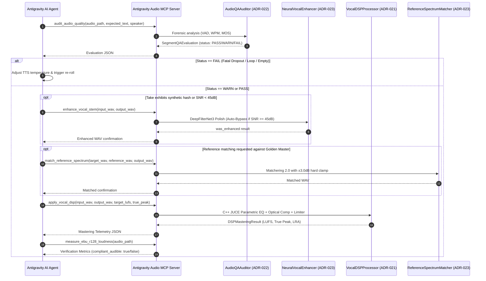

# 🤖 AI Agent & MCP Integration Guide (Antigravity Audio MCP Server v5.4)

## 📖 Overview

**Audiobook Studio (v5.4)** is designed for autonomous agentic operation within Google Antigravity, Claude Desktop, and MCP-compatible orchestration environments. The **Antigravity Audio MCP Server** ([`audiobook_factory/mcp/server.py`](file:///c:/Users/Suraj/Documents/antigravity/optimistic-kepler/audiobook_factory/mcp/server.py)) provides a standardized, strongly-typed JSON-RPC tool suite allowing autonomous LLM agents to execute studio vocal mastering, forensic quality control, neural speech polish, and reference spectrum matching.

---

## 🏗️ Architecture & Agent Execution Lifecycle

The MCP integration allows agents to interact with the audio pipeline via a closed-loop forensic audit and mastering lifecycle:



---

## 🛠️ Specialized Agent Skills

The repository equips Antigravity autonomous agents with two specialized production skills located in [`.agents/skills/`](file:///c:/Users/Suraj/Documents/antigravity/optimistic-kepler/.agents/skills/):

### 1. `novel-audiobook-factory`
- **Location**: [`.agents/skills/novel-audiobook-factory/SKILL.md`](file:///c:/Users/Suraj/Documents/antigravity/optimistic-kepler/.agents/skills/novel-audiobook-factory/SKILL.md)
- **Scope**: Autonomous studio-grade pure vocals-only audiobook production engine.
- **Trigger**: Activates whenever the user provides a novel manuscript (`.epub`, `.pdf`, `.txt`, `.md`) and requests an audiobook.
- **Workflow**: Coordinates geometric document extraction, literary Hindustani translation, sliding-window screenplay attribution, speech synthesis via Google Gemini Flash TTS, 4D acoustic formants, dialogue editorial snapping, and EBU R128 mastering.

### 2. `audio-engineer-ffmpeg`
- **Location**: [`.agents/skills/audio-engineer-ffmpeg/SKILL.md`](file:///c:/Users/Suraj/Documents/antigravity/optimistic-kepler/.agents/skills/audio-engineer-ffmpeg/SKILL.md)
- **Scope**: Studio vocal audio engineering, 4D parametric EQ formants, and FFmpeg mastering.
- **Capabilities**:
  - Broadcast EBU R128 loudness targeting (-19.0 LUFS integrated, -1.5 dBTP ceiling).
  - 4D acoustic formant DSP (pitch `asetrate`, tempo `atempo`, parametric EQ curves).
  - Raised-cosine Hann micro-fades (12ms pre-speech, 18ms post-speech).
  - Self-healing FFmpeg `filter_complex` graphs and chaptered M4B packaging.

---

## 🔌 Standardized MCP Tool Suite

The Antigravity Audio MCP Server implements 6 standardized tools exposed via stdio JSON-RPC.

### 1. `apply_vocal_dsp`
Applies C++ JUCE parametric vocal EQ (75Hz rumble cut, 320Hz boxiness notch, 3.2kHz presence lift), optical compression (2.5:1 ratio), and lookahead True-Peak limiting clamped strictly to `-1.5 dBTP`. Falls back seamlessly to deterministic FFmpeg dual-pass linear mastering if Pedalboard is unavailable.

#### Input Parameters
```json
{
  "type": "object",
  "properties": {
    "input_wav": {
      "type": "string",
      "description": "Absolute path to input 48kHz WAV audio file"
    },
    "output_wav": {
      "type": "string",
      "description": "Absolute path to destination 48kHz 24-bit PCM master WAV"
    },
    "target_lufs": {
      "type": "number",
      "default": -19.0,
      "description": "EBU R128 integrated loudness target in LUFS"
    },
    "true_peak_ceiling_dbtp": {
      "type": "number",
      "default": -1.5,
      "description": "Lookahead True Peak brickwall limiter ceiling in dBTP"
    },
    "subsonic_hz": {
      "type": "number",
      "default": 75.0,
      "description": "Subsonic highpass filter cutoff frequency in Hz"
    },
    "boxiness_cut_db": {
      "type": "number",
      "default": -1.5,
      "description": "Parametric notch attenuation gain at 320 Hz in dB"
    },
    "presence_lift_db": {
      "type": "number",
      "default": 0.8,
      "description": "Speech presence clarity boost gain at 3.2 kHz in dB"
    }
  },
  "required": ["input_wav", "output_wav"]
}
```

#### Output Schema
```json
{
  "status": "SUCCESS",
  "backend_used": "pedalboard_juce_v2",
  "output_path": "C:/audiobooks/masters/chapter_001_master.wav",
  "integrated_lufs": -18.96,
  "true_peak_dbtp": -1.50,
  "loudness_range_lu": 7.42,
  "execution_duration_sec": 0.42
}
```

---

### 2. `audit_audio_quality`
Audits a single synthesized speech segment for Voice Activity Detection (VAD) boundaries, text-grounded speaking rate (WPM and char/sec), severe dropouts (>320 WPM), hallucination loops (<40 WPM), and predicted Speech MOS.

#### Input Parameters
```json
{
  "type": "object",
  "properties": {
    "audio_path": {
      "type": "string",
      "description": "Path to synthesized speech audio file on disk"
    },
    "expected_text": {
      "type": "string",
      "default": "",
      "description": "Expected screenplay dialogue or narration text"
    },
    "speaker": {
      "type": "string",
      "default": "Narrator",
      "description": "Character or Narrator name"
    },
    "segment_index": {
      "type": "integer",
      "default": 1,
      "description": "1-indexed sequence order within chapter"
    }
  },
  "required": ["audio_path"]
}
```

#### Output Schema
```json
{
  "segment_index": 1,
  "segment_uid": "c01_s001_Aoede",
  "speaker": "Narrator",
  "status": "PASS",
  "duration_ms": 3420,
  "estimated_wpm": 142.1,
  "char_per_sec": 14.8,
  "predicted_mos": 4.65,
  "silence_leading_ms": 40,
  "silence_trailing_ms": 60,
  "issues": [],
  "remediation_advice": null
}
```

---

### 3. `match_reference_spectrum`
Matches the frequency spectrum, tonal balance, and dynamic curve of target audio to a golden reference master track using Matchering 2.0. Enforces a hard $\pm 3.0\text{ dB}$ clamp to prevent acoustic artifacts.

#### Input Parameters
```json
{
  "type": "object",
  "properties": {
    "target_wav": {
      "type": "string",
      "description": "Path to target chapter or segment WAV"
    },
    "reference_wav": {
      "type": "string",
      "description": "Path to golden reference master WAV"
    },
    "output_wav": {
      "type": "string",
      "description": "Destination path for matched WAV"
    },
    "max_clamp_db": {
      "type": "number",
      "default": 3.0,
      "description": "Hard clamp ceiling on spectral EQ adjustments in dB"
    }
  },
  "required": ["target_wav", "reference_wav", "output_wav"]
}
```

#### Output Schema
```json
{
  "status": "SUCCESS",
  "output_path": "C:/audiobooks/masters/matched_take.wav",
  "max_clamp_db": 3.0
}
```

---

### 4. `enhance_vocal_stem`
Cleans synthetic TTS metallic hash, quantization noise, and room reflections via DeepFilterNet3 (48kHz full-band). Employs selective auto-bypass for pristine stems ($>45\text{ dB}$ SNR) and energy difference clamping ($|\Delta\text{RMS}| \le 2.0\text{ dB}$).

#### Input Parameters
```json
{
  "type": "object",
  "properties": {
    "input_wav": {
      "type": "string",
      "description": "Path to input speech WAV file"
    },
    "output_wav": {
      "type": "string",
      "description": "Path to output cleaned 48kHz 24-bit PCM WAV"
    },
    "snr_bypass_db": {
      "type": "number",
      "default": 45.0,
      "description": "SNR threshold above which neural enhancement is automatically bypassed"
    }
  },
  "required": ["input_wav", "output_wav"]
}
```

#### Output Schema
```json
{
  "status": "SUCCESS",
  "output_path": "C:/audiobooks/enhanced/cleaned_vocal.wav",
  "was_enhanced": true
}
```

---

### 5. `measure_ebu_r128_loudness`
Rapidly measures ITU-R BS.1770-4 Integrated Loudness (LUFS), True Peak (dBTP), and Loudness Range (LRA). Provides immediate boolean verification of Audible broadcast compliance (`compliant_audible`).

#### Input Parameters
```json
{
  "type": "object",
  "properties": {
    "audio_path": {
      "type": "string",
      "description": "Path to audio file to measure"
    }
  },
  "required": ["audio_path"]
}
```

#### Output Schema
```json
{
  "filepath": "C:/audiobooks/masters/chapter_001_master.wav",
  "integrated_lufs": -19.04,
  "true_peak_dbtp": -1.50,
  "loudness_range_lu": 7.35,
  "compliant_audible": true
}
```

---

### 6. `audit_chapter_qa`
Audits an entire chapter timeline, comparing physical speech takes against screenplay metadata to produce a consolidated forensic quality report.

#### Input Parameters
```json
{
  "type": "object",
  "properties": {
    "audio_segments": {
      "type": "array",
      "items": { "type": "string" },
      "description": "List of paths to audio segment WAV files"
    },
    "script_segments": {
      "type": "array",
      "items": { "type": "object" },
      "description": "Optional list of screenplay script segment dicts"
    },
    "chapter_num": {
      "type": "integer",
      "default": 1,
      "description": "1-indexed chapter number"
    }
  },
  "required": ["audio_segments"]
}
```

#### Output Schema
```json
{
  "chapter_num": 1,
  "total_segments": 42,
  "passed_segments": 40,
  "warned_segments": 2,
  "failed_segments": 0,
  "overall_status": "PASS",
  "mean_mos": 4.58,
  "evaluations": [ ... ]
}
```

---

## 💻 Running the Stdio MCP Server

The server can be launched directly via Python stdio for integration into Antigravity or any MCP client:

```bash
python -m audiobook_factory.mcp.server
```

Or configured in your MCP client settings (e.g. `claude_desktop_config.json` or Antigravity MCP settings):

```json
{
  "mcpServers": {
    "antigravity-audio": {
      "command": "python",
      "args": ["-m", "audiobook_factory.mcp.server"],
      "cwd": "c:/Users/Suraj/Documents/antigravity/optimistic-kepler"
    }
  }
}
```

### Stdio JSON-RPC Request Example
```json
{"tool": "measure_ebu_r128_loudness", "args": {"audio_path": "C:/audiobooks/masters/chapter_001_master.wav"}}
```
### Response Example
```json
{"status": "ok", "result": {"filepath": "C:/audiobooks/masters/chapter_001_master.wav", "integrated_lufs": -19.02, "true_peak_dbtp": -1.5, "loudness_range_lu": 7.4, "compliant_audible": true}}
```

---

## 🛡️ Agent Safety & Idempotency Rules

When developing or executing autonomous agents in this ecosystem, adhere strictly to these architectural invariants:

1. **Auto-Janitor Safety Shield**:
   Synthesized speech WAV chunks consume Google Gemini API quota. Agents must **NEVER** purge raw WAV chunks in `audio_chunks/` unless the final master audio file exists and has been certified.
2. **Fail-Closed Verification**:
   If an audio audit returns `"status": "FAIL"`, agents must halt downstream mastering and trigger automated segment re-synthesis with adjusted parameters rather than forcing pipeline progression.
3. **Atomic State Commits**:
   All state updates and audio files use atomic promotion (`atomic_write_json`), ensuring partial writes or agent timeouts never leave corrupt files on disk.
4. **Idempotent Resumption**:
   If an agent's execution context expires, restarting the process automatically resumes from the last completed DAG ledger checkpoint without re-running finished chapters.
