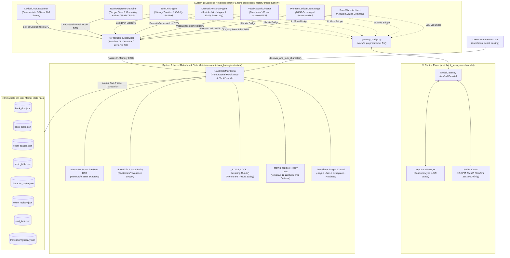
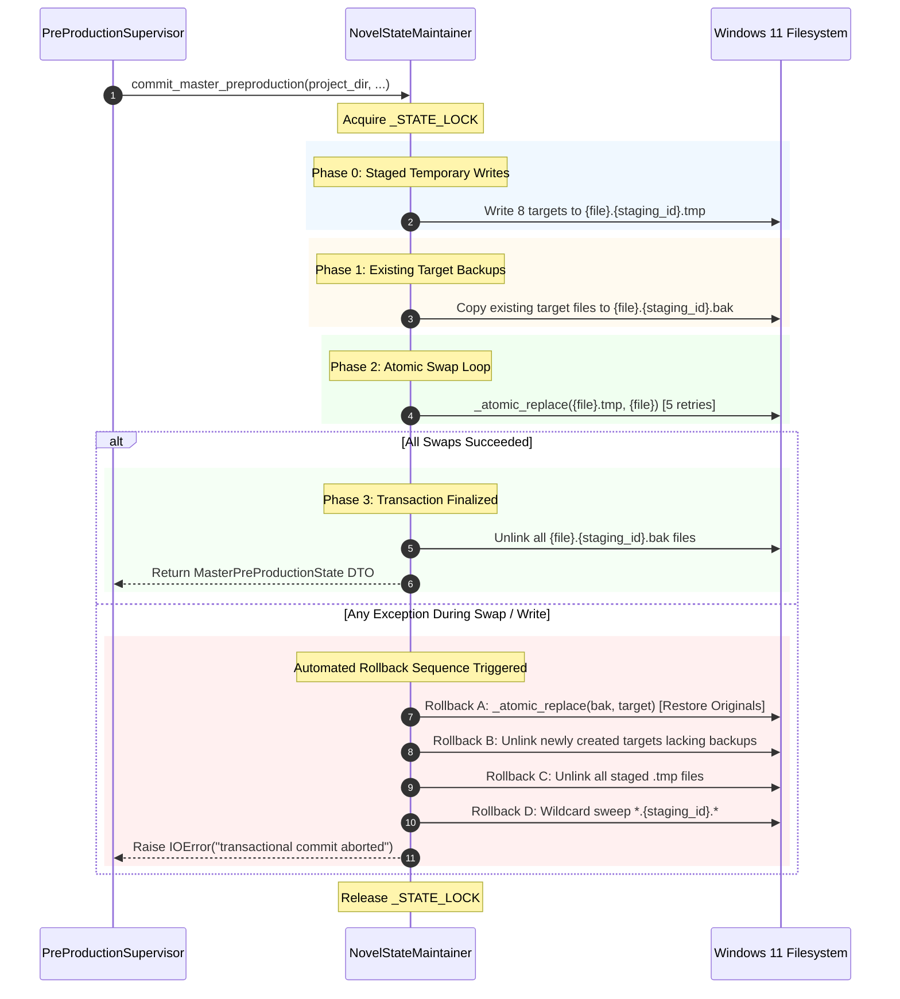

# Novel Researcher Architecture System: Engineering Specification & Implementation Standard
**Document Version:** `3.2.0-PROD`  
**System ID:** `sys-novel-researcher`  
**Canonical Project:** `proj-audiobook-studio`  
**Classification:** Core System Architecture Specification  
**Platform:** Windows 11 AI Workstation & Cross-Platform Production  
**Status:** Canonical Reference Standard (Updated post Phase 2 Merge, Control Plane Wiring & Windows 11 Hardening)

---

## 1. System Vision, Scope & Architectural Invariants

The **Novel Researcher Architecture System** (`sys-novel-researcher`) is the autonomous dramaturgy research, world-lore intelligence, and vocal casting showrunner for the studio audiobook production engine. Operating across Room 1 (Pre-Production) and downstream production rooms, it establishes immutable novel master state with cryptographic rigor, forensic provenance tracking, and zero human intervention.

```
┌────────────────────────────────────────────────────────────────────────────────────────┐
│                                SYSTEM BOUNDARY INVARIANT                               │
│                                                                                        │
│  Input: Pure text streams, chapter arrays, or semantic AST blocks.                     │
│  Output: Immutable, cryptographically verifiable, canonical novel master state:        │
│          - book_dna.json        (Literary DNA, Register & Dialect Cadence)             │
│          - book_bible.json      (Dramatis Personae, Lore Entities, Provenance Quotes)  │
│          - cast_lock.json       (Collision-Free 4D Vocal Formant Cast Registry)        │
│          - voice_registry.json  (Speaker-to-Formant DSP Parameters: Pitch, EQ, Speed) │
│          - character_roster.json(Complete Character Taxonomy & Sociolect Archetypes)   │
│          - vocal_spaces.json    (Room Impulse Reverb Acoustic Environments)            │
│          - sonic_bible.json     (Legacy Reverb & World Space Projection)               │
│          - translation/glossary.json (Backward-Compatible One-Way Projection)          │
│                                                                                        │
│  STRICTLY DECOUPLED FROM: EPUB parsing, PDF layout reconstruction, OCR, audio mixing.  │
│  STRICTLY ALIGNED WITH: Pure Vocals-Only Audiobook Production (Zero BGM / Zero SFX).   │
└────────────────────────────────────────────────────────────────────────────────────────┘
```

### 1.1 Non-Negotiable Core Invariants

1. **The Universal Novel-Agnostic Invariant:**
   The factory core, prompts, quality gates, and all researcher agents **MUST NEVER** contain hardcoded novel titles, author names, character rosters, file hashes, or era biases. All literary profiles, Devanagari spellings, character archetypes, and acoustic parameters must be dynamically derived from the provided novel text corpus and validated web research.
2. **The Pure Vocals-Only Architectural Invariant:**
   Background music (BGM), sound effects (SFX), multitrack foley sound banks, and Archive.org sound harvesting are strictly prohibited and permanently decoupled. The acoustic research layer is **100% focused on Vocal Excellence**: vocal room impulse acoustics (reverb wet mix, decay time, predelay), vocal distance staging (whisper to projection), and 4D acoustic formants (pitch shift, tempo scale, 4D parametric EQ curves).
3. **The "Nothing Above Source" Invariant:**
   - If a novel is dignified classic or heritage literature: `source_fidelity_tier` is locked to `CLASSIC_REVERENT` with `STRICTLY_CLEAN_REVERENT` profanity policy.
   - If a novel is visceral combat, dark fantasy, or psychological thriller: `source_fidelity_tier` is locked to `RAW_UNRATED` with unfiltered somatic authenticity, earthy Hindustani cadence, and unrated action intensity.
4. **The Bidirectional Grounding Invariant (NR-GATE-02):**
   No external web search result or LLM deduction is accepted into canonical state unless it is validated against the local book corpus. An entity discovered on the web must have $\ge 2$ mentions (or $\ge 1$ mention for multi-word proper nouns) in the text corpus to be granted canonical status; otherwise, it is rejected as an external web artifact.
5. **The Zero Voice Drift & Collision Elimination Invariant (NR-GATE-03):**
   Once a character's voice persona and 4D acoustic formants are allocated in `cast_lock.json`, that binding is **immutable**. Characters introduced in later chapters are allocated non-colliding signatures with guaranteed $\ge 4.0\%$ pitch step separation without altering existing bindings. Pitch modifications are strictly bounded within `[0.70, 1.30]` to eliminate unnatural robotic distortion, stepping speed by $+0.02$ when pitch reaches clamp limits.
6. **The Two-Phase Atomic Multi-File State Invariant (NR-GATE-06):**
   Master pre-production state across all target files must be committed as a transactional atomic unit. If any file write fails, all temporary files must be cleaned up and prior target files restored from temporary backups (`.bak.{staging_id}`), guaranteeing zero partial write drift.
7. **Thread-Safe State Synchronization & Windows 11 Hardening:**
   Dynamic mid-pipeline character discoveries across concurrent chapter translation or screenplay processing threads must synchronize against a shared re-entrant lock (`threading.RLock()`), preventing race conditions in `cast_lock.json` and `book_bible.json`. On Windows 11, atomic file swaps implement a 5-attempt retry loop with exponential backoff to eliminate `WinError 5` (Access Denied) and `WinError 32` (Sharing Violation) from transient filesystem indexers and antivirus scanners.
8. **Control Plane Wiring & Zero Rogue HTTP Invariant:**
   100% of LLM queries originating from pre-production agents MUST route through [`ModelGateway.generate_text()`](file:///c:/Users/Suraj/Documents/antigravity/optimistic-kepler/audiobook_factory/core/models/gateway.py#L98) via the authoritative [`execute_preproduction_llm()`](file:///c:/Users/Suraj/Documents/antigravity/optimistic-kepler/audiobook_factory/preproduction/gateway_bridge.py#L37) bridge. Direct unmetered `urllib` or raw HTTP calls are strictly banned. All calls acquire atomic Concurrency=1 key leases from [`KeyLeaseManager`](file:///c:/Users/Suraj/Documents/antigravity/optimistic-kepler/audiobook_factory/core/models/lease_manager.py#L142) and enforce AntiBanGuard rate pacing (11 RPM).

---

## 2. The 2-System Decoupled Architecture

The architecture enforces a strict decoupling between stateless computational dramaturgy (System 1) and transactional canonical persistence (System 2):



---

## 3. Subsystem 1 Deep-Dive: Stateless Novel Researcher Engine

Located at [`audiobook_factory/preproduction/`](file:///c:/Users/Suraj/Documents/antigravity/optimistic-kepler/audiobook_factory/preproduction/).

- **Domain Scope:** Pure stateless compute, deterministic text analysis, LLM inference, and external web grounding.
- **Architectural Contract:** **Zero direct filesystem write operations**. Every agent ingests text/DTOs and returns strictly validated Pydantic models. File paths are never directly mutated or written by System 1 agents.

### 3.1 [`LexicalCorpusScanner`](file:///c:/Users/Suraj/Documents/antigravity/optimistic-kepler/audiobook_factory/preproduction/lexical_scanner.py#L171) & [`LexicalCorpusIndex`](file:///c:/Users/Suraj/Documents/antigravity/optimistic-kepler/audiobook_factory/preproduction/lexical_scanner.py#L104)
- **Role:** Deterministic 0-token full-corpus scanner executing in under $50\text{ms}$.
- **Input:** Markdown chapter files in `extracted/`, `chapters/`, or `translation/`.
- **UTF-8 Hardening (BUG-02):** Reads files with `errors="replace"` to prevent silent chapter drops from corrupted multibyte characters.
- **Scanning Mechanics:**
  1. Title + Name patterns: `TITLE_HONORIFICS_PATTERN` matching honorific titles (`Lord`, `Lady`, `Captain`, `Doctor`, `Mr`, `Inspector`, `Alderman`, `Innkeeper`, `Duke`, etc.) followed by capitalized names.
  2. Multi-word proper nouns: `MULTIWORD_PROPER_NOUN_PATTERN` matching compound names like *"Geralt of Rivia"*, *"Edna Pontellier"*.
  3. Post-dialogue speakers: Regex matching patterns like `"... " said Geralt` and `"... " Geralt said`.
  4. Pre-dialogue speakers: Regex matching `Geralt said, "..."` and `Said Geralt, "..."`.
  5. Clause pre-dialogue speakers: Regex matching extended narrative clauses like `Elena drew her cloak tight and whispered, "..."`.
  6. Paragraph co-occurrence tracking: Populates co-occurrence frequencies between characters sharing narrative paragraphs.
- **Index Methods:**
  - `get_mention_count(name: str, aliases: Optional[List[str]] = None) -> int`: Returns total occurrences across name and all aliases.
  - `get_first_chapter(name: str) -> int`: Returns 1-indexed first appearance chapter.
  - `get_intro_sentence(name: str) -> str`: Returns the exact introductory narrative quote.
  - `get_top_speaking_characters(limit: int = 40) -> List[EntityOccurrence]`: Ranks entities by dialogue prominence:
    $$\text{Prominence Rank} = (\text{dialogue\_speaker\_count} \times 3 + \text{total\_mentions}, |\text{chapters\_appeared}|)$$

### 3.2 [`NovelDeepSearchEngine`](file:///c:/Users/Suraj/Documents/antigravity/optimistic-kepler/audiobook_factory/preproduction/novel_deepsearch.py#L115)
- **Role:** Antigravity-native Google Search Grounding with strict bidirectional corpus validation.
- **LLM Integration:** Dispatches via `execute_preproduction_llm()` with `tools=[{"googleSearch": {}}]`, temperature `0.2`, and thinking budget `1024`.
- **Bidirectional Corpus Grounding Gate (`verify_against_corpus`):**
  Cross-references web-discovered characters against `LexicalCorpusIndex`. Entities are verified only if:
  $$\text{mentions} \ge 2 \quad \lor \quad (\text{mentions} \ge 1 \land \text{is\_multiword})$$
  Web artifacts lacking text grounding are pruned and logged, satisfying **NR-GATE-02**.
- **Output DTO:** [`DeepSearchNovelDossier`](file:///c:/Users/Suraj/Documents/antigravity/optimistic-kepler/audiobook_factory/preproduction/novel_deepsearch.py#L90) comprising:
  - `literary_dna: LiteraryDNAProfile` (`tradition`, `primary_genre`, `sub_genres`, `historical_era`, `setting_geography`, `narrative_tone`, `source_fidelity_tier`)
  - `characters: List[CanonicalCharacter]` (`english_name`, `hindi_name`, `role_prominence`, `gender`, `age_group`, `occupation_status`, `vocal_weight`, `aliases`)
  - `world_acoustics: WorldAcousticSetting` (`primary_materials`, `architectural_style`, `geography_climate`, `banned_anachronisms`)
  - `musical_tradition: MusicalTradition` (`cultural_tradition`, `signature_instruments`, `primary_moods`)
  - `linguistic_dialect: LinguisticDialectProfile` (`recommended_hindustani_register`, `regional_cadence`, `acceptable_loanwords`, `proverb_transposition_style`)
  - `world_lore_entities: Dict[str, Dict[str, str]]` (`locations`, `creatures`, `organizations`, `titles`, `terminology`)

### 3.3 [`BookDNAAgent`](file:///c:/Users/Suraj/Documents/antigravity/optimistic-kepler/audiobook_factory/preproduction/book_dna_agent.py#L29)
- **Role:** Universal Literary DNA & Register Profiler.
- **The "Nothing Above Source" Mandate:**
  - `source_fidelity_tier`: `CLASSIC_REVERENT` (Dignified authorial voice, emotional pathos, sacred regional cadences) vs `RAW_UNRATED` (Visceral combat gore, unrated adult intimacy, raw street curses).
  - `profanity_policy`: `STRICTLY_CLEAN_REVERENT` vs `MILD_COLLOQUIAL` vs `UNRATED_AUTHENTIC_KASHYAP`.
  - `action_intensity`: `NONE_OR_MINIMAL`, `PSYCHOLOGICAL_TENSION`, `REALISTIC_GRIT`, `VISCERAL_COMBAT_GORE`.
  - `intimacy_intensity`: `NONE_OR_TENDER`, `ROMANTIC_SUBTEXT`, `SOMATIC_PASSION_RAW`, `RAW_EROTIC_REALISM`.
  - `regional_dialect_cadence`: Organic Hindustani dialect (Awadhi/Bhojpuri, Delhi/Lucknow Urdu, Rugged Frontier, Standard Spoken).

### 3.4 [`DramatisPersonaeAgent`](file:///c:/Users/Suraj/Documents/antigravity/optimistic-kepler/audiobook_factory/preproduction/dramatis_personae_agent.py#L21)
- **Role:** Full-novel casting director and character profiling specialist.
- **Capabilities:**
  - Extracts canonical Devanagari Hindi spellings.
  - Profiles sociolect traits (`POOR_OPPRESSED_PEASANT`, `ORTHODOX_PRIEST_LANDLORD`, `FEUDAL_ZAMINDAR`, `URBAN_DETECTIVE`, `STREET_THUG`, `ARISTOCRATIC_COMMANDER`, `NEUTRAL`).
  - Assigns baseline honorific pronouns (`aap`, `tum`, `tu`).
  - Defines vocal archetypes (`deep gravelly baritone`, `caustic alto`, `youthful tenor`, `weathered rustic bass`).

### 3.5 [`VocalAcousticDirector`](file:///c:/Users/Suraj/Documents/antigravity/optimistic-kepler/audiobook_factory/preproduction/vocal_acoustic_director.py#L102)
- **Role:** Pure vocals-only acoustic environment designer, room impulse response modeler, and 4D parametric EQ formant filter builder.
- **Vocals-Only Invariant:** Generates [`VocalSpacesManifest`](file:///c:/Users/Suraj/Documents/antigravity/optimistic-kepler/audiobook_factory/preproduction/vocal_acoustic_director.py#L71) containing [`VocalSpaceProfile`](file:///c:/Users/Suraj/Documents/antigravity/optimistic-kepler/audiobook_factory/preproduction/vocal_acoustic_director.py#L25) presets (`reverb_type`, `wet_mix`, `predelay_ms`, `decay_time_s`, `proximity_staging`, `high_shelf_damping_db`, `dominant_materials`).
- **Hardening Defense (BUG-01):** Clamps pitch ratios to eliminate `ZeroDivisionError`:
  ```python
  ratio = max(0.1, 1.0 + (eff_pitch_pct / 100.0))
  inv_tempo = 1.0 / ratio
  ```
- **FFmpeg Filter Complex Synthesizer (`build_vocal_filter_complex`):**
  Generates broadcast vocal DSP chains:
  1. Subsonic highpass: `highpass=f=60:poles=2` (clean room rumble).
  2. Pitch morphing: `asetrate={new_rate},aresample=24000` with compensatory `atempo={inv_tempo}`.
  3. Tempo scale: `atempo={eff_tempo}`.
  4. Parametric EQ Formant curves: `equalizer=f=220...`, `equalizer=f=3400...`, `equalizer=f=5000...`.
  5. Spatial room reverb: `aecho=0.95:{out_gain}:{predelay}:{decay}` + high-shelf air absorption damping.

### 3.6 [`PhoneticLexiconDramaturge`](file:///c:/Users/Suraj/Documents/antigravity/optimistic-kepler/audiobook_factory/preproduction/phonetic_lexicon_dramaturge.py#L20)
- **Role:** World lexicographer and phonetic lore specialist.
- **The 70/30 Pronunciation Invariant:** Proper names and geographic places preserve authentic source-language pronunciation transliterated phonetically into Devanagari script. Fictional concepts, weapons, and creature types receive evocative, cinematic Hindustani equivalents.

### 3.7 [`SonicWorldArchitect`](file:///c:/Users/Suraj/Documents/antigravity/optimistic-kepler/audiobook_factory/preproduction/sonic_world_architect.py#L21)
- **Role:** Acoustic worldbuilding and legacy `sonic_bible.json` generation. Provides clean backward-compatibility projection without SFX/BGM pollution.

### 3.8 [`PreProductionSupervisor`](file:///c:/Users/Suraj/Documents/antigravity/optimistic-kepler/audiobook_factory/preproduction/preproduction_supervisor.py#L36)
- **Role:** Room 1 coordinator and stateless showrunner.
- **Lifecycle Flow:**
  - Step 0: Deterministic lexical corpus sweep (`LexicalCorpusScanner`).
  - Step 0A: Multi-angle web research (`NovelDeepSearchEngine`) with bidirectional grounding.
  - Step 0B: Universal literary DNA & register profiling (`BookDNAAgent`).
  - Step 1: Dramatis personae extraction (`DramatisPersonaeAgent`).
  - Step 2: Vocal room acoustics synthesis (`VocalAcousticDirector`).
  - Step 3: World lore & phonetic lexicon extraction (`PhoneticLexiconDramaturge`).
  - Step 4: Epistemic provenance assembly into in-memory [`BookBible`](file:///c:/Users/Suraj/Documents/antigravity/optimistic-kepler/audiobook_factory/metadata/book_bible.py).
  - Step 5: Collision-free voice allocation via [`CharacterCaster`](file:///c:/Users/Suraj/Documents/antigravity/optimistic-kepler/audiobook_factory/character_caster.py).
  - Finalize: Delegates multi-file persistence to [`NovelStateMaintainer.commit_master_preproduction()`](file:///c:/Users/Suraj/Documents/antigravity/optimistic-kepler/audiobook_factory/metadata/state_maintainer.py#L84).

---

## 4. Control Plane Wiring: ModelGateway & KeyLeaseManager Integration

To eliminate rogue HTTP endpoints, direct `urllib` calls, and quota starvation, all 6 preproduction agents route 100% of their LLM traffic through the authoritative control plane bridge [`gateway_bridge.py`](file:///c:/Users/Suraj/Documents/antigravity/optimistic-kepler/audiobook_factory/preproduction/gateway_bridge.py).

```
┌────────────────────────────────────────────────────────────────────────────────────────┐
│                        PRE-PRODUCTION CONTROL PLANE PIPELINE                           │
│                                                                                        │
│   Agent (e.g. BookDNAAgent, DramatisPersonaeAgent, NovelDeepSearchEngine)             │
│                                  │                                                     │
│                                  ▼                                                     │
│        execute_preproduction_llm(task="directing"|"extraction", json_mode=True)       │
│                                  │                                                     │
│                                  ▼                                                     │
│                     ModelGateway.generate_text()                                       │
│                                  │                                                     │
│       ┌──────────────────────────┴──────────────────────────┐                          │
│       ▼                                                     ▼                          │
│  KeyLeaseManager                                      AntiBanGuard                     │
│  - Concurrency=1 mutual exclusion handle             - 11.0 RPM token bucket limiter   │
│  - ACID SQLite inventory (123+ keys)                 - Official stealth SDK headers    │
│  - Win32 kernel32 dead-PID crash recovery            - Chapter session affinity        │
│  - Salted public alias (key_a8f2)                    - 18-32s anti-correlation delay   │
│                                                                                        │
│                                  ▼                                                     │
│                         Gemini Provider API                                            │
│                      (BLOCK_NONE Safety Settings)                                      │
│                                  │                                                     │
│                                  ▼                                                     │
│              JSON Parsing: Regex Code Fence Stripping                                  │
│                                  │                                                     │
│                       json_repair Fallback Recovery                                    │
│                                  │                                                     │
│                                  ▼                                                     │
│                       Validated Dict / List DTO                                        │
└────────────────────────────────────────────────────────────────────────────────────────┘
```

### 4.1 Implementation: [`execute_preproduction_llm()`](file:///c:/Users/Suraj/Documents/antigravity/optimistic-kepler/audiobook_factory/preproduction/gateway_bridge.py#L37)

```python
def execute_preproduction_llm(
    prompt: str,
    system_instruction: Optional[str] = None,
    task: str = "directing",
    model: Optional[str] = None,
    json_mode: bool = True,
    temperature: float = 0.3,
    max_output_tokens: Optional[int] = None,
    thinking_budget: Optional[int] = None,
    session_id: Optional[str] = None,
    user_id: str = "preproduction_worker",
    tools: Optional[List[Dict[str, Any]]] = None,
    **kwargs: Any,
) -> Union[Dict[str, Any], List[Any], str]:
```

### 4.2 Control Plane Guarantees
1. **Zero Rogue HTTP Invariant:**
   When `call_llm_fn` is omitted or `None`, agents default to `execute_preproduction_llm()`. There are zero direct HTTP or raw SDK calls in the preproduction subsystem.
2. **Atomic Mutual Exclusion Leasing:**
   [`KeyLeaseManager`](file:///c:/Users/Suraj/Documents/antigravity/optimistic-kepler/audiobook_factory/core/models/lease_manager.py#L142) guarantees that no two concurrent workers share the same API key at any millisecond (`Concurrency = 1`). Leases are automatically released via `try ... finally` blocks.
3. **The 7 Iron Shields Protection:**
   - Token-bucket rate limiting clamped to 11.0 RPM (73% of Google's 15 RPM free ceiling).
   - Official stealth SDK headers (`x-goog-api-client`, `google-genai-sdk-python/0.8.3`).
   - Sticky session affinity preserving worker context across multiple research phases.
4. **Dramatic Fiction Safety Framing (`BLOCK_NONE`):**
   Injects [`get_dramatic_fiction_framing()`](file:///c:/Users/Suraj/Documents/antigravity/optimistic-kepler/audiobook_factory/safety.py) into system instructions, setting all content safety filters to `BLOCK_NONE`. This eliminates false-positive moderation terminations on gritty dramatic literature, dark fantasy, or visceral realism.
5. **Self-Healing JSON Deserialization:**
   Automatically strips conversational markdown fences (` ```json `), parses via standard `json.loads`, and falls back seamlessly to `json_repair.loads` on truncated or malformed responses.
6. **Mock Testing Isolation:**
   Detects `MOCK_OFFLINE=1` or `GEMINI_API_KEY=mock*` to return empty DTOs instantly during unit and integration test runs without spending network or token quotas.

---

## 5. Subsystem 2 Deep-Dive: Canonical Metadata & State Maintainer

Located at [`audiobook_factory/metadata/`](file:///c:/Users/Suraj/Documents/antigravity/optimistic-kepler/audiobook_factory/metadata/).

- **Domain Scope:** Authoritative canonical data models, persistence transactions, lock coordination, Windows 11 filesystem retry loops, and dynamic mid-pipeline casting synchronization.
- **Architectural Contract:** **Single authoritative source of truth for on-disk master state across all 5 rooms**. Owns all file I/O, atomic commit staging, error recovery, rollback handlers, and concurrency locking.

### 5.1 Canonical Data Models: [`book_bible.py`](file:///c:/Users/Suraj/Documents/antigravity/optimistic-kepler/audiobook_factory/metadata/book_bible.py)

#### 1. [`EpistemicProvenance`](file:///c:/Users/Suraj/Documents/antigravity/optimistic-kepler/audiobook_factory/metadata/book_bible.py#L17)
Tracks forensic grounding for every entity:
```python
class EpistemicProvenance(BaseModel):
    origin: Literal["CORPUS_EXTRACTED", "WEB_VERIFIED", "INFERRED_DERIVED"] = "CORPUS_EXTRACTED"
    first_chapter: int = 1
    corpus_mention_count: int = 1
    evidence_quote: str = ""
    web_citation: Optional[str] = None
```

#### 2. [`BookEntity`](file:///c:/Users/Suraj/Documents/antigravity/optimistic-kepler/audiobook_factory/metadata/book_bible.py#L26) (Aliased as `NovelEntity` and `CharacterEntry`)
Central character schema storing linguistic identity, honorific preference, and physical 4D acoustic formants:
```python
class BookEntity(BaseModel):
    canonical_id: str = ""
    english_name: str
    hindi_name: str = ""
    taxonomy: Literal["PROPER_NAME", "HERALDIC_MONIKER", "OCCUPATIONAL_ROLE"] = "PROPER_NAME"
    aliases: List[str] = Field(default_factory=list)
    category: str = "character"
    gender: Optional[str] = None
    is_child: bool = False
    vocal_weight: str = "authoritative"
    description: str = ""
    first_appearance_chapter: int = 1
    pronunciation_hint: str = ""
    sociolect_archetype: Optional[str] = "NEUTRAL"
    default_honorific_level: Optional[str] = "tum"
    speech_quirks: str = ""
    language_profile: Optional[Dict[str, Any]] = None
    is_canonical: bool = True
    confidence: float = 1.0
    provenance: EpistemicProvenance = Field(default_factory=EpistemicProvenance)

    # 4D Acoustic Voice Allocation Vector
    assigned_voice: Optional[str] = None
    pitch_shift_pct: float = 0.0
    tempo_scale: float = 1.0
    eq_formant: str = ""
```

#### 3. Auxiliary Lore Schemas
- [`DynamicRelationship`](file:///c:/Users/Suraj/Documents/antigravity/optimistic-kepler/audiobook_factory/metadata/book_bible.py#L108): Tracks dynamic honorific shifts (`default_pronoun`, `current_pronoun`, `respect_level`, `intimacy_level`, `hostility_level`, `authority_level`).
- [`WorldRule`](file:///c:/Users/Suraj/Documents/antigravity/optimistic-kepler/audiobook_factory/metadata/book_bible.py#L121): Tracks immutable world rules (`magic`, `social_hierarchy`, `biology`).
- [`FlaggedConflict`](file:///c:/Users/Suraj/Documents/antigravity/optimistic-kepler/audiobook_factory/metadata/book_bible.py#L147): Records candidate spelling or lore contradictions.

#### 4. [`BookBible`](file:///c:/Users/Suraj/Documents/antigravity/optimistic-kepler/audiobook_factory/metadata/book_bible.py#L184)
- **Central Container:** Houses `characters`, `locations`, `organizations`, `creatures`, `objects`, `titles`, `terminology`, `terminology_variants`, `relationships`, `world_rules`, `flagged_conflicts`, `candidate_entities`.
- **Deterministic State Hash:** `get_version_hash()` generates a SHA256 cryptographic digest of core entities, ensuring tamper-evident provenance.
- **Legacy Projection:** `export_legacy_glossary()` projects canonical state into `translation/glossary.json` schema without data loss.

#### 5. Backward Compatibility Re-Export Facade
[`audiobook_factory/translation/book_bible.py`](file:///c:/Users/Suraj/Documents/antigravity/optimistic-kepler/audiobook_factory/translation/book_bible.py) re-exports all canonical models from `audiobook_factory.metadata.book_bible`, ensuring 100% backward compatibility:
```python
from audiobook_factory.metadata.book_bible import (
    EpistemicProvenance,
    BookEntity,
    CharacterEntry,
    NovelEntity,
    DynamicRelationship,
    WorldRule,
    FlaggedConflict,
    BookBible,
)
```

---

## 6. Transactional State Management & Windows 11 Hardening

Located at [`audiobook_factory/metadata/state_maintainer.py`](file:///c:/Users/Suraj/Documents/antigravity/optimistic-kepler/audiobook_factory/metadata/state_maintainer.py).

### 6.1 Windows 11 Atomic Replace Hardening: [`_atomic_replace()`](file:///c:/Users/Suraj/Documents/antigravity/optimistic-kepler/audiobook_factory/metadata/state_maintainer.py#L37)
On Windows 11 NTFS and ReFS filesystems, atomic `os.replace(src, dst)` can fail with `WinError 5` (Access is denied) or `WinError 32` (The process cannot access the file because it is being used by another process) if Windows Search indexer, antivirus scanners (Windows Defender), or background backup daemons momentarily open the file.

To guarantee bulletproof atomicity, `_atomic_replace()` implements a 5-attempt retry loop with exponential backoff:
```python
def _atomic_replace(src: Path, dst: Path) -> None:
    """
    Strictly atomic file replacement with transient lock retries for Windows & POSIX.
    Guarantees NR-GATE-06 multi-file state immutability without non-atomic shutil.move fallback.
    """
    last_err: Optional[OSError] = None
    for attempt in range(5):
        try:
            os.replace(src, dst)
            return
        except OSError as e:
            last_err = e
            time.sleep(0.015 * (2 ** attempt))

    if last_err is not None:
        raise OSError(f"Atomic replacement of {dst} failed after 5 retries: {last_err}") from last_err
```

### 6.2 NR-GATE-06: Two-Phase Atomic Multi-File Staging & Rollback

[`NovelStateMaintainer.commit_master_preproduction()`](file:///c:/Users/Suraj/Documents/antigravity/optimistic-kepler/audiobook_factory/metadata/state_maintainer.py#L84) commits seven interrelated master state files simultaneously under `_STATE_LOCK = threading.RLock()`.



### 6.3 NR-GATE-03: Dynamic Character Discovery & Voice Collision Elimination

When downstream translation or screenplay workers encounter an emerging character, [`NovelStateMaintainer.discover_and_lock_character()`](file:///c:/Users/Suraj/Documents/antigravity/optimistic-kepler/audiobook_factory/metadata/state_maintainer.py#L239) safely locks the persona:
1. Acquires `_STATE_LOCK`.
2. Calls [`CharacterCaster.cast_single_speaker()`](file:///c:/Users/Suraj/Documents/antigravity/optimistic-kepler/audiobook_factory/character_caster.py#L785).
3. Evaluates previously allocated voice signatures, enforcing $\ge 4.0\%$ pitch step distance:
   $$\text{pitch} = \text{round}(\text{base\_pitch} + \text{sign} \times \text{step}, 2)$$
4. Clamps pitch strictly to natural vocal range $[0.70, 1.30]$, stepping speed by $+0.02$ when pitch reaches limits.
5. Updates `BookEntity` with `EpistemicProvenance(origin="CORPUS_EXTRACTED")` and physical acoustic parameters (`assigned_voice`, `pitch_shift_pct`, `tempo_scale`).
6. Atomically persists changes to `book_bible.json`, `cast_lock.json`, and `character_roster.json`.

---

## 7. Quality Gates Matrix

| Gate ID | Name | Pass Condition | Failure Action |
|---|---|---|---|
| **NR-GATE-01** | **Context Coverage Gate** | 100% of input chapters scanned by Lexical Scanner; top 30 speaking characters identified. | Re-run Lexical Scanner; assert chapter text list is non-empty. |
| **NR-GATE-02** | **Bidirectional Grounding Gate** | 0% of web entities with zero text mentions allowed into `book_bible.json`. | Reject ungrounded web entities; mark as external artifacts. |
| **NR-GATE-03** | **Voice Collision & Pitch Bound Gate** | 0 duplicate `assigned_voice` without distinct $\ge 4\%$ pitch separation; pitch strictly within `[0.70, 1.30]`. | Step pitch in $\pm 0.04$ increments; clamp to `[0.70, 1.30]` and step speed by $0.02$. |
| **NR-GATE-04** | **Vocals-Only Cleanliness Gate** | 0 sound bank, Foley SFX, or BGM tracks in `vocal_spaces.json`. | Strip non-vocal audio parameters; restrict manifest to vocal impulse reverb. |
| **NR-GATE-05** | **Zero Hardcoding Audit** | 0 occurrences of author names, novel titles, or character names in production source files. | Purge hardcoded keywords from code; dynamically derive all literary entities. |
| **NR-GATE-06** | **Atomic Multi-File State Gate** | All master state files committed in a single transactional checkpoint; 0% partial write drift. | Rollback to pre-run snapshot on write failure; restore `.bak` files and clean `.tmp`. |

---

## 8. Verification & Execution Status

The complete preproduction and metadata architecture is backed by automated test suites passing on Windows 11:

```text
============================= Test Suite Verification =============================
- test_preproduction_gateway_integration.py: 4/4 PASSED (Gateway Bridge & Zero Rogue Calls)
- test_novel_researcher_phase3.py:            5/5 PASSED (Atomic Commit, Rollback, Compat Facade)
- test_novel_researcher_adversarial.py:       4/4 PASSED (Pitch Ratio Extremes, Corrupt JSON Recovery)
- test_novel_researcher_phase2.py:            4/4 PASSED (4D Formants, Vocal Acoustics, NR-GATE-03/04)
- test_novel_researcher_phase1.py:            5/5 PASSED (0-Token Scanner, Bidirectional Grounding)
- test_character_caster.py:                   2/2 PASSED (Voice Allocation, Pitch Step Distance)
- test_multi_agent_preproduction.py:          4/4 PASSED (Dramatis Personae, Lexicon, Sonic Architect)
- test_book_bible.py:                         3/3 PASSED (Legacy Glossary, Hash, Auto-Commit)
```
