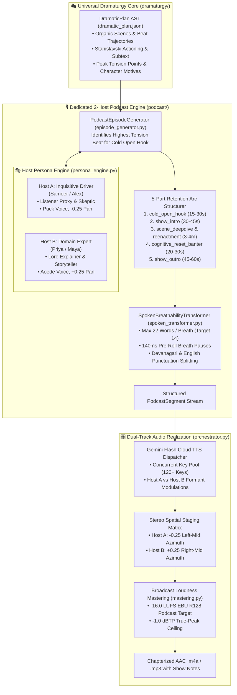
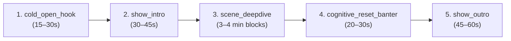

# 🎙️ Podcast System Architecture: Dedicated 2-Host Conversational Audio Engine

**Version:** 2.0 (Option C Standard v2.0 Compliant)  
**Classification:** Specialized Output Adapter Architecture  
**Canonical Project ID:** `proj-audiobook-studio`  
**Source Directory:** [`audiobook_factory/podcast/`](file:///c:/Users/Suraj/Documents/antigravity/optimistic-kepler/audiobook_factory/podcast/)

---

## 1. Executive Summary & Purpose

The **Dedicated 2-Host Podcast Engine** is a specialized format adaptation subsystem within Audiobook Studio's **Option C Architecture**. While the **Audiobook Adapter** adheres to the *Audible Flow Standard* (verbatim prose preservation, em-dash lead-ins, and measured 0.32-temperature narration), the **Podcast Engine** translates the unified literary Dramaturgy AST ([`DramaticPlan`](file:///c:/Users/Suraj/Documents/antigravity/optimistic-kepler/audiobook_factory/dramaturgy/contracts.py#L353-L415)) into a **high-retention, spoken-first, two-host narrative podcast episode**.



---

## 2. Why Podcasts Require a Dedicated Adaptation Engine

An audiobook listener and a narrative podcast listener have completely different cognitive listening contexts, tolerance for sentence complexity, and attention retention thresholds:

| Engineering Dimension | Audible Audiobook Standard | 2-Host Narrative Podcast Standard |
| :--- | :--- | :--- |
| **Source Text Sacredness** | **100% Verbatim:** Zero paraphrasing; original prose preserved line-for-line. | **Conceptual & Narrative Fidelity:** Source lore and events are preserved, but prose is rewritten into dynamic spoken dialogue. |
| **Vocal Delivery Model** | 1 Lead Narrator + Multi-Cast Character Acting. | **2 Synthetic Co-Hosts** in organic back-and-forth discussion, debate, and character re-enactment. |
| **Sentence Structure** | Long, literary sentences with nested clauses. | **Punchy & Breathable:** Strictly clamped to $\le 22$ words per breath turn. |
| **Retention Architecture** | Linear long-form immersion over hours. | **5-Part Retention Arc:** 15–30s Cold Open Hook and cognitive resets every 3–4 minutes. |
| **Turn Boundary Pauses** | Clean 300–600ms boundary pauses between sentences. | Dynamic conversational pacing with **140ms pre-roll breath pauses** and organic interjections (*"Wait, what?", "Exactly."*). |
| **Stereo Spatial Staging** | Mono-centered vocal field ($0.0$ pan). | **Stereo Staging:** Host A panned to $-0.25$ (Left-Mid) and Host B to $+0.25$ (Right-Mid). |
| **Mastering Target** | **-19.0 LUFS** / **-1.5 dBTP** (Audible / EBU R128). | **-16.0 LUFS** / **-1.0 dBTP** (Spotify / Apple Podcasts Standard). |

---

## 3. Host Persona Dynamics: Chemistry & Roles

The [`HostPersonaEngine`](file:///c:/Users/Suraj/Documents/antigravity/optimistic-kepler/audiobook_factory/podcast/persona_engine.py#L15-L181) configures two complementary personas that maintain intellectual polarity, clear vocal separation, and authentic conversational banter.

### A. Calibrated Host Pairings

#### 1. Hindi / Hindustani Production Mode: समीर (Sameer) & प्रिया (Priya)
- **समीर (Host A — Inquisitive Driver / Listener Proxy)**:
  - **Voice Model**: `Puck` (Gemini Flash TTS).
  - **Acoustic Formants**: Pitch shift: `-0.5` semitones, Speed rate: `1.04x`, Energy baseline: `0.88`.
  - **Stereo Spatial Pan**: `-0.25` (Left-Mid).
  - **Behavioral Directives**: Fast, energetic, asks the questions every listener wants to ask. Pushes back with genuine surprise, gasps, and natural conversational interruptions.
  - **Interjection Lexicon**: *"अरे सुनो"*, *"सच में?"*, *"रुको ज़रा..."*, *"मतलब क्या?"*, *"ओह भाई!"*, *"ये तो कमाल है!"*.
- **प्रिया (Host B — Domain Storyteller / Expert)**:
  - **Voice Model**: `Aoede` (Gemini Flash TTS).
  - **Acoustic Formants**: Pitch shift: `+0.5` semitones, Speed rate: `0.98x`, Energy baseline: `0.82`.
  - **Stereo Spatial Pan**: `+0.25` (Right-Mid).
  - **Behavioral Directives**: Measured, insightful, sets the dramatic atmosphere, unpacks character motives and subtext, and dissects narrative stakes.
  - **Interjection Lexicon**: *"बिल्कुल!"*, *"दरअसल बात ये है कि..."*, *"यही तो सबसे बड़ा मोड़ है!"*, *"हाँ, सही पकड़े हैं।"*, *"ध्यान से समझो..."*.

#### 2. English Production Mode: Alex & Maya
- **Alex (Host A — Inquisitive Driver)**:
  - **Voice Model**: `Puck`, Pan: `-0.25` (Left-Mid), Pitch: `-0.5`, Speed: `1.05x`.
  - **Interjection Lexicon**: *"Wait, hold on..."*, *"Are you serious?"*, *"Wait, what happened next?"*, *"No way!"*, *"That is wild!"*.
- **Maya (Host B — Domain Storyteller)**:
  - **Voice Model**: `Aoede`, Pan: `+0.25` (Right-Mid), Pitch: `+0.5`, Speed: `0.98x`.
  - **Interjection Lexicon**: *"Exactly."*, *"Here's what really happened..."*, *"And that's the turning point."*, *"Right, and listen to this..."*, *"Here is why that matters..."*.

### B. Supported Gemini TTS Voice Roster for Podcasts
The engine supports calibrated persona assignments across the following models:
- `Puck`: Energetic, crisp, inquisitive (Default Host A).
- `Aoede`: Warm, resonant, articulate storyteller (Default Host B).
- `Fenrir`: Deep, resonant, baritone male narrator.
- `Charon`: Authoritative, grave, somber male.
- `Zephyr`: Soft, intimate, reflective neutral-warm tone.
- `Kore`: Bright, youthful, dynamic female voice.

---

## 4. Spoken Breathability Transformer (`SpokenBreathabilityTransformer`)

Dense literary prose written for the page sounds breathless, monotonous, and artificial when spoken aloud. The [`SpokenBreathabilityTransformer`](file:///c:/Users/Suraj/Documents/antigravity/optimistic-kepler/audiobook_factory/podcast/spoken_transformer.py#L14-L122) sanitizes text for human vocal acoustics.

### Key Algorithmic Invariants

1. **Strict Word-Count Clamping**:
   - `MAX_WORDS_PER_BREATH`: **22 words** absolute ceiling.
   - `TARGET_WORDS_PER_BREATH`: **14 words** optimal cadence.
   - Prevents synthetic TTS runs from droning without respiratory reset pauses.
2. **Natural Acoustic Boundary Slicing**:
   - **Hindustani Regex Slicing**:
     ```python
     split_patterns = [
         r"(?<=[।!?])\s+",
         r"(?<=[,])\s+(?=और|लेकिन|परन्तु|क्योंकि|तो|मगर|यानी|मतलब|सच में|सुनो|अरे)",
         r"(?<=[,])\s+",
     ]
     ```
   - **English Regex Slicing**:
     ```python
     split_patterns = [
         r"(?<=[.!?])\s+",
         r"(?<=[,;])\s+(?=and|but|because|so|yet|which|meaning|actually|right|wait|look)",
         r"(?<=[,;])\s+",
     ]
     ```
3. **Organic Pre-Roll Breath Timing (140ms)**:
   - When a turn begins with an interjection, poses a question (`?`), expresses an exclamation (`!`), or carries a high-intensity emotion (`shocked`, `tense`, `excited`), the transformer injects a **140ms pre-roll breath pause** (`pre_roll_breath_ms = 140`) before vocal onset.
4. **Turn Boundary Pauses**:
   - Within multi-unit turns by the same speaker: **300ms** intra-turn cadence.
   - Between distinct speaker exchanges: **450ms** interactive turn pause.

---

## 5. The 5-Part Listener Retention Arc

To maintain peak listener engagement across 12–25 minute chapter episodes, [`PodcastEpisodeGenerator`](file:///c:/Users/Suraj/Documents/antigravity/optimistic-kepler/audiobook_factory/podcast/episode_generator.py#L33-L230) structures each episode into a strict 5-part dramaturgical arc:



1. **`cold_open_hook` (15–30 Seconds)**:
   - **Extraction Logic**: Scans the chapter's `DramaticPlan` and finds the beat with the highest tension score:
     $$\max(beat.tension\_before, beat.tension\_after)$$
   - Grabs the listener *in media res* at the peak dramatic crisis without greetings or pleasantries.
2. **`show_intro` (30–45 Seconds)**:
   - Sameer & Priya (or Alex & Maya) introduce the chapter's central dilemma, theme, and stakes.
3. **`scene_deepdive` / `reenactment` (3–4 Minute Blocks)**:
   - Explores each scene's dramatic conflict. When quoting critical character lines, hosts briefly re-enact or passionately recite character dialogue with dramatic color.
4. **`cognitive_reset_banter` (20–30 Seconds)**:
   - Injected between major scene transitions. Hosts step back, process a shocking twist or moral dilemma, and recalibrate listener attention before diving into the next beat.
5. **`show_outro` (45–60 Seconds)**:
   - Summarizes the core transformation of the protagonist, reflects on unresolved mysteries, and delivers a cliffhanger teaser for the next chapter.

---

## 6. Stereo Spatial Staging & Broadcast Loudness Mastering

Mastering for podcasts is coordinated by [`PodcastOrchestrator`](file:///c:/Users/Suraj/Documents/antigravity/optimistic-kepler/audiobook_factory/podcast/orchestrator.py#L33-L263).

### A. Stereo Azimuth Staging Matrix
Rather than collapsing both hosts into a flat center channel, each host is positioned in a calibrated binaural stereo field:
- **Host A (Sameer / Alex)**: Panned to `pan = -0.25` (Left-Mid Azimuth).
- **Host B (Priya / Maya)**: Panned to `pan = +0.25` (Right-Mid Azimuth).
- **Acoustic Environment**: Set to `podcast_studio` with tight room reflections and zero muddy reverb.

### B. Broadcast EBU R128 Podcast Loudness Standard
- **Integrated Loudness**: **-16.0 LUFS** ($\pm 0.5$ LU), matching Spotify, Apple Podcasts, and YouTube podcast standards.
- **True Peak Ceiling**: **-1.0 dBTP** hard ceiling to prevent inter-sample distortion on AAC/MP3 lossy transcoders.
- **Two-Pass FFmpeg DSP Chain**:
  1. Pass 1: Probes audio using `ebur128=framelog=verbose` to measure true integrated loudness and dynamic range.
  2. Pass 2: Applies measured linear loudnorm (`loudnorm=I=-16.0:TP=-1.0:LRA=11:linear=true`) with micro-fade concatenation.
- **Packaging Format**: Encoded via FFmpeg into AAC-LC at 192 kbps (`.m4a`) or high-bitrate `.mp3` with embedded episode metadata and cover art.

---

## 7. Strongly Typed Pydantic v2 Schemas

All podcast data structures are defined in [`audiobook_factory/podcast/contracts.py`](file:///c:/Users/Suraj/Documents/antigravity/optimistic-kepler/audiobook_factory/podcast/contracts.py):

```python
from typing import List, Dict, Any, Optional, Literal
from pydantic import BaseModel, Field, ConfigDict

HostRole = Literal["inquisitive_driver", "domain_expert", "guest_commentator"]
PodcastSectionType = Literal[
    "cold_open_hook",
    "show_intro",
    "scene_deepdive",
    "reenactment",
    "cognitive_reset_banter",
    "show_outro",
]

class HostProfile(BaseModel):
    model_config = ConfigDict(extra="ignore")
    host_id: str
    name: str
    role: HostRole = "inquisitive_driver"
    voice_id: str = "Puck"
    pitch_shift: float = 0.0
    speed_multiplier: float = 1.0
    pan: float = 0.0  # -0.25 Left, +0.25 Right
    energy_baseline: float = 0.8
    interjection_lexicon: List[str] = Field(default_factory=list)

class PodcastSegment(BaseModel):
    model_config = ConfigDict(extra="ignore")
    index: int = Field(..., ge=1)
    speaker: str
    text: str  # Capped at <= 22 words per breath
    emotion: str = "neutral"
    section_type: PodcastSectionType = "scene_deepdive"
    pause_after_ms: int = 450
    interjection_type: Optional[str] = None
    acting: Dict[str, Any] = Field(default_factory=dict)
    spatial: Dict[str, Any] = Field(default_factory=dict)
    beat_ref: Optional[str] = None
    spu_ref: Optional[str] = None

class PodcastEpisodePlan(BaseModel):
    model_config = ConfigDict(extra="ignore")
    episode_id: str
    episode_title: str
    source_chapter_id: str
    language: Literal["en", "hi"] = "hi"
    hosts: Dict[str, HostProfile] = Field(default_factory=dict)
    hook_statement: str = ""
    segments: List[PodcastSegment] = Field(default_factory=list)
    total_duration_estimate_sec: float = 0.0
    target_lufs: float = -16.0
```

---

## 8. CLI Commands & Operational Workflows

### 1. Generating Podcast Scripts & Plans
Generate the 2-Host podcast script and episode plan for Chapter 1:
```bash
# Hindustani (Default)
python audiobook_cli.py podcast <BOOK_SLUG> --chapter 1 --hindi

# English
python audiobook_cli.py podcast <BOOK_SLUG> --chapter 1 --english
```

### 2. Full Single-Command Production & Mastering
Generate script, synthesize audio chunks, stage stereo panning, and master to -16.0 LUFS:
```bash
python audiobook_cli.py podcast <BOOK_SLUG> --chapter 1 --produce --workers 3 --target-lufs -16.0
```

### 3. Dual-Track Multi-Format Packaging
Package both the standard Audiobook (.m4b) and Podcast (.m4a) tracks:
```bash
python audiobook_cli.py package <BOOK_SLUG> --format both --cover cover.jpg
```

---

## 🔗 Related Documentation
- [🏛️ Option C Architecture Blueprint](file:///c:/Users/Suraj/Documents/antigravity/optimistic-kepler/docs/ARCHITECTURE.md)
- [🎭 Dramaturgy & Adaptation System](file:///c:/Users/Suraj/Documents/antigravity/optimistic-kepler/docs/DRAMATURGY_AND_ADAPTATION_SYSTEM.md)
- [🛡️ Quality Gates & 8-Pillar Certification](file:///c:/Users/Suraj/Documents/antigravity/optimistic-kepler/docs/QUALITY_GATES.md)
- [💻 CLI Reference Manual](file:///c:/Users/Suraj/Documents/antigravity/optimistic-kepler/docs/CLI_REFERENCE.md)
