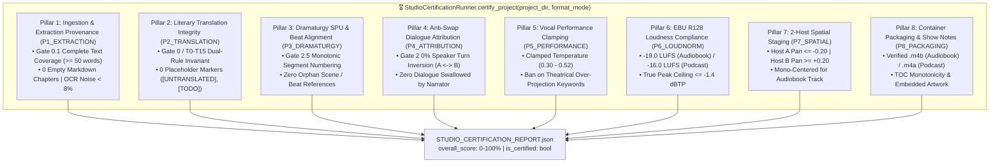
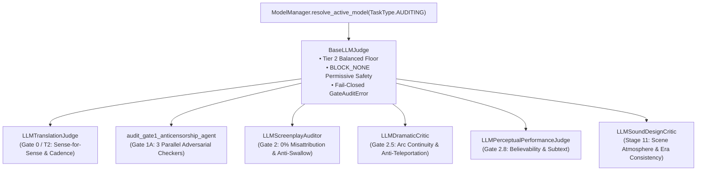

# 🛡️ Quality Gates: The Independent Verification Protocol

## Overview

A core pillar of **Audiobook Maker v4.0** is the **Multi-Gate Independent Verification Protocol**. In production audio engineering, catching defects early prevents expensive downstream rework and saves generative AI API quota.

The verification system spans **Gate 0.1**, **Translation & Spoken Language Gates T0 through T15**, and **Gates 0 through 6E**, auditing every artifact from raw source documents and canonical AST models through multi-pass literary translation, pronunciation planning, and performance realization to final chapterized `.m4b` delivery.


---

## 🎖️ The 8-Pillar Studio Production Certification Harness

The master quality arbiter of Audiobook Studio is the **8-Pillar Studio Production Certification Harness** ([`StudioCertificationRunner`](file:///c:/Users/Suraj/Documents/antigravity/optimistic-kepler/audiobook_factory/certification/runner.py)). Operating at the release tier, it conducts an autonomous, deterministic evaluation of the entire project across **8 studio engineering pillars**, generating an authoritative compliance scorecard ([`STUDIO_CERTIFICATION_REPORT.json`](file:///c:/Users/Suraj/Documents/antigravity/optimistic-kepler/audiobook_factory/certification/contracts.py#L34-L79)) for both Audiobook and Podcast tracks:



### 1. The 8 Studio Production Pillars

#### Pillar 1: Ingestion & Extraction Provenance (`P1_EXTRACTION`)
- **Underlying Gate**: Gate 0.1 Forensic Document Extraction.
- **Verification Mandate**: Inspects `extracted/` markdown chapters.
- **Scoring & Rules**:
  - Requires `extracted/` directory to exist with non-empty markdown files.
  - Slashes 30 points and fails closed if corrupted or empty files ($< 50$ bytes) are detected.
  - Word count floor must exceed 50 words per chapter.
- **Fail Condition**: Missing `extracted/` directory, empty files, or corrupted extraction.

#### Pillar 2: Literary Translation Dual-Rule Integrity (`P2_TRANSLATION`)
- **Underlying Gates**: Gate 0, Gate 1A, and Gates T0–T15.
- **Verification Mandate**: Audits `translation/` markdown files for dual-rule fidelity.
- **Scoring & Rules**:
  - Automatically skipped (`status = "SKIPPED"`, score 100%) if project is original English language.
  - Audits text for untranslated placeholder markers: scans for `[UNTRANSLATED]`, `[TODO]`, `[TRANSLATION_FAILED]`. Each occurrence reduces score by 25 points and triggers a critical finding.
  - Enforces the **Dual-Rule Invariant**: dignity for classical prose vs raw visceral reality for combat/intimacy without puritanical bowdlerization.
- **Fail Condition**: Detected placeholder markers or truncated translation files.

#### Pillar 3: Dramaturgy SPU & Beat Alignment (`P3_DRAMATURGY`)
- **Underlying Gate**: Gate 2.5 Dramatic Fidelity Validator.
- **Verification Mandate**: Audits dramatic plans (`dramaturgy/*_plan.json`, `podcasts/*_podcast_plan.json`) and scripts (`scripts/*.json`).
- **Scoring & Rules**:
  - Asserts that all segment indices are monotonically sequential ($index_1 < index_2 < index_3$).
  - Slashes 30 points on non-monotonic or scrambled indices.
  - Verifies all referenced `scene_id` and `beat_id` attributes resolve to valid nodes in the enclosing `DramaticPlan`.
- **Fail Condition**: Non-monotonic segment indices or orphan beat references.

#### Pillar 4: Anti-Swap Dialogue Attribution (`P4_ATTRIBUTION`)
- **Underlying Gate**: Gate 2 Screenplay Attribution Auditor.
- **Verification Mandate**: Screens all screenplay segments in `scripts/*.json` for attribution accuracy.
- **Scoring & Rules**:
  - **Zero Speaker Turn Inversion**: Slashes 20 points per empty speaker assignment.
  - **Anti-Swallow Dialogue Guard**: Scans `Narrator` lines for enclosed quotation marks (`"..."` or `“...”`). Flags possible quote leakage from Narrator to character, deducting 5 points per incident.
  - Whitelist validation against canonical character roster.
- **Fail Condition**: Empty speaker fields or character dialogue swallowed into narrator segments.

#### Pillar 5: Vocal Performance & Restraint Clamping (`P5_PERFORMANCE`)
- **Underlying Gate**: Gate 2.8 Dramatic Performance Pre-Mix Gate.
- **Verification Mandate**: Inspects acting directives in `scripts/*.json` to enforce vocal restraint.
- **Scoring & Rules**:
  - Enforces temperature clamping (`0.30 - 0.52`).
  - Scans for banned theatrical keywords: `screeching`, `melodramatic`, `theatrical over-projection`, `hysterical`.
  - Deducts 20 points per banned keyword and logs a critical gate violation.
- **Fail Condition**: Any presence of banned histrionic acting directives.

#### Pillar 6: EBU R128 Broadcast Loudness Compliance (`P6_LOUDNORM`)
- **Underlying Gates**: Gate 5 Master Probe & Gate 6B Loudness Continuity.
- **Verification Mandate**: Evaluates mastered audio files across active production tracks:
  - **Audiobook Track**: Inspects `mastered/*_mastered.wav` and `mastered/*_mastered.m4a` against the **-19.0 LUFS** target ($\pm 1.0$ LU) and **-1.5 dBTP** True Peak ceiling.
  - **Podcast Track**: Inspects `podcasts/*_podcast.m4a` and `podcasts/*_podcast_master.wav` against the **-16.0 LUFS** target ($\pm 1.0$ LU) and **-1.0 dBTP** True Peak ceiling.
- **Fail Condition**: Loudness drift exceeding $\pm 1.0$ LU or True Peak clipping.

#### Pillar 7: Multi-Host Spatial Staging (`P7_SPATIAL`)
- **Underlying Gate**: 2-Host Stereo Azimuth Matrix.
- **Verification Mandate**: Evaluates spatial separation for conversational tracks:
  - **Audiobook Track**: Panning audit is safely skipped (`status = "SKIPPED"`, score 100%) because audiobooks are mastered mono-centered ($0.0$ pan).
  - **Podcast Track**: Audits `podcasts/*_podcast_plan.json`. Asserts that Host A is panned left ($pan \le -0.20$) and Host B is panned right ($pan \ge +0.20$). Deducts 10 points for insufficient spatial separation.
- **Fail Condition**: Host azimuth pan collapsed into center channel ($|pan| < 0.10$).

#### Pillar 8: Chapter Container Metadata & Packaging (`P8_PACKAGING`)
- **Underlying Gates**: Gate 6C TOC Monotonicity & Gate 6D Container Specifications.
- **Verification Mandate**: Verifies final deliverable containers:
  - **Audiobook Track**: Verifies that a valid `.m4b` container exists with embedded chapter markers and square cover art ($\ge 1400 \times 1400$ px).
  - **Podcast Track**: Verifies that valid `.m4a` / `.mp3` episode files exist in `packaged_podcasts/` or `podcasts/` with show notes.
- **Fail Condition**: Missing deliverable container files or non-monotonic chapter seek tables.

---

### 2. Certification Data Contracts & Schemas

Defined in [`audiobook_factory/certification/contracts.py`](file:///c:/Users/Suraj/Documents/antigravity/optimistic-kepler/audiobook_factory/certification/contracts.py):

```python
AuditStatus = Literal["PASSED", "WARNING", "FAILED", "SKIPPED"]

class PillarAuditResult(BaseModel):
    pillar_id: str = Field(..., description="e.g. 'P1_EXTRACTION', 'P6_LOUDNORM'")
    pillar_name: str
    score: float = Field(..., ge=0.0, le=100.0)
    status: AuditStatus = "PASSED"
    critical_findings: List[str] = Field(default_factory=list)
    warnings: List[str] = Field(default_factory=list)
    telemetry: Dict[str, Any] = Field(default_factory=dict)

class StudioCertificationReport(BaseModel):
    project_id: str
    book_title: str
    timestamp: float = Field(default_factory=time.time)
    overall_score: float = Field(..., ge=0.0, le=100.0)
    is_certified: bool
    format_mode: str = "audiobook"  # "audiobook", "podcast", or "both"
    pillars: Dict[str, PillarAuditResult] = Field(default_factory=dict)
    summary_notes: List[str] = Field(default_factory=list)

    def save_to_file(self, filepath: Path) -> Path: ...
    @classmethod
    def load_from_file(cls, filepath: Path) -> StudioCertificationReport: ...
```

---

## 📋 Comprehensive Quality Gate Specifications

### Gate 0.1: Forensic Document Extraction Quality Gate (Pillar 1)
- **Function**: `ExtractionQualityAuditor.audit(book: CanonicalBook, force_gate: bool = False) -> ExtractionQualityReport`
- **Modules**: [`audiobook_factory/quality_gate.py`](file:///c:/Users/Suraj/Documents/Antigravity/Audiobook/audiobook_factory/quality_gate.py), [`pdf_engine.py`](file:///c:/Users/Suraj/Documents/Antigravity/Audiobook/audiobook_factory/pdf_engine.py)
- **Data Models**: [`CanonicalBook`](file:///c:/Users/Suraj/Documents/Antigravity/Audiobook/audiobook_factory/book_model.py#L236-L355), [`ExtractionQualityReport`](file:///c:/Users/Suraj/Documents/Antigravity/Audiobook/audiobook_factory/book_model.py#L174-L235), [`ExtractionGateAuditError`](file:///c:/Users/Suraj/Documents/Antigravity/Audiobook/audiobook_factory/book_model.py#L43-L52), [`SourceProvenance`](file:///c:/Users/Suraj/Documents/Antigravity/Audiobook/audiobook_factory/book_model.py#L54-L74)
- **Pipeline Stage**: Executed immediately during Stage 1 (`process_book_file`) before canonical serialization and markdown projection.
- **Audit Rules & Evaluators**:
  - **Document Completeness**: Verifies at least one chapter was detected ($total\_chapters \ge 1$).
  - **Minimum Text Coverage Floor**: Total extracted words must exceed $50$ words for EPUB and PDF documents.
  - **Empty Chapter Guard**: Flags any chapter containing fewer than $5$ words as a critical defect.
  - **Page Layout & OCR Defect Ratio**: Analyzes PDF page audits (`PDFQualityAnalyzer`). If suspicious pages (low density, OCR noise ratio $> 8\%$, Unicode replacement `\ufffd`, multi-column line wrap) exceed $25\%$ of total pages ($\frac{\text{suspicious}}{\text{total}} > 0.25$), fails closed.
  - **Multi-Signal Candidate Comparison Gate ([`PDFQualityAnalyzer.compare_extraction_candidates`](file:///c:/Users/Suraj/Documents/Antigravity/Audiobook/audiobook_factory/pdf_engine.py#L819-L960))**:
    - Evaluates local pypdf extraction vs. Gemini Vision escalation across composite scoring ($0.40 \times \text{Reading Order} + 0.45 \times \text{Text Integrity} + 0.15 \times \text{Sentence Coherence}$) with full support for ASCII, Accented Latin (`\u00C0-\u024F\u1E00-\u1EFF`), and Devanagari (`\u0900-\u097F`).
    - Disqualifies Gemini candidates exhibiting LLM refusal / conversational preamble leakage, 4-gram repetition loops ($\ge 5\times$, $> 30\%$ words), replacement char (`\ufffd`) regressions, low integrity ($< 0.65$), or prose truncation ($> 45\%$ clean word loss vs. clean local text).
  - **Literary Chapter vs. Production Chunk Telemetry**: Audits `detected_literary_chapters`, `production_chunks`, and `used_fallback_chunking`. When no literary chapter headings are found and fallback chunking is used, issues a non-fatal warning to `quality_report.warnings`.
  - **Status Resolution**: Resolves audit to `PASS` (clean), `WARN` (minor issues $< 25\%$ healed or non-fatal fallback chunking), or `REVIEW` (critical defects present).
- **Fail Condition**: Raises [`ExtractionGateAuditError`](file:///c:/Users/Suraj/Documents/Antigravity/Audiobook/audiobook_factory/book_model.py#L43-L52) with an actionable diagnostic report (affected chapters/pages and remediation options) if status is `REVIEW`.
- **Operator Override**: Bypassed when `--force-gate` is supplied to `extract` or `auto`.

---

### Room 1: Novel Researcher & Pre-Production Quality Gates (NR-GATE-01 through NR-GATE-06)
*(See full architectural specification: [`docs/NOVEL_RESEARCHER_ARCHITECTURE.md`](file:///c:/Users/Suraj/Documents/antigravity/optimistic-kepler/docs/NOVEL_RESEARCHER_ARCHITECTURE.md))*

- **Function**: Governs the 2-system pre-production pipeline across deterministic lexical scanning, Google Search Grounding, literary DNA profiling, pure vocals-only room impulse design, and transactional state persistence.
- **Modules**: [`audiobook_factory/preproduction/`](file:///c:/Users/Suraj/Documents/antigravity/optimistic-kepler/audiobook_factory/preproduction/), [`audiobook_factory/metadata/`](file:///c:/Users/Suraj/Documents/antigravity/optimistic-kepler/audiobook_factory/metadata/)
- **Pipeline Stage**: Executed during Stage 1 (Pre-Production Master Pass) before any chapter translation or screenplay structuring begins.

| Gate ID | Name | Pass Condition | Failure Action |
|---|---|---|---|
| **NR-GATE-01** | **Context Coverage Gate** | 100% of input chapters scanned by `LexicalCorpusScanner`; top speaking characters and proper nouns identified with 0 token expenditure. | Re-run lexical sweep; assert input chapter texts are non-empty. |
| **NR-GATE-02** | **Bidirectional Grounding Gate** | 0% of external web search entities without text corpus grounding allowed into canonical state. Requires $\ge 2$ mentions (or $\ge 1$ mention for multi-word proper nouns). | Filter ungrounded web artifacts; reject candidate entities. |
| **NR-GATE-03** | **Voice Collision & Pitch Bound Gate** | 0 duplicate `assigned_voice` without distinct $\ge 4.0\%$ acoustic pitch step separation; pitch offsets bounded strictly within $[0.70, 1.30]$. | Step pitch in $\pm 0.04$ increments; when bounds reached, micro-step speed by $+0.02$ to eliminate robotic distortion. |
| **NR-GATE-04** | **Vocals-Only Cleanliness Gate** | 0 sound bank assets, Foley sound effects, or background music cues present in `vocal_spaces.json`. Focused 100% on vocal room acoustics (reverb wet mix, decay time, predelay). | Strip non-vocal audio parameters; restrict manifest strictly to vocal impulse acoustics. |
| **NR-GATE-05** | **Zero Hardcoding Audit** | 0 hardcoded novel titles, author names, character rosters, file hashes, or franchise lore in production source code. | Purge hardcoded keywords from factory core; dynamically derive all literary entities. |
| **NR-GATE-06** | **Atomic Multi-File State Gate** | All master state files (`book_dna.json`, `book_bible.json`, `vocal_spaces.json`, `sonic_bible.json`, `character_roster.json`, `voice_registry.json`, `cast_lock.json`) committed in a single two-phase transactional checkpoint (`.tmp` $\rightarrow$ `.bak` $\rightarrow$ atomic replace $\rightarrow$ cleanup); 0% partial write drift. Windows 11 retry loop (5 attempts) eliminates `WinError 5` / `WinError 32`. | Rollback to pre-run snapshot; restore `.bak` files, purge `.tmp`, and re-raise IOError fail-closed. |

---

### Gates T0 – T15: Literary Translation Intelligence & Spoken Language Certification Suite (Pillar 2 — Option D Modernization)
*(See full architectural manuals: [`docs/LITERARY_TRANSLATION_INTELLIGENCE.md`](file:///c:/Users/Suraj/Documents/antigravity/optimistic-kepler/docs/LITERARY_TRANSLATION_INTELLIGENCE.md) and [`docs/PRONUNCIATION_AND_SPOKEN_LANGUAGE_QA.md`](file:///c:/Users/Suraj/Documents/antigravity/optimistic-kepler/docs/PRONUNCIATION_AND_SPOKEN_LANGUAGE_QA.md))*
- **Function**: `TranslationCertifier.certify_scene(...) -> GateAuditResult` and `DeterministicParityGate.verify(...) -> ParityMetrics`
- **Modules**: [`audiobook_factory/translation/parity_gate.py`](file:///c:/Users/Suraj/Documents/antigravity/optimistic-kepler/audiobook_factory/translation/parity_gate.py), [`certification.py`](file:///c:/Users/Suraj/Documents/antigravity/optimistic-kepler/audiobook_factory/translation/certification.py), [`engine.py`](file:///c:/Users/Suraj/Documents/antigravity/optimistic-kepler/audiobook_factory/translation/engine.py), [`contracts.py`](file:///c:/Users/Suraj/Documents/antigravity/optimistic-kepler/audiobook_factory/translation/contracts.py), [`cli.py`](file:///c:/Users/Suraj/Documents/antigravity/optimistic-kepler/audiobook_factory/translation/cli.py)
- **Pipeline Stage**: Executed during Stage 2 (Translation) in [`TranslationEngine.translate()`](file:///c:/Users/Suraj/Documents/antigravity/optimistic-kepler/audiobook_factory/translation/engine.py) and [`IntelligentTranslationPipeline.translate_chapter()`](file:///c:/Users/Suraj/Documents/antigravity/optimistic-kepler/audiobook_factory/translation/orchestrator.py). Any failed mandatory gate triggers repair or halts certification fail-closed.
- **Option D Architectural Foundation (Single-Pass Deliberation)**:
  - Replaced the lossy 4-pass serial telephone game cascade (Draft $\rightarrow$ Cadence $\rightarrow$ Idiom $\rightarrow$ Critic) with a single deliberative Gemini Flash call (`thinking_budget = 1024`, `temperature = 0.35`).
  - [`MultiAgentTranslationCollective.translate_block()`](file:///c:/Users/Suraj/Documents/antigravity/optimistic-kepler/audiobook_factory/translation/agents/collective.py) defaults to `TranslationEngine` (`use_single_pass=True`), while preserving `translate_block_legacy()` as an explicit backward-compatible fallback (`use_single_pass=False`).
- **Separation of Concerns & Strict Boundary Contracts**:
  - **Room 2 is Strictly Text-to-Text**: Emits pristine Devanagari Markdown only. Zero awareness of audio takes, sample rates, or voice profiles.
  - **No Screenplay Actor Tags**: Room 2 **NEVER** injects screenplay actor markers (such as `[GERALT]:` or JSON speaker attribution). Dialogue parsing belongs 100% to Room 3 downstream ([`script_builder.py`](file:///c:/Users/Suraj/Documents/antigravity/optimistic-kepler/audiobook_factory/script/script_builder.py)).
  - **No Audio Take QA or Synthesis in Translation**: Gate T14 (audio QA / acoustic alignment on candidate takes) belongs strictly downstream to Room 4 post-synthesis. Room 2 Translation never attempts audio QA or depends on audio hardware drivers.
  - **Zero Prohibited Imports**: Absolute import ban on `audio`, `audio_utils`, `tts`, `screenplay`, `cinematic`, or audio hardware drivers in `audiobook_factory/translation/`.
- **The Option D Deterministic Full-Text Parity Gate Matrix (`parity_gate.py`)**:
  - Runs in pure Python at zero token cost and validates 100% of the chapter text.
  - **Paragraph Count Parity**: Target paragraph count must match source within $\pm 15\%$.
  - **Dialogue Quote Parity**: Dialogue quotation mark pairs must match source within $\pm 10\%$.
  - **Text Length Ratio**: Target word count must achieve $\ge 75\%$ of source word count.
  - **Negation Polarity Parity**: Validates negative marker parity across English and Hindi.
  - **Anti-Tamper & Cleanliness Checks**: Blocks AI conversational preambles and forbidden calques.
  - **Standalone CLI Verification**: `python -m audiobook_factory.translation.cli parity source_chapter.txt translated_chapter.md`.
- **Adversarial Audit Hardening & Bug Fixes**:
  - **Negation Double-Counting Separation**: `parity_gate.py` strips compound patterns (`कभी नहीं`, `कुछ नहीं`, `कोई नहीं`) from the text buffer *before* evaluating single tokens (`नहीं`, `मत`, etc.), eliminating artificial Hindi negation inflation.
  - **Paragraph Truncation Blind Spot Fix**: For texts with $> 2$ paragraphs, the gate fails closed whenever paragraph divergence exceeds $\pm 15\%$ or the absolute paragraph delta exceeds 1 (`if src_paras > 2 or abs(tgt_paras - src_paras) > 1:`).
  - **Purged `audio_utils` Leak**: `orchestrator.py` uses localized `_atomic_replace` (via `os.replace`), completely removing the legacy `audio_utils` import leak.
- **The Scene & Full-Text Parity Gates (Comprehensive Suite)**:
  - **Gate T0 (Source Text Integrity & Word Count Parity)**: Target translation must achieve $\ge 75\%$ of source length ratio and match paragraph count within $\pm 15\%$. Severe truncation ($< 75\%$) or dropped paragraphs trigger immediate `FAIL` and resolve status to `BLOCKED`.
  - **Gate T1 (Terminology Compliance)**: Deterministic regex audit against `BookBible.terminology_variants` and entity `forbidden_variants`. Triggers `FAIL` on forbidden spelling variants (eligible for Level 1 auto-repair).
  - **Gate T2 (Semantic Fidelity & Action Integrity)**: Employs `SemanticAligner.align()` to compare `SourceSemanticMap` against `TargetSemanticMap` at paragraph and beat levels. Audits expanded lexical negation parity (including *नहीं, मत, ना, न, बिना, बग़ैर, कभी नहीं, कुछ नहीं, कोई नहीं, इनकार, रोका, मना, नाकाम*), actor retention, and action continuity. Confirmed meaning distortion triggers `FAIL`; localized discrepancies record paragraph indices in `affected_paragraphs`.
  - **Gate T3 (Omission & Quote Parity)**: Runs deterministic quote count parity ($\pm 10\%$) verifying that conversational turns in English have matching dialogue quotes in Hindi, followed by beat omission detection. Missing story beats trigger `FAIL` and index `affected_paragraphs`.
  - **Gate T4 (Addition & Hallucination Detector)**: Audits whether translator invented actions, characters, or lore absent from the English source. Emits `FAIL` on fabricated plot facts.
  - **Gate T5 (Entity & Script Purity)**: Scans for untransliterated Latin proper nouns ($\ge 4$ chars) leaked into Devanagari narrative prose. Emits `FAIL` on leaked Latin strings.
  - **Gate T6 (Relationship, Pronoun & Memory Continuity - `T6_relationship_memory`)**: Audits active speaker/target pairs against `MemoryContext.get_character_performance_guidance()`, verifying that recommended Hindi pronouns (`आप`, `तुम`, `तू`) and socio-linguistic registers match established narrative relationships without unmotivated honorific drift.
  - **Gate T7 (Character Language Profile Alignment - `T7_character_voice`)**: Audits dialogue lines against each speaker's [`CharacterLanguageProfile`](file:///c:/Users/Suraj/Documents/antigravity/optimistic-kepler/audiobook_factory/translation/character_profile.py) archetype. Advisory gate emitting `WARN` on minor voice breaks and `FAIL` on severe character drift.
  - **Gate T8 (7D Literary Intensity Preservation)**: Quantifies source and target scenes across 7 dimensions (`violence`, `sexual_intimacy`, `profanity`, `emotional_intensity`, `formality`, `urdu_register`, `colloquiality`) via [`LiteraryIntensityVector`](file:///c:/Users/Suraj/Documents/antigravity/optimistic-kepler/audiobook_factory/translation/intensity_model.py#L17-L25). Enforces **"Nothing Above Source"** with calibrated variance:
    - Directional delta $|\Delta| \le 0.75$: Clean `PASS`.
    - Soft heuristic band $0.75 < |\Delta| \le 2.0$: Emits `WARN` (`is_valid=True`), accommodating natural Devanagari keyword density without brittle false rejections.
    - Extreme distortion $|\Delta| > 2.0$: Hard failure `FAIL` (`is_valid=False`), halting critical moral sanitization ($\Delta < -2.0$) or gratuitous amplification ($\Delta > +2.0$).
  - **Gate T9 (Literary Naturalness & Anachronism Guard)**: Enforces **Non-Destructive Sanitizer Separation** ([`sanitizer.py`](file:///c:/Users/Suraj/Documents/antigravity/optimistic-kepler/audiobook_factory/sanitizer.py)): blocks modern clinical English loanwords (`डिप्रेशन`, `ट्रॉमा`, `स्ट्रेस`) and literal calques while preserving authentic rustic vocabulary (`नमस्ते`, `राम-राम`, `दारू`). Paired with an LLM translatese critic (minimum score $3.5 / 5.0$).
  - **Gate T10 (Hindustani Register Balance)**: [`HindustaniRegisterEngine.audit_text()`](file:///c:/Users/Suraj/Documents/antigravity/optimistic-kepler/audiobook_factory/translation/hindustani_register.py#L112-L135) verifies contextual Urdu seasoning density stays within organic bounds ($0.2\% - 8.0\%$ per 100 words on scenes $> 300$ words). Advisory gate emitting `WARN` if over- or under-seasoned.
  - **Gate T11 (Provenance & Cache Seal)**: Cryptographically seals an 11-dimension SHA-256 composite cache key (`source_hash:bible_version_hash:policy_version:prompt_version:translator_version:evaluator_version:semantic_map_version:semantic_map_hash:repair_version:model:advisory_version`) into `provenance.json`.
  - **Gate T12 (Spoken Language & Code-Switch QA - `T12_spoken_language`)**: Advisory gate evaluating sentence script balance and code-switching naturalness via [`classify_sentence_language()`](file:///c:/Users/Suraj/Documents/antigravity/optimistic-kepler/audiobook_factory/pronunciation/language_detector.py). Emits `WARN` if Latin script ratio exceeds $45\%$ in translated Hindi narrative without justified code-switching.
  - **Gate T13 (Pronunciation Plan QA - `T13_pronunciation_plan`)**: **Critical Mandatory Gate** executing the Deterministic 7-Tier Resolver ([`PronunciationResolver`](file:///c:/Users/Suraj/Documents/antigravity/optimistic-kepler/audiobook_factory/pronunciation/resolver.py)) and [`SpokenTextEngine`](file:///c:/Users/Suraj/Documents/antigravity/optimistic-kepler/audiobook_factory/pronunciation/spoken_text.py) across all sensitive tokens and entities. Emits `FAIL` on `PronunciationStatus.FAILED` (halting certification), and `WARN` on `REVIEW_REQUIRED`, `UNCERTAIN`, or `LIKELY` unverified entities. Critical gate warnings prevent silent `PASS` and escalate to `REVIEW_REQUIRED`.
  - **Gate T14 (Pronunciation Audio QA & Acoustic Alignment - `T14_pronunciation_audio` — Room 4 Post-Synthesis)**: Advisory post-synthesis gate executing [`PronunciationAudioQA.audit_take()`](file:///c:/Users/Suraj/Documents/antigravity/optimistic-kepler/audiobook_factory/pronunciation/auditor.py) on synthesized candidate audio takes in Room 4. Emits `WARN` if Meta MMS_FA CTC forced alignment detects swallowed tokens ($< \max(60, \text{syllables} \times 45)\text{ms}$), stutter repetitions ($> \max(1200, \text{syllables} \times 350)\text{ms}$), or cadence anomalies ($> 6.0$ or $< 1.0$ words/sec).
  - **Gate T15 (Cross-Chapter Pronunciation Consistency - `T15_pronunciation_consistency`)**: Advisory scene gate cross-checking scene entities against [`CrossChapterConsistencyAuditor`](file:///c:/Users/Suraj/Documents/antigravity/optimistic-kepler/audiobook_factory/pronunciation/consistency.py). Emits `WARN` if unexempted pronunciation drift is detected against earlier chapters.
- **The Critical vs. Advisory Gate Boundary**:
  - **Critical Gates (`CRITICAL_GATES`)**: `T0_integrity`, `T1_terminology`, `T2_semantic`, `T3_omission`, `T4_addition`, `T5_terminology`, `T6_relationship_memory`, `T8_intensity`, `T13_pronunciation_plan`. Any failure or warning on a critical gate halts certification and forces `REVIEW_REQUIRED` or `BLOCKED`.
  - **Advisory Gates (`ADVISORY_GATES`)**: `T7_character_voice`, `T9_naturalness`, `T10_register_balance`, `T12_spoken_language`, `T14_pronunciation_audio`, `T15_pronunciation_consistency`.
- **The 4-Tier Certification State Machine**:
  - `PASS` (`certified=True`): All gates pass cleanly; ready for downstream screenplay synthesis.
  - `PASS_WITH_WARNINGS` (`certified=True`): Zero gate failures and at most 1–2 advisory warnings (from advisory gates `T7`, `T9`, `T10`, `T12`, `T14`, or `T15`). Certified to proceed without expensive regeneration loops.
  - `AUTO_REPAIR` (`certified=True`): Failures isolated strictly to deterministic terminology (`T5`) or registered calques (`T9`), immediately resolved by Level 1 repair without LLM re-prompting.
  - `REVIEW_REQUIRED` (`certified=False`): Critical gate failures (`T0`, `T1`, `T2`, `T3`, `T4`, `T5`, `T6`, `T8`, `T13`), any critical gate warning, or $\ge 3$ advisory warnings. Automatically triggers Level 2 surgical paragraph rewrite or Level 3 scene retranslation.
  - `BLOCKED` (`certified=False`): Fatal structural defect (completely empty translation or severe truncation $< 35\%$).
- **Fail-Closed Gate Halting**:
  - When a scene reaches `BLOCKED` status, the pipeline raises `RuntimeError(f"Scene {scene.scene_id} certification BLOCKED: ...")` in [`orchestrator.py`](file:///c:/Users/Suraj/Documents/antigravity/optimistic-kepler/audiobook_factory/translation/orchestrator.py#L508-L511), immediately halting chapter production before corrupted text reaches screenplay or TTS stages.
  - Operator override is permitted only via `--force-gate`.
  - When `REVIEW_REQUIRED` persists after all repair levels, actionable diagnostics are written to `certification.json` to enable human-in-the-loop review.

---

### MemoryValidator: The 7 Continuity Contradiction Guardrails (Memory 2.0)
*(See complete specification: [`docs/WORLD_AND_CHARACTER_MEMORY_2_0.md`](file:///c:/Users/Suraj/Documents/Antigravity/Audiobook/docs/WORLD_AND_CHARACTER_MEMORY_2_0.md))*
- **Function**: `MemoryValidator.validate_deltas(deltas, book_bible, character_states, relationships, facts_registry, world_state, events_by_id) -> MemoryValidationReport`
- **Module**: [`audiobook_factory/translation/memory/memory_validator.py`](file:///c:/Users/Suraj/Documents/Antigravity/Audiobook/audiobook_factory/translation/memory/memory_validator.py)
- **Pipeline Stage**: Executed during Stage 5 of the scene memory lifecycle before committing any deltas to `MemoryStore`.
- **The 7 Contradiction Guardrails**:
  1. **`CANON_IMMUTABILITY_VIOLATION` (`canon_contradiction`)**: Blocks mutations to locked BookBible attributes (`canonical_name`, `gender`, `canonical_role`, `voice_id`, `locked_pronoun`, `locked_register`) or deltas flagged `HARD_CANON`.
  2. **`TIMELINE_CONTRADICTION`**: Rejects retrograde present-tense chapter mutations or events asserting negative story epochs in `TemporalMode.PRESENT`. Directs past memories to `FLASHBACK`.
  3. **`DEAD_CHARACTER_ACTION` (`dead_character_violation`)**: Prohibits deceased characters (`is_alive=False`) from moving, acting, or recovering in `PRESENT` timeline unless an explicit resurrection `WorldRule` exists in BookBible.
  4. **`PHYSICAL_IMPOSSIBILITY` & `IMPOSSIBLE_LOCATION_TRANSITION`**: Prevents simultaneous presence of a character in two distinct locations within the same scene (unless marked as intra-scene travel) and blocks actions while incapacitated.
  5. **`OBJECT_CUSTODY_CONFLICT`**: Rejects ownership transfer of objects held by a different character or objects marked `status="destroyed"`.
  6. **`ABRUPT_RELATIONSHIP_JUMP` (`relationship_jump`)**: Clamps single-scene relationship jumps to $\pm 2$ points on standard events and $\pm 3$ on major turning points, requiring explicit `StoryEvent` provenance.
  7. **`KNOWLEDGE_LEAKAGE` (`knowledge_violation`)**: Prohibits characters from acting upon or mentioning secrets where their epistemic status is `UNKNOWN`.
- **Fail Condition & Isolation**: Produces `MemoryValidationReport(outcome=ValidationOutcome.CONFLICT)`. Conflicting deltas are rejected and recorded as `FlaggedConflict` records; rejected events are permanently quarantined in `store.rejected_events` (preventing ghost event pollution in active timelines or salience queries).

---

### Gate 0 / T2: LLM Translation Fidelity & Cadence Judge (Universal Studio Architecture)
- **Function**: `LLMTranslationJudge.audit_translation(source_text: str, hindi_text: str, chapter_title: str = "", min_score: float = 0.80, strict: bool = True) -> TranslationFidelityVerdict`
- **Module**: [`audiobook_factory/gates/llm_judge.py`](file:///c:/Users/Suraj/Documents/Antigravity/Audiobook/audiobook_factory/gates/llm_judge.py), [`gate_auditor.py`](file:///c:/Users/Suraj/Documents/Antigravity/Audiobook/audiobook_factory/gate_auditor.py)
- **Pipeline Stage**: Inline execution after Stage 2 (Translation) and integrated with Gate T2 scene certification.
- **Data Models**: [`TranslationFidelityVerdict`](file:///c:/Users/Suraj/Documents/Antigravity/Audiobook/audiobook_factory/gates/llm_judge.py#L33-L46) (`status`, `score`, `literary_cadence_score`, `action_integrity_score`, `critical_inversions`, `dropped_clauses`, `translatese_passages`, `reason`, `recommendations`)
- **Audit Rules & Evaluators**:
  - **Sense-for-Sense Fidelity**: Verifies that dramatic subtext, character motivation, and narrative events are preserved without omission, factual drift, or hallucinated additions.
  - **Literary Hindustani Cadence**: Rejects stiff, literal English calques ("translatese"), unnatural passive voice, or sterile bureaucratic phrasing. Rewards earthy, rhythmic, spoken cadence (*"Aate mein Namak jitni Urdu"*).
  - **Action & Negation Integrity**: Flags any inversion where an action was flipped (e.g. "did not enter" translated as "प्रवेश किया") or where subject/object roles were inverted.
  - **Dialogue Social Register**: Characters must retain their authentic social register and honorifics (`आप`, `तुम`, `तू`).
  - **Dynamic Model Resolution**: Uses `BaseLLMJudge.resolve_auditing_model()` (`TaskType.AUDITING`), enforcing a **Tier 2 Balanced** floor with concurrent health pings and zero hardcoded model strings.
- **Fail Condition**: Raises `GateAuditError` if `strict=True` and `verdict.status == "FAIL"` or `verdict.score < min_score` ($< 0.80$) or any critical inversions are detected.

---

### Gate 1A: 3-Agent Adversarial Anti-Censorship & Translation Fidelity (ADR-045)
- **Function**: `audit_gate1_anticensorship_agent(english_text: str, hindi_text: str, model: Optional[str] = None) -> Dict[str, Any]`
- **Module**: [`audiobook_factory/gate_auditor.py`](file:///c:/Users/Suraj/Documents/Antigravity/Audiobook/audiobook_factory/gate_auditor.py)
- **Pipeline Stage**: Post-translation adversarial audit prior to screenplay drafting.
- **Architecture (3 Parallel Specialist Checkers)**:
  - Deconstructs anti-censorship auditing into three concurrent checkers operating across the rotating key pool via `ThreadPoolExecutor(max_workers=3)`:
    1. **Profanity & Curses Checker (`_audit_profanity_agent`):** Audits translation against prudish bowdlerization (e.g. replacing 'bastard' with polite 'दुष्ट' instead of authentic 'हरामी' / 'कमीने'). Enforces the **19-to-21 Amplification Rule**.
    2. **Combat Gore & Violence Checker (`_audit_combat_agent`):** Verifies that bone fractures, blood spray, and visceral strikes are not sanitized into sterile summaries.
    3. **Somatic Intimacy & Passion Checker (`_audit_intimacy_agent`):** Ensures romantic or sensual scenes are rendered with Manto-grade somatic friction and emotional heat, rejecting clinical biology-textbook terms.
- **Fail-Closed Invariant & Purge of Fake Passes**:
  - In legacy code, exceptions in censorship auditing fell back to a fake `{"status": "PASS", "score": 1.0}`.
  - This has been completely purged: if any checker fails, or if an LLM is unavailable in production, the gate strictly marks `status="DILUTED"` or halts with typed `LLMUnavailableError`.
  - **Orchestrator Fail-Closed Invariant**: In [`orchestrator.py`](file:///c:/Users/Suraj/Documents/Antigravity/Audiobook/audiobook_factory/orchestrator.py), any chapter translation resolving to `DILUTED` bowdlerization status triggers a fail-closed hard halt in strict mode, blocking censored text from proceeding to screenplay synthesis.
- **Fail Condition**: Sets `status="DILUTED"` and reduces score ($< 0.80$) if sanitization or dilution is detected, triggering automated translation repair or halting production.

---

### Gate 1: Character Voice Casting, Collision Elimination & Acoustic Gender Alignment (ADR-021)
- **Function**: `audit_gate1_roster(roster_file, registry_file, active_characters=None) -> Dict[str, Any]`
- **Module**: [`audiobook_factory/gate_auditor.py`](file:///c:/Users/Suraj/Documents/Antigravity/Audiobook/audiobook_factory/gate_auditor.py)
- **Pipeline Stage**: Inline execution after Stage 3 (Screenplay Script Generation).
- **Audit Rules**:
  - Every character present in the chapter screenplay must have an entry in `character_roster.json` and `voice_registry.json`. Non-vocal action tags (`Foley`, `SFX`) are automatically excluded from vocal requirements.
  - Computes acoustic voice signature: `sig = f"{voice}_p{pitch:.2f}_s{speed:.2f}"`.
  - **Zero Voice Collision Mandate**: No two active characters in the same project can share the exact same voice signature unless explicitly configured as ensemble crowd voices.
  - **Stratified Novel Sampling**: Replaced shallow head-only chapter sampling in `CharacterCaster` with 5-tier stratified sampling across the entire novel scope ($0\%$, $25\%$, $50\%$, $75\%$, $100\%$), ensuring characters introduced late in the book are cast prior to production.
  - **Dynamic Single-Speaker Casting (`cast_single_speaker`)**: Automatically discovers and casts minor characters encountered mid-production. Allocates a unique, non-colliding Gemini voice persona from the available gender pool, applies micro-pitch offsets ($\Delta p = \pm 0.02$), and atomically commits records to `character_roster.json`, `voice_registry.json`, and `cast_lock.json`. Guarantees 0% voice drift even for dynamic walk-on roles.
  - **Cast Lock Priority (ADR-023)**: If `cast_lock.json` is present, authoritative locked voice attributions take absolute precedence over legacy registries, verifying that locked characters are assigned their certified voices.
  - **Acoustic Gender Alignment Check (ADR-021)**: Cross-references roster `gender` with known Gemini persona gender profiles (`FEMALE_PERSONAS = {"aoede", "kore", "leda", "zephyr"}`, `MALE_PERSONAS = {"charon", "fenrir", "puck", "zeus", "orpheus", "achilles"}`). Emits clear acoustic gender warning logs if male roles are assigned female personas or vice versa.
- **Fail Condition**: Raises `GateAuditError` detailing conflicting characters (e.g. `Harry vs Ron (Puck_p1.00_s1.00)`).

---

### Gate 2: Screenplay Scripting Schema, Prosody, Canonical Whitelist & Anti-Swallow Guard (ADR-021 / ADR-044 / ADR-050)
- **Functions**: `audit_gate2_script(script_file, allowed_speakers=None, project_dir=None) -> Dict[str, Any]`, `audit_gate2_prosody(script_file) -> Dict[str, Any]`
- **Module**: [`audiobook_factory/gate_auditor.py`](file:///c:/Users/Suraj/Documents/Antigravity/Audiobook/audiobook_factory/gate_auditor.py) & [`audiobook_factory/gates/screenplay.py`](file:///c:/Users/Suraj/Documents/Antigravity/Audiobook/audiobook_factory/gates/screenplay.py)
- **Pipeline Stage**: Executed at beginning of `produce_chapter`.
- **Audit Rules**:
  - Validates full Pydantic v2 schema compliance with `ScreenplayScript`.
  - Asserts that all segment indices are monotonically sequential starting at 1.
  - Ensures no segment text is empty or whitespace-only.
  - **Strict Prosody Tag Coverage Floor ($\ge 60.0\%$)**: Replaced the legacy unconditional `PASS` placebo with strict prosody validation. Dialogue lines must possess acting delivery cues, emotional punctuation, or SSML tags. If prosody tag coverage drops below $60.0\%$ in dramatic scenes, Gate 2 fails closed or flags critical review.
  - **Auto-Discovery of Canonical Roster & Whitelist Enforcement (ADR-021)**: If `allowed_speakers` is not explicitly provided, auto-discovers `character_roster.json` and `voice_registry.json` generated by `CharacterCaster` from `project_dir`. Dynamically indexes English names, Devanagari transliterations, underscore/space variants, and character aliases.
  - **Fail-Closed Drift Prevention**: Screens every segment's `speaker` against the whitelist. Any non-canonical character or hallucinated role triggers a fail-closed `GateAuditError`, halting chapter synthesis in `orchestrator.py` before external TTS API calls are initiated.
  - **Fail-Closed Anti-Swallow Dialogue Guard (ADR-044)**: Scans all segments where `type == 'narration'` or `speaker == 'Narrator'`. If any narration segment contains quotation marks enclosing $\ge 2$ characters (e.g. `"शैतान कहीं का,"` or `“...”`), Gate 2 strictly fails closed with `GateAuditError("Direct dialogue quotes detected inside narration segments: [...]")`. All spoken character dialogue must be cleanly isolated into discrete segments with dedicated cast voices, preventing the narrator from swallowing character lines.
- **Fail Condition**: Raises `GateAuditError` on schema corruption, missing keys, unauthorized non-canonical speakers, prosody coverage $< 60\%$, or dialogue quotes detected inside narration segments.

---

### Gate 2.5: Dramatic Fidelity & Character Arc Validator (Stage 3 Dramaturgy)
*(See full architectural manual: [`docs/DRAMATIC_ADAPTATION_AND_SCREENPLAY.md`](file:///c:/Users/Suraj/Documents/Antigravity/Audiobook/docs/DRAMATIC_ADAPTATION_AND_SCREENPLAY.md))*
- **Function**: `audit_gate2_5_dramatic_fidelity(script_file: Path, dramatic_plan_file: Optional[Path] = None, source_file: Optional[Path] = None, project_dir: Optional[Path] = None) -> Dict[str, Any]`
- **Modules**: [`audiobook_factory/gate_auditor.py`](file:///c:/Users/Suraj/Documents/Antigravity/Audiobook/audiobook_factory/gate_auditor.py), [`audiobook_factory/dramaturgy/dramatic_validator.py`](file:///c:/Users/Suraj/Documents/Antigravity/Audiobook/audiobook_factory/dramaturgy/dramatic_validator.py)
- **Data Models**: [`DramaticPlan`](file:///c:/Users/Suraj/Documents/Antigravity/Audiobook/audiobook_factory/dramaturgy/contracts.py#L149-L202), [`DramaticValidationResult`](file:///c:/Users/Suraj/Documents/Antigravity/Audiobook/audiobook_factory/dramaturgy/contracts.py#L290-L323), [`DramaticValidationIssue`](file:///c:/Users/Suraj/Documents/Antigravity/Audiobook/audiobook_factory/dramaturgy/contracts.py#L278-L289), [`ScreenplayScript`](file:///c:/Users/Suraj/Documents/Antigravity/Audiobook/audiobook_factory/contracts.py)
- **Pipeline Stage**: Executed during Stage 3 after screenplay generation and `clean_screenplay_pass2` dramatic metadata enrichment, prior to Stage 4 `AgentDirector` manifest synthesis.
- **The 8 Audit Pillars**:
  1. **Pillar 1: Structural & Index Integrity**: Enforces strict 1-based monotonic numbering (`index = 1, 2, 3...`) across all screenplay segments (`NON_MONOTONIC_INDEX`). Verifies that all referenced `scene_id` and `beat_id` attributes exist within the enclosing `DramaticPlan` (`ORPHAN_SCENE_REF`, `ORPHAN_BEAT_REF`).
  2. **Pillar 2: Character Epistemics & Objective Guidance**: Verifies that character dialogues carry explicit actioning verbs (`actioning`) or tactical goals (`character_objective`). Enforces **Strict Epistemic Isolation**: cross-references spoken text against `MemoryContext.epistemic_constraints` (`UNKNOWN` bucket); any unmotivated disclosure of unpossessed secrets triggers a fail-closed `EPISTEMIC_ISOLATION_BREACH` error.
  3. **Pillar 3: Dramatic Arc Continuity & Anti-Emotional Teleportation**: Screens consecutive dialogue lines by the same character for volatile emotional leaps without intermediate dramatic bridges (`EMOTIONAL_TELEPORTATION`), such as `calm` $\rightarrow$ `bellowing_rage` or `whispering` $\rightarrow$ `bellowing_rage`.
  4. **Pillar 4: Dramatic Fidelity Guard**: Compares dialogue coverage against source narrative quotes ($\ge 12$ characters). Flags dropped or mutated dialogue (`DROPPED_SOURCE_DIALOGUE`) if $\ge 3$ quotes are lost. Multi-line exclusion regex (`r'["“]([^\n"”]{12,})["”]'`) and Unicode-symmetrical punctuation normalization (`clean_script_text`) prevent false-positive dropped dialogue errors across multi-paragraph blocks and Devanagari typography.
  5. **Pillar 5: Creative Overreach Guard**: Enforces the **"Nothing Above Source"** invariant. Flags high-confidence unsupported subtext (`CREATIVE_OVERREACH_SUBTEXT` with confidence $> 0.60$) and fabricated physical action SFX cues (`CREATIVE_OVERREACH_ACTION`, e.g. explosions or gunshots absent from source text).
  6. **Pillar 6: Beat Causality & Continuous Chain Guard**: Audits multi-beat scenes to verify continuous causal chains (`therefore`/`but`), flagging broken trigger-response links (`BROKEN_BEAT_CAUSALITY`).
  7. **Pillar 7: Dramatic State Delta Audit**: Enforces that high/critical complexity scenes produce a measurable transformation in `DramaticStateDelta` across knowledge, relationships, danger, or decisions (`STATIC_SCENE_NO_DELTA`).
  8. **Pillar 8: Adaptation & Fidelity Policy (Gate 2.5 Tiered Strictness)**: Enforces immutable source invariants via `AdaptationFidelityPolicy`. Blatant ungrounded plot revelations trigger a hard-failing `FABRICATED_REVEAL_BREACH` error, while unauthorized narrator perspective shifts trigger `NARRATIVE_POV_VIOLATION`.
- **Fail Condition**: Raises `GateAuditError` if `val_res.passed is False` (any issue with severity `ERROR`). Emits actionable warnings for non-critical advisories.
- **CLI & API Integration**:
  - API: `audit_gate2_5_dramatic_fidelity(script_file, dramatic_plan_file=..., source_file=..., project_dir=...)`
  - CLI: Audited via `python audiobook_cli.py script audiobooks/projects/my_project --audit-only` and integrated into the autonomous chapter pipeline.

---

### Gate 2.8: Auditory Distinction & Acoustic Calibration Gate (Fail-Closed Boundary)
*(Authoritative implementation: [`audiobook_factory/gates/gate28_distinction.py`](file:///c:/Users/Suraj/Documents/antigravity/optimistic-kepler/audiobook_factory/gates/gate28_distinction.py))*  
*(See complete architectural specification: [`docs/STUDIO_VOICE_CASTING_AND_CALIBRATION.md`](file:///c:/Users/Suraj/Documents/antigravity/optimistic-kepler/docs/STUDIO_VOICE_CASTING_AND_CALIBRATION.md))*

- **Function**: `AuditoryDistinctionGate.audit_chapter_script(segments: List[Dict[str, Any]], project_dir: Path | str, strict: bool = True) -> AuditoryDistinctionVerdict`
- **Modules**: [`audiobook_factory/gates/gate28_distinction.py`](file:///c:/Users/Suraj/Documents/antigravity/optimistic-kepler/audiobook_factory/gates/gate28_distinction.py), [`audiobook_factory/casting/calibrator.py`](file:///c:/Users/Suraj/Documents/antigravity/optimistic-kepler/audiobook_factory/casting/calibrator.py), [`audiobook_factory/casting/registry.py`](file:///c:/Users/Suraj/Documents/antigravity/optimistic-kepler/audiobook_factory/casting/registry.py)
- **Data Models**: [`AuditoryDistinctionVerdict`](file:///c:/Users/Suraj/Documents/antigravity/optimistic-kepler/audiobook_factory/gates/gate28_distinction.py#L30-L41), [`SceneContrastMatrix`](file:///c:/Users/Suraj/Documents/antigravity/optimistic-kepler/audiobook_factory/casting/contracts.py#L376-L389), [`GateAuditError`](file:///c:/Users/Suraj/Documents/antigravity/optimistic-kepler/audiobook_factory/gates/pre_synthesis.py#L22)
- **Pipeline Stage**: Positioned directly between Room 3.5 (Acoustic Calibration) and Gate 2.9 (Pre-TTS Sanity Gate), executing immediately before speech synthesis dispatch.

#### 1. Input Contract & Execution Parameters
- `segments` (`List[Dict[str, Any]]`): Sequential screenplay segments containing `speaker`, `type`, `scene_id`, `formant_profile`, and `eq_filters`.
- `project_dir` (`Path | str`): Root path of the project directory hosting `voice_registry.json` and `cast_lock.json`.
- `strict` (`bool = True`): Fail-closed control flag. When `True`, raises `GateAuditError` on any critical violation; when `False`, emits telemetry in `AuditoryDistinctionVerdict`.

#### 2. Core Verification Pillars
1. **Dialogue Speaker Whitelist & Cast Lock Verification**:
   - Asserts that every non-narrator dialogue speaker has a non-null, valid voice assigned in `voice_registry.json`.
   - Verifies character lock status against `cast_lock.json`. Zero silent fallback to Narrator for dialogue turns.
2. **Scene Pairwise Auditory Separation Distance ($\ge 0.65$)**:
   - Computes pairwise Euclidean acoustic distances across all co-speakers sharing any dramatic scene using [`SceneAcousticCalibrator`](file:///c:/Users/Suraj/Documents/antigravity/optimistic-kepler/audiobook_factory/casting/calibrator.py).
   - If co-speaker acoustic distance falls below $0.65$, raises a critical violation: listeners cannot distinguish the characters by ear.
3. **Phase-Safe Audio Invariant (Ban on Destructive DSP)**:
   - Scans segment `eq_filters` for banned audio manipulation:
     - Digital pitch-shifting via resampling (`asetrate`) is strictly prohibited due to formant shifting ($F_0$ distortion).
     - WSOLA time-stretching (`atempo`) is strictly prohibited due to metallic flanging.
   - Any occurrence immediately fails closed with `GateAuditError`.
4. **Remediation of the Sledgehammer DSP Bug**:
   - Verifies that surgical, non-destructive parametric EQ curves (150 Hz chest resonance and 2.8 kHz presence) generated by [`SceneAcousticCalibrator`](file:///c:/Users/Suraj/Documents/antigravity/optimistic-kepler/audiobook_factory/casting/calibrator.py) are preserved without phase corruption.

#### 3. Formal Failure Modes & Diagnostic Messages
Gate 2.8 categorizes defects into critical violations (halting) and non-fatal warnings:

| Defect Code | Severity | Trigger Condition | Diagnostic Error Message |
| :--- | :--- | :--- | :--- |
| `UNASSIGNED_SPEAKER` | **CRITICAL** | Speaker missing from `voice_registry.json` | `Scene '{sc_id}': Speaker '{spk}' has no voice assignment in voice_registry.json!` |
| `NULL_VOICE_ID` | **CRITICAL** | `voice` attribute is null or empty string | `Scene '{sc_id}': Speaker '{spk}' has null or unassigned voice_id.` |
| `INSUFFICIENT_CONTRAST` | **CRITICAL** | Pairwise acoustic distance $< 0.65$ | `Scene '{sc_id}': Co-speakers '{pair}' have insufficient acoustic separation distance ({d:.2f} < 0.65)! Listener cannot distinguish voices.` |
| `BANNED_ASETRATE_DSP` | **CRITICAL** | `asetrate` found in segment `eq_filters` | `Scene '{sc_id}' Segment #{idx}: Destructive digital pitch-shifting (asetrate) is strictly forbidden!` |
| `BANNED_ATEMPO_DSP` | **CRITICAL** | `atempo` found in segment `eq_filters` | `Scene '{sc_id}' Segment #{idx}: WSOLA time-stretching (atempo) is strictly forbidden!` |
| `UNLOCKED_SPEAKER` | **WARNING** | Speaker present in registry but not locked in `cast_lock.json` | `Scene '{sc_id}': Speaker '{spk}' is not formally locked in cast_lock.json.` |
| `UNKNOWN_VOICE_ID` | **WARNING** | Assigned `voice_id` not found in `VoiceProfileRegistry` | `Scene '{sc_id}': Speaker '{spk}' assigned voice '{vid}' not in curated VoiceProfileRegistry.` |

#### 4. Diagnostic Halting & Remediation Protocols
- **Fail-Closed Contract**: When `strict=True` and $\ge 1$ violation occurs, Gate 2.8 halts production with a formatted error:
  ```
  GateAuditError: Gate 2.8 Auditory Distinction Audit FAILED with N violation(s):
    - [CRITICAL] Scene 'scene_01': Co-speakers 'Corwin:Edward' have insufficient acoustic separation distance (0.50 < 0.65)! Listener cannot distinguish voices.
  ```
- **Automated Remediation Workflow**:
  1. **Acoustic Formant Re-Calibration**: Execute [`SceneAcousticCalibrator.calibrate_scene_segments()`](file:///c:/Users/Suraj/Documents/antigravity/optimistic-kepler/audiobook_factory/casting/calibrator.py#L39). The calibrator applies complementary formants (Speaker A $+2.5\text{ dB}$ at 150 Hz / Speaker B $+3.0\text{ dB}$ at 2.8 kHz), boosting distance by $+0.40$ and resolving contrast violations without modifying voice IDs.
  2. **Character Recasting**: If co-speakers share the identical base voice or demographic profile, invoke [`CastLockManager.recast_character()`](file:///c:/Users/Suraj/Documents/antigravity/optimistic-kepler/audiobook_factory/casting/cast_lock.py#L117) to reassign one partner to a distinct pitch tier (`low` vs `medium` vs `high`).
  3. **Voice Lock Promotion**: If an unlocked speaker warning appears, invoke [`CastLockManager.lock_character()`](file:///c:/Users/Suraj/Documents/antigravity/optimistic-kepler/audiobook_factory/casting/cast_lock.py#L70) to establish immutable cast permanence.

---

### Gate 2.9: Pre-TTS Config & Attribution Sanity Gate (Fail-Closed Stage 3 -> Stage 4 Boundary)
*(Authoritative implementation: [`audiobook_factory/gates/pre_synthesis.py`](file:///c:/Users/Suraj/Documents/antigravity/optimistic-kepler/audiobook_factory/gates/pre_synthesis.py))*

- **Function**: `audit_gate2_9_pre_tts_sanity(script_file: Union[Path, str, List[Dict[str, Any]]], project_dir: Optional[Union[Path, str]] = None, source_file: Optional[Union[Path, str]] = None, source_text: Optional[str] = None, format_mode: Literal["audiobook", "podcast"] = "audiobook", call_llm_fn: Optional[Any] = None, skip_llm: bool = False, strict: bool = True) -> AuditResult`
- **Modules**: [`audiobook_factory/gates/pre_synthesis.py`](file:///c:/Users/Suraj/Documents/antigravity/optimistic-kepler/audiobook_factory/gates/pre_synthesis.py), [`audiobook_factory/orchestration/gates.py`](file:///c:/Users/Suraj/Documents/antigravity/optimistic-kepler/audiobook_factory/orchestration/gates.py), [`audiobook_factory/podcast/orchestrator.py`](file:///c:/Users/Suraj/Documents/antigravity/optimistic-kepler/audiobook_factory/podcast/orchestrator.py)
- **Data Models**: [`AuditResult`](file:///c:/Users/Suraj/Documents/antigravity/optimistic-kepler/audiobook_factory/gates/contracts.py), [`GateAuditError`](file:///c:/Users/Suraj/Documents/antigravity/optimistic-kepler/audiobook_factory/gates/contracts.py), [`PreSynthesisLLMVerdict`](file:///c:/Users/Suraj/Documents/antigravity/optimistic-kepler/audiobook_factory/gates/pre_synthesis.py#L28-L49)
- **Pipeline Stage**: Executed synchronously at the exit of Stage 3 (Screenplay / Dramaturgy / Podcast Scripting) immediately before handing script batches to Room 4 TTS Dispatchers.

#### Executive Overview
Gate 2.9 is the authoritative, fail-closed pre-synthesis gate guarding Room 4 speech generation. In multi-voice audiobook and podcast production, speech synthesis is an expensive, rate-metered operation consuming Google Gemini Flash TTS quotas (10 RPD per key on `gemini-3.8-flash-tts`). Feeding improperly attributed, structurally corrupt, or acoustically un-calibrated scripts into TTS causes severe downstream defects:
- Swapped character dialogues ($A \leftrightarrow B$) resulting in male voices performing female roles or incorrect emotional arcs.
- Spoken dialogue swallowed into narrator segments, destroying multi-cast immersion.
- Raw Markdown fences (```` ```json ````) or LLM conversational meta-chatter read aloud by neural voices.
- Out-of-bounds pitch or speed parameters producing robotic or cartoonish acoustic distortions.

Gate 2.9 enforces a **Dual-Tier Hybrid Architecture with Zero-Token Metadata Pre-Flight**:
- **Tier 0 (Zero-Token Metadata Doctor Pre-Flight)**: Before inspecting segments or consuming tokens, Gate 2.9 runs [`MetadataDoctor.diagnose_project(pdir)`](file:///c:/Users/Suraj/Documents/antigravity/optimistic-kepler/audiobook_factory/metadata/doctor.py) in $<50\text{ms}$ offline. If the project metadata fails (e.g., corrupt BookBible, violated acoustic bounds, unmapped script speakers), all errors are prepended as `[MetadataDoctor] {err}` and Gate 2.9 halts immediately before burning API quota.
- **Tier 1 (Deterministic Fast-Path)**: Executes ultra-fast local regex, speaker whitelist, and acoustic parameter clamping in milliseconds at zero token cost.
- **Tier 2 (Adversarial LLM Attribution & Dramaturgy Sanity Judge)**: Powered by Gemini models across the 123+ API key pool, evaluating contextual speaker turns and dramatic alignment.

```mermaid
flowchart TD
    subgraph ScriptInput["📥 Screenplay / Podcast Script Input"]
        Script["Raw Script Segments<br/>(scripts/chapter_XXX_hi_script.json or podcast_script.json)"]
        Context["Contextual Artifacts<br/>• character_roster.json / voice_registry.json<br/>• podcast_config.json / BookBible<br/>• Source Narrative (source_file / source_text)"]
    end

    subgraph Tier0["🩺 Tier 0: Zero-Token Metadata Doctor Pre-Flight (<50ms Offline)"]
        T0_Doc["MetadataDoctor.diagnose_project(pdir)<br/>• Extraction & Manifest Verification<br/>• BookBible Canon Schema Integrity<br/>• CastLock SSOT & >= 4% Acoustic Separation<br/>• Translation Glossary Alignment<br/>• Screenplay 100% Speaker Coverage<br/>• Mastering V2 EBU R128 Compliance"]
    end

    ScriptInput --> Tier0
    Tier0 -->|doc_report.passed == False| FailTier0["🛑 Fail-Closed Abort<br/>[MetadataDoctor] Critical Anomalies<br/>Halt before LLM tokens consumed"]
    Tier0 -->|doc_report.passed == True| Tier1

    subgraph Tier1["⚡ Tier 1: Deterministic Fast-Path Audit (Local 0-Token)"]
        direction TB
        T1_Mono["1. Sequential Monotonicity<br/>(index = 1, 2, 3...)"]
        T1_White["2. Speaker Whitelist Verification<br/>(Must resolve in roster / voice catalog)"]
        T1_Gender["3. Anti-Swap Gender Inflection Guard<br/>(Hindi verbal inflections: रहा हूँ vs रही हूँ)"]
        T1_LeadIn["4. Speech Verb Co-Reference<br/>('Geralt said:' cannot be assigned to Renfri)"]
        T1_Swallow["5. Anti-Swallow Dialogue Guard<br/>(0 dialogue quotes inside Narrator segments)"]
        T1_Acoustic["6. Acoustic Range Clamping<br/>(Pitch [0.65, 1.35], Speed [0.75, 1.30], non-null voice)"]
        T1_Podcast["7. Podcast Spatial Staging<br/>(Host A <= -0.20, Host B >= +0.20, breathability <= 45w)"]
        T1_Hygiene["8. Text Hygiene & Breathability<br/>(No markdown fences, no conversational preambles)"]
        
        T1_Mono --> T1_White --> T1_Gender --> T1_LeadIn --> T1_Swallow --> T1_Acoustic --> T1_Podcast --> T1_Hygiene
    end

    subgraph Tier1Eval{"Tier 1 Decision"}
        T1_Hygiene --> Tier1Eval
    end

    Tier1Eval -->|Critical Defects Detected| FailTier1["🛑 Fail-Closed Abort<br/>Raise GateAuditError<br/>Halt before TTS dispatch"]
    Tier1Eval -->|Clean & skip_llm=False| Tier2["🧠 Tier 2: Adversarial LLM Attribution Judge (LLMPreSynthesisJudge)"]
    Tier1Eval -->|Clean & skip_llm=True| PassGate["✅ PASS Gate 2.9<br/>Hand off to TTSDispatcher (Room 4)"]

    subgraph Tier2Engine["Control Plane: ModelGateway (123+ Gemini Key Pool)"]
        Tier2 --> Stratify["Segment & Narrative Stratification<br/>(Sample: Head 10, Mid 20, Tail 10)"]
        Stratify --> Gateway["ModelGateway.generate_text()<br/>• AntiBanGuard 11.0 RPM Token-Bucket<br/>• Session Affinity: session_id='gate2_9_pre_tts'<br/>• Stealth Headers: x-goog-api-client<br/>• Creative Safety: BLOCK_NONE"]
        Gateway --> LLMVerdict["PreSynthesisLLMVerdict<br/>• status: 'PASS' | 'FAIL'<br/>• attribution_accuracy >= 0.85<br/>• speaker_swaps: []<br/>• swallowed_dialogue: []<br/>• persona_mismatches: []"]
    end

    subgraph Tier2Eval{"Tier 2 Decision"}
        LLMVerdict --> Tier2Eval
    end

    Tier2Eval -->|FAIL / Swaps / Swallowed / Accuracy < 0.85| FailTier2["🛑 Fail-Closed Abort<br/>Raise GateAuditError<br/>Prevent API quota burn"]
    Tier2Eval -->|PASS & 0 Swaps & 0 Swallowed| PassGate
```

#### Dual-Tier Responsibilities & Auditing Matrix

| Tier | Subsystem | Responsibility | Verification Mechanism | Failure Consequence |
|---|---|---|---|---|
| **Tier 0** | **Metadata Doctor Pre-Flight** | Cross-room metadata consistency | Executes [`MetadataDoctor.diagnose_project()`](file:///c:/Users/Suraj/Documents/antigravity/optimistic-kepler/audiobook_factory/metadata/doctor.py) in $<50\text{ms}$ offline before token consumption. Audits extraction, BookBible, CastLock $\ge 4\%$ pitch separation, translation glossary, screenplay coverage, and mastering ledgers. | Fatal `GateAuditError` halting synthesis before API dispatch. |
| **Tier 1** | **Monotonic Indexing** | Segment index sequence | Asserts $index_i == i$ for all segments $1 \dots N$. | Fatal `GateAuditError`. |
| **Tier 1** | **Speaker Whitelist** | Prevent hallucinated actors | Cross-references normalized speaker against `character_roster.json`, `voice_registry.json`, `podcast_config.json`, or default roles (`Narrator`, `Narration`, `Foley`, `Host_A`, `Host_B`). | Fatal `GateAuditError`. |
| **Tier 1** | **Anti-Swap Gender Inflections** | Hindi grammatical gender match | Boundary-regex matching on Devanagari first-person verb inflections (`MALE_HINDI_INFLECTIONS` vs `FEMALE_HINDI_INFLECTIONS`). | Actionable warning for potential turn inversion. |
| **Tier 1** | **Speech Verb Co-Reference** | Lead-in attribution alignment | Regex `SPEECH_VERB_LEAD_IN` matching previous narrator tag (e.g. *उसने कहा*, *said:*) against current dialogue speaker. | Actionable warning for lead-in mismatch. |
| **Tier 1** | **Consecutive Repeats** | Prevent turn monopolization | Flags $\ge 2$ consecutive dialogue turns by the same character without narrator or conversational response. | Warning for unbroken monologue. |
| **Tier 1** | **Anti-Swallow Dialogue Guard** | Quote separation | Scans `Narrator` lines for enclosed quotation marks ($" \dots "$ or $“ \dots ”$) accompanied by terminal punctuation or speech verbs. | Fatal `GateAuditError`. |
| **Tier 1** | **Acoustic Clamping** | Pitch, speed & voice safety | Audiobooks: pitch $\in [0.65, 1.35]$, speed $\in [0.75, 1.30]$. Podcasts: semitone pitch $\in [-12.0, 12.0]$, speed $\in [0.75, 1.30]$. Voice ID must be non-null and assigned. | Fatal `GateAuditError`. |
| **Tier 1** | **Podcast Stereo Spatial Pan** | Dual-host separation | Host A pan $\le -0.20$ (Left-Mid), Host B pan $\ge +0.20$ (Right-Mid). Monologues $> 45$ words must contain pause punctuation. | Warning on spatial collapse or run-on monologues. |
| **Tier 1** | **Text Hygiene** | Strip synthesis contaminants | Regex `MARKDOWN_FENCE_PATTERN` (```` ```json ````) and `LLM_CHATTER_PATTERN` (*"Certainly, here is the script:"*). | Fatal `GateAuditError`. |
| **Tier 2** | **Speaker Turn Inversion ($A \leftrightarrow B$)** | Dramatic attribution accuracy | LLM judge cross-references dialogue flow against source text and character personas in `BookBible`. | Fatal `GateAuditError`. |
| **Tier 2** | **Swallowed Dialogue Recovery** | Conversational dialogue in narration | LLM judge detects character speech embedded in indirect narration. | Fatal `GateAuditError`. |
| **Tier 2** | **Persona & Register Alignment** | Sociolect & character integrity | LLM judge evaluates dialogue against character archetypes, gender, age, and honorific registers. | Persona mismatch warning. |
| **Tier 2** | **Podcast Dual-Host Banter** | Staging balance | LLM judge ensures conversational chemistry, turn balance, and distinct viewpoints between Host A and Host B. | Banter defect warning or fatal abort. |

#### Data Contracts & Schema: `PreSynthesisLLMVerdict`

Defined in [`audiobook_factory/gates/pre_synthesis.py`](file:///c:/Users/Suraj/Documents/antigravity/optimistic-kepler/audiobook_factory/gates/pre_synthesis.py#L28-L49):

```python
class PreSynthesisLLMVerdict(BaseModel):
    """LLM evaluation verdict for pre-synthesis dialogue attribution and sanity."""
    model_config = ConfigDict(extra="ignore")

    status: str = Field(..., description="'PASS' or 'FAIL'")
    score: float = Field(..., ge=0.0, le=1.0, description="Overall sanity score [0.0 - 1.0]")
    attribution_accuracy: float = Field(default=1.0, ge=0.0, le=1.0, description="Dialogue attribution score [0.0 - 1.0]")
    speaker_swaps: List[Dict[str, Any]] = Field(
        default_factory=list,
        description="List of dialogue lines misassigned to wrong character or inverted ($A <-> B$)"
    )
    swallowed_dialogue: List[Dict[str, Any]] = Field(
        default_factory=list,
        description="Direct spoken dialogue quotes wrongly embedded inside narrator lines"
    )
    persona_mismatches: List[Dict[str, Any]] = Field(
        default_factory=list,
        description="Character voice style or emotional tone severe inconsistencies"
    )
    reason: str = Field(default="", description="Summary explanation of the audit evaluation")
    recommendations: List[str] = Field(default_factory=list, description="Actionable remediation directives")
```

#### Fail-Closed Contract & Pipeline Integration

Gate 2.9 is integrated as a mandatory quality checkpoint across both pipeline paths:

1. **Audiobook Pipeline** ([`audiobook_factory/orchestration/gates.py`](file:///c:/Users/Suraj/Documents/antigravity/optimistic-kepler/audiobook_factory/orchestration/gates.py#L92-L116)):
   ```python
   # Gate 2.9: Pre-TTS Config & Attribution Sanity Gate (Fail-Closed)
   from audiobook_factory.gates.pre_synthesis import audit_gate2_9_pre_tts_sanity
   if os.environ.get("SKIP_PRE_TTS_GATE", "false").lower() not in ("true", "1", "yes"):
       gate2_9_res = audit_gate2_9_pre_tts_sanity(
           script_file=script_file,
           project_dir=project_dir,
           source_file=source_chap_file if source_chap_file.exists() else None,
           format_mode="audiobook",
           strict=True,
       )
   ```

2. **Podcast Pipeline** ([`audiobook_factory/podcast/orchestrator.py`](file:///c:/Users/Suraj/Documents/antigravity/optimistic-kepler/audiobook_factory/podcast/orchestrator.py#L317-L327)):
   ```python
   # Gate 2.9 Pre-TTS Sanity Check for Podcast Episode
   if os.environ.get("SKIP_PRE_TTS_GATE", "false").lower() not in ("true", "1", "yes"):
       from audiobook_factory.gates.pre_synthesis import audit_gate2_9_pre_tts_sanity
       audit_gate2_9_pre_tts_sanity(
           script_file=script_p,
           project_dir=proj_dir,
           format_mode="podcast",
           strict=True,
       )
   ```

3. **Operational Environment Overrides**:
   - `SKIP_PRE_TTS_GATE=true`: Bypasses Gate 2.9 entirely (use strictly in developer offline scratch sessions).
   - `FORCE_GATE=true`: Degrades `GateAuditError` from a fatal process crash to a logged warning, allowing synthesis to proceed despite defects.
   - `skip_llm=True` (API flag): Executes Tier 1 deterministic checks while skipping Tier 2 LLM judge execution (ideal for rapid offline unit tests).

4. **Telemetry & Audit Ledger**:
   On pass, Gate 2.9 embeds complete LLM evaluation findings directly into the returned `AuditResult.details["llm_audit"]`, capturing attribution accuracy, persona observations, and model rationale into the project's permanent audit ledger.

---

### Gate 3 & Gate 3.5: Dynamic Manifest Feasibility & Fail-Closed Directing Verification
- **Functions**: `audit_chapter_gates(project_dir: Path, chapter_num: int)`, `audit_gate3_5_acoustic_feasibility(manifest: CreativeManifest, sound_bank: Optional[SoundBank] = None) -> AuditResult`, `audit_gate3_scenes(scenes_file: Path, script_file: Path) -> Dict[str, Any]`
- **Module**: [`audiobook_factory/gate_auditor.py`](file:///c:/Users/Suraj/Documents/Antigravity/Audiobook/audiobook_factory/gate_auditor.py) & [`audiobook_factory/scene_acoustics.py`](file:///c:/Users/Suraj/Documents/Antigravity/Audiobook/audiobook_factory/scene_acoustics.py)
- **Pipeline Stage**: Executed immediately after `AgentDirector` emits a `CreativeManifest` or scene breakdown, before any FFmpeg audio rendering begins.
- **Dynamic Resolution Logic**:
  - **Modern Manifest Path**: If `manifests/chapter_XXX_manifest.json` exists, validates acoustic silence ($\ge 60.0\%$), asset file availability on disk in Sound Bank, and timeline monotonicity via Gate 3.5 (`audit_gate3_5_acoustic_feasibility`).
  - **Asset Extension Resolution Fallback (ADR-020)**: If direct file path lookup fails for cue references ending with audio extensions (`.wav`, `.mp3`, etc.), the auditor seamlessly falls back to querying the SQLite FTS5 catalog via `bank.resolve_sound(asset_ref, category="SFX")`, eliminating false failures for catalog assets without explicit absolute paths.
  - **Level 2 Scene Acoustics Integrity Audit (ADR-018)**: When `scene_acoustics` is present, executes `audit_scene_acoustics_integrity()` to verify decoupled 4-stem layers (base room tone, weather, crowd wallah, stochastic spots), asset existence in Sound Bank, and barrier occlusion cutoff frequencies.
  - **Legacy Scene Source Path**: If `chapter_XXX_scenes_source.json` exists, verifies dramatic acts and segment coverage against the script.
  - **Fail-Closed Directing Requirement**: If NEITHER legacy scenes nor `CreativeManifest` is found, Gate 3 strictly **fails closed** with:
    `GateAuditError: Gate 3 Failed: Neither chapter_XXX_scenes_source.json nor chapter_XXX_manifest.json found. Directing stage must be executed before gate audit.`
    This permanently prevents un-directed chapters from bypassing acoustic staging.
- **Fail Condition**: Raises `GateAuditError` if directing artifacts are missing, silence mandate is violated, missing assets exceed threshold, or dramatic segments are discontinuous.

---

### Gate 3.8: Millisecond Audio Reality Pre-Mix Gate (AudioRealityAuditor)
*(See authoritative implementation: [`audiobook_factory/audio_reality_auditor.py`](file:///c:/Users/Suraj/Documents/Antigravity/Audiobook/audiobook_factory/audio_reality_auditor.py))*
- **Function**: `AudioRealityAuditor.audit_and_remediate(manifest: CreativeManifest, output_dir: Optional[Path] = None, era: str = "UNIVERSAL_CONTEMPORARY", franchise_affinity: Optional[str] = None) -> Tuple[CreativeManifest, AudioRealityReport]`
- **Module**: [`audiobook_factory/audio_reality_auditor.py`](file:///c:/Users/Suraj/Documents/Antigravity/Audiobook/audiobook_factory/audio_reality_auditor.py)
- **Data Models**: [`AuditedCueRecord`](file:///c:/Users/Suraj/Documents/Antigravity/Audiobook/audiobook_factory/audio_reality_auditor.py#L26-L39), [`AudioRealityReport`](file:///c:/Users/Suraj/Documents/Antigravity/Audiobook/audiobook_factory/audio_reality_auditor.py#L41-L51)
- **Pipeline Stage**: Executed immediately prior to multitrack compositing in [`ManifestRenderer`](file:///c:/Users/Suraj/Documents/Antigravity/Audiobook/audiobook_factory/manifest_renderer.py) and [`CinemaAudioEngine`](file:///c:/Users/Suraj/Documents/Antigravity/Audiobook/audiobook_factory/cinema_audio_engine.py).
- **The 4 Physical Reality Pillars**:
  1. **Foley Duration Physics Cap ($\le 3.5\text{s}$)**: Clamps any Foley cue exceeding `MAX_FOLEY_DURATION_SEC` ($3.5\text{s}$, with a hard file ceiling of $6.0\text{s}$). Applies an automated logarithmic micro-fadeout (`afade=t=out`), preventing domestic tableware or footsteps from droning across entire scenes.
  2. **180-Second Anti-Repetition Cooldown**: Tracks `recent_foley_assets` by path. Rejects or quenches any asset attempting to trigger again within 3 minutes ($180,000\text{ms}$) of its prior onset in the same acoustic scene, eliminating monotonic loop fatigue.
  3. **Strict Bus Category Isolation (Anti-Hijack Guard)**: Detects rogue musical tracks (`/music/` or `\music\` in path, duration $> 20.0\text{s}$, or filenames containing `ost`, `theme`, `soundtrack`, `suite`) erroneously slotted into the Foley bus. Rejects hijacked cues and logs actionable diagnostics.
  4. **Dynamic Era & Anachronism Filtering**: Evaluates cue filenames against regex word-boundary rules in `ERA_BANNED_SUBSTRINGS[era]` (defaults to `UNIVERSAL_CONTEMPORARY` with zero false-positives; in historical/medieval eras, dynamically blocks genuine anachronisms like cars, engines, telephones, and airplanes without matching innocent words like *cart*, *scarf*, or *soldiers*).
- **Ledger Output**: Emits canonical `chapter_XXX_audio_reality_ledger.json` recording pass/remediated/rejected counts and forensic cue records.
- **Fail Condition**: Fails closed or remediates cues with explicit logging before unverified audio enters the mix bus.

---

### Gate SB-1: Sound Bank Physical Audio Verification Gate (AudioVerificationGate)
*(See authoritative implementation: [`audiobook_factory/sound_bank/verification_gate.py`](file:///c:/Users/Suraj/Documents/Antigravity/Audiobook/audiobook_factory/sound_bank/verification_gate.py))*
- **Function**: `AudioVerificationGate.verify_asset(audio_path: Path | str, category: str = "SFX", era: str = "MEDIEVAL_FANTASY", auto_conform: bool = True) -> VerificationResult`
- **Module**: [`audiobook_factory/sound_bank/verification_gate.py`](file:///c:/Users/Suraj/Documents/Antigravity/Audiobook/audiobook_factory/sound_bank/verification_gate.py)
- **Data Models**: [`VerificationResult`](file:///c:/Users/Suraj/Documents/Antigravity/Audiobook/audiobook_factory/sound_bank/verification_gate.py#L48-L55) (`is_valid`, `reason`, `metrics`, `conformed_path`, `fallback_recommended`)
- **Pipeline Stage**: Asset ingestion, catalog search resolution, and pre-mix buffer verification.
- **Audit Rules & Evaluators**:
  - **Physical Stream Probe**: Executes `ffprobe` json probing to verify container headers, audio stream codecs, sample rate, and non-empty file size ($\ge 500$ bytes).
  - **Category Duration Contracts**:
    - `AMB` (Ambience Bed): Strictly $\ge 45.0\text{s}$ (rejects short 10-15s noise loops that fatigue listeners).
    - `FOL` (Foley): Strictly $\le 4.5\text{s}$ (prevents long beds from leaking into Foley spots).
    - `SFX` (Impacts/Combat): Strictly $\le 12.0\text{s}$.
  - **Banned Anachronisms (`ERA_BANNED_KEYWORDS`)**: Banned keyword sweeps per era (e.g. `car`, `traffic`, `telephone`, `engine`, `radio`, `airplane`, `siren`, `plastic` in `MEDIEVAL_FANTASY`).
  - **Synthetic White Noise Purge**: Detects and disqualifies synthetic flanged noise artifacts or dummy `anoisesrc` files.
  - **Sample Rate Conformance**: Automatically conforms non-48kHz audio streams to studio 48kHz stereo WAV via `conformed_path`.
- **Fail Condition**: Sets `is_valid=False`, prevents bad asset from being scheduled into `CreativeManifest`, and suggests clean silence or acoustic fallback.

---

### Stage 11 / Gate 3.5: LLM Sound Design & Atmosphere Critic (LLMSoundDesignCritic)
- **Function**: `LLMSoundDesignCritic.audit_soundscape(scene_text: str, manifest_summary: Dict[str, Any], active_env: str = "", franchise_era: str = "MEDIEVAL_FANTASY", strict: bool = True) -> SoundDesignAtmosphereVerdict`
- **Module**: [`audiobook_factory/gates/llm_judge.py`](file:///c:/Users/Suraj/Documents/Antigravity/Audiobook/audiobook_factory/gates/llm_judge.py)
- **Data Models**: [`SoundDesignAtmosphereVerdict`](file:///c:/Users/Suraj/Documents/Antigravity/Audiobook/audiobook_factory/gates/llm_judge.py#L102-L113) (`status`, `score`, `ambience_scene_fitness`, `music_mood_aligned`, `foley_narrative_plausible`, `clashing_elements`, `era_inconsistencies`, `reason`)
- **Pipeline Stage**: Executed during Stage 11 multi-stem mix review.
- **Audit Rules**:
  - Compares the narrative literary scene excerpt directly against scheduled Ambience, Music, and Foley cues.
  - Asserts that ambient soundscapes create an immersive, period-accurate atmosphere matching the scene tone.
  - Identifies clashing mood elements (e.g. cheerful melody during grim execution) or modern era leaks.
  - **Fail-Closed & Audited Degraded Mode Handling (`cinematic_rules.py`)**:
    - Exceptions during LLM sound design review strictly NEVER award a fake perfect score ($1.0$).
    - If `LLM_SOUND_DESIGN_STRICT=true` is enabled, any critic crash escalates to a critical hard failure (`status = "FAIL"`, `score = 0.0`), immediately halting the pipeline.
    - In standard mode, the engine degrades gracefully to `PASS_WITH_WARNINGS` with reduced score ($0.50$), recording `degraded_mode = True` and explicit bypass reasons in the forensic evidence map for post-run human auditing.
- **Fail Condition**: Raises `GateAuditError` if `strict=True` and `verdict.status == "FAIL"` or tone clashes/era leaks are detected.

---

### Gate 4.5: Master Timeline & Audio Transcript Ledger
- **Function**: `audit_gate4_ledger(ledger_file: Path, script_file: Path, audio_dir: Path) -> Dict[str, Any]`
- **Module**: [`audiobook_factory/gate_auditor.py`](file:///c:/Users/Suraj/Documents/Antigravity/Audiobook/audiobook_factory/gate_auditor.py)
- **Pipeline Stage**: Executed during timeline assembly and certified in `produce_chapter`.
- **Audit Rules**:
  - Inspects canonical `scripts/chapter_XXX_timeline_ledger.json` (mirrored to `soundscapes/`).
  - **Monotonicity**: Asserts that each segment's `start_ms` is strictly greater than or equal to the previous segment's `end_ms`.
  - **Text Preservation**: Compares speech transcripts in the ledger with the screenplay script, flagging any text truncation or divergence.
  - **Physical Chunk Validation & Action Beat Exemption (ADR-020)**: Verifies that every referenced audio chunk exists on disk in `audio_chunks/`. Standard spoken dialogue chunks must exceed $1,000$ bytes; silent choreography pacing chunks (`speaker: "Foley"` or text containing `[ACTION]`) are validated against a 44-byte WAV header floor (`st_size > 44`), preventing false empty-chunk failures on valid kinetic pacing beats.
- **Fail Condition**: Raises `GateAuditError` on overlapping timestamps, text divergence, or missing WAV chunks.

---

### Gate 5: Broadcast Master EBU R128 Probe
- **Function**: `audit_gate5_master(master_file: Path, target_lufs: float = -19.0, tolerance_lu: float = 1.0, max_true_peak: float = -1.4) -> Dict[str, Any]`
- **Module**: [`audiobook_factory/gate_auditor.py`](file:///c:/Users/Suraj/Documents/Antigravity/Audiobook/audiobook_factory/gate_auditor.py)
- **Pipeline Stage**: Executed after chapter mastering.
- **Audit Rules**:
  - Probes the rendered master file using FFmpeg `ebur128=framelog=verbose`.
  - Measures Integrated Loudness ($I$ in LUFS) and True Peak ($TP$ in dBTP).
  - Asserts integrated loudness is within $target\_lufs \pm tolerance\_lu$ (standardized to $-19.0 \pm 1.0\text{ LU}$ across Gate 5 and Gate 6B).
  - Asserts true peak does not exceed ceiling $-1.4\text{ dBTP}$ (preventing inter-sample clipping on MP3/AAC encoders).
- **Fail Condition**: Raises `GateAuditError` if probe fails or audio violates loudness/peak ceilings.

---

### Gate 5.2: Spectral Masking (Dialogue-to-Music & Dialogue-to-Masking Ratio)
- **Function**: `audit_gate5_2_spectral_masking(dialogue_stem: Path, music_stem: Path, min_dmr_db: float = 12.0) -> AuditResult`
- **Module**: [`audiobook_factory/gate_auditor.py`](file:///c:/Users/Suraj/Documents/Antigravity/Audiobook/audiobook_factory/gate_auditor.py) & [`audiobook_factory/cinema_audio_engine.py`](file:///c:/Users/Suraj/Documents/Antigravity/Audiobook/audiobook_factory/cinema_audio_engine.py)
- **Pipeline Stage**: Executed on discrete stems in `produce_chapter` and recorded in `chapter_XXX_stem_ledger.json`.
- **Audit Rules**:
  - Measures integrated loudness of both `stem_DX.wav` and `stem_MX.wav` within the critical human speech vocal corridor ($300\text{ Hz} - 3500\text{ Hz}$).
  - Computes Dialogue-to-Music Ratio: $\text{DMR} = \text{LUFS}_{\text{vocal}} - \text{LUFS}_{\text{music}}$. Mandates $\text{DMR} \ge +12.0\text{ dB}$ whenever music underscores dialogue.
  - **Discrete Stem DMR Proxy (ADR-018)**: Computes overall Dialogue-to-Masking Ratio $\text{DMR}_{\text{stem}} = \text{LUFS}_{\text{DX}} - \text{LUFS}_{\text{ME}}$. Asserts that $\text{DMR}_{\text{stem}} \ge +10.0\text{ dB}$ (or $\text{LUFS}_{\text{ME}} \le -35.0\text{ LUFS}$), certifying that the combined Music + Foley + Ambience bed does not mask the dialogue track.
- **Fail Condition**: Returns `AuditResult(passed=False)` if music or background bed is loud enough in the mid-frequencies to mask voice intelligibility.

---

### Gate 5.3: Stereo Phase Correlation & Mono Compatibility Guard
- **Function**: `audit_gate5_3_stereo_phase(audio_file: Path, min_phase_correlation: float = 0.20) -> AuditResult`
- **Module**: [`audiobook_factory/gate_auditor.py`](file:///c:/Users/Suraj/Documents/Antigravity/Audiobook/audiobook_factory/gate_auditor.py)
- **Pipeline Stage**: Executed on final master and spatial dialogue stem.
- **Audit Rules**:
  - Probes stereo audio using FFmpeg `aphasemeter` filter.
  - Computes Pearson correlation coefficient $r \in [-1.0, +1.0]$ between Left and Right channels across all frames.
  - Mandates mean phase correlation $r \ge +0.20$ ($r \ge +0.85$ for spatial dialogue).
  - Prevents disastrous phase cancellation when listeners hear the audiobook on mono smart speakers, mobile phones, or single earbuds.
- **Fail Condition**: Returns `AuditResult(passed=False)` on negative correlation or phase inversion.

---

### Gate 6A: Voice Continuity Across Chapters
- **Function**: `audit_gate6a_voice_continuity(project_dir: Path) -> AuditResult`
- **Module**: [`audiobook_factory/gates/album.py`](file:///c:/Users/Suraj/Documents/antigravity/optimistic-kepler/audiobook_factory/gates/album.py) & [`audiobook_factory/gate_auditor.py`](file:///c:/Users/Suraj/Documents/antigravity/optimistic-kepler/audiobook_factory/gate_auditor.py)
- **Pipeline Stage**: Inline execution after screenplay generation across all chapters and during master release certification.
- **Voice Authority Precedence Hierarchy**:
  To prevent conflicting voice definitions between legacy catalogs and current casting bibles, `audit_gate6a_voice_continuity` constructs its canonical voice authority map using a strict hierarchical precedence order:
  $$\text{cast\_lock.json (Supreme Authority)} \longrightarrow \text{book\_bible.json} \longrightarrow \text{character\_roster.json} \ / \ \text{voice\_registry.json}$$
  1. `voice_registry.json` and `character_roster.json` provide baseline historical projections.
  2. `book_bible.json` entity assignments (`assigned_voice`) take precedence over legacy registries.
  3. `cast_lock.json` (`locks.items() -> lk.get("voice_id")`) is the **Supreme Single Source of Truth**, overwriting all lower tiers. If a character is locked in `cast_lock.json`, its voice assignment is universally immutable across all chapters.
- **Audit Rules**:
  - Maps every character that speaks across multiple chapters in `scripts/chapter_*_script.json`.
  - Ensures the character has a persistent canonical voice assignment that does not mutate between chapters.
  - Detects voice collisions where two distinct characters share conflicting configurations without $\ge 4\%$ acoustic separation.
  - Recasting requires explicit invalidation of affected chapter audio chunks in `TakeBankManager`.
- **Fail Condition**: Returns `AuditResult(passed=False)` if any multi-chapter character changes voice mid-book without explicit invalidation, or if a speaking character lacks a canonical voice assignment.

---

### Gate 6B: Loudness Continuity & Metric Integrity (ADR-050 & Mastering V2 Fast-Path)
- **Function**: `audit_gate6b_loudness_continuity(chapter_files: List[Path], target_lufs: float = -19.0, max_variance: float = 1.0, strict: bool = False, true_peak_ceiling: float = -1.4) -> AuditResult`
- **Module**: [`audiobook_factory/gates/album.py`](file:///c:/Users/Suraj/Documents/antigravity/optimistic-kepler/audiobook_factory/gates/album.py) & [`audiobook_factory/gate_auditor.py`](file:///c:/Users/Suraj/Documents/antigravity/optimistic-kepler/audiobook_factory/gate_auditor.py)
- **Pipeline Stage**: Executed on mastered chapter stems before M4B packaging and during 8-pillar certification.
- **MasteringLedger Fast-Path Audit**:
  - Rather than re-running slow, redundant FFmpeg `ebur128` measurement filter passes over multi-gigabyte audio stems, Gate 6B executes a fast-path audit using chapter mastering ledgers.
  - Probes 5 candidate ledger locations per chapter:
    - `{chapter_stem}_mastering_ledger.json` (sibling directory)
    - `{stem_clean}_mastering_ledger.json`
    - `mastered/{chapter_stem}_mastering_ledger.json`
    - `mastered/{stem_clean}_mastering_ledger.json`
    - `../mastered/{stem_clean}_mastering_ledger.json`
  - If a valid [`MasteringLedger`](file:///c:/Users/Suraj/Documents/antigravity/optimistic-kepler/audiobook_factory/mastering_contracts.py#L469) exists, Gate 6B directly parses verified `integrated_lufs` and `true_peak_dbtp` values in sub-millisecond time.
  - Falls back to an active FFmpeg `ebur128=framelog=verbose` filter pass only if the ledger is missing or unparseable.
- **Audit Rules**:
  - Integrated loudness must be within $target\_lufs \pm max\_variance$ (standard $-19.0 \pm 1.0\text{ LUFS}$ for Audiobooks, $-16.0 \pm 1.0\text{ LUFS}$ for Podcasts).
  - True Peak ceiling must not exceed $true\_peak\_ceiling$ (hard ceiling $\le -1.4\text{ dBTP}$).
  - Inter-chapter variance: max loudness deviation across consecutive chapters cannot exceed $1.0\text{ LU}$.
  - **Metric Forgery Purge (ADR-050)**: Code forging fake passing metrics is permanently purged; actual probe errors or out-of-spec metrics fail closed.
  - When `strict=True`, any probe failure, corrupt file, or metric anomaly halts master release immediately.
- **Fail Condition**: Fails closed if volume jumps noticeably ($> 1.0\text{ LU}$) between consecutive chapters, if True Peak breaches $\le -1.4\text{ dBTP}$, or if any chapter fails audio verification.

---

### Gate 6C: Table of Contents & Timeline Monotonicity
- **Function**: `audit_gate6c_toc_monotonicity(chapter_files_or_project_dir, toc=None) -> AuditResult`
- **Module**: [`audiobook_factory/gate_auditor.py`](file:///c:/Users/Suraj/Documents/Antigravity/Audiobook/audiobook_factory/gate_auditor.py)
- **Pipeline Stage**: Inline execution after Stage 6 M4B packaging.
- **Audit Rules**:
  - Verifies that chapter file counts match Table of Contents markers.
  - Validates strict timeline monotonicity: chapter start timestamps must be strictly non-overlapping ($start\_ms_{i+1} \ge end\_ms_i$).
  - Asserts that total duration matches the sum of individual chapter durations within $\pm 500\text{ ms}$.
- **Fail Condition**: Fails on overlapping markers, negative durations, or desynced seek tables.

---

### Gate 6D: Packaging & Container Specifications (ADR-050)
- **Function**: `audit_gate6d_packaging_specs(cover_image: Optional[Path], specs: Optional[BookPackagingSpecs] = None) -> AuditResult`
- **Module**: [`audiobook_factory/gate_auditor.py`](file:///c:/Users/Suraj/Documents/Antigravity/Audiobook/audiobook_factory/gate_auditor.py) & [`audiobook_factory/gates/album.py`](file:///c:/Users/Suraj/Documents/Antigravity/Audiobook/audiobook_factory/gates/album.py)
- **Audit Rules**:
  - Verifies audio container settings: codec (`aac`), sample rate ($48,000\text{ Hz}$), channels ($2$ stereo), bitrate ($\ge 192\text{ kbps}$).
  - **Hardened Artwork Verification**: Fixed indentation defect that previously caused non-empty cover checks to be skipped. Evaluates cover artwork across:
    1. **Format Validation**: Must be valid, non-corrupt JPEG or PNG image.
    2. **Square Aspect Ratio**: Ratio of width to height must be strictly $1:1$ ($\frac{\text{width}}{\text{height}} == 1.0$).
    3. **Audible / Apple Books Dimension Standard**: Minimum resolution must be $\ge 1400 \times 1400$ pixels.
- **Fail Condition**: Fails on non-square aspect ratio, dimensions $< 1400 \times 1400$, corrupt image headers, or non-standard container codecs.

---

### Gate 6E: Cross-Chapter Pronunciation Consistency (Book Master)
*(See full architectural manual: [`docs/PRONUNCIATION_AND_SPOKEN_LANGUAGE_QA.md`](file:///c:/Users/Suraj/Documents/Antigravity/Audiobook/docs/PRONUNCIATION_AND_SPOKEN_LANGUAGE_QA.md))*
- **Function**: `CrossChapterConsistencyAuditor.audit_project(project_dir) -> List[CrossChapterPronunciationDrift]`
- **Modules**: [`audiobook_factory/pronunciation/consistency.py`](file:///c:/Users/Suraj/Documents/Antigravity/Audiobook/audiobook_factory/pronunciation/consistency.py), [`audiobook_factory/gate_auditor.py`](file:///c:/Users/Suraj/Documents/Antigravity/Audiobook/audiobook_factory/gate_auditor.py#L1623-L1647)
- **Pipeline Stage**: Executed during Stage 6 book master audit (`audit_book_master`) before final `.m4b` container release.
- **Audit Rules**:
  - Scans all generated screenplay script files in `project_dir/scripts/chapter_*_script.json`.
  - Aggregates all character and lore entity occurrences recorded in `segment.pronunciation_metadata`.
  - Evaluates every entity appearing across $\ge 2$ chapters for phonetic variation in `resolved_spoken` (e.g. Chapter 1: `"गेराल्ट"` vs Chapter 4: `"गेराल्ड"`).
  - Cross-references detected variances against `allowed_exceptions` registry (e.g. intentional disguise, dialect shift, or alias adoption).
  - Fails closed if any unexempted pronunciation drift is detected (`unexempted_drifts == 0`).
- **Fail Condition**: Fails `audit_book_master` with `gate_6e_pronunciation_consistency: {"passed": False, "drifts_detected": N, "errors": [...]}` and blocks master release.

---

## ⚖️ The Unified LLM Creative Quality & Audit Judge Protocol

### 1. Architectural Motivation: Eliminating Rubber-Stamp Heuristics
In earlier iterations of automated audiobook pipelines, creative gates frequently relied on brittle regex heuristics or caught exceptions by returning a fake `{"status": "PASS", "score": 1.0}` pass. 

The **Universal Studio Architecture** completely purges these fake passes. All creative auditing is unified under the **Unified LLM Creative Quality & Audit Judge Protocol** ([`audiobook_factory/gates/llm_judge.py`](file:///c:/Users/Suraj/Documents/Antigravity/Audiobook/audiobook_factory/gates/llm_judge.py)).



### 2. `BaseLLMJudge` Foundation
- **Dynamic Model Resolution (ADR-043)**: Evaluators call `BaseLLMJudge.resolve_auditing_model()`, delegating to `ModelManager.resolve_active_model(TaskType.AUDITING)`. This dynamically discovers healthy Gemini models, runs concurrent latency pings, and enforces a strict **Tier 2 Balanced** floor.
- **Fail-Closed Contract**: If an API call fails, times out, or returns invalid schema data, the evaluator raises a typed [`GateAuditError`](file:///c:/Users/Suraj/Documents/Antigravity/Audiobook/audiobook_factory/gates/contracts.py) with full diagnostic traces; silent fallback to fake passing scores is strictly prohibited.
- **Permissive Safety Governance**: Employs universal `BLOCK_NONE` thresholds and dramatic fiction framing (`audiobook_factory.safety`) across all evaluators to prevent false moderation blocks on combat choreography or rustic slang.
- **Offline Mock Engine**: When running in automated test environments (`MOCK_OFFLINE=true`), `BaseLLMJudge._generate_mock_verdict()` synthesizes realistic, schema-valid Pydantic verdicts without network overhead, enabling 100% reliable CI/CD verification.

### 3. Specialized Creative Judges Matrix

| Judge Class | Gate Stage | Primary Verification Mandate | Minimum Threshold | Fail Condition |
| :--- | :--- | :--- | :---: | :--- |
| **`LLMTranslationJudge`** | Gate 0 & Gate T2 | Sense-for-Sense literary fidelity, Hindustani cadence (*"Aate mein Namak jitni Urdu"*), action & negation parity, honorific preservation (`Aap/Tum/Tu`). | $0.80$ composite | Raises `GateAuditError` on inverted actions or score $< 0.80$. |
| **`audit_gate1_anticensorship_agent`** | Gate 1A | 3 parallel adversarial agents (`Profanity`, `Combat Gore`, `Somatic Intimacy`) preventing puritanical sanitization. | $0.80$ composite | Sets `status="DILUTED"` or halts with `LLMUnavailableError`. |
| **`LLMScreenplayAuditor`** | Gate 2 | Attribution integrity (every dialogue turn mapped to true source speaker), zero dialogue swallowed into narration, zero hallucinated dialogue. | $1.00$ attribution | Raises `GateAuditError` if misattributions or swallowed dialogue exist. |
| **`LLMDramaticCritic`** | Gate 2.5 | Dramatic tension trajectory, causal beat transitions (`therefore/but`), and zero ungrounded emotional teleportation. | $0.80$ composite | Raises `GateAuditError` on emotional teleportation or broken causality. |
| **`LLMPerceptualPerformanceJudge`** | Gate 2.8 | Actor vocal delivery against director intent: believability, emotional fidelity, subtext nuance, and dialogue reactivity. | $0.70$ composite | Raises `GateAuditError` on flat/robotic delivery or overacting. |
| **`LLMSoundDesignCritic`** | Stage 11 / Gate 3.5 | Narrative scene atmosphere fitness, period accuracy, mood alignment, and zero modern era leaks. | $0.80$ composite | Raises `GateAuditError` on genre clash or modern sound leak. |

### 4. Structured Pydantic v2 Verdict Schemas
All judges emit strongly-typed, schema-validated Pydantic v2 verdict objects:
- `TranslationFidelityVerdict`: `status`, `score`, `literary_cadence_score`, `action_integrity_score`, `critical_inversions`, `dropped_clauses`, `translatese_passages`, `reason`, `recommendations`.
- `DialogueAttributionVerdict`: `status`, `score`, `total_lines_inspected`, `misattributed_segments`, `hallucinated_lines`, `swallowed_dialogue`, `reason`.
- `DramaticArcVerdict`: `status`, `score`, `emotional_teleportation_detected`, `teleportation_violations`, `broken_causality_beats`, `reason`.
- `VocalActingVerdict`: `status`, `overall_acting_score`, `dimension_scores`, `acting_believability`, `emotional_fidelity`, `subtext_fidelity`, `dialogue_reactivity`, `diagnostics`, `take_selection_approved`, `acting_redirections`.
- `SoundDesignAtmosphereVerdict`: `status`, `score`, `ambience_scene_fitness`, `music_mood_aligned`, `foley_narrative_plausible`, `clashing_elements`, `era_inconsistencies`, `reason`.

---

## 🏃 Running Quality Gate Audits via CLI & Python API

### Unified CLI Audits

```bash
# 1. Full 8-Pillar Studio Production Certification & Gate 6 Master Audit
python audiobook_cli.py audit-book audiobooks/projects/my_project

# 2. Single Chapter Multi-Gate Verification Audit (Gates 0, 1, 2, 3, 4.5, 5)
python audiobook_cli.py audit my_project --chapter 1

# 3. Ingestion Extraction Audit with fail-closed Gate 0.1 enforcement
python audiobook_cli.py extract books/sample_novel.epub

# 4. Ingestion Extraction with Gate 0.1 override (bypass REVIEW failure)
python audiobook_cli.py extract books/sample_novel.epub --force-gate

# 5. Packaging Verification with Gate 6 strict enforcement
python audiobook_cli.py package my_project --format both --enforce-gate6
```

### Programmatic Studio Certification API

```python
from pathlib import Path
from audiobook_factory.certification import StudioCertificationRunner

# Execute autonomous 8-Pillar Studio Certification across both deliverables
project_dir = Path("audiobooks/projects/my_project")
report = StudioCertificationRunner.certify_project(project_dir, format_mode="both")

print(f"Overall Compliance Score: {report.overall_score}%")
print(f"Certified For Release: {report.is_certified}")

for pillar_id, res in report.pillars.items():
    print(f"[{res.status}] {res.pillar_name} -> {res.score}%")
    for defect in res.critical_findings:
        print(f"  [CRITICAL] {defect}")
```

