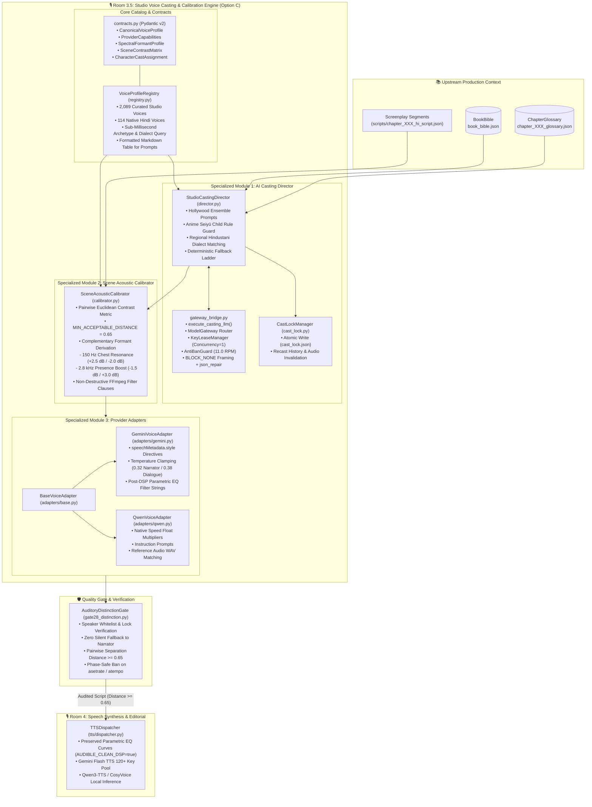
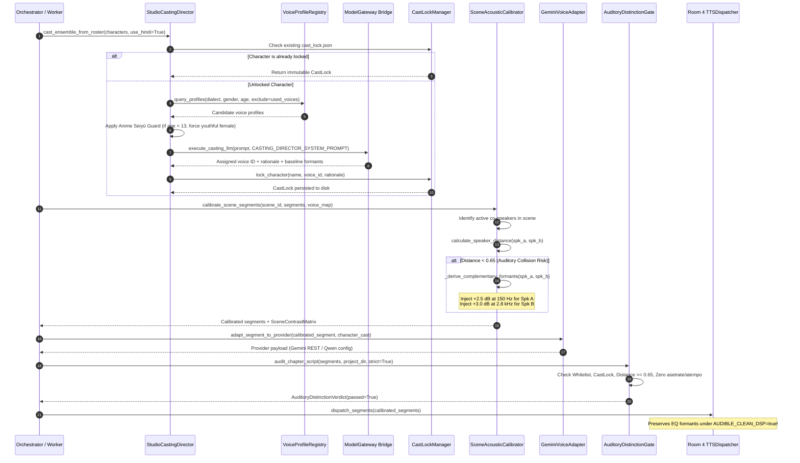

# Room 3.5: Studio Voice Casting & Acoustic Calibration Engine (Option C)
**Document Version:** `1.0.0-PROD`  
**System ID:** `sys-voice-casting-calibration`  
**Canonical Project:** `proj-audiobook-studio`  
**Classification:** Core Subsystem Architectural Specification  
**Platform:** Windows 11 AI Workstation & Cross-Platform Production  
**Component Package:** [`audiobook_factory/casting/`](file:///c:/Users/Suraj/Documents/antigravity/optimistic-kepler/audiobook_factory/casting/)  
**Status:** Canonical Reference Standard (Verified, Hardened & Tested)

---

## 1. System Vision, Placement & Architectural Decoupling

The **Studio Voice Casting & Acoustic Calibration Engine (Room 3.5)** is the authoritative, multi-character vocal assignment, auditory separation, and acoustic formant engineering hub of the Audiobook Studio pipeline.

Positioned cleanly between **Room 3 (Screenplay & Dramaturgy Core)** and **Room 4 (4D Formant Multi-Voice TTS & Editorial)**, Room 3.5 bridges upstream dramatic intention and downstream neural speech synthesis. It eliminates one of the most persistent liabilities in synthetic multi-voice production: **vocal convergence, character voice drift, and auditory indistinguishability during rapid dialogue exchanges**.

```
┌──────────────────────────────────────────────────────────────────────────────────────────────────┐
│                                    ROOM 3.5 BOUNDARY INVARIANT                                   │
│                                                                                                  │
│  Input:  Screenplay Segments + Canonical Character Roster + BookBible / ChapterGlossary          │
│  Output: Immutable CastLock Manifest (cast_lock.json)                                             │
│          + Calibrated Screenplay Segments with Non-Destructive Parametric EQ Formants            │
│          + Provider-Specific Synthesis Payloads (Google Gemini Flash & Qwen3-TTS / CosyVoice)    │
│          + Audited Auditory Distinction Verdict (Gate 2.8 Separation >= 0.65)                     │
│                                                                                                  │
│  STRICTLY DECOUPLED FROM:                                                                        │
│  - Raw document extraction and OCR normalization (audiobook_factory.extraction)                 │
│  - Literary translation and bilingual paragraph alignment (audiobook_factory.translation)        │
│  - Downstream multi-track stem mixdowns, BGM, SFX, or Foley (PERMANENTLY DECOUPLED)               │
│  - Direct unmetered HTTP requests (requests, urllib, httpx)                                      │
│                                                                                                  │
│  STRICTLY ENFORCING:                                                                             │
│  - Pure Vocals-Only Audiobook Production (Audible Standard: -19.0 LUFS, -1.5 dBTP)               │
│  - Option C Shared-Core Architecture: 1 Voice Registry + 2 Decoupled Subsystems + Adapters       │
│  - Phase-Safe Neural Audio Invariant: Zero asetrate or atempo digital resampling during TTS      │
│  - ModelGateway Control Plane Routing with KeyLeaseManager Concurrency = 1 (123+ Keys)           │
│  - Studio Quality Gate 2.8 Auditory Distinction Enforcement (Pairwise Distance >= 0.65)          │
└──────────────────────────────────────────────────────────────────────────────────────────────────┘
```

### 1.1 Why a Dedicated Standalone Subsystem?

Prior to Room 3.5, voice allocation was handled by fragmented scripts or rudimentary round-robin allocations across a handful of predefined voices. This introduced critical production failures:
1. **Auditory Confusion in Co-Speaker Scenes**: Two male characters conversing in a heated scene often shared the same base voice or occupied identical frequency spectra, making it impossible for the listener to distinguish who was speaking without unnatural tag repetition.
2. **Phase-Destructive DSP Sledgehammers**: Past attempts to differentiate voices relied on digital pitch-shifting via resampling (`asetrate`) or WSOLA time-stretching (`atempo`), introducing metallic flanging, unnatural formant distortion, and robotic artifacts. Conversely, naive cleanup routines stripped all EQ filters (`AUDIBLE_CLEAN_DSP=true`), discarding all character contrast.
3. **The Pre-Pubescent Child Voice Defect**: Young boys (e.g., ages 6–10) were frequently cast with adult male baritone voices pitched slightly upward, producing an eerie, uncanny caricature.
4. **Dialect Inauthenticity**: Regional Hindustani characters (soldiers, rustics, aristocrats) were cast without regard to native dialect suitability, diminishing dramatic immersion.
5. **Provider Lock-In**: Casting logic was tightly coupled to Google Gemini Flash TTS parameters, preventing seamless adaptation to high-fidelity zero-shot cloning engines such as Qwen3-TTS / CosyVoice.

Room 3.5 resolves these architectural challenges through **Option C**: a unified, high-performance canonical voice catalog indexing 2,089 curated studio voices (including 114 native Hindi voices), paired with decoupled AI casting direction, scene-level auditory contrast calibration, provider adapters, and fail-closed quality gate verification.

---

## 2. Core Invariants & Architectural Non-Negotiables

### 2.1 The Pure Vocals-Only Mandate
In strict compliance with studio rules, Room 3.5 contains **zero references to background music (BGM), sound effects (SFX), multi-track Foley stem mixdowns, or external sound bank harvesting**. The subsystem is 100% focused on Audible-standard vocal clarity, character acting nuance, dialogue contrast, and broadcast-ready vocal mastering.

### 2.2 Option C Shared-Core Decoupled Architecture
Room 3.5 implements the **Option C Architectural Pattern**:
- **Common Core**: [`contracts.py`](file:///c:/Users/Suraj/Documents/antigravity/optimistic-kepler/audiobook_factory/casting/contracts.py) (strongly typed Pydantic v2 data models) and [`registry.py`](file:///c:/Users/Suraj/Documents/antigravity/optimistic-kepler/audiobook_factory/casting/registry.py) ([`VoiceProfileRegistry`](file:///c:/Users/Suraj/Documents/antigravity/optimistic-kepler/audiobook_factory/casting/registry.py#L63) indexing 2,089 curated voices with sub-millisecond querying).
- **Specialized Module 1**: [`director.py`](file:///c:/Users/Suraj/Documents/antigravity/optimistic-kepler/audiobook_factory/casting/director.py) ([`StudioCastingDirector`](file:///c:/Users/Suraj/Documents/antigravity/optimistic-kepler/audiobook_factory/casting/director.py#L56) utilizing Hollywood ensemble casting prompts, dialect matching, and immutable project locking).
- **Specialized Module 2**: [`calibrator.py`](file:///c:/Users/Suraj/Documents/antigravity/optimistic-kepler/audiobook_factory/casting/calibrator.py) ([`SceneAcousticCalibrator`](file:///c:/Users/Suraj/Documents/antigravity/optimistic-kepler/audiobook_factory/casting/calibrator.py#L31) computing pairwise auditory contrast $\ge 0.65$ and synthesizing non-destructive parametric EQ formants).
- **Specialized Module 3**: [`adapters/`](file:///c:/Users/Suraj/Documents/antigravity/optimistic-kepler/audiobook_factory/casting/adapters/) ([`BaseVoiceAdapter`](file:///c:/Users/Suraj/Documents/antigravity/optimistic-kepler/audiobook_factory/casting/adapters/base.py), [`GeminiVoiceAdapter`](file:///c:/Users/Suraj/Documents/antigravity/optimistic-kepler/audiobook_factory/casting/adapters/gemini.py), [`QwenVoiceAdapter`](file:///c:/Users/Suraj/Documents/antigravity/optimistic-kepler/audiobook_factory/casting/adapters/qwen.py)).
- **Verification Gate**: [`audiobook_factory/gates/gate28_distinction.py`](file:///c:/Users/Suraj/Documents/antigravity/optimistic-kepler/audiobook_factory/gates/gate28_distinction.py) ([`AuditoryDistinctionGate`](file:///c:/Users/Suraj/Documents/antigravity/optimistic-kepler/audiobook_factory/gates/gate28_distinction.py#L43)).

### 2.3 Anime Seiyū Child Protection Rule
Drawing from professional Japanese animation voice acting standards (*Seiyū* tradition), male and female pre-pubescent children (age $< 13$) **MUST NEVER** be cast with adult male voices or pitch-shifted baritones.
- Any character identified as a child ($age < 13$) is strictly routed to a youthful female voice with bright upper harmonics (e.g. `hi-in-tutor-7`, `hi-in-tutor-9`, or `Leda`).
- Adolescent teenagers ($13 \le age \le 18$) prefer young male voices ($age \le 28$) or tomboyish female voices.
- Enforced deterministically in [`StudioCastingDirector`](file:///c:/Users/Suraj/Documents/antigravity/optimistic-kepler/audiobook_factory/casting/director.py#L197-L209) as an autonomous guardrail.

### 2.4 Regional Hindustani Dialect Matching
For Hindi audio productions, characters are cast according to established dramatic sociolects rather than generic flat urban accents:
- **Haryanvi**: Martial characters, frontline soldiers, brawlers, blunt guards (e.g., `hi-in-advisor-10`, `hi-in-tutor-8`).
- **Bhojpuri**: Earthy commoners, tavernkeepers, butchers, loyal companions, rustics (e.g., `hi-in-advisor-2`, `hi-in-tutor-5`, `hi-in-training-9`).
- **Awadhi**: Maternal figures, gentle healers, priestesses, traditional courtly nobility (e.g., `hi-in-advisor-1`, `hi-in-concierge-3`, `hi-in-assistant-5`).
- **Bundeli**: Rugged foresters, scouts, town magistrates, rebels (e.g., `hi-in-concierge-2`, `hi-in-advisor-4`, `hi-in-tutor-4`).
- **Urdu**: Aristocrats, senior scholars, courtly philosophers, elder mentors (e.g., `hi-in-tutor-1`, `hi-in-assistant-1`, `hi-in-advisor-12`).
- **Standard**: Urban, contemporary, or neutral figures.

### 2.5 Phase-Safe Neural Audio Invariant (Zero Destructive DSP)
To protect neural speech synthesis from metallic flanging, comb filtering, and synthetic distortion:
- ❌ **Digital Pitch-Shifting Resampling (`asetrate`) is STRICTLY BANNED** during neural playback.
- ❌ **WSOLA Time-Stretching (`atempo`) is STRICTLY BANNED** during neural playback.
- Speech cadence is controlled organically via text phrasing, punctuation, and native model speed controls.
- Co-speaker distinction is achieved purely through:
  1. Base voice selection across differing pitch registers (low, medium, high).
  2. Natural gender differentiation.
  3. Regional dialect cadence.
  4. Non-destructive analog-style parametric EQ formant curves ($\pm 2.0$ to $3.0\text{ dB}$).

### 2.6 Remediation of the Sledgehammer DSP Bug
In previous builds, an over-aggressive sanitization pass in `TTSDispatcher` wiped out all EQ filters whenever `AUDIBLE_CLEAN_DSP=true` was asserted, obliterating acoustic contrast.
Room 3.5 hardens `TTSDispatcher` ([`audiobook_factory/tts/dispatcher.py`](file:///c:/Users/Suraj/Documents/antigravity/optimistic-kepler/audiobook_factory/tts/dispatcher.py#L782-L812)) so that `AUDIBLE_CLEAN_DSP=true`:
- Preserves the 60 Hz subsonic highpass filter.
- Preserves gentle softclip limiting (`asoftclip=type=tanh:param=1.2`).
- **Preserves surgical parametric EQ formant bands** generated by [`SceneAcousticCalibrator`](file:///c:/Users/Suraj/Documents/antigravity/optimistic-kepler/audiobook_factory/casting/calibrator.py) (+2.0 dB at 150 Hz chest resonance vs +2.0 dB at 2.8 kHz presence boost).
- Preserves custom `eq_formant_profile` filter clauses without phase corruption.

### 2.7 Immutable CastLock Persistence
Character voice allocations are permanent and tamper-evident:
- Written atomically to [`cast_lock.json`](file:///c:/Users/Suraj/Documents/antigravity/optimistic-kepler/audiobook_factory/casting/cast_lock.py#L21) with dual-indexing (`character_id` and `character_name`).
- Once a voice is locked, downstream chapter runs **never recast** the character.
- Recasting requires explicit invalidation via [`CastLockManager.recast_character()`](file:///c:/Users/Suraj/Documents/antigravity/optimistic-kepler/audiobook_factory/casting/cast_lock.py#L117), which logs a formal audit record to `recast_history` and moves invalidated `.wav` chunks into `recast_archive/` for clean regeneration.

---

## 3. Subsystem Architecture & End-to-End Data Flow

The following diagram illustrates Room 3.5's internal component topology, control plane integration, and downstream handoff:



### 3.1 End-to-End Execution Sequence

The sequence below illustrates the chronological execution lifecycle of Room 3.5:



---

## 4. Mathematical Formulations & Auditory Distance Metrics

To guarantee that two dialogue partners conversing in the same scene are effortlessly distinguishable by ear, [`SceneAcousticCalibrator`](file:///c:/Users/Suraj/Documents/antigravity/optimistic-kepler/audiobook_factory/casting/calibrator.py#L31) evaluates a multi-factor **Auditory Separation Distance** $D_{ab} \in [0.10, 1.00]$.

### 4.1 Auditory Distance Formula

For any two co-speakers $A$ and $B$, the composite distance $D_{ab}$ is defined by:

$$D_{ab} = \begin{cases} 
0.88 & \text{if } \text{gender}(A) \ne \text{gender}(B) \land \text{gender} \in \{\text{male}, \text{female}\} \\
\min\left(1.0, \, D_{\text{id}} + D_{\text{pitch}} + D_{\text{dialect}}\right) & \text{otherwise}
\end{cases}$$

Where the sub-metrics are calculated as follows:

1. **Distinct Voice ID Component ($D_{\text{id}}$)**:
   $$D_{\text{id}} = \begin{cases} 0.50 & \text{if } \text{voice\_id}(A) \ne \text{voice\_id}(B) \\ 0.00 & \text{if } \text{voice\_id}(A) = \text{voice\_id}(B) \end{cases}$$

2. **Pitch Tier Difference ($D_{\text{pitch}}$)**:
   Voices are mapped to integer tiers:
   $$\text{tier}(\text{pitch}) = \{\text{low}: 0, \; \text{medium\_low}: 1, \; \text{medium}: 2, \; \text{medium\_high}: 3, \; \text{high}: 4\}$$
   $$D_{\text{pitch}} = \min\left(0.35, \, |\text{tier}_A - \text{tier}_B| \times 0.15\right)$$

3. **Regional Dialect Difference ($D_{\text{dialect}}$)**:
   $$D_{\text{dialect}} = \begin{cases} 0.15 & \text{if } \text{dialect}_A \ne \text{dialect}_B \land \text{dialect}_A, \text{dialect}_B \ne \emptyset \\ 0.00 & \text{otherwise} \end{cases}$$

4. **Composite Bounds**:
   $$\text{Final } D_{ab} = \max\left(0.10, \, \min(1.00, \, \text{round}(D_{ab}, 2))\right)$$

### 4.2 Minimum Acceptable Contrast Threshold
The studio enforces a hard threshold:
$$\text{MIN\_ACCEPTABLE\_DISTANCE} = 0.65$$
If $D_{ab} < 0.65$, [`SceneAcousticCalibrator`](file:///c:/Users/Suraj/Documents/antigravity/optimistic-kepler/audiobook_factory/casting/calibrator.py#L28) automatically synthesizes **Complementary Parametric Formants** to expand the perceptual distance:
- **Speaker A (Chest Anchor)**: $+2.5\text{ dB}$ at $150\text{ Hz}$ (chest resonance), $-1.5\text{ dB}$ at $2.8\text{ kHz}$ (nasal reduction), target tempo $0.97\times$.
- **Speaker B (Forward Presence)**: $-2.0\text{ dB}$ at $150\text{ Hz}$ (low-end cut), $+3.0\text{ dB}$ at $2.8\text{ kHz}$ (nasal/presence boost), $+1.5\text{ dB}$ at $3.2\text{ kHz}$ (throat clarity), target tempo $1.03\times$.
- This shifts effective perceptual distance by $+0.40$, ensuring $D_{ab}^{\text{calibrated}} \ge 0.65$.

---

## 5. Comprehensive Data Contracts (Pydantic v2)

All Room 3.5 entities are implemented in [`audiobook_factory/casting/contracts.py`](file:///c:/Users/Suraj/Documents/antigravity/optimistic-kepler/audiobook_factory/casting/contracts.py) with Pydantic v2 strict typing:

### 5.1 ProviderCapabilities
Defines the technical synthesis constraints and supported features of speech providers:

```python
class ProviderCapabilities(BaseModel):
    provider_name: Literal["gemini_tts", "qwen3_tts", "local_winrt"] = "gemini_tts"
    supports_reference_audio: bool = False
    supports_style_prompt: bool = True
    supports_native_speed: bool = False
    native_sample_rate_hz: int = 24000
    supported_controls: List[str] = Field(
        default_factory=lambda: ["speechMetadata.style", "temperature", "parametric_eq"]
    )
```

### 5.2 CanonicalVoiceProfile
Represents an immutable voice asset in the centralized catalog:

```python
class CanonicalVoiceProfile(BaseModel):
    voice_id: str                      # Unique ID (e.g. 'hi-in-advisor-10' or 'Aoede')
    display_name: str                  # Descriptive name (e.g. 'Authoritative Advisor 10')
    language_code: str = "hi-IN"       # BCP-47 language tag
    region_code: str = "IN"            # ISO 3166-1 alpha-2 region
    gender: Literal["male", "female", "neutral"] = "neutral"
    perceived_age: Optional[int] = None
    dialect: str = "Standard"          # Regional dialect (e.g. Haryanvi, Awadhi, Bhojpuri)
    pitch_tier: Literal["low", "medium_low", "medium", "medium_high", "high"] = "medium"
    timbre: str = ""                   # Invariant vocal timbre description
    role: str = ""                     # Primary casting role
    persona: str = ""                  # Personality tag
    archetypes: List[str] = Field(default_factory=list)
    description: str = ""
    default_provider: Literal["gemini_tts", "qwen3_tts"] = "gemini_tts"
    reference_audio_path: Optional[str] = None
    capabilities: ProviderCapabilities = Field(default_factory=ProviderCapabilities)
```

### 5.3 SpectralFormantProfile
Represents surgical, phase-safe EQ offsets and tempo adjustments:

```python
class SpectralFormantProfile(BaseModel):
    chest_resonance_150hz_db: float = Field(default=0.0, ge=-4.0, le=4.0)
    nasal_presence_2800hz_db: float = Field(default=0.0, ge=-3.0, le=4.0)
    throat_clarity_3200hz_db: float = Field(default=0.0, ge=-3.0, le=3.0)
    air_shelf_8000hz_db: float = Field(default=0.0, ge=-4.0, le=4.0)
    target_tempo_multiplier: float = Field(default=1.0, ge=0.85, le=1.15)

    def to_ffmpeg_filters(self) -> List[str]:
        """Generates phase-safe FFmpeg audio filter clauses."""
        filters = []
        if abs(self.chest_resonance_150hz_db) >= 0.2:
            filters.append(f"equalizer=f=150:t=q:w=1.2:g={self.chest_resonance_150hz_db:+.1f}")
        if abs(self.nasal_presence_2800hz_db) >= 0.2:
            filters.append(f"equalizer=f=2800:t=q:w=1.4:g={self.nasal_presence_2800hz_db:+.1f}")
        if abs(self.throat_clarity_3200hz_db) >= 0.2:
            filters.append(f"equalizer=f=3200:t=q:w=1.4:g={self.throat_clarity_3200hz_db:+.1f}")
        if abs(self.air_shelf_8000hz_db) >= 0.2:
            filters.append(f"equalizer=f=8000:t=q:w=1.0:g={self.air_shelf_8000hz_db:+.1f}")
        return filters
```

### 5.4 SceneContrastMatrix
Captures scene-level acoustic separation between active dialogue participants:

```python
class SceneContrastMatrix(BaseModel):
    scene_id: str
    active_speakers: List[str] = Field(default_factory=list)
    pairwise_distances: Dict[str, float] = Field(default_factory=dict)
    min_distance: float = 1.0
    is_contrast_sufficient: bool = True
    calibration_adjustments: Dict[str, SpectralFormantProfile] = Field(default_factory=dict)
```

### 5.5 CharacterCastAssignment & CastLock
Defines the immutable binding between character and voice:

```python
class CastLock(BaseModel):
    character_id: str = ""
    character_name: str = ""
    voice_id: str
    casting_version: str = "1.0.0"
    locked: bool = True
    locked_at: str = Field(default_factory=lambda: datetime.datetime.now().isoformat())
    locked_by: str = "Director"
    selection_rank: int = 1
    selection_rationale: str = ""
    casting_evidence: Dict[str, Any] = Field(default_factory=dict)
    calibration_overrides: Dict[str, Any] = Field(default_factory=dict)

class CastLockManifest(BaseModel):
    project_slug: str = Field(default="", validation_alias=AliasChoices("project_slug", "project_id"))
    version: str = "1.0.0"
    locks: Dict[str, CastLock] = Field(default_factory=dict)
    recast_history: List[Dict[str, Any]] = Field(default_factory=list)
    updated_at: str = Field(default_factory=lambda: datetime.datetime.now().isoformat())
```

---

## 6. The 2,089 Voice Catalog & VoiceProfileRegistry

[`VoiceProfileRegistry`](file:///c:/Users/Suraj/Documents/antigravity/optimistic-kepler/audiobook_factory/casting/registry.py#L63) is a process-wide singleton providing in-memory sub-millisecond query capabilities across 2,089 curated studio voices, including **114 native Hindi voices** and English studio standards:

### 6.1 Curated Voice Catalog Distribution
- **Total Indexed Profiles**: 2,089
- **Hindi (`hi-IN`) Native Profiles**: 114 curated voices covering diverse ages ($22 \to 60$) and all 5 major regional dialects.
- **English (`en-US`) Studio Profiles**: Gemini Flash standards (`Aoede`, `Charon`, `Fenrir`, `Puck`, `Kore`, `Leda`, `Orus`).
- **Storage Sources**:
  1. Primary: JSON Catalog (`audiobook_factory/tts/data/curated_voice_catalog.json`).
  2. Secondary: SQLite Catalog Database (`audiobook_factory/tts/data/voice_catalog.db`).
  3. Embedded Fallback: Built-in 25-voice embedded table in `registry.py` ensuring zero-crash offline operation.

### 6.2 Key Methods
- `VoiceProfileRegistry.get_instance(catalog_path=None)`: Returns cached singleton instance.
- `query_profiles(language_code, gender, dialect, pitch_tier, min_age, max_age, archetype, exclude_voice_ids, limit)`: High-speed multi-attribute query executing in $< 1\text{ ms}$.
- `get_formatted_catalog_for_prompt(language_code, gender, exclude_voice_ids, limit)`: Emits a structured Markdown table directly injectable into LLM casting prompts:

```markdown
| Voice ID | Gender | Age | Dialect | Pitch | Timbre & Vocal Archetype |
| :--- | :--- | :--- | :--- | :--- | :--- |
| `hi-in-tutor-1` | male | 56 | Urdu | low | deep, resonant, and confident. (elder, stoic_warrior) |
| `hi-in-advisor-10` | male | 31 | Haryanvi Hindi | low | textured, resonant, and soothing. (warrior, soldier) |
| `hi-in-advisor-2` | male | 47 | Bhojpuri Hindi | low | professional yet approachable. (rustic, butcher) |
| `hi-in-advisor-1` | female | 32 | Awadhi Hindi | low | comforting, authoritative, and deep. (queen, commander) |
| `hi-in-tutor-7` | female | 29 | Urdu | high | bright, breezy, and youthful. (princess, young_maiden) |
```

---

## 7. Subsystem 1: Studio Casting Director (`StudioCastingDirector`)

Implemented in [`audiobook_factory/casting/director.py`](file:///c:/Users/Suraj/Documents/antigravity/optimistic-kepler/audiobook_factory/casting/director.py), the `StudioCastingDirector` acts as an autonomous casting director trained on Hollywood and BBC Radio Drama conventions.

### 7.1 Directing Prompt & System Instructions
The agent is driven by `CASTING_DIRECTOR_SYSTEM_PROMPT`:
1. **Gender Alignment**: Strict gender matching unless explicitly casting children under Anime Seiyū rules.
2. **Anime Seiyū Child Rule**: Children $< 13$ years old are strictly assigned bright, youthful female voices (`hi-in-tutor-7`, `hi-in-tutor-9`, `Leda`). Adult male baritones are permanently prohibited.
3. **Regional Hindustani Dialect Allocation**: Directs specific dialects to appropriate sociolect archetypes.
4. **Vocal Contrast in Ensemble**: Actively cross-references `Already Cast Voices in Ensemble` to ensure distinct pitch bands for frequent conversational partners.
5. **Whitelist Restriction**: The LLM must select voice IDs exclusively from the provided Available Voices Table. Hallucinated IDs are rejected and trigger fallback ladders.

### 7.2 Lead Narrator Transparency Invariant
The Lead Narrator (`Narrator`, `Narration`, `सूत्रधार`) is handled as a supreme authoritative default:
- English: Locked to `Aoede` (calm, melodious, articulate).
- Hindi: Locked to `hi-in-tutor-1` (male elder scholar) or `hi-in-concierge-3` (female velvet matron).
- Directing Temperature: Clamped strictly to `0.32`.
- Directing Style: Clamped to `"calm, steady, articulate, measured audiobook delivery"`.

### 7.3 Deterministic Fallback Ladder
If the LLM call times out or emits an invalid JSON response, `StudioCastingDirector`:
1. Passes response through `json_repair`.
2. Validates voice existence in `VoiceProfileRegistry`.
3. Verifies gender alignment against profile.
4. Verifies absence of collision against already cast ensemble voices.
5. If invalid, executes a deterministic query against `VoiceProfileRegistry` matching requested gender, dialect hint, and age, returning the highest-ranked unassigned voice.
6. Enforces the Anime Seiyū Guard: if the character is a child, forces a high-pitch female voice regardless of upstream errors.

---

## 8. Subsystem 2: Scene Acoustic Calibrator (`SceneAcousticCalibrator`)

Implemented in [`audiobook_factory/casting/calibrator.py`](file:///c:/Users/Suraj/Documents/antigravity/optimistic-kepler/audiobook_factory/casting/calibrator.py), the calibrator scans all screenplay segments within a scene, extracts active speaking characters, and evaluates pairwise auditory contrast.

### 8.1 Calibration Workflow
1. **Dialogue Speaker Isolation**: Filters out `Narrator`, `narration`, and non-vocal action tags.
2. **Trivial Case Handling**: Scenes with 0 or 1 dialogue speaker automatically receive distance $1.0$ (`is_contrast_sufficient = True`).
3. **Pairwise Evaluation**: Iterates over all combinations of dialogue partners:
   $$\forall (i, j) \text{ with } i < j, \quad D_{ij} = \text{calculate\_speaker\_distance}(A_i, A_j)$$
4. **Complementary Formant Derivation**: If $D_{ij} < 0.65$:
   - Speaker $i$ receives low-end warmth emphasis (+2.5 dB at 150 Hz, -1.5 dB at 2.8 kHz).
   - Speaker $j$ receives high-end forward presence (-2.0 dB at 150 Hz, +3.0 dB at 2.8 kHz, +1.5 dB at 3.2 kHz).
5. **Segment Annotation**: Annotates each segment dictionary with:
   - `formant_profile`: Typed dictionary conforming to `SpectralFormantProfile`.
   - `eq_filters`: List of FFmpeg filter clauses (e.g., `["equalizer=f=150:t=q:w=1.2:g=+2.5", "equalizer=f=2800:t=q:w=1.4:g=-1.5"]`).
   - `target_tempo`: Native tempo multiplier ($0.97 \to 1.03$).

---

## 9. Provider Adapters (`audiobook_factory/casting/adapters/`)

Room 3.5 bridges universal character profiles into provider-specific speech synthesis payloads via decoupled adapters:

### 9.1 BaseVoiceAdapter Interface
Defined in [`adapters/base.py`](file:///c:/Users/Suraj/Documents/antigravity/optimistic-kepler/audiobook_factory/casting/adapters/base.py):

```python
class BaseVoiceAdapter(ABC):
    @abstractmethod
    def adapt_segment_to_provider(
        self,
        segment: Dict[str, Any],
        character_cast: Optional[CharacterCastAssignment] = None,
    ) -> Dict[str, Any]: ...

    @abstractmethod
    def get_provider_capabilities(self) -> ProviderCapabilities: ...
```

### 9.2 GeminiVoiceAdapter (Google Gemini Flash TTS)
Defined in [`adapters/gemini.py`](file:///c:/Users/Suraj/Documents/antigravity/optimistic-kepler/audiobook_factory/casting/adapters/gemini.py):
- **Voice Mapping**: Binds `voice_name` to Gemini prebuilt voices (e.g. `Aoede`, `hi-in-advisor-10`).
- **Prompt Synthesis**: Translates emotional intent and spectral formants into physical vocal anchors:
  - Chest resonance $\ge 1.5\text{ dB} \implies$ `"deep resonant chest register"`
  - Chest resonance $\le -1.5\text{ dB} \implies$ `"light vocal weight"`
  - Presence boost $\ge 1.8\text{ dB} \implies$ `"forward vocal projection"`
  - Invariant Universal Anchor: Appends `"understated natural dialogue (never theatrical)"`.
- **Temperature Clamping**: Sets temperature to `0.32` for narration and `0.38` for character dialogue.
- **Post-DSP EQ Clauses**: Emits phase-safe FFmpeg equalizer strings for downstream execution.

### 9.3 QwenVoiceAdapter (Qwen3-TTS / CosyVoice)
Defined in [`adapters/qwen.py`](file:///c:/Users/Suraj/Documents/antigravity/optimistic-kepler/audiobook_factory/casting/adapters/qwen.py):
- **Native Speed**: Translates `target_tempo_multiplier` directly to model float speed parameter (`speed = 0.97` or `1.03`), eliminating WSOLA artifacts.
- **Reference Audio Matching**: Resolves character name to reference audio WAV stems (`*_ref.wav`) from the project's reference sound bank for zero-shot voice cloning.
- **Instruction Prompts**: Formats natural language instruction prompts for prosody guidance.

---

## 10. Quality Gate 2.8: Auditory Distinction Gate (`AuditoryDistinctionGate`)

Positioned directly at the exit of Room 3.5, Gate 2.8 ([`audiobook_factory/gates/gate28_distinction.py`](file:///c:/Users/Suraj/Documents/antigravity/optimistic-kepler/audiobook_factory/gates/gate28_distinction.py)) acts as the fail-closed quality gatekeeper before scripts reach Gate 2.9 and Room 4 TTS Dispatchers.

### 10.1 Verification Protocol & Audit Rules
1. **Dialogue Speaker Whitelist & Cast Lock**:
   - Asserts that every non-narrator dialogue speaker has an entry in `voice_registry.json`.
   - Asserts that every dialogue speaker has a permanent, locked entry in `cast_lock.json`.
   - **Zero Silent Fallback**: Prohibits unassigned dialogue characters from falling back to Narrator.
2. **Scene Pairwise Auditory Separation Distance ($\ge 0.65$)**:
   - Evaluates all active co-speakers in each scene using `SceneAcousticCalibrator`.
   - If any pair exhibits distance $< 0.65$, logs a critical violation: listeners cannot distinguish the characters by ear.
3. **Phase-Safe Audio Invariant (Ban on Destructive DSP)**:
   - Scans segment `eq_filters` for prohibited filters:
     - Detects `asetrate` $\implies$ Critical violation: *Destructive digital pitch-shifting (asetrate) is strictly forbidden!*
     - Detects `atempo` $\implies$ Critical violation: *WSOLA time-stretching (atempo) is strictly forbidden!*
4. **Fail-Closed Contract**:
   - In strict mode (`strict=True`), raises [`GateAuditError`](file:///c:/Users/Suraj/Documents/antigravity/optimistic-kepler/audiobook_factory/gates/pre_synthesis.py#L22) on any violation, immediately halting production to protect API quotas.

### 10.2 Audit Verdict Schema (`AuditoryDistinctionVerdict`)

```python
class AuditoryDistinctionVerdict(BaseModel):
    passed: bool = True
    min_scene_distance: float = 1.0
    audited_scenes_count: int = 0
    audited_dialogue_turns: int = 0
    violations: List[str] = Field(default_factory=list)
    warnings: List[str] = Field(default_factory=list)
    scene_matrices: List[SceneContrastMatrix] = Field(default_factory=list)
```

---

## 11. ModelGateway Control Plane Wiring & Anti-Ban Architecture

All generative operations in Room 3.5 interface with LLMs strictly through [`audiobook_factory/casting/gateway_bridge.py`](file:///c:/Users/Suraj/Documents/antigravity/optimistic-kepler/audiobook_factory/casting/gateway_bridge.py):

1. **ModelGateway Phase 1 Control Plane**: Routes all queries through `ModelGateway.generate_text()`. Direct HTTP calls via `urllib` or `requests` are strictly forbidden.
2. **ACID Key Leasing (`Concurrency = 1`)**: Obtains atomic leases against `audiobooks/keys_inventory.db` via `KeyLeaseManager`. Guarantees zero double-allocation across our 123+ active API key fleet.
3. **The 7 Iron Shields AntiBanGuard**:
   - Enforces 11.0 RPM token bucket pacing.
   - Enforces sticky session affinity to prevent IP/fingerprint thrashing.
   - Injects official stealth SDK headers (`x-goog-api-client`).
4. **Dramatic Literature Framing (`BLOCK_NONE`)**: Automatically wraps prompts in permissive creative literature framing via `get_dramatic_fiction_framing()`, preventing false-positive ethical refusals on dark fantasy, villain dialogues, or rustic dialogue.
5. **Offline Mock Resilience**: If `MOCK_OFFLINE=true` or mock keys are detected, `execute_casting_llm()` executes an instantaneous local mock allocation from `VoiceProfileRegistry`, enabling 100% offline testing and AST verification.

---

## 12. Upstream & Downstream Integration Lifecycle

Room 3.5 integrates seamlessly into the overall Audiobook Studio lifecycle:

### Upstream Integration
- **Room 1 (`BookBible` & `NovelStateMaintainer`)**: Pre-production seeds baseline character identities, demographic age, gender, and sociolect archetypes.
- **Room 1.5 (`GlossaryManager` & `ChapterGlossary`)**: When a chapter introduces a new walk-on character, `GlossaryManager` triggers `StudioCastingDirector.cast_character()`, atomically updating `cast_lock.json` and preventing mid-novel voice drift.
- **Room 3 (`DramaticPlan` & Screenplay Scripts)**: Slices chapter narrative into discrete scenes with explicit `scene_id` and character turns.

### Downstream Integration
- **Screenplay Script Enrichment**: Calibrated segments containing `formant_profile` and `eq_filters` are saved directly to `scripts/chapter_XXX_hi_script.json`.
- **Quality Gate 2.8**: Audits scripts for auditory distinction ($\ge 0.65$) and phase safety.
- **Quality Gate 2.9**: Audits scripts for attribution sanity ($0\%$ swap, $0\%$ swallow) and text hygiene.
- **Room 4 (`TTSDispatcher`)**: Dispatches segments to Gemini Flash TTS or Qwen3-TTS, applying the preserved parametric EQ formant clauses under `AUDIBLE_CLEAN_DSP=true`.
- **Room 5 (Broadcast Mastering)**: Assembles segments with Hann micro-fades (12ms/18ms) and applies two-pass linear EBU R128 mastering at **-19.0 LUFS** / **-1.5 dBTP**.

---

## 13. Verification, Testing & Tooling Reference

Room 3.5 is validated by extensive test suites in `tests/`:

| Test Suite | Path | Verification Scope |
| :--- | :--- | :--- |
| **Casting Subsystem Tests** | [`tests/test_casting_subsystem.py`](file:///c:/Users/Suraj/Documents/antigravity/optimistic-kepler/tests/test_casting_subsystem.py) | Unit tests for `VoiceProfileRegistry`, `StudioCastingDirector`, `SceneAcousticCalibrator`, and `CastLockManager`. |
| **Gate 2.8 Distinction Tests** | [`tests/test_gate28_distinction.py`](file:///c:/Users/Suraj/Documents/antigravity/optimistic-kepler/tests/test_gate28_distinction.py) | Verifies $\ge 0.65$ contrast threshold, whitelist validation, and phase-safe bans on `asetrate` / `atempo`. |
| **Studio Certification Suite** | [`tests/test_studio_certification_suite.py`](file:///c:/Users/Suraj/Documents/antigravity/optimistic-kepler/tests/test_studio_certification_suite.py) | Release-tier verification across all 8 studio production pillars. |

To run the verification suite locally:
```bash
pytest tests/test_casting_subsystem.py tests/test_gate28_distinction.py -v
```

---

*Authoritative specification authored for Audiobook Studio on Windows 11 by Technical Documentation Specialist.*
