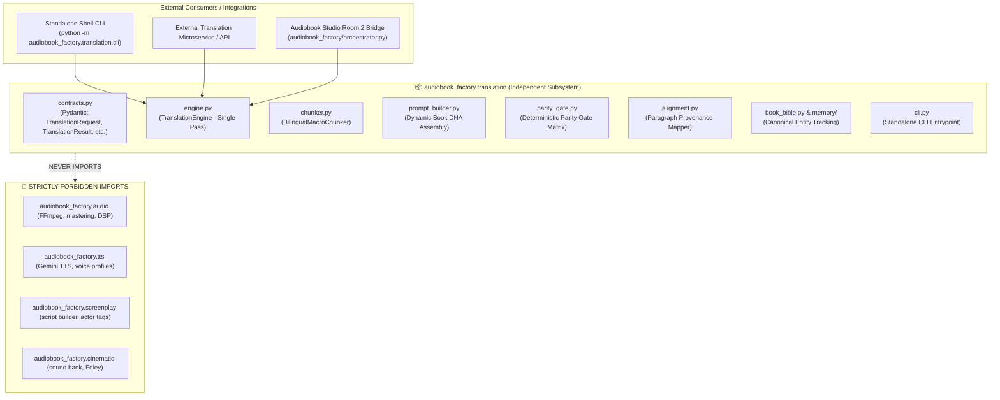

# Engineering Implementation Specification: Option D Standalone Translation Architecture

**Document Version**: 2.0.0  
**Status**: Implemented & Verified (Canonical Production Standard)  
**Target Milestone**: Pillar 2 Modernization  
**Scope**: Autonomous Standalone Translation Subsystem (`audiobook_factory/translation/`)  

---

## 1. Executive Summary & Design Rationale

### 1.1 The Challenge
The translation subsystem previously suffered from two major architectural vulnerabilities:
1. **Pipeline Entanglement**: Translation code was coupled with the broader audiobook pipeline (importing project-specific key managers, directory paths, orchestrator conventions, and even audio utilities), preventing its reuse as an independent, standalone translation engine.
2. **Micro-Scene Fragility & Telephone Game**: Chapters were shredded into 250-word micro-scenes (incurring 70–80 API calls per chapter), followed by a 4-pass serial rewrite chain (`draft` $\rightarrow$ `cadence` $\rightarrow$ `idiom` $\rightarrow$ `critic`). Each serial pass paraphrased, compressed, and dropped narrative clauses. Hardcoded franchise regexes (e.g., Witcher 1 lore) and colorist tropes (`गोरी-चिट्टी`) were embedded directly in sanitizer scripts.

### 1.2 The Implemented Architecture: Option D
**Option D (Robust Token-Optimized Hybrid Architecture)** delivers:
- **Complete Decoupling**: A pure text-to-text / text-to-structured-asset engine with **zero imports** from TTS, audio mastering, sound effects, or screenplay synthesis. It operates as an independent Python library or standalone CLI tool for translating entire books or standalone documents.
- **Single-Pass Deliberative Generation**: Macro-chunking (1,500–2,200 words) using Google Gemini Flash with `thinking_budget = 1024` and `temperature = 0.35`. Gemini leverages internal reasoning to restructure English SVO clauses to Hindi SOV and resolve idioms in a single call, eliminating the 4-pass telephone cascade.
- **Deterministic Full-Text Parity Gates**: Fast, zero-token Python validation auditing paragraph count parity ($\pm 15\%$), dialogue quote count ($\pm 10\%$), length ratio ($\ge 75\%$), and negation consistency, replacing token-expensive blind 6,000-character sampling.
- **Strict Universal Novel-Agnostic Invariant**: 100% removal of all hardcoded novel titles, character rosters, and colorist/racial biases.
- **Preserved Backward Compatibility**: `MultiAgentTranslationCollective.translate_block()` defaults to `TranslationEngine` (Option D single pass), while preserving `translate_block_legacy()` as an explicit fallback (`use_single_pass=False`).

---

## 2. Decoupling, Separation of Concerns & Boundary Contracts

### 2.1 The Dependency Boundary
The translation package is strictly self-contained within `audiobook_factory/translation/`.



### 2.2 Boundary Contracts Across Production Rooms

| Production Room | Responsibility | Strict Boundary Contract |
| :--- | :--- | :--- |
| **Room 2: Translation** (`audiobook_factory/translation/`) | English-to-Hindi Literary Translation | **Text-to-text ONLY**. Emits pristine Devanagari Markdown. **NEVER** injects screenplay actor markers (`[GERALT]:`, `[NARRATOR]:`) or JSON attribution. **NEVER** performs audio take QA or TTS synthesis. Zero imports of audio/TTS/screenplay. |
| **Room 3: Screenplay** (`audiobook_factory/script/`) | Dramatic Adaptation & Dialogue Attribution | Ingests Room 2 Markdown. Disentangles dialogue quotes, identifies speakers, adds dramatic delivery tags, and formats screenplay structure. |
| **Room 4: Performance** (`audiobook_factory/tts/`, `performance/`) | Voice Acting & Synthesis | Dispatches speaker lines to the Gemini Flash TTS key pool. Conducts take auditions and acoustic validation. |
| **Room 5: Mastering** (`audiobook_factory/dialogue_editing/`, `mastering.py`) | Vocal Engineering & Packaging | Applies zero-crossing editorial, Hann micro-fades, EBU R128 loudness normalization, and M4B container assembly. |

### 2.3 Import Decoupling Matrix

| Allowed within `audiobook_factory.translation` | Strictly Prohibited within `audiobook_factory.translation` |
| :--- | :--- |
| Standard Library (`re`, `json`, `pathlib`, `typing`, `hashlib`, `os`, `time`, `urllib`) | Any import of `audiobook_factory.audio.*` or `audiobook_factory.audio_utils` |
| Data validation via `pydantic.BaseModel` | Any import of `audiobook_factory.tts.*` (Voice dispatch, key pools) |
| Abstract LLM callable: `Callable[..., str]` via Dependency Injection | Any import of `audiobook_factory.script.*` (`script_builder`, screenplay parsing) |
| Unicode Devanagari normalization and regex patterns | Any import of `audiobook_factory.cinematic.*` (Sound bank, SFX) |
| Canonical `BookBible` & in-memory state models | Audio hardware drivers (`pyaudio`, `sounddevice`, ALSA) |
| Local file I/O for reading text and saving Markdown/JSON | Screenplay actor tag formatting (`[SPEAKER]:`) |

---

## 3. Public Typed Contracts (`contracts.py`)

All interaction with the translation engine occurs via strongly typed Pydantic models defined in [`contracts.py`](file:///data/data/com.termux/files/home/audiobook-studio/audiobook_factory/translation/contracts.py):

```python
from enum import Enum
from typing import Any, Dict, List, Optional
from pydantic import BaseModel, Field


class FidelityTier(str, Enum):
    """Stylistic guidance tier for literary Hindustani translation."""
    RAW_UNRATED = "RAW_UNRATED"          # Mature dark fantasy, visceral combat, uncensored tavern slang
    CLASSIC_REVERENT = "CLASSIC_REVERENT"  # Heritage classics (Premchand, Tagore), dignified pathos, zero profanity


class TranslationRequest(BaseModel):
    """Input payload for a standalone translation request."""
    source_text: str = Field(..., description="Full raw source text of the chapter or document.")
    source_title: str = Field(default="", description="Optional title or chapter heading.")
    tier: FidelityTier = Field(default=FidelityTier.RAW_UNRATED, description="Stylistic guidance tier.")
    book_bible_path: Optional[str] = Field(default=None, description="Path to persistent book_bible.json.")
    dynamic_glossary: Dict[str, str] = Field(default_factory=dict, description="In-memory entity translations (en -> hi).")
    chunk_size_words: int = Field(default=1800, ge=500, le=3000, description="Target macro-chunk word count.")
    max_single_chunk_words: int = Field(default=2200, ge=1000, le=4000, description="Max word count to translate in 1 call.")
    thinking_budget: int = Field(default=1024, ge=0, le=4096, description="Gemini Flash internal deliberation budget.")
    source_language: str = Field(default="en", description="Source ISO language code.")
    target_language: str = Field(default="hi", description="Target ISO language code.")
    temperature: float = Field(default=0.35, ge=0.0, le=1.0, description="Sampling temperature.")
    metadata: Dict[str, Any] = Field(default_factory=dict, description="Optional caller metadata.")


class ParagraphAlignment(BaseModel):
    """Bilingual sentence/paragraph alignment mapping for provenance and QA."""
    index: int = Field(..., description="0-indexed sequence number of the paragraph.")
    source_paragraph: str = Field(..., description="Source English paragraph text.")
    target_paragraph: str = Field(..., description="Target Hindi Devanagari paragraph text.")
    source_hash: str = Field(..., description="SHA-256 hash (first 16 hex chars) of source paragraph.")
    target_hash: str = Field(..., description="SHA-256 hash (first 16 hex chars) of target paragraph.")


class ParityMetrics(BaseModel):
    """Deterministic full-text parity verification metrics."""
    source_paragraph_count: int
    target_paragraph_count: int
    paragraph_parity_ratio: float
    source_quote_count: int
    target_quote_count: int
    quote_parity_ratio: float
    source_word_count: int
    target_word_count: int
    length_ratio: float
    source_negations_count: int
    target_negations_count: int
    passed_all_gates: bool
    rejection_reasons: List[str] = Field(default_factory=list)


class TranslationResult(BaseModel):
    """Output payload from the standalone translation engine."""
    translated_markdown: str = Field(..., description="Pristine Hindi Devanagari translation.")
    alignments: List[ParagraphAlignment] = Field(default_factory=list, description="Paragraph-level alignment map.")
    parity: ParityMetrics = Field(..., description="Deterministic full-text validation report.")
    new_entities_discovered: Dict[str, str] = Field(default_factory=dict, description="Extracted terminology additions.")
    total_chunks: int = 1
    llm_calls_made: int = 1
    elapsed_seconds: float = 0.0
```

---

## 4. Algorithmic Specifications & Adversarial Audit Fixes

### 4.1 `BilingualMacroChunker` (`chunker.py`)
Splits text intelligently to balance context preservation with token limits:
- **Small Chapters ($\le 2,200$ words)**: Processed in a **single chunk** (1 API call). Zero context loss across scene transitions.
- **Large Chapters ($> 2,200$ words)**: Segmented at natural paragraph boundaries (`\n\n`) into blocks of $1,500$ to $1,800$ words.
- **Sliding Context Window**:
  - Each chunk receives the previous chunk's trailing English context ($\approx 150$ words) and trailing Hindi translation ($\approx 150$ words).
  - The model is instructed: *"The preceding context is provided ONLY for narrative continuity, pronoun resolution, and tone consistency. Do NOT re-translate the preceding context. Emit ONLY the translation for NEW TEXT."*

### 4.2 `TranslationEngine` (`engine.py`)
Replaces the 4-agent cascade with a single, highly steered call:
- **Configuration**:
  - `model = "gemini-2.5-flash"`
  - `thinking_budget = 1024` (Gemini Flash deliberates internally on clause restructuring from English SVO to Hindi SOV and resolves idioms before generating text).
  - `temperature = 0.35` (Balances literary flair with strict semantic fidelity).
- **Prompt Architecture**:
  - **System Prompt**: Dynamically injects either the 11 Golden Invariants (`RAW_UNRATED`) or Dignified Pathos Directives (`CLASSIC_REVERENT`).
  - **Entity Partitioning**: Explicitly classifies proper given names (transliterated into Devanagari) vs. descriptive monikers/titles (translated into authentic Hindi).
  - **Zero English Intrusion**: Demands pure Devanagari output without Roman alphabet characters or conversational preambles.
- **Dependency Injection**:
  - Supports custom `llm_fn` callable or runs isolated direct HTTP requests to the Google Gemini REST API using `urllib.request` (zero SDK dependencies).

### 4.3 Adversarial Audit Bug Fixes

#### Fix 1: Negation Double-Counting Separation (`parity_gate.py`)
- **Root Cause**: The Hindi negation counter previously matched compound patterns (e.g. `कभी नहीं`, `कुछ नहीं`, `कोई नहीं`) and then ran a second pass matching single words (e.g. `नहीं`), causing double counting and false rejection against English negation counts.
- **Resolution**: Compound patterns are matched, tallied, and **stripped** from the text buffer before single tokens are counted:
  ```python
  @staticmethod
  def _count_negations_hindi(text: str) -> int:
      count = 0
      cleaned = text
      for pat in HINDI_COMPOUND_NEGATION_PATTERNS:
          matches = re.findall(pat, cleaned)
          count += len(matches)
          cleaned = re.sub(pat, " ", cleaned)
      tokens = re.findall(r"[\u0900-\u097F]+", cleaned)
      count += sum(1 for t in tokens if t in HINDI_SINGLE_NEGATIONS)
      return count
  ```

#### Fix 2: Paragraph Truncation Blind Spot Fail-Closed Logic (`parity_gate.py`)
- **Root Cause**: When paragraph counts diverged beyond the $\pm 15\%$ tolerance, the gate had a permissive delta check that could permit paragraph drops in short chapters.
- **Resolution**: Enforced strict fail-closed validation for any text containing more than 2 paragraphs, or whenever the absolute paragraph difference exceeds 1:
  ```python
  if abs(para_ratio - 1.0) > self.paragraph_tolerance:
      if src_paras > 2 or abs(tgt_paras - src_paras) > 1:
          rejection_reasons.append(
              f"Paragraph count divergence: source has {src_paras}, target has {tgt_paras} "
              f"(ratio {para_ratio:.2f}, limit +/- {self.paragraph_tolerance:.2f})"
          )
  ```

#### Fix 3: Purged `audio_utils` Leak (`orchestrator.py`)
- **Root Cause**: `orchestrator.py` imported atomic replacement from `audiobook_factory.audio_utils`, creating an unintended coupling between the translation module and the audio subsystem.
- **Resolution**: Completely removed the import and implemented local atomic file replacement using `os.replace`:
  ```python
  def _atomic_replace(src: Path, dst: Path) -> None:
      """Atomically replaces destination file with source file without audio dependencies."""
      import os
      os.replace(src, dst)
  ```

---

## 5. Integration with `MultiAgentTranslationCollective`

[`MultiAgentTranslationCollective`](file:///data/data/com.termux/files/home/audiobook-studio/audiobook_factory/translation/agents/collective.py) serves as the backwards-compatible facade:
- **Default Path (`use_single_pass=True`)**:
  - Automatically delegates to [`TranslationEngine`](file:///data/data/com.termux/files/home/audiobook-studio/audiobook_factory/translation/engine.py).
  - Uses `thinking_budget = 1024` and `temperature = 0.35`.
  - Audits output via `TranslationQualityCritic.audit_and_certify()`.
- **Legacy Fallback (`use_single_pass=False`)**:
  - Routes to [`translate_block_legacy()`](file:///data/data/com.termux/files/home/audiobook-studio/audiobook_factory/translation/agents/collective.py#L150-L241).
  - Executes the 4-pass serial chain: `LiteraryDraftTranslator` $\rightarrow$ `HindustaniCadenceSpecialist` $\rightarrow$ `SubtextAndIdiomDramaturge` $\rightarrow$ `TranslationQualityCritic`.

---

## 6. Standalone CLI Reference

The translation CLI is accessible via `python -m audiobook_factory.translation.cli`:

### 6.1 `translate` Subcommand
```bash
python -m audiobook_factory.translation.cli translate \
    source_chapter.txt \
    -o translated_chapter.md \
    --tier RAW_UNRATED \
    --budget 1024
```

**Parameters:**
- `input_file`: Path to source English text file.
- `-o, --output`: Path where translated Devanagari Markdown is written.
- `--tier`: `RAW_UNRATED` (default) or `CLASSIC_REVERENT`.
- `--glossary`: Optional JSON file with custom entity mappings (`{"English": "Hindi"}`).
- `--budget`: Gemini Flash deliberation token budget (default: 1024).

### 6.2 `parity` Subcommand
```bash
python -m audiobook_factory.translation.cli parity \
    source_chapter.txt \
    translated_chapter.md
```

**Evaluation Output:**
- Paragraph count and ratio ($\pm 15\%$)
- Dialogue quotation count and ratio ($\pm 10\%$)
- Word count and length ratio ($\ge 75\%$)
- Negation polarity counts
- Rejection reasons (if any gate fails)

---

## 7. Verification Matrix & Quality Checklist

- [x] **Zero Forbidden Imports**: AST scan confirms zero imports of `audio`, `audio_utils`, `tts`, `screenplay`, `cinematic`, or audio hardware drivers in `audiobook_factory/translation/`.
- [x] **Single-Pass Deliberation**: `MultiAgentTranslationCollective.translate_block()` defaults to `TranslationEngine` with `thinking_budget = 1024`.
- [x] **Legacy Fallback Preserved**: `translate_block_legacy()` is available and functional when `use_single_pass=False`.
- [x] **Separation of Concerns**: Room 2 strictly emits text-to-text Devanagari Markdown; zero screenplay actor tags (`[SPEAKER]:`) injected; zero audio take QA or synthesis performed.
- [x] **Adversarial Fix 1**: `DeterministicParityGate` separates compound negation patterns before single token counting.
- [x] **Adversarial Fix 2**: `DeterministicParityGate` fails closed on paragraph drops for texts $> 2$ paragraphs.
- [x] **Adversarial Fix 3**: `orchestrator.py` uses localized `_atomic_replace` instead of `audio_utils`.
- [x] **Standalone CLI Tested**: Both `translate` and `parity` subcommands function independently.
- [x] **Typed Contracts**: Pydantic models in `contracts.py` provide runtime validation for all data exchanges.
