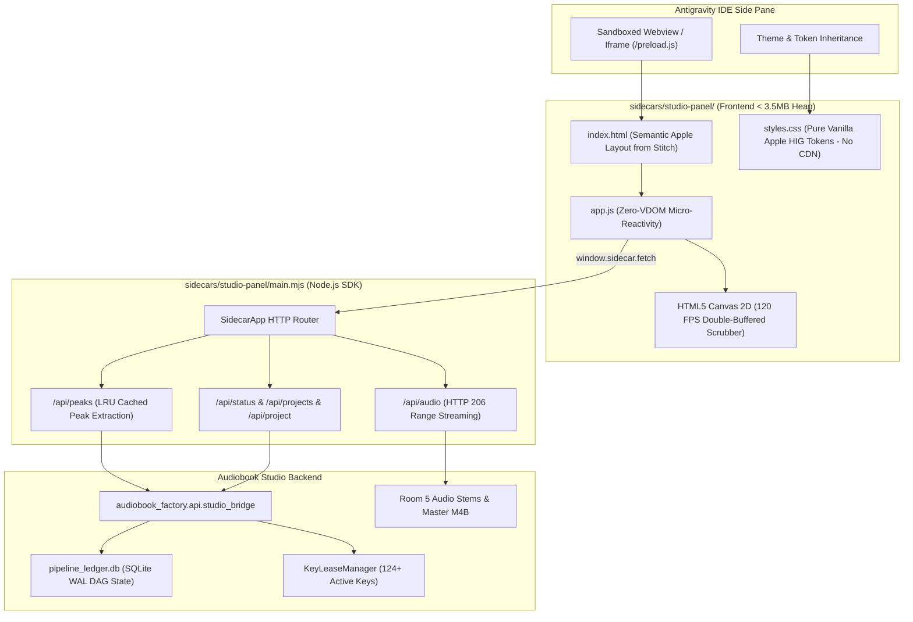

# Stitch UI Wiring & Full-Stack Integration Master Plan

- **Document Identifier**: `ENG-PLAN-STITCH-UI-WIRING-V1`
- **Canonical Project ID**: `proj-audiobook-studio`
- **Subsystem**: `sidecars/studio-panel/` & `audiobook_factory/api/studio_bridge.py`
- **Design Source**: Google Stitch Generated Workstation ([`sidecars/studio-panel/stitch_screen.html`](file:///c:/Users/Suraj/Documents/antigravity/optimistic-kepler/sidecars/studio-panel/stitch_screen.html))
- **Design System**: [DESIGN.md](file:///c:/Users/Suraj/Documents/antigravity/optimistic-kepler/DESIGN.md) (Apple macOS Sonoma / Tahoe Minimalist Light Workstation)
- **Primary Invariant**: Zero external runtime dependencies, $\le 3.5\text{ MB}$ Heap Memory, 120 FPS Canvas Scrubber, Zero CDN / Offline Isolation

---

## 1. System Architecture & Wiring Data Flow

---

## 2. 6-Phase Execution Roadmap

### Phase 1: Python Engine Bridge Enhancements (`audiobook_factory/api/studio_bridge.py`)
1. Fast Waveform Peak Extractor (`cmd_peaks` in $< 15\text{ ms}$ via soundfile + numpy).
2. Rich Project Detail Payload (5-Room DAG progression states, cast roster with pitch shift %, authentic Hindi Devanagari dialogue segments, and master audio metadata).
3. Unit test coverage for bridge commands.

### Phase 2: Node.js Sidecar API & Streaming Server (`sidecars/studio-panel/main.mjs`)
1. HTTP 206 Partial Content audio streaming for instant chapter seeking/scrubbing.
2. LRU cached `/api/peaks` endpoint.
3. Live static file reload preservation.

### Phase 3: Apple Minimalist Light CSS Architecture (`sidecars/studio-panel/styles.css`)
1. Extraction of Stitch Tailwind prototype into pure, standalone CSS variables and classes (100% offline isolation, zero CDN dependency).
2. Apple Design System tokens (frosted glass `.glass-panel`, `.recessed-well`, tactile buttons, studio amber audio meters).

### Phase 4: Semantic Markup & Workstation Layout (`sidecars/studio-panel/index.html`)
1. Convert Stitch layout into semantic HTML with clean DOM hook IDs.
2. Wire 5-Room DAG Stepper, Waveform Canvas Hero, Multi-Cast Roster, and Dialogue Editorial Inspector with Hindi prose.

### Phase 5: Zero-VDOM Micro-Reactivity & 120 FPS Canvas Engine (`sidecars/studio-panel/app.js`)
1. Micro-reactive proxy store (`< 1 KB`).
2. 120 FPS double-buffered hardware Canvas 2D waveform scrubber.
3. Multi-cast character audition soundboard.
4. Live telemetry polling (124+ Gemini keys status, Doctor diagnostics).

### Phase 6: Verification, Footprint Profiling & Global Plugin Sync
1. Verify Chromium iframe heap memory $\le 3.5\text{ MB}$.
2. Test end-to-end with active project `sword_of_destiny_-_andrzej_sapkowski__worldfreebooks_com`.
3. Mirror to `C:\Users\Suraj\.gemini\config\plugins\audiobook-studio\sidecars\studio-panel\`.
